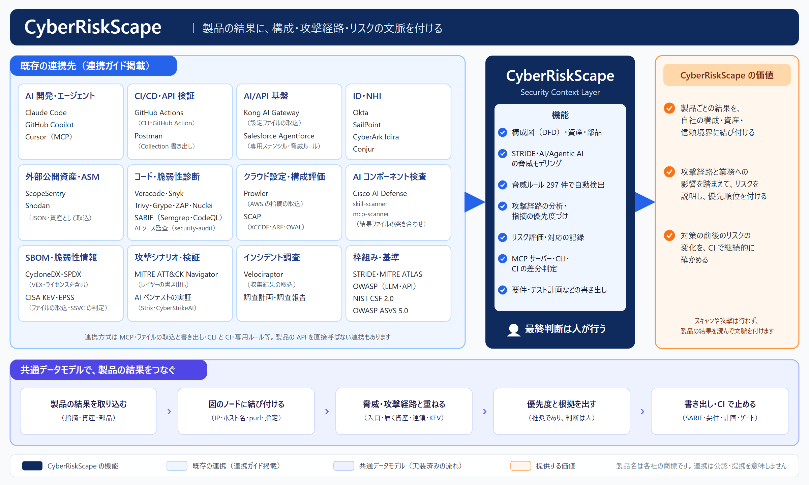
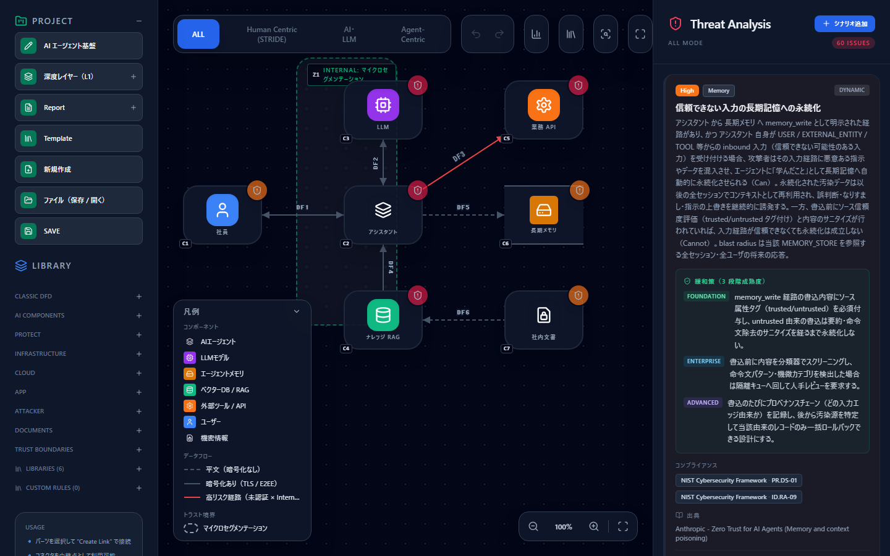

# CyberRiskScape

**脅威モデリングを中核とした、OSS の Security Context Layer — AI・LLM・エージェントシステム・PQC に対応**

[](LICENSE)
[](data/threat-library)
[](#開発)
[](https://takashi-ohmoto-git.github.io/CyberRiskScape/)

[English](README.md) | **日本語**

ASM・クラウドの検査・脆弱性管理・ID 基盤・AI セキュリティのスキャナーなど、お使いのセキュリティ製品の結果を取り込み、
資産の関係・脅威モデル・攻撃経路・リスクの相関として文脈化して、人と AI エージェントの判断に渡します
（下の「エコシステム」節）。その中核が脅威モデリングです。



ブラウザ上でシステム構成図（DFD）を描くと、構成に応じた脅威が自動で列挙されます。
サーバ不要・完全ローカル動作で、設計データが外部に送信されることはありません。

### ▶ 30 秒で試す

**ブラウザで（インストール不要）** — [オンラインデモ](https://takashi-ohmoto-git.github.io/CyberRiskScape/)を開きます。

1. サンプルの構成図が入った状態で立ち上がり、右の **Threat Analysis** に検出された脅威が並びます
2. キャンバスの部品や線をクリックすると、属性（認証・暗号化・外部公開の有無など）を編集できます。入力を変えると脅威が増減します
3. 左のパレットから部品をキャンバスへ置き、線をつなぐと、構成に応じた脅威が加わります

**手元の CLI で**（Node.js 20 以上。準備に数分）— 同梱の会員サイトの図を分析します。

```bash
git clone https://github.com/takashi-ohmoto-git/CyberRiskScape.git
cd CyberRiskScape && npm ci && npm run build:cli

# 脅威の一覧を Markdown で書き出す
node dist-cli/main.js analyze guide/templates/nco-advisory-2026-11-project.ja.json --format md --out threats.md
# 同じ図に、国家サイバー統括室の注意喚起（2026 年 11 月）のチェックリストを当てはめる
node dist-cli/main.js checklist guide/templates/nco-advisory-2026-11-project.ja.json --id nco-advisory-2026-11
```

はじめて使う方は **[はじめに — CyberRiskScape 入門](guide/getting-started.ja.md)** をご覧ください。
ツールの目的・画面構成・キャンバス操作を画面付きで説明しています。
背景にある考え方は [Secure by Design 入門](guide/secure-by-design.ja.md) にまとめています。
「機能一覧」は[こちら](guide/README.ja.md)を参照してください。

---

## こんな課題を解決します

| 課題 | CyberRiskScape での解決 |
|---|---|
| **設計・脅威モデリング** | |
| 脅威モデリングに専門家と時間がかかり、設計のたびには回せない | 構成図を描くだけで、297 件のルールが構成に応じた脅威を列挙する。テンプレートから始められ、未入力の属性は悪い値と仮定して漏れを防ぐ（[はじめに](guide/getting-started.ja.md)） |
| AI エージェント・LLM・MCP サーバー・長期メモリのリスクを、従来の手法では洗い出せない | エージェント型 AI を第一級の部品として扱い、OWASP LLM・Agentic・MITRE ATLAS 等にもとづくルールで評価する（[AI 駆動開発](guide/ai-driven-development.ja.md)） |
| 設計が変わるたびに脅威モデルが古くなり、AI が書くコードの速さに追いつかない | コーディングエージェントが MCP で脅威を問い合わせ・図を更新し、CI が図の差分から新しい脅威を検出して PR を止める（[MCP](guide/mcp-integration.ja.md)・[CI](guide/ci-integration.ja.md)） |
| AI エージェント型の攻撃者が、どこから入り、何を優先して狙うかが分からない | 図に AI エージェント攻撃者を置くと、侵入できる入口・狙われやすい標的・優先される経路を示し、1 か所の対策で最も多くの経路を切れる場所（チョークポイント）と監視の死角を挙げる。手口は ATT&CK・MITRE F3 のマトリクスで見られる（[攻撃経路分析](guide/attack-paths.ja.md)・[攻撃経路のどこを切るか](guide/agentic-attacker-paths.ja.md)） |
| **脆弱性・診断の結果** | |
| スキャナーの指摘が多すぎて、どれから直すか決められない。評価の低い指摘は後回しにされる | 指摘を図のノードと部品に結び、攻撃経路・CISA KEV・EPSS・CISA SSVC から優先度（P1〜P4）を根拠つきで出す。個々は低評価でも、組み合わさると重要な資産に届く連鎖を示す（[OSS で組む脆弱性管理](guide/oss-vulnerability-management.ja.md)） |
| 製品ごとに結果がばらばらで、全体としてのリスクを説明できない | SARIF・CycloneDX・SPDX・OCSF・SCAP など各製品の結果を共通のモデルで取り込み、自社の構成・資産・信頼境界の文脈で読み直す（[連携ガイド](guide/integrations.ja.md)） |
| 診断やペンテストの範囲を何を根拠に決めればよいか分からず、結果が本当に成立するのかも分からない | 脅威モデルからテスト計画書と診断してよい範囲（RoE）を書き出す。AI 自律ペンテスト（Strix・CyberStrikeAI）が PoC で確かめた結果を、脅威カードに「実証」として載せる（[計画書](guide/pentest-plan.ja.md)・[実証の取り込み](guide/oss-vulnerability-management.ja.md)） |
| **外部への露出とサプライチェーン** | |
| 外から見えている資産と台帳が合わない。閉じたつもりの管理画面が残っている | ASM（Shodan・ScopeSentry）や AI ペンテストが観測した資産を取り込み、図の「外部公開」の入力と食い違う資産を一覧にする（[露出を減らす](guide/exposure-reduction.ja.md)） |
| SaaS・委託先・OSS 部品からの漏えいを把握できない | SBOM の部品をノードに結び、深刻な脆弱性の公表時に影響するノードを引く。委託先の接続経路を多要素認証へ切り替える順に並べ、SaaS や委託先に預けたデータの漏えいを脅威として出す（[SBOM](guide/sbom.ja.md)・[国家サイバー統括室の注意喚起](guide/nco-advisory-2026-11.ja.md)） |
| **運用・報告** | |
| 注意喚起やガイドラインが出るたびに、自社に当てはまるかを確かめるのが大変 | 公表された注意喚起の対策をチェックリストにして図に当てはめ、項目ごとに「要対応・問題なし」等と関係するノードを出す。CI で要対応を止められる（[IPA の注意喚起](guide/ipa-alert-2026-10.ja.md)） |
| 侵害が疑われたとき、どこを調べればよいか分からない | 攻撃経路上のノードごとに、確かめることと見るログをまとめた調査計画書を出し、集めた証拠を図に重ねて報告する（[侵害の調査](guide/compromise-investigation.ja.md)） |
| 経営層・監査への説明資料づくりに手間がかかる | 1 枚の経営層向けサマリつきの PDF レポートを出し、脅威を NIST CSF 2.0・NIST AI RMF・AI 事業者ガイドラインに対応づける（[レポート](guide/report-export.ja.md)・[コンプライアンス](guide/compliance-map.ja.md)） |
| PQC（耐量子計算機暗号）への移行で、どこを変えればよいか分からない | 経路を暗号を終端するノードで区間に分け、区間ごとに PQC への対応を判定する。CBOM から暗号ライブラリ・アルゴリズムも確かめる（[PQC 移行](guide/pqc-migration.ja.md)） |
| 機密の設計情報を外部のクラウドや AI に渡せない | サーバー不要で、ブラウザの中だけで動く。外部への通信はなく、LLM も呼ばないため、閉域環境でも使える |

---

## 特徴

### エージェント型 AI の脅威モデリングに対応

古典的な STRIDE に加えて、**AI エージェント・LLM・MCP サーバ・長期メモリ**といった
現代的な構成要素を第一級のコンポーネント型として扱います。

| フレームワーク区分 | ルール数 | 内容 |
|---|---:|---|
| `STRIDE` | 202 | 古典的な脅威（なりすまし・改ざん・情報漏えい 等） |
| `AI` | 35 | 敵対的 ML、モデル抽出、学習データ汚染 等 |
| `AgenticAI` | 60 | 目標乗っ取り、ツール誤用、権限の持ち越し、メモリ汚染 等 |

API については、OWASP API Security Top 10 2023 の 10 項目すべてに対応するルールを収録しています
（認可の不備・認証の不備・費用の青天井・機微な業務フローの自動化・CORS・外部 API の応答の信用・SaaS や委託先に預けたデータ 等）。

### エコシステム — 開発・API・ID 基盤とつながる

脅威モデルを図の中で終わらせず、設計・実装・検証で使うツールとつなぎます。**MCP サーバーを内蔵**し、
API ゲートウェイ・API テスト・ID 基盤・AI エージェント基盤とファイルベースで連携します。外部への通信は
行わないため、閉域環境でも使えます。

| 連携先 | できること |
|---|---|
| **MCP**（Claude Code・GitHub Copilot・Cursor など） | コーディングエージェントが設計中に脅威を問い合わせ、構成図を更新する（[ガイド](guide/mcp-integration.ja.md)） |
| **CI**（GitHub Actions） | 構成図の差分から新しい脅威を検出して PR を止め、結果を SARIF で出力する（[ガイド](guide/ci-integration.ja.md)） |
| **API ゲートウェイ**（Kong AI Gateway） | decK・kongctl（AI Gateway 2.x）の設定から構成図を自動生成し、設定の変更を PR で見張る（[ガイド](guide/kong-ai-gateway.ja.md)） |
| **コーディングエージェント**（Claude Code の作業ディレクトリ） | package.json・requirements.txt・.env・.mcp.json・`.claude/` の設定から、開発環境と依存パッケージの構成図を自動生成する。.env の値は記録しない（[ガイド](guide/repo-import.ja.md)） |
| **API テスト**（Postman・Postman CLI・Newman） | 検出した脅威を確かめる検証用リクエストを書き出す（[ガイド](guide/postman.ja.md)） |
| **ペネトレーションテスト**（社内・外部のテスト業者） | 入口・攻撃経路・重点テスト項目と確認観点をまとめた、業者に依存しないテスト計画書を書き出す（[ガイド](guide/pentest-plan.ja.md)） |
| **AI ペンテストの実証**（Strix・CyberStrikeAI） | AI 自律ペネトレーションテストが PoC で成立を確かめた結果を台帳 YAML に変換して取り込み、脅威カードに「実証」と表示する。Strix には脅威モデルと診断してよい範囲（RoE）を指示ファイルと MCP で渡せる。Metasploit の攻撃結果も同じ台帳で取り込める（CLI のみ。[ガイド](guide/oss-vulnerability-management.ja.md) §4・§7・§9・§10） |
| **侵害の調査**（Velociraptor・同梱のトリアージスクリプト） | 侵害が疑われるときに、脅威モデルから調査計画書を書き出し、集めた証拠を図のノードに重ねて「痕跡あり・否定できない・未調査・痕跡なし」を報告する。侵害の有無は判定しない（[ガイド](guide/compromise-investigation.ja.md)） |
| **ID 基盤・NHI**（Okta・SailPoint・CyberArk（Idira）・Microsoft Entra ID・Active Directory / LDAP） | IdP・ディレクトリ・NHI・PAM・IGA をモデル化して評価し、Conjur のポリシーから図を自動生成、各社の MCP サーバーと組み合わせて実際の ID の状態と突き合わせる（[ガイド](guide/nhi-identity.ja.md)） |
| **ASM・サブドメイン乗っ取り**（ScopeSentry） | ScopeSentry の書き出しまたは API（MCP）から露出サービスと DNS ゾーンの図を自動生成し、サブドメイン乗っ取りを評価、定期の取り込みの差分で新しい露出を検知する（[ガイド](guide/scopesentry.ja.md)） |
| **ASM・外部露出**（Shodan） | `shodan download` の書き出しから露出サービスの図を自動生成し、CISA の 4 ステップに沿って評価・削減、前回との差分で新しい露出を検知する（[ガイド](guide/exposure-reduction.ja.md)） |
| **AI エージェント基盤**（Salesforce Agentforce） | 専用のステンシル・脅威ルール・構成図テンプレートで評価する（[ガイド](guide/agentforce.ja.md)） |
| **車載・SDV**（コネクテッドカー） | 専用のステンシル（Vehicle (SDV) カテゴリ）・UN R155 Annex 5 を出典とする脅威ルール・ゾーン型アーキテクチャの構成図テンプレートで評価する（[ガイド](guide/sdv.ja.md)） |
| **AI による脆弱性診断**（Anthropic `defending-code-reference-harness`） | 脅威モデルを `THREAT_MODEL.md` 互換で書き出し、診断の入力にする（[ガイド](guide/security-context.ja.md)） |
| **脆弱性の修正**（Veracode） | SAST・DAST の指摘を AI で修正する流れに、脅威モデルを前提知識・優先順位・回帰テストとして組み込む構成例（[ガイド](guide/veracode-remediation.ja.md)） |
| **クラウドの検査**（Prowler） | Prowler の AWS の検査結果（OCSF）で、図のノードの未入力の運用状況・攻撃面属性を埋め、FAIL の検査を図の脅威と突き合わせる（[ガイド](guide/prowler.ja.md)） |
| **AI 部品の検査**（Cisco AI Defense skill-scanner / mcp-scanner） | エージェントスキル・MCP サーバーの検査結果を、AITech 対応表を介して図の脅威と突き合わせ、描き漏れを見つける（[ガイド](guide/ai-scanners.ja.md)） |
| **AI によるソース監査**（Cloudflare security-audit スキル） | 指摘を画面か CLI でノードに取り込み、脅威カードに「ソース監査で実証（ローカル）／要確認」を出し、要確認の前提を図の事実と並べる（[ガイド](guide/security-audit.ja.md)） |
| **OSS の脆弱性管理**（Trivy・Syft / Grype・ZAP・Nuclei） | SAST・SCA・DAST の結果を取り込み、部品・指摘としてノードに結びつけ、KEV・EPSS・CISA SSVC と攻撃経路で優先順位を付ける（CLI のみ。[ガイド](guide/oss-vulnerability-management.ja.md)） |

連携できる製品と方法の一覧は [連携ガイド](guide/integrations.ja.md) を参照してください。

### 主な機能

- **ビジュアル DFD エディタ** — 148 種のコンポーネント型（14 ライブラリ・16 カテゴリ）、
  トラスト境界、データフローの暗号化区分・認証状態の表現。ネットワーク・セキュリティ機器
  （クラウドの同等サービスの例つき）、Storage & Databases、DFD 標準記法（Yourdon 法）で
  表示する Basic Shapes (DFD) を収録
- **脅威の自動検出** — 配置しただけで発火する内在脅威と、接続条件つきで発火する
  経路依存脅威を区別して検出
- **攻撃経路グラフ分析** — 攻撃者から資産に至る経路を可視化し、チョークポイント
  （複数経路が集中する防御点）を特定。上位経路の手口を ATT&CK・MITRE F3 のマトリクスで表示（[ガイド](guide/attack-paths.ja.md)）
- **PQC 移行支援** — 深度レイヤーとは別の PQC レイヤーに構成を描き、送信元から送信先までの経路を、
  暗号を終端・復号するノードで区間に分けて分析。区間ごとに終端判定・蓋然性・PQC 判定
  （CRYPTREC 暗号リスト表 2・NIST FIPS 203/204/205 に基づく）を出し、簡易レポート（CSV）を
  出力。CycloneDX の SBOM／CBOM から、ノードの暗号ライブラリ・アルゴリズムの PQC 判定も確認できる（[ガイド](guide/pqc-migration.ja.md)）
- **部品（BOM）の取り込みと書き出し** — CycloneDX・SPDX の SBOM／CBOM／AI BOM の部品を保存してノードに結びつけ、Asset タブで確認し、SPDX 2.3・CycloneDX 1.7 で書き出す（[ガイド](guide/sbom.ja.md)）
- **レイヤー間の複製** — 深度レイヤーと PQC レイヤーの間で、下書きとして図を複製
- **運用状況の記録** — 図だけでは分からないことをノードごとに記録：ログ（取得・保持期間・確認できる主体）、
  保管時の暗号化、パッチの適用状況、アカウント棚卸し、保有データの必要性と件数規模、
  エージェントの権限（コマンド・サンドボックス・外部通信・行動予算）、依存パッケージ・スキルの管理、
  コンテナ基盤・メッセージブローカー・更新サーバーの設定、料金が発生する外部機能の上限、機微な業務フローの自動化への対策、最終点検日。
  未入力は「対策なし」として評価（[ガイド](guide/ipa-alert-2026-10.ja.md)）
- **指摘の取り込みと優先度づけ** — SAST・SCA・DAST・ペンテスト・クラウドの検査などの指摘をノードと部品に結びつけ、
  CISA KEV・FIRST の EPSS・攻撃経路の露出と連鎖から推奨の優先度（P1〜P4）と CISA SSVC の判定を根拠つきで出す。
  CI では `analyze --fail-on-findings` で、しきい値以上の指摘が残る間は止める（[ガイド](guide/oss-vulnerability-management.ja.md)）
- **注意喚起チェックリスト** — 公表された注意喚起の対策（同梱：IPA 注意喚起 2026-10-09 の 17 項目、
  国家サイバー統括室の注意喚起 2026-11-05 の 12 項目）を
  図に当てはめ、項目ごとに「要対応・未入力・リスク受容・問題なし・対象なし」と関係ノードを一覧。
  点検が古いノードの一覧、CSV 出力、CI 用の `checklist --fail-on-action` に対応
  （[ガイド](guide/ipa-alert-2026-10.ja.md)・[ガイド（国家サイバー統括室）](guide/nco-advisory-2026-11.ja.md)）
- **コンプライアンスマッピング** — 検出脅威を NIST CSF 2.0（128 項目）/
  NIST AI RMF（72 項目）/ AI 事業者ガイドライン（34 項目）に紐付け。MITRE D3FEND・MITRE F3 への対応づけも一部のルールで試行
- **リスク評価** — Impact × Likelihood スコアリング、リスク対応方針（低減・受容・移転・回避）の記録
- **カスタムルール** — UI 上のエディタから独自の脅威ルールを追加
- **脅威ライブラリ・インスペクタ** — どのルールがどの条件で発火するかを読み取り専用で確認
- **エクスポート** — 脅威一覧を CSV / JSON、および Anthropic 公式
  `defending-code-reference-harness` の `THREAT_MODEL.md` 互換 Markdown で出力。
  さらに、**PDF レポート**（1 枚の経営層向けサマリ＋詳細）と構成図の **PNG 画像**を、
  レイヤーを選んで出力（[ガイド](guide/report-export.ja.md)）
- **ローカル保存** — IndexedDB による自動保持と、File System Access API による
  ローカルファイルへの明示的な保存

---

## スクリーンショット



左：コンポーネントパレットとライブラリ管理 ／ 中央：DFD キャンバスと凡例 ／
右：検出された脅威（発火条件・3 段階成熟度の緩和策・コンプライアンス対応・出典）

実際の動作は[オンラインデモ](https://takashi-ohmoto-git.github.io/CyberRiskScape/)で確認できます。

---

## 動作要件

| 項目 | 要件 |
|---|---|
| Node.js | 20 以上（開発・ビルド時のみ） |
| ブラウザ | Chromium 系（Chrome / Edge）を推奨 |

ローカルファイルへの保存機能は File System Access API を使うため、Chromium 系
ブラウザでのみ有効です。Firefox / Safari では当該機能が無効表示になりますが、
それ以外の機能はすべて利用できます。

---

## クイックスタート

```bash
git clone https://github.com/takashi-ohmoto-git/CyberRiskScape.git
cd CyberRiskScape
npm install
npm run dev
```

表示された URL（既定では http://localhost:5173）をブラウザで開きます。

本番ビルドは以下で生成できます。出力は静的ファイルのみなので、任意の静的ホスティング
に配置できます。

```bash
npm run build     # dist/ に出力
npm run preview   # ビルド成果物をローカルで確認
```

---

## 使い方

1. **コンポーネントを配置** — 左サイドバーから DFD 要素（ユーザー、LLM、エージェント、
   データストア 等）をキャンバスへ配置します
2. **接続を引く** — 要素間にデータフローを引き、暗号化区分・認証状態・
   セマンティクス（ツール呼び出し、メモリ書き込み 等）を設定します
3. **トラスト境界を描く** — 信頼境界を配置し、境界をまたぐ通信を明示します
4. **脅威を確認** — 構成に応じた脅威が自動で列挙されます。各脅威は「検出根拠」から
   発火条件・ルール ID・出典を辿れます
5. **評価と対応方針を記録** — リスク評価と対応方針（低減／受容／移転／回避）を
   入力します。誤検知は抑制できます
6. **エクスポート** — 脅威一覧を CSV / JSON / Markdown、PDF レポート、構成図の PNG で出力します

各ステップの具体的な操作方法は [はじめに — CyberRiskScape 入門](guide/getting-started.ja.md) に
画面付きでまとめています。

---

## 開発

```bash
npm run dev          # 開発サーバ起動
npm run build        # 本番ビルド
npm run preview      # ビルド成果物の確認
npm run test         # テスト一括実行
npm run test:watch   # テスト watch モード
npx tsc --noEmit     # 型チェック（strict）
```

変更後の標準的な検証は `npx tsc --noEmit` とテストの実行です。現在 2,418 件の
テストが通ります。

---

## CLI

ブラウザなしで保存済みプロジェクト JSON を解析するヘッドレス CLI です。CI でのゲート
判定等に使えます。評価対象は同梱の脅威ルールのみです（IndexedDB に保存するカスタム
ルールは CLI からは参照できません）。

```bash
npm run build:cli
node dist-cli/main.js analyze <project.json> [options]
```

| オプション | 値 | 既定 |
|---|---|---|
| `--format` | `json` \| `sarif` \| `md` | `json` |
| `--layer` | `L0` \| `L1` \| `L2` \| `L3` \| `PQC` | ノードがある全レイヤー |
| `--framework` | `STRIDE` \| `AI` \| `AgenticAI` \| `ALL` | `ALL` |
| `--fail-on` | `Critical` \| `High` \| `Medium` \| `Low` | 指定なし（ゲート判定なし） |
| `--fail-on-findings` | `Critical` \| `High` \| `Medium` \| `Low` | 指定なし（取り込んだ指摘のゲート判定なし） |
| `--locale` | `ja` \| `en` | `ja` |
| `--out` | 出力先ファイルパス | 標準出力 |

終了コード：`0` 成功 ／ `1` `--fail-on`・`--fail-on-findings` によるゲート不合格 ／ `2` 入力・引数エラー。

`analyze` のほかに、次のサブコマンドがあります（一覧と各オプションは `node dist-cli/main.js --help`）。

| 用途 | サブコマンド |
|---|---|
| 構成図を作る | `import-kong`・`import-kongctl`・`import-repo`・`import-conjur`・`import-shodan`・`import-scopesentry` |
| 製品の結果を取り込む | `import-sarif`・`import-nuclei`・`import-sbom`・`import-prowler`・`import-findings`（SCAP）・`import-security-audit`・`import-pentest`（`convert-strix`・`convert-cyberstrikeai`・`convert-metasploit` で台帳に変換）・`import-aipentest-assets`・`import-metasploit-assets` |
| 悪用の事実・見込みと優先度 | `import-kev`・`import-epss`・`fill-patch-status`・`findings-priority`（P1〜P4 と CISA SSVC） |
| 突き合わせ・文脈 | `asm-reconcile`・`sbom-report`・`context`・`checklist`・`findings-report`・`investigation-report`・`pqc-sbom-report` |
| 書き出す | `export-requirements`・`export-test-plan`・`export-roe`・`export-detection-requirements`・`export-contractor-paths`・`export-postman`・`export-attack-navigator`・`export-investigation-plan`・`export-spdx`・`export-sbom-ai`・`export-triage-patterns` |

使い方は [OSS で組む脆弱性管理](guide/oss-vulnerability-management.ja.md)・[連携ガイド](guide/integrations.ja.md) と各ガイドを参照してください。

### モデル差分ゲート（`diff`）

保存済みプロジェクト JSON の 2 版（base / head）を比較し、脅威モデリングの**実行トリガー**
（下記 T1〜T8）に当たる変更と、脅威の追加・解消・対応方針変更・実効 severity 変化を
Markdown（PR コメントにそのまま貼れる形）または JSON で出します。

```bash
node dist-cli/main.js diff <base.json> <head.json> [options]
```

| オプション | 値 | 既定 |
|---|---|---|
| `--format` | `md` \| `json` | `md` |
| `--fail-on` | `Critical` \| `High` \| `Medium` \| `Low` | 指定なし（ゲート判定なし） |
| `--triggers` | 実行トリガー定義 YAML のパス | 同梱の T1〜T8（指定時は翻訳オーバーレイ非適用） |
| `--locale` | `ja` \| `en` | `ja` |
| `--out` | 出力先ファイルパス | 標準出力 |

ゲートは**新規に追加された脅威だけ**を対象にします（既存の未対応脅威では落ちません）。
受容・誤検知への対応方針変更はゲートを落とさず、「要承認」として出力に明示します。

実行トリガー一覧：

| ID | トリガー |
|---|---|
| T1 | 新しい信頼境界 |
| T2 | 新しい外部インターフェース |
| T3 | 新しい認証／認可の仕組み |
| T4 | 新しい技術またはランタイム |
| T5 | 機密データが新しい経路を通る |
| T6 | 新しいサードパーティ連携 |
| T7 | エージェントの能力拡大 |
| T8 | モデル・学習データ・RAG ソースの変更 |

T4 のみモデル差分から自動判定できず（図に技術スタックの情報が無いため）、常に
「PR レビューで確認」として出力されます。

### 実行トリガー チェックリスト（`triggers`）と CI 導入

```bash
node dist-cli/main.js triggers [options]
```

| オプション | 値 | 既定 |
|---|---|---|
| `--format` | `md` \| `json` | `md` |
| `--triggers` | 実行トリガー定義 YAML のパス | 同梱の T1〜T8（指定時は翻訳オーバーレイ非適用） |
| `--locale` | `ja` \| `en` | `ja` |
| `--out` | 出力先ファイルパス | 標準出力 |

上記 T1〜T8 を Markdown チェックリスト（PR テンプレートや AI レビュアーの観点表として使える形）
または JSON で出します。そのまま使える GitHub Action（`action.yml`）・ワークフロー例・
CODEOWNERS・PR テンプレートと、導入手順の全体は[ガイド](guide/README.ja.md)の
[AI駆動開発のCIに組み込む](guide/ci-integration.ja.md)を参照してください。

### MCP サーバー（`mcp`）

`node dist-cli/main.js mcp` で、stdio 経由の MCP サーバーを起動します。コーディングエージェント（Claude Code・GitHub Copilot 等）が
脅威を問い合わせ、構成図の構成を更新できます。外部通信は行わず、受容やリスク評価は変更できません。
導入は[コーディングエージェントから使う](guide/mcp-integration.ja.md)を参照してください。

---

## コントリビュート

Issue と Pull Request を歓迎します。開発の流れ・脅威ルール追加時のルール・翻訳への
参加方法は [CONTRIBUTING.ja.md](CONTRIBUTING.ja.md) を参照してください。

---

## セキュリティ

脆弱性を発見した場合は、公開の Issue ではなく GitHub の Security Advisory 機能から
非公開でご報告ください。報告手順と既知の注意点は [SECURITY.ja.md](SECURITY.ja.md) に
まとめています。

特に以下の 2 点にご注意ください。

- **信頼できない YAML を読み込まないでください。** コンポーネントライブラリの
  インライン SVG アイコンは現在サニタイズされていないため、第三者が配布する
  ライブラリ YAML は内容を確認してから使用してください
- 本ツールは脅威モデリングの**設計支援**を目的としており、検出結果の網羅性や
  正確性を保証するものではありません。実際のリスク評価は専門家の判断と併用してください

---

## ライセンス

[Apache License 2.0](LICENSE)

脅威ライブラリおよびコンプライアンスマッピングは本プロジェクトの独自著作であり、
参照している外部ソース（OWASP、MITRE ATLAS、NIST、CISA、Anthropic 等）の帰属表示は
[NOTICE](NOTICE) にまとめています。
