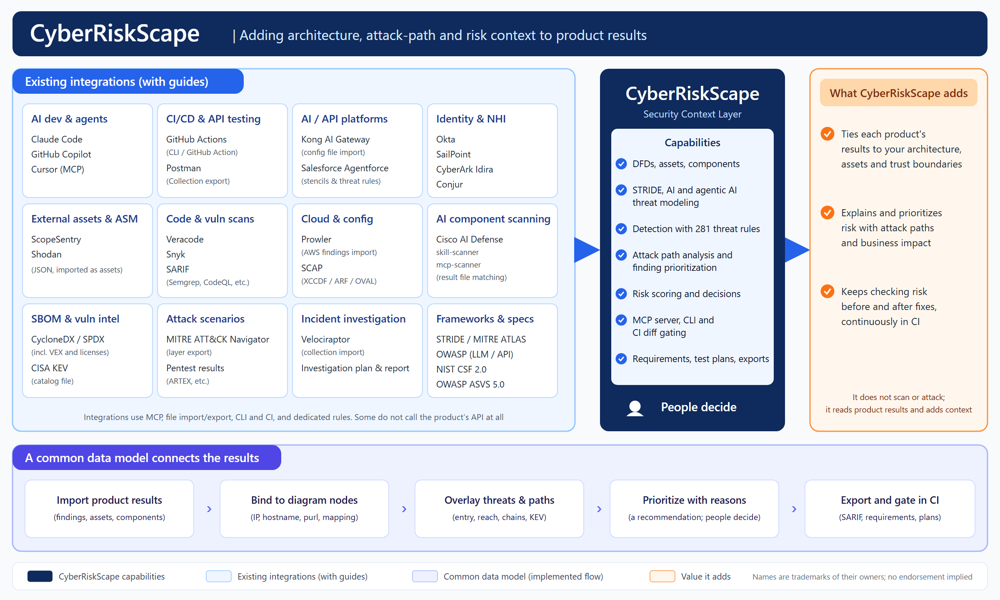
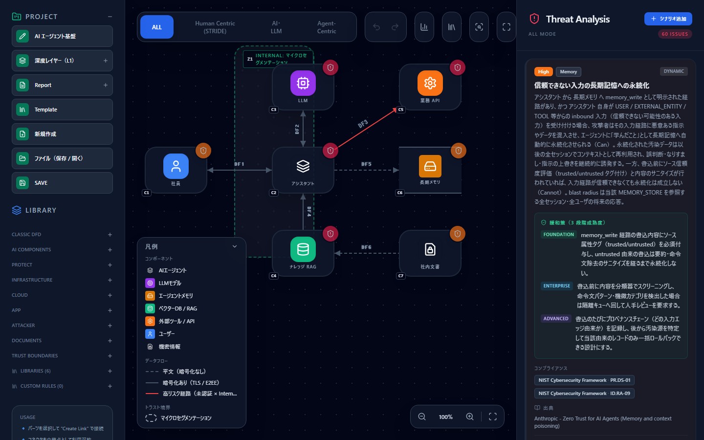

# CyberRiskScape

**An open-source Security Context Layer built on threat modeling — for AI, LLM, agentic systems, and post-quantum cryptography**

[](LICENSE)
[](data/threat-library)
[](#development)
[](https://takashi-ohmoto-git.github.io/CyberRiskScape/)

**English** | [日本語](README.ja.md)

CyberRiskScape takes in results from your security tools — attack surface management, cloud posture,
vulnerability management, identity platforms, AI security scanners — and turns them into context:
asset relationships, threat models, attack paths, and correlated risk that people and AI agents can
act on (see *Ecosystem* below). At its core is threat modeling:

Draw a data flow diagram in your browser, and CyberRiskScape enumerates the threats that
apply to your architecture — including the ones classical threat modeling tools have no
vocabulary for: goal hijacking, tool misuse, privilege carry-over, memory poisoning.



It runs entirely in the browser. No server, no account, no telemetry — your design never
leaves your machine.

### ▶ Try it in 30 seconds

**In the browser (nothing to install)** — open the [live demo](https://takashi-ohmoto-git.github.io/CyberRiskScape/).

1. It starts with a sample diagram loaded, and the detected threats are listed in **Threat Analysis** on the right
2. Click a component or a line on the canvas to edit its attributes (authentication, encryption, external exposure and so on). Change the input and the threats change with it
3. Drag a component from the palette on the left onto the canvas and connect it, and the threats for that architecture are added

**With the CLI on your machine** (Node.js 20 or later; a few minutes to set up) — analyze the bundled membership-site diagram.

```bash
git clone https://github.com/takashi-ohmoto-git/CyberRiskScape.git
cd CyberRiskScape && npm ci && npm run build:cli

# Write the threat list as Markdown
node dist-cli/main.js analyze guide/templates/nco-advisory-2026-11-project.en.json --format md --locale en --out threats.md
# Apply the checklist for Japan's National Cybersecurity Office advisory (November 2026) to the same diagram
node dist-cli/main.js checklist guide/templates/nco-advisory-2026-11-project.en.json --id nco-advisory-2026-11 --locale en
```

New here? Start with **[Getting Started](guide/getting-started.md)** — what the tool is for,
how the screen is laid out, and how to work on the canvas, with screenshots.
For the thinking behind it, see [An Introduction to Secure by Design](guide/secure-by-design.md).
For the feature list, see [here](guide/README.md).

> **Interface language.** English and Japanese are both supported — use the JA / EN switch
> in the top bar, and your choice is remembered. The interface, all 299 threat rules
> (name, category, description, mitigations) and every component type label are
> translated. Help is welcome.

---

## Problems it solves

| Problem | How CyberRiskScape solves it |
|---|---|
| **Design and threat modeling** | |
| Threat modeling needs experts and time, so it cannot be run for every design change | Draw the architecture, and 299 rules list the threats that fit it. Start from templates; unset attributes are assumed to be the bad value so nothing is missed ([Getting Started](guide/getting-started.md)) |
| Conventional methods cannot surface the risks of AI agents, LLMs, MCP servers and long-term memory | Agentic AI is a first-class component, evaluated with rules based on OWASP LLM, Agentic, MITRE ATLAS and more ([AI-driven development](guide/ai-driven-development.md)) |
| The threat model goes stale with every design change and cannot keep up with code written by AI | Coding agents query threats and update the diagram over MCP, and CI detects new threats from diagram diffs and blocks the PR ([MCP](guide/mcp-integration.md), [CI](guide/ci-integration.md)) |
| You cannot tell where an AI-agent attacker would get in and what it would go after first | Place an AI agent attacker on the diagram to see the entry points it can use, the targets it is likely to go after and the paths it would prioritize, along with choke points where one countermeasure cuts the most paths and monitoring blind spots. Techniques are shown on ATT&CK and MITRE F3 matrices ([Attack paths](guide/attack-paths.md), [Where to cut the attack paths](guide/agentic-attacker-paths.md)) |
| **Vulnerability and assessment results** | |
| Scanners produce too many findings to decide what to fix first, and low-rated findings get put off | Findings are tied to diagram nodes and components, and a priority (P1–P4) is given with reasons from attack paths, CISA KEV, EPSS and CISA SSVC. It shows chains of individually low-rated findings that together reach important assets ([Vulnerability Management with OSS Scanners](guide/oss-vulnerability-management.md)) |
| Each product's results are separate, so the overall risk cannot be explained | Results from each product, such as SARIF, CycloneDX, SPDX, OCSF and SCAP, are imported into a common model and re-read in the context of your architecture, assets and trust boundaries ([Integrations](guide/integrations.md)) |
| There is no basis for scoping assessments and penetration tests, and no way to tell whether results really hold | Export a test plan and the scope that may be tested (RoE) from the threat model. Results that autonomous AI penetration testing (Strix, CyberStrikeAI) confirmed with a PoC are shown as "verified" on threat cards ([Test plan](guide/pentest-plan.md), [importing verification](guide/oss-vulnerability-management.md)) |
| **External exposure and supply chain** | |
| What is visible from outside does not match the inventory, and admin consoles you thought were closed remain | Import assets observed by ASM (Shodan, ScopeSentry) and AI penetration testing, and list the assets that contradict the diagram's "externally exposed" input ([Reducing exposure](guide/exposure-reduction.md)) |
| Leaks through SaaS providers, contractors and OSS components cannot be tracked | Tie SBOM components to nodes and look up the affected nodes when a serious vulnerability is announced. Rank contractor connection paths in the order to switch to multi-factor authentication, and raise the leak of data entrusted to SaaS providers and contractors as a threat ([SBOM](guide/sbom.md), [NCO advisory](guide/nco-advisory-2026-11.md)) |
| **Operations and reporting** | |
| Every new security alert or guideline means checking whether it applies to you | Turn a published alert's measures into a checklist applied to the diagram, showing each item's status (action needed, no issue, etc.) and related nodes. CI can block on items needing action ([IPA alert](guide/ipa-alert-2026-10.md)) |
| When a compromise is suspected, it is unclear where to look | Produce an investigation plan with what to check and which logs to read for each node on the attack paths, and report the collected evidence overlaid on the diagram ([Compromise investigation](guide/compromise-investigation.md)) |
| Preparing explanations for executives and auditors takes effort | Export a PDF report with a one-page executive summary, and map threats to NIST CSF 2.0, NIST AI RMF and Japan's AI Business Operator Guidelines ([Report](guide/report-export.md), [Compliance](guide/compliance-map.md)) |
| In a PQC (post-quantum cryptography) migration, it is unclear what needs to change | Split paths into segments at the nodes that terminate encryption and judge PQC readiness per segment. Also check cryptographic libraries and algorithms from a CBOM ([PQC migration](guide/pqc-migration.md)) |
| Confidential design information cannot be handed to external clouds or AI | No server needed; it runs entirely in the browser. It makes no external connections and calls no LLM, so it also works in closed environments |

---

## What makes it different

### Agentic AI is a first-class citizen

Alongside classical STRIDE, CyberRiskScape treats **AI agents, LLMs, MCP servers, and
long-term memory** as first-class component types, with a rule set to match.

| Framework | Rules | Covers |
|---|---:|---|
| `STRIDE` | 202 | Spoofing, tampering, repudiation, information disclosure, DoS, elevation of privilege |
| `AI` | 35 | Adversarial ML, model extraction, training data poisoning |
| `AgenticAI` | 60 | Goal hijacking, tool misuse, privilege carry-over, memory poisoning |

For APIs, the library has rules for all ten items of the OWASP API Security Top 10 2023
(broken authorization and authentication, runaway costs, automation of sensitive business flows, CORS, trusting external API
responses, data entrusted to SaaS providers and contractors, and more).

This is where the project invests. Most threat modeling tools have zero rules in the third row.

### Ecosystem — connected to your development, API, and identity stack

The threat model does not stay inside the diagram: it connects to the tools you use to design, build, and verify.
CyberRiskScape **ships an MCP server** and integrates file-based with API gateways, API testing, identity
platforms, and AI agent platforms. It makes no outbound calls, so it also works in air-gapped environments.

| Integrates with | What you get |
|---|---|
| **MCP** (Claude Code, GitHub Copilot, Cursor, and others) | Coding agents query threats and update the diagram while they design ([guide](guide/mcp-integration.md)) |
| **CI** (GitHub Actions) | Detect new threats from diagram diffs, block the PR, and emit SARIF ([guide](guide/ci-integration.md)) |
| **API gateways** (Kong AI Gateway) | Generate the diagram from your decK or kongctl (AI Gateway 2.x) configuration and watch configuration changes in PRs ([guide](guide/kong-ai-gateway.md)) |
| **Coding agents** (a Claude Code working directory) | Generate a diagram of the development environment and dependency packages from package.json, requirements.txt, .env, .mcp.json and `.claude/` settings; values in .env are never recorded ([guide](guide/repo-import.md)) |
| **API testing** (Postman, Postman CLI, Newman) | Export verification requests that check the detected threats ([guide](guide/postman.md)) |
| **Compromise investigation** (Velociraptor and the bundled triage script) | When you suspect a compromise, export an investigation plan from the threat model and overlay the collected evidence on the diagram's nodes as "traces found", "cannot rule out", "not investigated" or "no traces". It does not determine whether a compromise occurred ([guide](guide/compromise-investigation.md)) |
| **Penetration testing** (in-house or external testers) | Export a vendor-neutral test plan with entry points, attack paths, focus test items, and check viewpoints ([guide](guide/pentest-plan.md)) |
| **AI pentest verification** (Strix, CyberStrikeAI) | Convert the results that autonomous AI penetration testing confirmed with a PoC into a registry YAML, import them, and show them as "verified" on threat cards. Strix can be given the threat model and the scope it may test (RoE) through an instruction file and MCP. Metasploit exploitation results are imported through the same registry (CLI only; [guide](guide/oss-vulnerability-management.md) sections 4, 7, 9 and 10) |
| **Identity platforms and NHIs** (Okta, SailPoint, CyberArk (Idira), Microsoft Entra ID, Active Directory / LDAP) | Model and assess IdPs, directories, NHIs, PAM and IGA, generate the diagram from a Conjur policy, and pair with each vendor's MCP server to cross-check against the real state of your identities ([guide](guide/nhi-identity.md)) |
| **ASM and external exposure** (Shodan) | Generate a diagram of exposed services from a `shodan download` export, assess and reduce exposure along CISA's four steps, and catch new exposure by diffing against the previous import ([guide](guide/exposure-reduction.md)) |
| **ASM and subdomain takeover** (ScopeSentry) | Generate a diagram of exposed services and DNS zones from a ScopeSentry export or its API (MCP), assess subdomain takeover, and catch new exposure by diffing periodic imports ([guide](guide/scopesentry.md)) |
| **AI agent platforms** (Salesforce Agentforce) | Dedicated stencils, threat rules, and a diagram template ([guide](guide/agentforce.md)) |
| **Process mining, iPaaS and data warehouses** (Celonis) | Dedicated types (Workflow automation / iPaaS, Analytics platform / data warehouse), threat rules and a diagram template to assess setups with extraction, write-back and MCP ([guide](guide/celonis.md)) |
| **Automotive** (SDV, connected cars) | Dedicated stencils (Vehicle (SDV) category), threat rules based on UN R155 Annex 5, and a zonal-architecture diagram template ([guide](guide/sdv.md)) |
| **AI-driven vulnerability review** (Anthropic `defending-code-reference-harness`) | Export the threat model as `THREAT_MODEL.md`-compatible input for the review ([guide](guide/security-context.md)) |
| **Vulnerability remediation** (Veracode) | An example setup that builds the threat model into a flow fixing SAST and DAST findings with AI, as context, prioritization, and regression tests ([guide](guide/veracode-remediation.md)) |
| **Cloud security scanning** (Prowler) | Fill the operational posture and attack surface attributes still unset on diagram nodes from Prowler's OCSF findings for AWS, and cross-check FAIL checks against the diagram's threats ([guide](guide/prowler.md)) |
| **Threat model migration** (Microsoft Threat Modeling Tool) | Import a TMT .tm7, carry over the diagram, threats, and decisions, and see the differences between TMT threats and detected threats in a migration report ([guide](guide/threat-modeling-tool.md)) |
| **AI component scanning** (Cisco AI Defense skill-scanner / mcp-scanner) | Cross-reference agent skill and MCP server scan results with the diagram's threats through an AITech mapping table, and find what is left undrawn ([guide](guide/ai-scanners.md)) |
| **AI source audit** (Cloudflare security-audit skill) | Import findings onto a node from the screen or the CLI, mark threat cards as "verified by source audit (local)" or "needs confirmation", and line up the preconditions of needs-confirmation findings with the diagram's facts ([guide](guide/security-audit.md)) |
| **OSS vulnerability management** (Trivy, Syft / Grype, ZAP, Nuclei) | Import SAST, SCA and DAST results, attach them to nodes as components and findings, and prioritise with KEV, EPSS, CISA SSVC and attack paths (CLI only; [guide](guide/oss-vulnerability-management.md)) |

For the full list of products and how they connect, see [Integrations](guide/integrations.md).

### Features

- **Visual DFD editor** — 150 component types across 14 libraries and 16 categories, trust
  boundaries, and data flows carrying encryption, authentication, and semantic attributes.
  The library covers network and security appliances (with examples of the equivalent cloud
  services), Storage & Databases, and Basic Shapes (DFD) drawn in the classic Yourdon notation
- **Automatic threat detection** — distinguishes *inherent* threats (a component fires them
  just by existing) from *path-dependent* ones (they need a specific connection to exist)
- **Attack path analysis** — maps routes from attacker to asset and identifies choke points
  where several routes converge on one defensible node. The techniques on the top routes can be
  viewed as an ATT&CK or MITRE F3 matrix ([guide](guide/attack-paths.md))
- **PQC migration support** — draw a design on a PQC layer, separate from the depth layers,
  and trace a route from sender to destination, split into segments at each node that
  terminates or decrypts the encryption. Each segment gets a termination verdict, a likelihood,
  and a PQC verdict (based on the CRYPTREC Cryptographic Algorithm List, Table 2, and NIST FIPS
  203/204/205), and a simple report (CSV) can be exported. A CycloneDX SBOM / CBOM can also be read to
  check a node's cryptographic libraries and the PQC verdicts of its algorithms ([guide](guide/pqc-migration.md))
- **Component (BOM) import and export** — save the components of a CycloneDX or SPDX SBOM, CBOM, or AI BOM, link them to nodes, check them in the Asset tab, and export them as SPDX 2.3 and CycloneDX 1.7 ([guide](guide/sbom.md))
- **Layer copy** — copy a depth layer to the PQC layer (or back) as a draft
- **Operational posture record** — record per node what a diagram cannot show on its own:
  logging (collection, retention, who can review), encryption at rest, patch status, account
  review, whether held data is still needed and how many records, agent permissions (commands,
  sandbox, egress, action budget), dependency and skill management, container platform, message broker
  and update server settings, limits on paid external functions, protection of sensitive business flows
  against automation, and the last review date.
  Blank fields are evaluated as "no countermeasure" ([guide](guide/ipa-alert-2026-10.md))
- **Finding import and prioritization** — link findings from SAST, SCA, DAST, pentests, cloud scanning and
  more to nodes and components, and output a recommended priority (P1–P4) and the CISA SSVC decision with
  reasons, from CISA KEV, FIRST EPSS, and exposure and chains on attack paths. In CI,
  `analyze --fail-on-findings` blocks while findings at or above the threshold remain
  ([guide](guide/oss-vulnerability-management.md))
- **Alert checklist** — apply a published alert's measures (bundled: the IPA alert of
  2026-10-09, 17 items, and Japan's National Cybersecurity Office advisory of 2026-11-05, 12 items) to your diagram. Each item shows action needed / not entered / risk
  accepted / no issue / not applicable with the related nodes, plus the nodes whose review
  record is old. Export CSV or run it in CI with `checklist --fail-on-action`
  ([guide](guide/ipa-alert-2026-10.md), [NCO advisory guide](guide/nco-advisory-2026-11.md))
- **Compliance mapping** — maps detected threats to NIST CSF 2.0 (128 items), NIST AI RMF
  (72 items), and Japan's AI Business Operator Guidelines (34 items). Mappings to MITRE D3FEND and MITRE F3
  are being trialled on some rules
- **Risk assessment** — Impact × Likelihood scoring and risk treatment decisions (mitigate / accept /
  transfer / avoid)
- **Custom rules** — add your own detection rules from an in-app editor
- **Threat library inspector** — read-only view of every rule and the exact conditions
  that make it fire
- **Export** — threat lists as CSV / JSON, and as Markdown compatible with the
  `THREAT_MODEL.md` schema used by Anthropic's `defending-code-reference-harness`;
  a **PDF report** (one-page executive summary plus details) and **PNG diagram images**,
  with selectable layers ([guide](guide/report-export.md))
- **Local persistence** — automatic retention via IndexedDB, plus explicit saves to local
  files through the File System Access API

---

## Screenshot



Left: component palette and library management. Center: the DFD canvas and its legend.
Right: detected threats, each with its firing conditions, three-tier mitigations,
compliance references, and sources.

See it running in the [live demo](https://takashi-ohmoto-git.github.io/CyberRiskScape/).

---

## Requirements

| | |
|---|---|
| Node.js | 20 or later (for development and builds only) |
| Browser | Chromium-based (Chrome / Edge) recommended |

Saving to local files uses the File System Access API, which is Chromium-only. On Firefox
and Safari that one feature is disabled; everything else works.

---

## Quick start

```bash
git clone https://github.com/takashi-ohmoto-git/CyberRiskScape.git
cd CyberRiskScape
npm install
npm run dev
```

Open the URL it prints (http://localhost:5173 by default).

Production builds are plain static files and can be hosted anywhere:

```bash
npm run build     # outputs to dist/
npm run preview   # serve the build locally
```

---

## How to use it

1. **Place components** — add DFD elements (users, LLMs, agents, data stores, …) from the
   left sidebar onto the canvas
2. **Connect them** — draw data flows and set encryption, authentication, and semantics
   (tool call, memory write, …)
3. **Draw trust boundaries** — make the crossings explicit
4. **Review threats** — threats appear as you build. Each one opens to show why it fired:
   its conditions, rule ID, and source
5. **Assess and decide** — record risk scores and a risk treatment; suppress false positives
6. **Export** — CSV, JSON, Markdown, a PDF report, or PNG diagram images

[Getting Started](guide/getting-started.md) walks through each of these steps with screenshots.

---

## Development

```bash
npm run dev          # dev server
npm run build        # production build
npm run preview      # preview the build
npm run test         # run all tests
npm run test:watch   # watch mode
npx tsc --noEmit     # type check (strict)
```

The standard check after a change is `npx tsc --noEmit` plus the test suite. 2,598 tests
currently pass.

---

## CLI

A headless CLI can analyze a saved project file without a browser — useful for CI gates.
It evaluates only the bundled threat rules (custom rules stored in IndexedDB are not
available to it).

```bash
npm run build:cli
node dist-cli/main.js analyze <project.json> [options]
```

| Option | Values | Default |
|---|---|---|
| `--format` | `json` \| `sarif` \| `md` | `json` |
| `--layer` | `L0` \| `L1` \| `L2` \| `L3` \| `PQC` | every layer that has nodes |
| `--framework` | `STRIDE` \| `AI` \| `AgenticAI` \| `ALL` | `ALL` |
| `--fail-on` | `Critical` \| `High` \| `Medium` \| `Low` | no gate |
| `--fail-on-findings` | `Critical` \| `High` \| `Medium` \| `Low` | no gate on imported findings |
| `--locale` | `ja` \| `en` | `ja` |
| `--out` | output file path | stdout |

Exit codes: `0` success, `1` `--fail-on` or `--fail-on-findings` gate failed, `2` input/argument error.

Besides `analyze`, the CLI has the following subcommands (run `node dist-cli/main.js --help` for the list and options).

| Purpose | Subcommands |
|---|---|
| Build a diagram | `import-kong`, `import-kongctl`, `import-repo`, `import-conjur`, `import-shodan`, `import-scopesentry` |
| Import product results | `import-sarif`, `import-nuclei`, `import-sbom`, `import-prowler`, `import-tm7` (migration report with `migration-report`), `import-findings` (SCAP), `import-security-audit`, `import-pentest` (convert to a registry with `convert-strix`, `convert-cyberstrikeai`, `convert-metasploit`), `import-aipentest-assets`, `import-metasploit-assets`, `import-business-context` (a business criticality table; convert a Celonis Knowledge Model with `convert-celonis`) |
| Exploitation facts, likelihood and priority | `import-kev`, `import-epss`, `fill-patch-status`, `findings-priority` (P1–P4 and CISA SSVC) |
| Reconcile and look up context | `asm-reconcile`, `sbom-report`, `context`, `checklist`, `findings-report`, `investigation-report`, `pqc-sbom-report` |
| Export | `export-requirements`, `export-test-plan`, `export-roe`, `export-detection-requirements`, `export-contractor-paths`, `export-postman`, `export-attack-navigator`, `export-investigation-plan`, `export-spdx`, `export-sbom-ai`, `export-triage-patterns`, `export-event-log` (the course of threat handling from git history, as an OCEL 2.0 / CSV event log for process mining) |

See [Vulnerability Management with OSS Scanners](guide/oss-vulnerability-management.md), the [integration guide](guide/integrations.md) and each guide for usage.

### Model diff gate (`diff`)

Compares two versions (base / head) of a saved project file and reports which threat
modeling **triggers** (T1–T8 below) the change hits, plus added/removed threats,
disposition changes, and effective severity changes. Markdown output is ready to paste
as a PR comment; JSON is for machine processing.

```bash
node dist-cli/main.js diff <base.json> <head.json> [options]
```

| Option | Values | Default |
|---|---|---|
| `--format` | `md` \| `json` | `md` |
| `--fail-on` | `Critical` \| `High` \| `Medium` \| `Low` | no gate |
| `--triggers` | path to a trigger-definition YAML | the bundled T1–T8 (translation overlay not applied when set) |
| `--locale` | `ja` \| `en` | `ja` |
| `--out` | output file path | stdout |

The gate only considers **newly added** threats (existing unaddressed ones never fail it).
Disposition changes to accepted/false-positive never fail the gate either — they are
flagged as "needs approval" in the output instead.

Trigger list:

| ID | Trigger |
|---|---|
| T1 | New trust boundary |
| T2 | New external interface |
| T3 | New authentication / authorization mechanism |
| T4 | New technology or runtime |
| T5 | Sensitive data takes a new path |
| T6 | New third-party integration |
| T7 | Expanded agent capability |
| T8 | Change to the model, training data, or RAG source |

T4 cannot be auto-judged from the model diff (the diagram has no tech-stack information),
so it is always reported as "confirm in PR review".

### Triggers checklist (`triggers`) and CI setup

```bash
node dist-cli/main.js triggers [options]
```

| Option | Values | Default |
|---|---|---|
| `--format` | `md` \| `json` | `md` |
| `--triggers` | path to a trigger-definition YAML | the bundled T1–T8 (translation overlay not applied when set) |
| `--locale` | `ja` \| `en` | `ja` |
| `--out` | output file path | stdout |

Outputs the T1–T8 trigger list above as a Markdown checklist (for a PR template or an AI
reviewer's checklist) or as JSON. For a ready-to-use GitHub Action (`action.yml`), example
workflow, CODEOWNERS and PR template, and the full setup guide, see
[Integrating with AI-Driven Development CI](guide/ci-integration.md) in the [user guide](guide/README.md).

### MCP server (`mcp`)

`node dist-cli/main.js mcp` starts an MCP server over stdio so coding agents (Claude Code, GitHub Copilot, etc.)
can query threats and update the diagram's structure and the nodes' business context (`apply_business_context`). It makes no external calls and cannot change acceptances or risk assessments.
See [Using It from Coding Agents](guide/mcp-integration.md).

---

## Roadmap

Near-term priorities, in order:

1. **Structured audit report** — the PDF report (one-page summary, top-10 details, per-layer
   appendix) has shipped; still to come is an HTML output fit to serve as audit evidence, with
   detection confidence stated explicitly

Done recently: an English UI with a language switcher, plus English translation overlays
for all 299 threat rules and every component type label, all leaving the existing schemas
unchanged.

---

## Contributing

Issues and pull requests are welcome. See [CONTRIBUTING.md](CONTRIBUTING.md) for the
development workflow, the rules for adding threat rules, and how to help with translation.

---

## Security

Please report vulnerabilities privately through
[GitHub Security Advisories](https://github.com/takashi-ohmoto-git/CyberRiskScape/security/advisories/new),
not through public issues. Details are in [SECURITY.md](SECURITY.md).

Two things to be aware of:

- **Do not load untrusted YAML.** Inline SVG icons in component libraries are not yet
  sanitized, so review any third-party library YAML before using it
- This tool is a **design aid** for threat modeling. It does not guarantee that its findings
  are complete or correct; use it alongside expert judgment, not instead of it

---

## License

[Apache License 2.0](LICENSE)

The threat library and compliance mappings are original work of this project. Attribution
for the external sources they reference (OWASP, MITRE ATLAS, NIST, CISA, Anthropic, and
others) is collected in [NOTICE](NOTICE).
