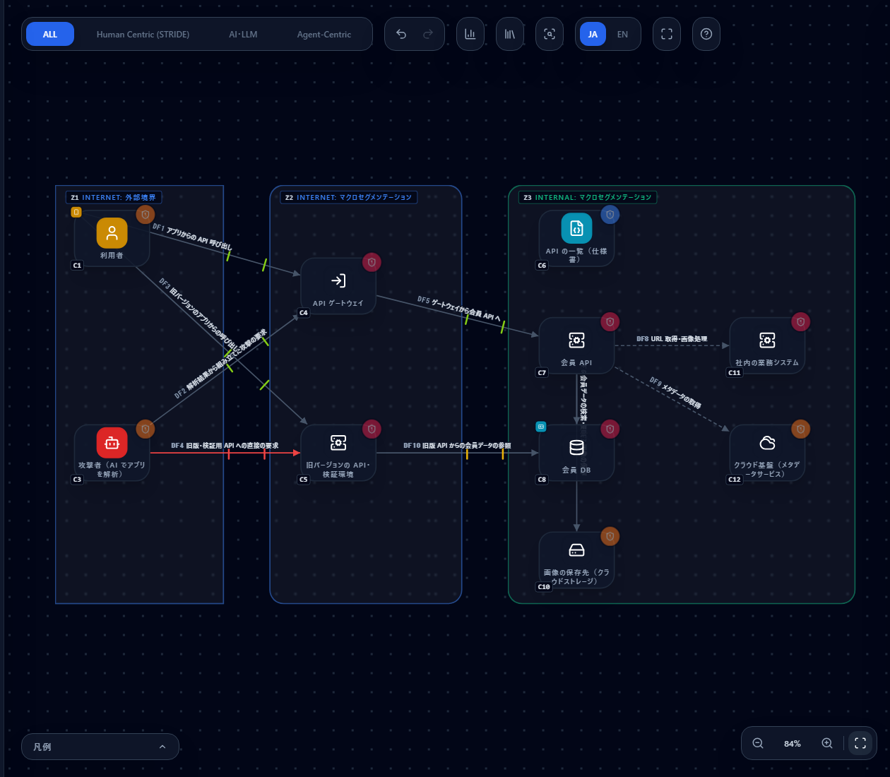
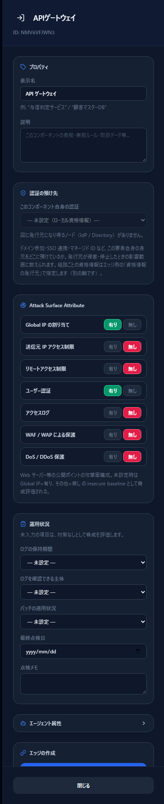
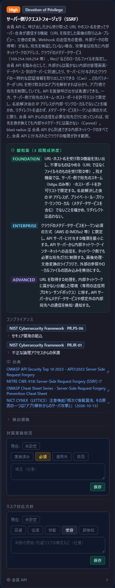
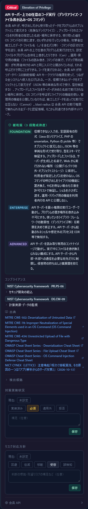
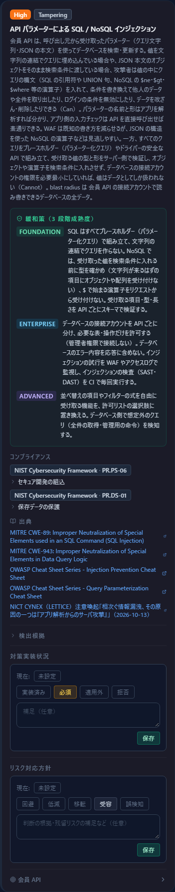
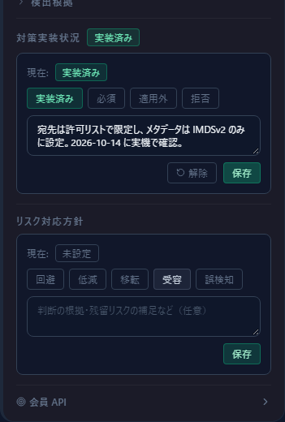
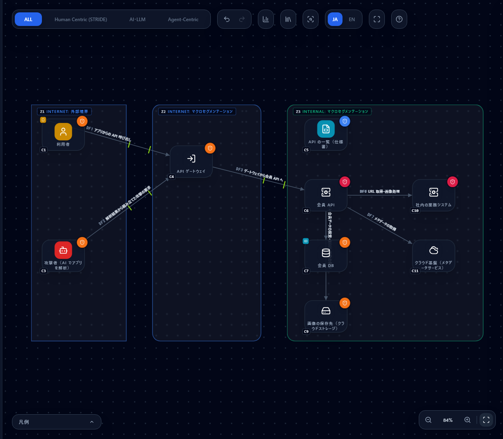

# NICT の注意喚起「A2B 攻撃」（2026 年 10 月）を、会員アプリの図で確かめる

[English](a2b-attack-2026-10.md) | **日本語**

> このページは、情報通信研究機構（NICT）CYNEX の脅威情報分析チーム LETTICE の注意喚起
> 「相次ぐ情報漏洩、その原因の一つは『アプリ解析からのサーバ攻撃』― AI で高度化する脆弱性探索、Android アプリを手がかりにした A2B 攻撃に注意 ―」
> （2026 年 10 月 13 日。[出典 1](#参考リンク)、報道発表は[出典 2](#参考リンク)）が挙げる攻撃の流れと対策を、
> CyberRiskScape の構成図でどう確かめるかを、架空の会員アプリを例にまとめたものです。
> NICT・LETTICE が作成・認定・推奨するものではありません。注意喚起の内容は日本語で要約しており、原文の転載ではありません。
> 攻撃の指標（IoC。IP アドレスなど）はここに載せていません。対策の正確な内容・最新の情報・指標は、必ず原文を確認してください。
> 件数は執筆時点（2026 年 10 月）の実測値です。

---

## 1. このページで分かること・前提

- 注意喚起が説明する **A2B 攻撃**（App-to-Backend Attack）の 4 段階を、**図のどこで・どのルールが出るか**で追う
- 狙われる **4 つの脆弱性**（SSRF・RCE・SQL/NoSQL インジェクション・IDOR＝BOLA）が、図のどのノードに出て、カードをどう読み、何を点検するか
- 注意喚起の推奨対策（侵害の確認・脆弱性の点検・暫定的な緩和策）のうち、**図で確かめられるものと、実機で確かめるもの**の仕分け
- 対策後の図で件数がどう変わり、**何が消えて何が残るか**。残るもの（4 つの脆弱性）を「対策実装状況」に記録する方法

**注意喚起の要旨**

公開されている Android アプリを解析し、アプリが使う API の情報（接続先・エンドポイント・パラメーター・応答の構造）を取り出し、
その情報をもとに対象のバックエンドに合わせて攻撃する手口が確認されています。注意喚起の図 1 は、流れを次の 4 段階で示しています。
なお AI は、図 1 では段階 1〜3 に描かれていますが、本文では「AI による解析・脆弱性探索の効率化で、こうした攻撃がより多くのシステムに及ぶ**可能性**」
への注意として書かれています。確認された攻撃で AI が使われたと本文で明言しているわけではありません。

1. 公開アプリを入手し、解析して API の情報を取得する
2. 解析結果から、バックエンドの API・エンドポイント（`/user` `/profile` `/order` `/upload` など）を特定する
3. AI で攻撃のリクエストを作り、サーバーごとに合わせて脆弱性を探して悪用する
4. バックエンドの脆弱性が悪用され、内部システムやデータベースに不正にアクセスされる

不特定多数に同じ攻撃を撒くのではなく、**対象ごとに攻撃を変える**のが特徴です。認証不要の API だけでなく、ログイン後の API も狙われます。
主に狙われるのは **SSRF・RCE・SQL インジェクション・IDOR** の 4 つです。iOS アプリや Web のバックエンド API でも同じことが起こりえます。
恒久的な対策は、**アプリ側の制御に頼らず、バックエンド側で認証・認可・入力の検証を行う**ことです。

**CyberRiskScape が担う範囲**

CyberRiskScape は**設計（構成図）から脅威を洗い出す**ツールです。「バックエンドにこの問いが立つ」「公開の入口にこの設定が足りない」
「旧版の API がゲートウェイを迂回できる」といった**設計上の弱いところ**を図の上で確かめ、どこから点検するかを決める材料を出します。
**ログに侵害の痕跡があるか、IoC に一致するアクセスがあるか、実機の API に脆弱性があるかは、図からは分かりません。**
それらは実機・ログ・テストで確かめてください（§5・§7）。

**このページの前提となる知識：** [はじめに](getting-started.ja.md)の操作と、[脅威パネルの読み方](reading-threats.ja.md)、
[テンプレートを作る・使う](templates.ja.md)。

---

## 2. 題材の会員アプリ — テンプレートを読み込んで構成を確認する

**架空の会員アプリ**を想定します。

- 利用者が、スマートフォンの会員アプリから API ゲートウェイ経由で会員 API を呼ぶ（会員情報の閲覧・更新、画像のアップロード、URL を指定した画像の取り込み）
- 会員 API は、会員 DB（個人情報）・画像の保存先（クラウドストレージ）・社内の業務システム・クラウド基盤のメタデータサービスにつながる
- 古いバージョンのアプリは、今もゲートウェイを通らずに**旧バージョンの API・検証環境**を呼んでいる（止め忘れ）
- 攻撃者は、公開されたアプリを解析し、ゲートウェイと旧版 API に直接リクエストを送る

次のテンプレートを、そのまま読み込めます（読み込み方は[テンプレートの章](templates.ja.md#3-読み込むimport)と同じです）。
**まず「対策前」を読み込んでください。**

| ファイル | 内容 |
|---|---|
| [`templates/a2b-mobile-app-before.ja.json`](templates/a2b-mobile-app-before.ja.json)（[英語版](templates/a2b-mobile-app-before.en.json)） | 対策前：旧版 API が残り、ゲートウェイの防御・運用状況が未入力か問題のある値 |
| [`templates/a2b-mobile-app-after.ja.json`](templates/a2b-mobile-app-after.ja.json)（[英語版](templates/a2b-mobile-app-after.en.json)） | 対策後：注意喚起の暫定・恒久対策を取ったあとの図（§6） |

**図の中身：** コンポーネント 12・データフロー 10・トラスト境界 3（読み込むと **79 件**の脅威が検出されます。Critical 7・High 47・Medium 25）。
ノードの番号（C1〜）と線の番号（DF1〜）は、以降の表と同じです。

| 場所 | 描いたもの（型） |
|---|---|
| インターネット側（外部境界） | C1 利用者（`ユーザー`。C2 利用者のスマートフォン（`スマートフォン`。会員アプリ入り）を内包）、C3 攻撃者（`AIエージェント攻撃者`。AI でアプリを解析） |
| 公開セグメント（Public Area） | C4 API ゲートウェイ（`APIゲートウェイ`。Attack Surface Attribute を入力）、C5 旧バージョンの API・検証環境（`バックエンドAPI`） |
| 内部セグメント（Security Zone） | C6 API の一覧（`API仕様書`。棚卸しの対象）、C7 会員 API（`バックエンドAPI`）、C8 会員 DB（`データベース`。C9 会員の個人情報（`個人情報`）を内包）、C10 画像の保存先（`ストレージ`）、C11 社内の業務システム（`バックエンドAPI`。SSRF の到達先）、C12 クラウド基盤（`IaaS`。メタデータサービス。SSRF の到達先） |

| 線 | 認証・暗号・経路 |
|---|---|
| DF1 スマホ → ゲートウェイ（アプリからの呼び出し） | トークン・TLS・公衆網 |
| DF2 攻撃者 → ゲートウェイ（解析結果から組み立てた要求） | トークン・TLS・公衆網 |
| DF3 スマホ → 旧版 API（旧バージョンのアプリの呼び出し） | トークン・TLS・公衆網 |
| DF4 攻撃者 → 旧版 API（直接の要求） | 認証なし・TLS・公衆網 |
| DF5 ゲートウェイ → 会員 API | トークン・TLS・閉域網 |
| DF6 会員 API → 会員 DB、DF7 会員 API → 画像の保存先 | ID/パスワード（DB）・API キー（保存先）・TLS・閉域網 |
| DF8 会員 API → 業務システム（URL 取得・画像処理）、DF9 会員 API → メタデータサービス | 認証なし・平文・閉域網 |
| DF10 旧版 API → 会員 DB | ID/パスワード・TLS・閉域網 |

> **描き方のメモ。** 攻撃者は、被害を受ける側の組織ではなく**外部の主体**なので、DMZ ではなく**インターネット側の境界**に置いています。
> 到達先の業務システムとメタデータサービスは「SSRF で届いてしまう先」を示すために描いたものです。業務システムも `バックエンドAPI` で描いたので、
> 会員 API と同じルールが業務システム（C11）にも出ます（その先でも同じ問いが立つ、という意味です）。
> 運用状況は、対策前では**未入力・古い点検日・問題のある値**が混ざっています（ゲートウェイの WAF・送信元 IP 制限・アクセスログが「無し」、
> 会員 DB の暗号化が「なし」・ログが「取得していない」、会員 API・旧版 API のパッチが「未適用あり」、ストレージ・メタデータサービスの運用状況が空 など）。
> 未入力は「対策なし」として評価されます（[仮定検出](reading-threats.ja.md)）。

---

## 3. A2B 攻撃の 4 段階を図の上で追う

段階ごとに、**図のどこで・どのルールが出るか**を並べます。ルール ID は脅威カードの「検出根拠」と CSV に出ます。件数は対策前の図の実測です。

**① 公開アプリを入手し、解析して API の情報を取る**

- **図のどこ：** C3 攻撃者（AI でアプリを解析）、C2 スマートフォン（アプリの入れ物）、C4・C5 に届く DF1〜DF4
- **出る脅威：**
  - AI で高度化した攻撃者 `zt-agentic-attacker-ai-accelerated-001`（C3。High）。解析・攻撃の試行が安く速くなる、という前提を示します
  - アプリに埋め込んだ秘密情報で呼び出し元を確かめている `api-mobile-embedded-secret-001`（C4・C5。High）。アプリを解析すれば取り出せるものは、呼び出し元の証明になりません
  - 端末内の資格情報の露出 `endpoint-device-loss-local-credential-exposure-001`（C2。Medium）
- **ここでの考え方：** アプリの中の情報は、**攻撃者に読まれる前提**で設計します。アプリ側の入力チェックや隠した URL は、API を直接呼ぶ攻撃者には効きません

**② 解析結果から、API・エンドポイントを特定する**

- **図のどこ：** C6 API の一覧、DF3（旧版 API を直接呼ぶ線）、DF4（攻撃者から旧版 API への線）、C4・C5 の公開状況
- **出る脅威：**
  - API の棚卸しの不備 `api-spec-improper-inventory-001`（C6。Medium）。`API仕様書` ノードを置くと出ます。旧版・検証用の API が一覧にあるか、が問いです
  - ゲートウェイを経由しないバックエンド API への直接アクセス `api-backend-gateway-bypass-001`（DF3。High）。スマホから旧版 API へ直接線がある、ということです。**攻撃者ノードからの線（DF4）では出ません**（正規の呼び出し元の経路を見るルールです）
  - 認証のない公衆網の線 `stride-edge-unauth-internet-001`（DF4。Critical）、トラスト境界を跨ぐ直接暴露 `stride-edge-internet-exposed-sensitive-001`（DF10。Critical）
  - API を使った個人情報の大量取得の制限・検知の欠如 `api-bulk-data-harvesting-001`（C4・C5。High）
  - ゲートウェイの公開の入口に足りない防御：グローバル IP 直接公開 `stride-web-global-ip-exposure-001`・送信元 IP 無制限 `stride-web-no-source-ip-restriction-001`・管理面リモートアクセス `stride-web-remote-mgmt-exposed-001`（Critical）・WAF 欠如 `stride-web-no-waf-001`・DDoS 保護欠如 `stride-web-no-ddos-protection-001`・アクセスログ欠如 `stride-web-no-access-log-001`・盲点境界 `stride-web-blind-perimeter-001`
- **ここでの考え方：** 攻撃者は、**使われていない API・古い版・検証環境**を先に探します。図に「旧版 API」「検証環境」を描けているか、一覧（API 仕様書）と実際の公開ホストが一致しているか、が点検の入口です

**③ サーバーごとに脆弱性を探して悪用する**

- **図のどこ：** バックエンド API のノード（C5 旧版 API・C7 会員 API・C11 業務システム）。発火の条件は「**inbound の接続がある**＝呼び出し元から入力を受ける」ことです
- **出る脅威：** 狙われる 4 つの脆弱性（§4）。バックエンド API ごとに 5 件ずつ出ます：SSRF `api-backend-ssrf-001`・SQL/NoSQL インジェクション `api-backend-query-injection-001`・
  任意のコード実行 `api-backend-remote-code-execution-001`（Critical）・オブジェクト単位の認可不備 `api-backend-object-level-authorization-001`・機能単位の認可不備 `api-backend-function-level-authorization-001`
- **加えて：** トークンの検証不備 `api-token-session-validation-gap-001`（C4・C5）と、公衆網上のトークンの窃取・再利用 `zt-bearer-token-replay-001`（DF1〜DF3）。ログイン後の API も狙われる、という点に対応します
- **ここでの考え方：** ゲートウェイは、トークンの有無やレート制限は見られても、**入力の中身（URL・SQL の断片・ファイル名）や、レコードが誰のものか**は知りません。この 5 件は、バックエンドの実装で止める問いです

**④ 脆弱性を突かれ、内部システムやデータベースに不正にアクセスされる**

- **図のどこ：** DF6〜DF10 と、会員 DB（C8）・個人情報（C9）・画像の保存先（C10）・業務システム（C11）・メタデータサービス（C12）
- **出る脅威：**
  - 会員 DB の情報漏洩 `stride-data-store-info-disclosure-001`・改ざん `stride-data-store-tampering-001`・監査追跡不能 `stride-data-store-repudiation-001`
  - ストレージの公開設定の誤り `storage-public-access-misconfiguration-001`（C10。High）。クラウドストレージの設定不備の点検に当たります
  - 内部への通信が認証なし・平文 `stride-edge-plain-encryption-001`（DF8・DF9。High）
  - 保管時の暗号化・ログ・パッチ・アカウント棚卸し・保有の必要性の運用状況（`posture-*`）。未入力は「対策なし」として評価されます
- **ここでの考え方：** 入口を突破されたあとの**被害の大きさ**（blast radius）を決めるのは、内部の設計です。内部への通信の認証・DB の接続アカウントの権限・メタデータサービスの保護で、到達範囲を絞ります

---

## 4. 狙われる 4 つの脆弱性を 1 つずつ確かめる

4 つとも、出るのは**バックエンド API のノード**（対策前の図では C5・C7・C11 の 3 か所）です。脅威カードの「Can」は「実装に不備があれば攻撃者ができること」、
「Cannot」は「対策が入っていれば攻撃者にできないこと」を表します。**カードは「問い」を出しているのであって、脆弱性があると断定しているのではありません。**
「Cannot」に書かれた状態になっているかを、実装・テスト・設定で確かめるのが点検です。

### 4.1 SSRF（サーバー側リクエストフォージェリ）— `api-backend-ssrf-001`（High）

- **出るノード：** C5 旧版 API・C7 会員 API・C11 業務システム。**描いた到達先**：DF8（業務システム）・DF9（メタデータサービス）は、会員 API が URL を取得しに行く先の例です
- **カードの読み方：** Can は、URL を受け取る機能（URL 指定の画像取り込み・文書変換・Webhook の宛先登録）で宛先を検証していないと、内部のネットワークやクラウドのメタデータ
  （サーバーに付与された一時的な認証情報）に届く、という内容です。Cannot は、宛先を許可リストで限定し、名前解決後の IP が内部でないことを確かめ、メタデータサービスをトークン必須の方式にしていれば届かない、という内容です
- **点検のポイント：** URL・ホスト名を受け取る API を洗い出す（不要なら止める）／宛先のスキーム・ホスト・ポートの許可リスト／リダイレクトを追わない／メタデータサービスの保護（IMDSv2 など）／
  API サーバーからの送信先の制限／画像処理・文書変換ライブラリの外部参照の無効化
- **図で変えられるもの：** DF8・DF9 の認証・暗号化（対策後は認証あり・TLS に直してあります）。ただし**ルール自体は属性では消えません**（§6）

### 4.2 RCE（任意のコード実行）— `api-backend-remote-code-execution-001`（Critical）

- **出るノード：** SSRF と同じ 3 か所
- **カードの読み方：** Can は、危険なデシリアライズ・利用者が指定した名前や場所へのファイルの保存・OS コマンドへの値の受け渡し・公開された管理機能のいずれかがあると、サーバー上でプログラムを実行され、
  サーバーが持つ DB の接続情報や API キー、クラウドの権限で内部に広がる、という内容です。severity が Critical なのは、侵害の範囲がそのノードの権限で触れるすべてに及ぶからです
- **点検のポイント：** 信頼できない入力を言語固有の形式で復元していないか／アップロードの保存先と名前（実行されない場所・サーバーが決めた名前）／OS コマンドの呼び出し／運用・デバッグ用の機能が利用者向けの API と同じ入口で公開されていないか／
  使っているライブラリの既知の脆弱性（パッチ）
- **図で変えられるもの：** パッチの適用状況（運用状況）。そのほかは実装・設定の点検です

### 4.3 SQL / NoSQL インジェクション — `api-backend-query-injection-001`（High）

- **出るノード：** SSRF と同じ 3 か所（データベースへ線があるのは C5・C7 ですが、ルールは「入力を受ける」ことで出ます）
- **カードの読み方：** Can は、パラメーターを文字列の連結でクエリに埋め込んだり、JSON のオブジェクトをそのまま検索条件に渡したりしていると、条件を書き換えて他人のデータや全件を取り出されたり、ログインを回避されたりする、という内容です。
  WAF は既知の書き方を減らせますが、NoSQL の演算子など JSON の構造を使うものは見逃しやすい、と書いてあります
- **点検のポイント：** すべてのクエリがプレースホルダー（パラメーター化）か／受け取る値の型と形の検証（オブジェクトや `$` で始まる演算子を受けない）／DB の接続アカウントが必要最小の権限か／エラー内容を応答に含めていないか／SAST・DAST を CI で回しているか
- **図で変えられるもの：** DB の運用状況（ログ・暗号化・アカウント棚卸し）で被害の範囲と検知は変わりますが、このルールは消えません

### 4.4 IDOR（オブジェクト単位の認可不備、BOLA）— `api-backend-object-level-authorization-001`（High）

- **出るノード：** SSRF と同じ 3 か所。機能単位の認可不備（BFLA）`api-backend-function-level-authorization-001` も同じ数だけ出ます
- **カードの読み方：** Can は、リクエストの ID を書き換えるだけで他人のレコードを見られる・変えられる、という内容です。連番の ID を順に試す攻撃（注意喚起の「連番 ID のアクセス」）が典型です。
  ゲートウェイはトークンの有効性は見られても、**レコードの持ち主**は知らないので、この判定はバックエンドでしかできません
- **点検のポイント：** すべてのデータ操作で、呼び出し元とレコードの所有関係を照合しているか／応答と更新の対象の項目を許可リストで限定しているか（余計な項目を返さない・受け取った項目をそのまま反映しない）／
  推測しにくい ID（連番にしない）は補助にすぎず、認可の代わりにならないこと
- **図で変えられるもの：** なし（認可の実装は、図の属性では表せません）

### 4 つの脆弱性の結果を「対策実装状況」に記録する

4 つのルールは**属性を直しても消えません**。実装を点検した結果は、脅威カードの**「対策実装状況」**に記録します（[脅威パネルの読み方 §5](reading-threats.ja.md)）。

1. 点検したノードの脅威カード（例：会員 API の SSRF）を開く
2. 「対策実装状況」で **実装済み** を選び、**補足に、確かめた内容と日付**（例：「宛先は許可リストで限定、メタデータは IMDSv2 のみ。2026-10-14 に実機で確認」）を書いて**保存**
3. 点検しておらず、やると決めたものは **必須**。この構成では要らないと判断したものは **適用外**、入れないと決めたものは **拒否**（いずれも補足が必須）

- 記録しても**カードは一覧に残ります**（一覧から消えるのは、リスク対応方針の「受容」と「誤検知」だけです）。記録は、**Analytics・PDF レポート・CSV に載ります**
- **テンプレートに記録は入りません。** テンプレートは図（ノード・線・境界）だけを持つので、記録はプロジェクトのファイル（左サイドバーの **ファイル（保存 / 開く）**）に保存してください。
  図を作り直すとノードの ID が変わり、記録は引き継がれません
- 記録は**確かめた事実の入力**であって、ツールが実機を調べた結果ではありません

---

## 5. 注意喚起の推奨対策と、図で確かめる方法

注意喚起の推奨対策を、CyberRiskScape で確かめられるかで仕分けます。「実機で」とあるものは、図からは分かりません。

**(1) 侵害の確認**

| 注意喚起の項目 | 図で確かめる方法 |
|---|---|
| API・公開ホストの洗い出し（アプリが使う API・サブドメイン・旧バージョンの API・検証環境・クラウドの公開サービス） | **洗い出した結果を図に描く。** 描けた旧版 API・検証環境は、`ゲートウェイ迂回`・`認証なしの公衆網の線` などで弱いところが見えます。API の一覧を `API仕様書` で置くと棚卸しの問いが出ます。**洗い出し自体は実機で**（DNS・証明書・クラウドの管理画面） |
| アクセス・API・認証ログの確認（2026 年 8 月以降）と IoC の照合 | **実機で**（ログ基盤・WAF・クラウドのログ）。図では、**ログを取れているか・何日残るか**を運用状況（ログ・保持期間）で確かめられます。遡れる期間が短いと、調査が成り立たない、という脅威が出ます |
| 認証なしの大量取得・連番 ID のアクセス・他会員情報の閲覧や変更・トークンの不審な発行・管理機能の利用の確認 | **実機で**（ログの分析）。図では、大量取得の制限・検知の欠如 `api-bulk-data-harvesting-001`、IDOR・BFLA の問い、トークンの検証不備の問いが、**何を探すべきか**の手がかりになります |
| 影響範囲の調査 | **実機で。** 図の blast radius（SSRF・RCE のカードの末尾）と[攻撃経路分析](attack-paths.ja.md)は、侵害された場合に**どこまで届きうるか**の見当に使えます |

**(2) 脆弱性の点検**

| 注意喚起の項目 | 図で確かめる方法 |
|---|---|
| 認可不備（IDOR / BOLA） | 脅威カード（§4.4）が問いを出す。**実装は API テストで。** 結果は対策実装状況に記録 |
| 認証・セッション管理の不備（トークンの不正発行・偽造・認証回避、固定の認証情報や暗号鍵の露出） | `api-token-session-validation-gap-001`・`zt-bearer-token-replay-001`・`api-mobile-embedded-secret-001`。線の認証方式（Token）も図に入力。**鍵・秘密情報が実際に露出していないかは実機で**（コード・設定・アプリの確認） |
| SQL / NoSQL インジェクション | 脅威カード（§4.3）。**実装は SAST・DAST・テストで** |
| SSRF（URL 取得・画像処理・文書変換） | 脅威カード（§4.1）。到達先（メタデータサービス・業務システム）を図に描き、線の認証・暗号化を見る。**実装・クラウドの設定は実機で** |
| クラウドサービス・ストレージの設定不備（S3・GCS・Firestore） | `storage-public-access-misconfiguration-001`（ストレージ）。**実際の公開設定は、クラウドの管理画面・設定の診断で** |
| コード実行・ファイル操作（危険なデシリアライズ・任意ファイルの書き込み・管理機能の公開） | 脅威カード（§4.2）。公開の入口の管理面は `stride-web-remote-mgmt-exposed-001`（Attack Surface Attribute のリモートアクセス制限）。**実装は実機で** |

**(3) 暫定的な緩和策**

| 注意喚起の項目 | 図で確かめる方法 |
|---|---|
| 国外・不要なアクセス元の制限 | ゲートウェイの Attack Surface Attribute「送信元 IP アクセス制限」を「有り」にすると `stride-web-no-source-ip-restriction-001` が消える（§6）。**実際の制限は WAF・ゲートウェイの設定で** |
| 不要な公開 API・管理機能・検証環境の停止・制限 | **ノードと線を削除すると、そのノードの分の脅威がまとめて消える**（旧版 API に関わる分は 41 件の解消のうち 16 件。§6）。リモートアクセス制限（管理面）も属性で入力 |
| アクセス頻度・連続した ID の監視とレート制限・WAF | 「WAF / WAP による保護」「DoS / DDoS 保護」「アクセスログ」の属性。**レート制限の閾値の妥当性は実機で** |
| 認証情報・トークンの無効化と再発行 | **実機で**（運用の手順）。図では、トークン方式の線を見直す入口になります |
| 脆弱性の修正（直せなければ API・機能・サービスの一時停止） | 修正の結果は**対策実装状況に記録**。一時停止はノード・線の削除で図に反映 |
| 恒久対策：バックエンドで認証・認可・入力の検証 | 4 つのルールがそのまま「問い」。**実装の点検と記録**を続ける |

---

## 6. 対策後 — 件数がどう変わるか

**「対策後」のテンプレート**（[`a2b-mobile-app-after.ja.json`](templates/a2b-mobile-app-after.ja.json)）を読み込むと、注意喚起の暫定・恒久対策を取ったあとの図になります。
対策前から変えたのは次のとおりです。**対策後の運用状況は、「すべて確かめた」と仮定した入力例です**（自分の図では、実際に確かめた値だけを入力してください）。

| 対象 | 対策前 → 対策後 |
|---|---|
| 旧バージョンの API・検証環境（C5）と、そこにつながる線（DF3・DF4・DF10） | **削除**（停止）。旧バージョンのアプリは更新を促す前提 |
| API ゲートウェイ（C4） | 送信元 IP 制限（国外制限）・リモートアクセス制限・アクセスログ・WAF・DDoS 保護：無し → 有り。ログの保持期間：1 年以上。パッチ：最新 |
| 会員 API（C7）・業務システム・ストレージ・メタデータサービス | ログ取得・保持期間 1 年以上・パッチ最新（ストレージ・メタデータサービスは保管時の暗号化・アカウント棚卸しも入力） |
| 会員 DB（C8） | ログ：取得していない → 取得・1 年以上。保管時の暗号化：なし → あり（自組織管理の鍵）。アカウント棚卸し：不定期 → 定期的に実施 |
| 会員の個人情報（C9） | 保有の必要性：要検討 → 必要（使わない項目を削除したうえで） |
| DF8（業務システム）・DF9（メタデータサービス） | 認証なし・平文 → トークン・TLS（内部への通信を認証付きに） |
| 各ノード | 最終点検日：2026-10-14 |

**脅威の件数：79 件 → 38 件**（Critical 7 → 2・High 47 → 22・Medium 25 → 14。実測。`diff` では「追加 0 件・解消 41 件」）。
対策後は旧版 API を削除したので、ノードの番号が 1 つずつ前にずれます（C5 が API の一覧、C6 が会員 API、…）。

| | 対策前 | 対策後 |
|---|---|---|
| 検出の総数 | 79 | 38 |
| Critical / High / Medium | 7 / 47 / 25 | 2 / 22 / 14 |
| 4 つの脆弱性＋BFLA のルール（`api-backend-*` の 5 種）の件数 | 15（3 ノード × 5） | 10（2 ノード × 5） |

**何が消えたか（41 件）**

- **旧版 API の削除で消えたもの：** 旧版 API のノードに出ていた 11 件（4 つの脆弱性・BFLA・トークン・大量取得・埋め込み秘密・運用状況）と、そこにつながる線の 5 件（計 16 件。線の内訳：ゲートウェイ迂回・認証なしの公衆網・境界跨ぎの直接暴露・トークン再利用・PQC）
- **ゲートウェイの入力で消えたもの：** 送信元 IP 無制限・管理面リモートアクセス（Critical）・アクセスログ欠如・WAF 欠如・DDoS 保護欠如・盲点境界・パッチ未適用（Critical）
- **運用状況の入力で消えたもの：** 会員 DB・ストレージ・メタデータサービス・会員 API などのログ・保管時の暗号化・パッチ・アカウント棚卸し・保有の必要性
- **内部の線の見直しで消えたもの：** DF8・DF9 の「盗聴（平文・認証なし）」

**何が残ったか（38 件）**

- **4 つの脆弱性と BFLA：** 会員 API と業務システムに各 5 件（計 10 件。Critical の RCE 2 件を含む）。**図の属性では消えません。** 旧版 API を止めると、旧版の分だけ減りますが、**会員 API の分は残ります**。
  ここが、§4 で点検して対策実装状況に記録する対象です
- **ゲートウェイ：** グローバル IP 直接公開（公開しているのが前提）・権限昇格・DoS、トークンの検証不備・埋め込み秘密・大量取得の制限
- **トークンと端末：** 公衆網上のトークンの窃取・再利用（DF1・DF2）、管理されていない端末からの機微データ（DF1）、スマートフォンのパッチ・暗号化（自組織が確かめられないので未入力のまま）
- **データ：** 会員 DB の情報漏洩・改ざん、ストレージの改ざん・公開設定の誤り、監査追跡
- **そのほか：** API の棚卸し（API 仕様書）、攻撃者（AI による加速）、暗号の棚卸し・将来の暗号解読（PQC。[PQC 移行を支援する](pqc-migration.ja.md)）

**全部は消えません。** 残ったものは、①実装の点検が必要なもの（4 つの脆弱性・トークン）は**対策実装状況に記録**し、②公開していること自体や PQC のように構成上の事実であるものは、
Analytics で**リスク対応方針（低減・受容・移転・回避）と理由を記録**します。**図の属性では消せないものを、残ったまま正直に示す**のが、このテンプレートの使い方です。

---

## 7. 限界（確かめられないこと）

- **侵害の有無は分かりません。** ログの異常、IoC に一致するアクセス、不審に発行されたトークン、窃取された情報の有無は、実機・ログ・各サービスの管理画面で調べてください。
  注意喚起の「侵害の確認」は、ほぼ**実機の作業**です（§5）
- **実機の API に脆弱性があるかは分かりません。** 4 つのルールは「バックエンドにこの問いが立つ」ことを示すもので、脆弱性の存在を検出するものではありません（脆弱性診断・ペネトレーションテスト・コードレビューの代わりにはなりません）
- **判定は構成図に基づきます。** 描いていない API・旧版・検証環境・クラウドの公開サービスは評価されません。図の質は、洗い出しの質で決まります
- **発火の条件は粗い。** バックエンド API に呼び出し元の線があれば、URL 取得や SQL を使わない API にも 4 つのルールは出ます。出たカードは「この API に当てはまるか」を確かめ、当てはまらなければ**適用外**（補足つき）に記録してください
- **運用状況は入力であって、観測ではありません**
- ここで描いたのは**架空の構成**です。件数は、あなたの図では変わります
- 注意喚起の**経営層の判断・インシデント対応・専門事業者への調査依頼**は、ツールの範囲外です。[PDF レポート](report-export.ja.md)は、報告の材料に使えます

---

## 参考リンク

1. NICT CYNEX（脅威情報分析チーム LETTICE）「【注意喚起】相次ぐ情報漏洩、その原因の一つは『アプリ解析からのサーバ攻撃』」（2026 年 10 月 13 日）
   <https://cynex.nict.go.jp/library/261013-01.html>
2. NICT 報道発表（2026 年 10 月 13 日） <https://www.nict.go.jp/press/2026/10/13-1.html>
3. OWASP「API Security Top 10 2023」 <https://owasp.org/API-Security/editions/2023/en/0x11-t10/>
4. JPCERT/CC の注意喚起 <https://www.jpcert.or.jp/at/2026/at260030.html>
5. 個人情報保護委員会の注意喚起 <https://www.ppc.go.jp/news/careful_information/261007_alert/>

IoC（攻撃元の IP アドレスなど）は、出典 1 の原文で確認してください。

## 次に読むもの

- [IPA の注意喚起（2026 年 10 月）の対策を、会員サイトの図で確かめる](ipa-alert-2026-10.ja.md) — 公開サーバー・外部サービス・保有データの 17 項目をチェックリストで確かめる
- [脅威パネルの読み方](reading-threats.ja.md) — 対策実装状況・リスク対応方針の記録
- [攻撃経路分析](attack-paths.ja.md) — 侵害された場合にどこまで届くか、どこに対策を置けば効くか
- [インターネット露出を減らす](exposure-reduction.ja.md) — 公開している資産の洗い出しと、要らない露出の削減
