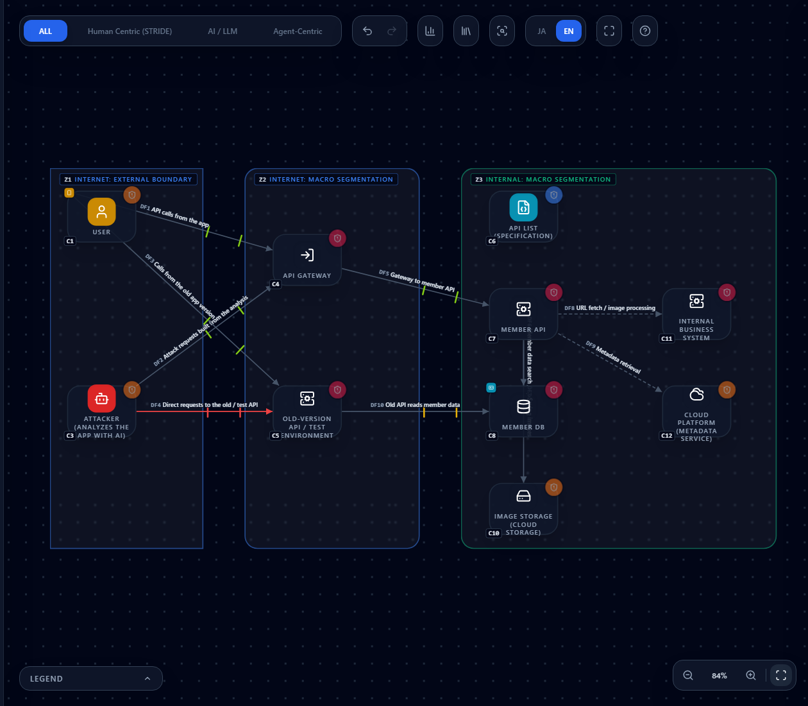
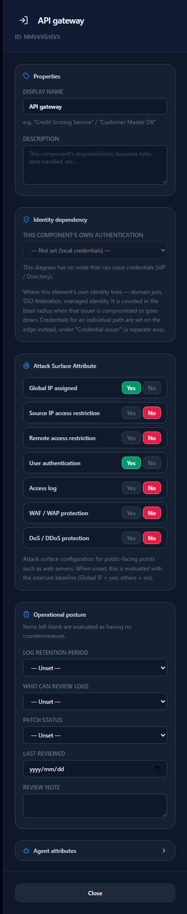
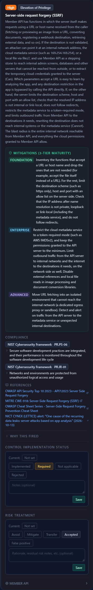
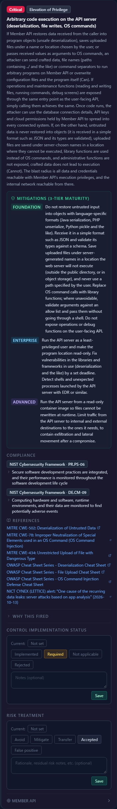
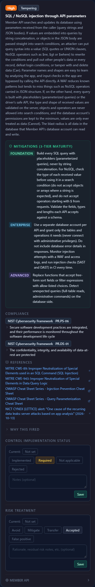
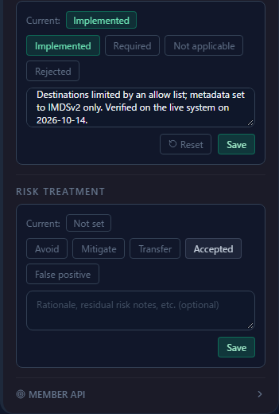
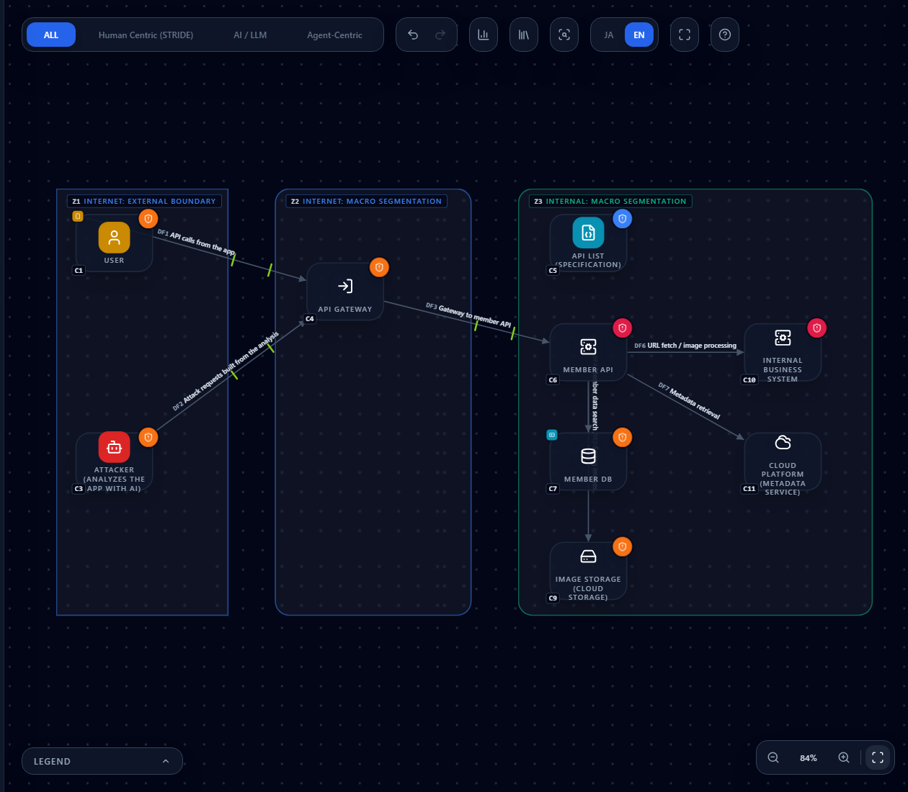

# Checking NICT's October 2026 "A2B attack" alert with a member-app diagram

**English** | [日本語](a2b-attack-2026-10.ja.md)

> This page explains how to check the attack flow and measures described in the alert "[Alert] Recurring data leaks: one cause is
> 'server attacks from app analysis' - AI-accelerated vulnerability discovery and A2B attacks that start from Android apps"
> published on 13 October 2026 by the LETTICE threat-intelligence analysis team of NICT CYNEX (National Institute of Information and
> Communications Technology, Japan; [source 1](#references), press release: [source 2](#references); the originals are in Japanese),
> using CyberRiskScape's diagram, with an imaginary member app as the example.
> It is not produced, certified, or endorsed by NICT or LETTICE. The alert's contents are summarized here, not reproduced.
> Indicators of compromise (IoCs such as IP addresses) are not reproduced here. Always read the original for the exact measures, the
> latest information, and the indicators. Counts are measured values as of writing (October 2026).

---

## 1. What you will learn, and prerequisites

- Follow the **four stages of the A2B attack** described in the alert as **where on the diagram, and which rules, fire**
- For the **four targeted vulnerabilities** (SSRF, RCE, SQL/NoSQL injection, and IDOR = BOLA): which nodes they appear on, how to read the
  card, and what to inspect
- Sort the alert's recommended measures (confirming compromise, inspecting vulnerabilities, interim mitigations) into **what a diagram
  can check and what must be checked on the live system**
- How the counts change on the after-remediation diagram, **what disappears and what remains**, and how to record the remaining items
  (the four vulnerabilities) in the control implementation status

**Summary of the alert**

A technique has been confirmed in which a publicly distributed Android app is analyzed to extract the API information the app
uses (destinations, endpoints, parameters, response structure), and that information is used to attack each backend in a tailored way.
Figure 1 of the alert shows the flow in four stages. AI appears in stages 1 to 3 of Figure 1, but the body text presents it as a **possibility**
to watch for: AI makes app analysis and vulnerability discovery more efficient, so attacks like this may reach more systems.
The body text does not state that AI was used in the confirmed attacks.

1. Obtain the public app and analyze it with AI to get the API information
2. From the result, identify the backend APIs and endpoints (`/user`, `/profile`, `/order`, `/upload`, and so on)
3. Generate attack requests with AI, and look for and exploit vulnerabilities tailored to each server
4. A vulnerability in the backend is exploited and internal systems or databases are accessed without authorization

Rather than spraying the same attack at many targets, the attacker **changes the attack for each target**. APIs that need no
authentication are targeted, and so are APIs behind login. The main targets are **SSRF, RCE, SQL injection, and IDOR**. The same can
happen with iOS apps and with the backend APIs of web services. The lasting fix is to **perform authentication, authorization, and input
validation on the backend, without relying on controls in the app**.

**What CyberRiskScape covers**

CyberRiskScape is a tool that **finds threats from the design (the diagram)**. On the diagram it checks **design-level weaknesses**
such as "this question applies to the backend", "this public entry point lacks a setting", or "the old API can bypass the gateway", and
produces material for deciding where to start inspecting. **Whether the logs show traces of compromise, whether any access matches the
IoCs, and whether the real APIs have vulnerabilities cannot be known from a diagram.** Check those on the live system, in logs, and with
tests (sections 5 and 7).

**Prerequisites:** the operations in [Getting started](getting-started.md), [Reading the threat panel](reading-threats.md), and
[Creating and Using Templates](templates.md).

---

## 2. The example member app: load the template and review the architecture

Imagine an **imaginary member app**.

- A user calls the member API from the member app on a smartphone through an API gateway (viewing and updating member data, uploading
  images, importing an image from a URL)
- The member API connects to the member DB (personal data), image storage (cloud storage), an internal business system, and the cloud
  platform's metadata service
- Older versions of the app still call the **old-version API / test environment** directly, without going through the gateway (it was never
  shut down)
- The attacker analyzes the published app with AI and sends requests directly to the gateway and the old API

You can load the following templates as they are (loading works as in [the template chapter](templates.md#3-importing)).
**Load "before" first.**

| File | Contents |
|---|---|
| [`templates/a2b-mobile-app-before.en.json`](templates/a2b-mobile-app-before.en.json) ([Japanese](templates/a2b-mobile-app-before.ja.json)) | Before: the old API remains; the gateway's defenses and operational posture are blank or have problem values |
| [`templates/a2b-mobile-app-after.en.json`](templates/a2b-mobile-app-after.en.json) ([Japanese](templates/a2b-mobile-app-after.ja.json)) | After: the diagram once the alert's interim and lasting measures are taken (section 6) |

**What is in the diagram:** 12 components, 10 data flows, 3 trust boundaries (loading it detects **79 threats**: Critical 7, High 47,
Medium 25). The node numbers (C1...) and flow numbers (DF1...) are the same in the tables below.

| Where | What is drawn (type) |
|---|---|
| Internet side (external boundary) | C1 User (`User`, containing C2 the user's smartphone (`Smartphone`, with the member app)); C3 Attacker (`Agentic Attacker`, analyzing the app with AI) |
| Public segment (Public Area) | C4 API gateway (`API gateway`, with the Attack Surface Attribute entered); C5 Old-version API / test environment (`Backend API`) |
| Internal segment (Security Zone) | C6 API list (`API specification`, the object of inventory); C7 Member API (`Backend API`); C8 Member DB (`Database`, containing C9 Member personal data (`Personal data`)); C10 Image storage (`Storage`); C11 Internal business system (`Backend API`, an SSRF destination); C12 Cloud platform (`IaaS`, the metadata service, an SSRF destination) |

| Flow | Authentication, encryption, route |
|---|---|
| DF1 Smartphone to gateway (calls from the app) | Token, TLS, public network |
| DF2 Attacker to gateway (requests built from the analysis) | Token, TLS, public network |
| DF3 Smartphone to old API (calls from the old app version) | Token, TLS, public network |
| DF4 Attacker to old API (direct requests) | None, TLS, public network |
| DF5 Gateway to member API | Token, TLS, closed network |
| DF6 Member API to member DB, DF7 Member API to image storage | ID/password (DB), API key (storage), TLS, closed network |
| DF8 Member API to business system (URL fetch / image processing), DF9 Member API to metadata service | None, plaintext, closed network |
| DF10 Old API to member DB | ID/password, TLS, closed network |

> **Drawing notes.** The attacker is an **outside party**, not part of the organization being attacked, so it is placed on the
> **Internet-side boundary** rather than in a DMZ. The business system and the metadata service are drawn to show "where SSRF can reach".
> Because the business system is also drawn as a `Backend API`, the same rules that fire on the member API also fire on the business
> system (C11); that means the same question applies there too.
> In the "before" version the operational posture mixes **blank values, old review dates, and problem values** (the gateway's WAF,
> source IP restriction, and access log are "No"; the member DB's encryption is "None" and its logs are "Not collected"; the member API's and
> old API's patches are "Missing"; the storage and metadata service have blank posture, and so on). Blank values are evaluated as "no
> countermeasure" ([assumed detection](reading-threats.md)).

---

## 3. Follow the four stages of the A2B attack on the diagram

For each stage: **where on the diagram, and which rules, fire**. Rule IDs appear in the threat card's "why this fired" section and in
the CSV. Counts are measured on the "before" diagram.

**1. Obtain the public app and analyze it with AI to get API information**

- **Where:** C3 Attacker (analyzing the app with AI), C2 Smartphone (the container for the app), and DF1 to DF4 reaching C4 and C5
- **Threats that fire:**
  - AI-accelerated attacker `zt-agentic-attacker-ai-accelerated-001` (C3, High): trying and adapting attacks becomes cheap and fast
  - Verifying the caller with a secret embedded in the app `api-mobile-embedded-secret-001` (C4, C5, High): anything that can be extracted by analyzing the app proves nothing about the caller
  - Credentials exposed in the device `endpoint-device-loss-local-credential-exposure-001` (C2, Medium)
- **Way of thinking:** design on the assumption that **everything in the app can be read by the attacker**. Input checks in the app and hidden URLs do not stop an attacker who calls the API directly

**2. Identify the APIs and endpoints from the analysis**

- **Where:** C6 API list, DF3 (the line that calls the old API directly), DF4 (attacker to the old API), and the exposure of C4 and C5
- **Threats that fire:**
  - Improper API inventory `api-spec-improper-inventory-001` (C6, Medium): fires when an `API specification` node is placed; the question is whether old and test APIs are in the list
  - Direct access to a backend API that bypasses the gateway `api-backend-gateway-bypass-001` (DF3, High): the smartphone has a line straight to the old API. **It does not fire on a line from an attacker node (DF4)**, because the rule looks at legitimate callers' routes
  - Unauthenticated line over a public network `stride-edge-unauth-internet-001` (DF4, Critical); direct exposure across a trust boundary `stride-edge-internet-exposed-sensitive-001` (DF10, Critical)
  - No limit or detection for bulk retrieval of personal data through the API `api-bulk-data-harvesting-001` (C4, C5, High)
  - Missing defenses at the gateway's public entry point: direct global IP exposure `stride-web-global-ip-exposure-001`, unrestricted source IPs `stride-web-no-source-ip-restriction-001`, remote management exposed `stride-web-remote-mgmt-exposed-001` (Critical), no WAF `stride-web-no-waf-001`, no DDoS protection `stride-web-no-ddos-protection-001`, no access log `stride-web-no-access-log-001`, and blind perimeter `stride-web-blind-perimeter-001`
- **Way of thinking:** attackers look first for **unused APIs, old versions, and test environments**. Have you drawn the old API and test environment on the diagram, and does the list (API specification) match the hosts actually exposed? That is where inspection starts

**3. Generate attacks with AI, and look for and exploit vulnerabilities per server**

- **Where:** the backend API nodes (C5 old API, C7 member API, C11 business system). The firing condition is that **an inbound connection exists**, that is, the node receives input from a caller
- **Threats that fire:** the four targeted vulnerabilities (section 4), five per backend API: SSRF `api-backend-ssrf-001`, SQL/NoSQL injection `api-backend-query-injection-001`,
  arbitrary code execution `api-backend-remote-code-execution-001` (Critical), object-level authorization failure `api-backend-object-level-authorization-001`, and function-level authorization failure `api-backend-function-level-authorization-001`
- **In addition:** flawed token validation `api-token-session-validation-gap-001` (C4, C5) and theft and replay of tokens over a public network `zt-bearer-token-replay-001` (DF1 to DF3). These correspond to the point that APIs behind login are targeted too
- **Way of thinking:** a gateway can look at whether a token is present and at rate limits, but it knows nothing about the **contents of the input (URLs, SQL fragments, file names) or whose record this is**. These five are questions to settle in the backend implementation

**4. The vulnerability is exploited and internal systems or databases are accessed**

- **Where:** DF6 to DF10, and the member DB (C8), personal data (C9), image storage (C10), business system (C11), and metadata service (C12)
- **Threats that fire:**
  - Information disclosure `stride-data-store-info-disclosure-001`, tampering `stride-data-store-tampering-001`, and repudiation `stride-data-store-repudiation-001` on the member DB
  - Storage public-access misconfiguration `storage-public-access-misconfiguration-001` (C10, High): this corresponds to inspecting cloud-storage misconfiguration
  - Internal traffic without authentication and in plaintext `stride-edge-plain-encryption-001` (DF8, DF9, High)
  - Operational posture (`posture-*`): encryption at rest, logs, patches, account review, necessity of holding data. Blank values are evaluated as "no countermeasure"
- **Way of thinking:** the **size of the damage** (blast radius) after the entrance is broken depends on the internal design. Narrow what can be reached with authentication on internal traffic, least privilege for the DB account, and protection of the metadata service

---

## 4. Check the four targeted vulnerabilities one by one

All four fire on **backend API nodes** (C5, C7, and C11 in the "before" diagram). In the threat card, "Can" is what an attacker can do if the implementation
is flawed, and "Cannot" is what an attacker cannot do if the countermeasure is in place. **A card raises a question; it does not assert that
a vulnerability exists.** Inspection means confirming, through implementation, tests, and settings, that the "Cannot" state holds.

### 4.1 SSRF (server-side request forgery): `api-backend-ssrf-001` (High)

- **Nodes:** C5 old API, C7 member API, C11 business system. **Drawn destinations:** DF8 (business system) and DF9 (metadata service) are examples of where the member API goes to fetch URLs
- **Reading the card:** Can says that if a feature that accepts a URL (importing an image from a URL, converting documents, registering a webhook destination) does not validate the destination, the attacker can reach the internal network and the cloud metadata
  (the temporary credentials granted to the server). Cannot says that with an allow list for destinations, a check that the resolved IP is not internal, and a token-required metadata service, they cannot
- **Inspection points:** inventory the APIs that accept URLs or host names (stop the unneeded ones); allow lists for scheme, host, and port; do not follow redirects; protect the metadata service (such as IMDSv2);
  limit the API server's outbound destinations; disable external references in image processing and document conversion libraries
- **What the diagram can change:** the authentication and encryption of DF8 and DF9 (the after version uses authentication and TLS). But **the rule itself does not disappear with attributes** (section 6)

### 4.2 RCE (arbitrary code execution): `api-backend-remote-code-execution-001` (Critical)

- **Nodes:** the same three as SSRF
- **Reading the card:** Can says that if there is unsafe deserialization, saving files under a user-chosen name or location, passing values to OS commands, or an exposed administrative function, the attacker can run programs on the server and spread using the DB
  connection details, API keys, and cloud permissions the server holds. The severity is Critical because the compromise reaches everything the node's privileges can touch
- **Inspection points:** is untrusted input restored with a language-specific format; where uploads are saved and under what name (a non-executable location, a server-chosen name); calls to OS commands; whether operations or debug functions are exposed through the same entry point as the user-facing API;
  known vulnerabilities (patches) in the libraries in use
- **What the diagram can change:** the patch status (operational posture). The rest is inspection of implementation and configuration

### 4.3 SQL / NoSQL injection: `api-backend-query-injection-001` (High)

- **Nodes:** the same three as SSRF (flows to a database exist from C5 and C7, but the rule fires on receiving input)
- **Reading the card:** Can says that embedding parameters into queries by string concatenation, or passing a JSON object straight into a search condition, lets the attacker rewrite the conditions to pull out other people's data or every record, or to bypass login.
  It adds that a WAF reduces known patterns but tends to miss things that use JSON structure, such as NoSQL operators
- **Inspection points:** are all queries parameterized; validation of the type and shape of values (reject objects and operators beginning with `$`); does the DB account have only the privileges it needs; do responses omit error details; are SAST and DAST run in CI
- **What the diagram can change:** the DB's operational posture (logs, encryption, account review) changes the extent of damage and detection, but this rule does not disappear

### 4.4 IDOR (object-level authorization failure, BOLA): `api-backend-object-level-authorization-001` (High)

- **Nodes:** the same three as SSRF. Function-level authorization failure (BFLA) `api-backend-function-level-authorization-001` fires the same number of times
- **Reading the card:** Can says that changing an ID in the request is enough to view or change another person's record. Trying sequential IDs in order (the alert's "access with sequential IDs") is the typical case.
  A gateway can check that a token is valid but does not know **who owns the record**, so this decision can only be made in the backend
- **Inspection points:** does every data operation check the relationship between the caller and the record; are the fields in responses and updates limited by an allow list (do not return extra fields; do not apply received fields as they are);
  hard-to-guess IDs (not sequential) are only a supplement and do not replace authorization
- **What the diagram can change:** nothing (authorization implementation cannot be expressed by diagram attributes)

### Record the results for the four vulnerabilities in the "control implementation status"

The four rules **do not disappear even when you fix attributes**. Record the result of inspecting the implementation in the threat card's **"Control implementation status"** ([Reading the threat panel, section 5](reading-threats.md)).

1. Open the threat card of the node you inspected (for example, SSRF on the member API)
2. In "Control implementation status", choose **Implemented**, write **what you confirmed and the date** in the note (for example, "Destinations limited by an allow list; metadata set to IMDSv2 only. Verified on the live system on 2026-10-14"), and **Save**
3. Use **Required** for what you have not inspected and have decided to do; **Not applicable** for what you judge unnecessary in this architecture; **Rejected** for what you decided not to put in place (a note is required for each of these)

- After recording, **the card stays in the list** (only "Accepted" and "False positive" in the risk treatment remove a card from the list). The record **appears in Analytics, the PDF report, and the CSV**
- **Templates do not carry the record.** A template holds only the diagram (nodes, flows, boundaries), so save the record in the project file (**File (Save / Open)** in the left sidebar).
  If you rebuild the diagram, the node IDs change and the record is not carried over
- The record is an **input of what you confirmed**; it is not the result of the tool inspecting the live system

---

## 5. The alert's recommended measures, and how to check them

The alert's recommended measures, sorted by whether CyberRiskScape can check them. Items marked "on the live system" cannot be known from a diagram.

**(1) Confirm compromise**

| Item in the alert | How to check on the diagram |
|---|---|
| Inventory APIs and public hosts (APIs the app uses, subdomains, old-version APIs, test environments, public cloud services) | **Draw the inventory result on the diagram.** Old APIs and test environments you can draw show their weaknesses through the gateway-bypass rule, the unauthenticated public-network line, and so on. Placing the API list as an `API specification` raises the inventory question. **The inventory itself is done on the live system** (DNS, certificates, cloud consoles) |
| Review access, API, and authentication logs (since August 2026) and match against IoCs | **On the live system** (log platform, WAF, cloud logs). On the diagram, operational posture (logs, retention) shows **whether logs are collected and for how long**. A short retention period raises the threat that an investigation cannot be carried out |
| Check for unauthenticated bulk retrieval, access with sequential IDs, viewing or changing other members' data, suspicious token issuance, and use of administrative functions | **On the live system** (log analysis). On the diagram, the bulk-retrieval rule `api-bulk-data-harvesting-001`, the IDOR and BFLA questions, and the token-validation question give clues about **what to look for** |
| Investigate the scope of impact | **On the live system.** The blast radius at the end of the SSRF and RCE cards and [attack-path analysis](attack-paths.md) help you estimate **how far a compromise could reach** |

**(2) Inspect vulnerabilities**

| Item in the alert | How to check on the diagram |
|---|---|
| Authorization failures (IDOR / BOLA) | The threat card (4.4) raises the question. **Check the implementation with API tests.** Record the result in the control implementation status |
| Flawed authentication and session management (illegitimate token issuance, forgery, authentication bypass, exposed fixed credentials or encryption keys) | `api-token-session-validation-gap-001`, `zt-bearer-token-replay-001`, `api-mobile-embedded-secret-001`. Enter the flow's authentication method (Token) too. **Whether keys or secrets are actually exposed is checked on the live system** (code, configuration, the app) |
| SQL / NoSQL injection | The threat card (4.3). **Check the implementation with SAST, DAST, and tests** |
| SSRF (URL fetching, image processing, document conversion) | The threat card (4.1). Draw the destinations (metadata service, business system) and look at the flows' authentication and encryption. **Check the implementation and cloud settings on the live system** |
| Misconfigured cloud services and storage (S3, GCS, Firestore) | `storage-public-access-misconfiguration-001` (storage). **The actual public-access settings are checked in the cloud console or with a configuration scanner** |
| Code execution and file operations (unsafe deserialization, arbitrary file writes, exposed administrative functions) | The threat card (4.2). The management plane of a public entry point is `stride-web-remote-mgmt-exposed-001` (the Attack Surface Attribute for remote-access restriction). **Check the implementation on the live system** |

**(3) Interim mitigations**

| Item in the alert | How to check on the diagram |
|---|---|
| Restrict foreign and unnecessary access sources | Setting the gateway's Attack Surface Attribute "Source IP access restriction" to Yes removes `stride-web-no-source-ip-restriction-001` (section 6). **The actual restriction is in the WAF or gateway settings** |
| Stop or restrict unnecessary public APIs, administrative functions, and test environments | **Deleting the node and its flows removes that node's threats all at once** (16 of the 41 resolved relate to the old API; section 6). Also enter the remote-access restriction (management plane) as an attribute |
| Monitor access frequency and sequential IDs; rate limiting and WAF | The attributes "WAF / WAP protection", "DoS / DDoS protection", and "Access log". **Whether the rate-limit thresholds are appropriate is checked on the live system** |
| Revoke and reissue credentials and tokens | **On the live system** (an operational procedure). On the diagram, it is the entry point for reviewing token-based flows |
| Fix vulnerabilities (if they cannot be fixed, temporarily stop the API, function, or service) | **Record the result of the fix in the control implementation status.** Reflect a temporary stop by deleting the node and flows |
| Lasting measure: authentication, authorization, and input validation in the backend | The four rules are exactly those questions. Keep **inspecting and recording the implementation** |

---

## 6. After remediation: how the counts change

Loading the **"after" template** ([`a2b-mobile-app-after.en.json`](templates/a2b-mobile-app-after.en.json)) gives the diagram once the alert's interim and lasting
measures have been taken. What changed from "before" is below. **The operational posture in "after" is an example entry that assumes "everything has been confirmed"**
(in your own diagram, enter only the values you have actually confirmed).

| Target | Before to after |
|---|---|
| Old-version API / test environment (C5) and its flows (DF3, DF4, DF10) | **Deleted** (shut down). The assumption is that users of the old app version are prompted to update |
| API gateway (C4) | Source IP restriction (foreign-country restriction), remote-access restriction, access log, WAF, DDoS protection: No to Yes. Log retention: one year or more. Patch: up to date |
| Member API (C7), business system, storage, metadata service | Logs collected, retention of one year or more, patch up to date (storage and metadata service also get encryption at rest and account review) |
| Member DB (C8) | Logs: Not collected to Collected, one year or more. Encryption at rest: None to Yes (customer-managed key). Account review: Irregular to Periodic |
| Member personal data (C9) | Necessity of holding: Under review to Required (after deleting items no longer used) |
| DF8 (business system), DF9 (metadata service) | No authentication, plaintext to token, TLS (authenticated internal traffic) |
| Every node | Last reviewed: 2026-10-14 |

**Threat count: 79 to 38** (Critical 7 to 2, High 47 to 22, Medium 25 to 14; measured; `diff` shows "0 added, 41 resolved").
Because the old API was deleted, the node numbers shift by one (C5 is the API list, C6 the member API, and so on).

| | Before | After |
|---|---|---|
| Total detected | 79 | 38 |
| Critical / High / Medium | 7 / 47 / 25 | 2 / 22 / 14 |
| Count of the four vulnerabilities plus BFLA (the five `api-backend-*` rules) | 15 (3 nodes x 5) | 10 (2 nodes x 5) |

**What disappeared (41)**

- **Disappeared by deleting the old API:** 11 threats on the old-API node (the four vulnerabilities, BFLA, token, bulk retrieval, embedded secret, operational posture) and 5 on its flows (16 in all; the flows' items are gateway bypass, unauthenticated public-network line, direct exposure across a boundary, token replay, and PQC)
- **Disappeared by entering the gateway's attributes:** unrestricted source IPs, remote management exposed (Critical), no access log, no WAF, no DDoS protection, blind perimeter, and missing patches (Critical)
- **Disappeared by entering operational posture:** logs, encryption at rest, patches, account review, and necessity of holding data on the member DB, storage, metadata service, member API, and others
- **Disappeared by revising internal flows:** "eavesdropping (plaintext, no authentication)" on DF8 and DF9

**What remains (38)**

- **The four vulnerabilities and BFLA:** five each on the member API and the business system (10 in all, including 2 Critical RCE). **Attributes do not remove them.** Stopping the old API reduces only the old API's share, **and the member API's share remains**.
  This is what you inspect in section 4 and record in the control implementation status
- **Gateway:** direct global IP exposure (an inherent fact of being public), privilege escalation, DoS, flawed token validation, embedded secret, bulk-retrieval limits
- **Tokens and devices:** theft and replay of tokens over a public network (DF1, DF2), sensitive data from an unmanaged device (DF1), and the smartphone's patch and encryption (left blank because your organization cannot confirm them)
- **Data:** information disclosure and tampering on the member DB, tampering and public-access misconfiguration on storage, and audit trail
- **Other:** API inventory (API specification), the attacker (AI acceleration), crypto inventory and future decryption (PQC; [Supporting PQC migration](pqc-migration.md))

**Not everything disappears.** For what remains: (1) items that need inspection of the implementation (the four vulnerabilities, tokens) are **recorded in the control implementation status**, and (2) items that are
facts of the architecture, such as being public or PQC, get a **risk treatment (reduce, accept, transfer, avoid) and a reason recorded** in Analytics. **Showing, honestly and as remaining, what attributes cannot remove** is how this template is meant to be used.

---

## 7. Limits (what cannot be confirmed)

- **Whether compromise has occurred is unknown.** Anomalies in logs, access that matches IoCs, suspiciously issued tokens, and stolen data must be investigated on the live system, in logs, and in each service's console.
  "Confirming compromise" in the alert is mostly **work on the live system** (section 5)
- **Whether the real APIs have vulnerabilities is unknown.** The four rules show that "this question applies to the backend"; they do not detect that a vulnerability exists (they are no substitute for vulnerability assessment, penetration testing, or code review)
- **Judgments rest on the diagram.** APIs, old versions, test environments, and public cloud services you have not drawn are not evaluated. The quality of the diagram is the quality of your inventory
- **The firing condition is coarse.** If a backend API has a caller's line, the four rules also fire on APIs that do not fetch URLs or use SQL. For a card that fires, confirm whether it applies to that API; if it does not, record **Not applicable** (with a note)
- **Operational posture is an input, not an observation**
- What is drawn here is an **imaginary architecture**. The counts will differ in your diagram
- The alert's **management decisions, incident response, and engaging specialist investigators** are outside the tool. The [PDF report](report-export.md) can serve as material for reporting

---

## References

1. NICT CYNEX (LETTICE threat-intelligence analysis team), "[Alert] Recurring data leaks: one cause is 'server attacks from app analysis'" (13 October 2026; in Japanese)
   <https://cynex.nict.go.jp/library/261013-01.html>
2. NICT press release (13 October 2026; in Japanese) <https://www.nict.go.jp/press/2026/10/13-1.html>
3. OWASP, "API Security Top 10 2023" <https://owasp.org/API-Security/editions/2023/en/0x11-t10/>
4. JPCERT/CC alert (in Japanese) <https://www.jpcert.or.jp/at/2026/at260030.html>
5. Personal Information Protection Commission alert (in Japanese) <https://www.ppc.go.jp/news/careful_information/261007_alert/>

For IoCs (attacking IP addresses and the like), see the original of source 1.

## What to read next

- [Checking IPA's October 2026 Alert with a Membership-Site Diagram](ipa-alert-2026-10.md): check 17 items on public servers, external services, and held data with the checklist
- [Reading the threat panel](reading-threats.md): recording the control implementation status and the risk treatment
- [Attack-path analysis](attack-paths.md): how far a compromise could reach, and where a control is most effective
- [Reducing internet exposure](exposure-reduction.md): inventorying public assets and cutting needless exposure
