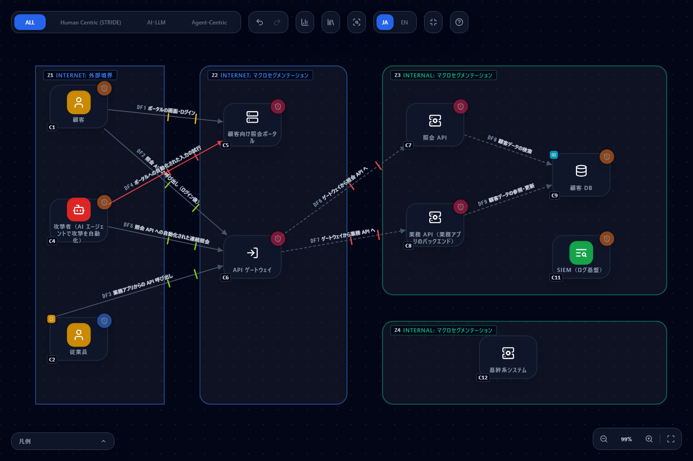
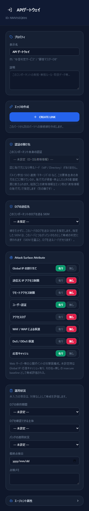
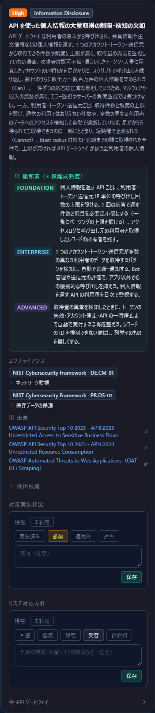
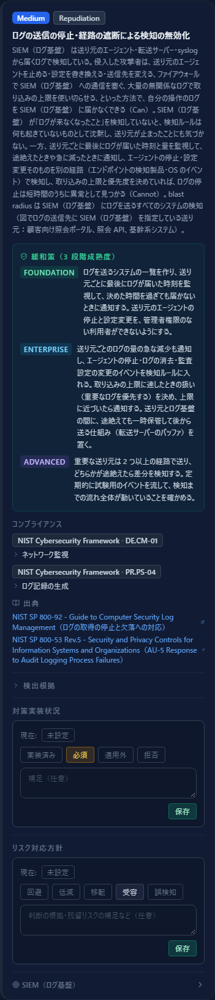
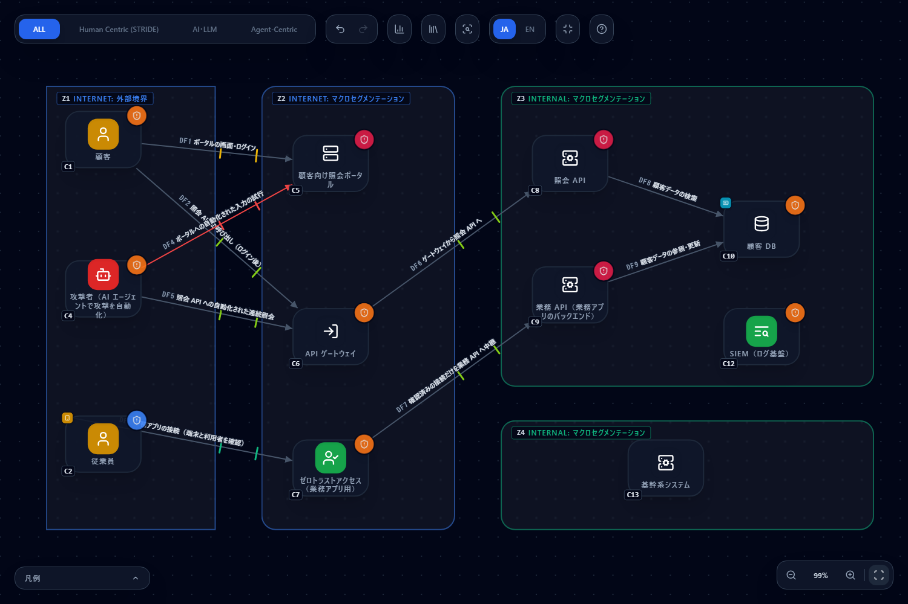

# AI エージェントによる自動化された攻撃に、公開 Web アプリ・API の設計で備える（2026 年 10 月）

[English](ai-agent-attack-2026-10.md) | **日本語**

> このページは、次の 3 つの報告が述べる「AI エージェントで自動化された攻撃」の傾向と推奨対策を、
> CyberRiskScape の構成図でどう確かめるかを、架空の公開 Web アプリ・API を例にまとめたものです。
>
> - Zscaler ThreatLabz のブログ記事（2026 年 10 月 14 日。[出典 1](#参考リンク)）
> - CrowdStrike「2026 Global Threat Report」の報道発表（2026 年 2 月 24 日。[出典 2](#参考リンク)）
> - CrowdStrike「2026 Threat Hunting Report」（対象期間 2025 年 7 月 1 日〜2026 年 6 月 30 日。[出典 3](#参考リンク)）
>
> Zscaler・CrowdStrike が作成・認定・推奨するものではありません。報告の内容は日本語で要約しており、原文の転載ではありません。
> 攻撃に使われたツールの名前・仕組み、攻撃の手順、被害を受けた組織の名前はここに載せていません。
> 攻撃の指標（IoC。IP アドレス・ドメイン）も載せていないので、原文で確認してください。対策の正確な内容・最新の情報も、必ず原文を確認してください。
> 件数は執筆時点（2026 年 10 月）の実測値です。

---

## 1. このページで分かること・前提

- 報告にある攻撃の流れ（**公開アプリへの到達 → 入力・認証の弱点 → 大量のデータ取得 → 持ち出し**）を、**図のどこで・どのルールが出るか**で追う
- AI エージェントが攻撃の**速さ・並列・粘り強さ**を変えるとき、**「面倒にする」だけの対策と「不可能にする」対策**がどう違うか
- 報告の推奨対策のうち、**図で確かめられるものと、実機で確かめるもの**の仕分け
- 対策後の図で件数がどう変わり、**何が消えて何が残るか**。残るものを「対策実装状況」と「リスク対応方針」に記録する方法
- AI ペンテストツールを**自社で使う場合**に、図で出る問い

**報告の要旨**

- **Zscaler ThreatLabz（出典 1）：** 攻撃者が AI エージェント型のペネトレーションテスト用フレームワークを悪用した事例を報告しています。
  狙われたのは**基幹系の外側にある、公開された周辺の Web アプリ・API**（顧客向けの照会ポータルと、従業員向けモバイルアプリのバックエンド）でした。
  手口は **SQL インジェクション**と**認証バイパス**に分類され、**約 6.7 万人分の個人情報**（氏名・電話番号・年収・融資限度額）が被害を受けました。
  推奨対策として、外部公開の縮小とゼロトラストアクセス、サーバー側の認可、レスポンスを必要な項目に絞ること、連続照会や 1 セッションあたりの大量参照の監視とレート制限、
  デセプション、変更のたびの認可テスト、DLP、ペンテストツールを本番から隔離して本番の認証情報を置かないこと、を挙げています
- **CrowdStrike 2026 Global Threat Report（出典 2）：** AI を使う攻撃者の活動が**前年比 89% 増**。eCrime の**ブレイクアウト**（最初の侵入から横展開を始めるまでの時間）は**平均 29 分、最速 27 秒**。
  **90 以上の組織**で、GenAI ツールに悪意あるプロンプトが注入されました
- **CrowdStrike 2026 Threat Hunting Report（出典 3）：** 有効な PoC（概念実証コード）が公開されてから悪用されるまで**約 24 時間**。
  AI エージェントを起点にした検知のリードは、人を起点にしたものの **2.5 倍の比率**で増えました

3 つに共通するのは、**攻撃の試行が速く・多く・休まなくなっている**ことです。人の手間を前提にした防御（試行回数の制限、手順の複雑さ）は、時間稼ぎにはなっても止める力が弱くなります。

**CyberRiskScape が担う範囲**

CyberRiskScape は**設計（構成図）から脅威を洗い出す**ツールです。「この API に認可の問いが立つ」「公開の入口にこの設定が足りない」「この画面は公開しなくてよい」
といった**設計上の弱いところ**を図の上で確かめ、どこから対策・点検するかを決める材料を出します。
**侵害されているかどうか、IoC に一致するアクセスがあるか、実機の Web アプリ・API に脆弱性があるかは、図からは分かりません。**
それらは実機・ログ・テストで確かめてください（§5・§8）。

**このページの前提となる知識：** [はじめに](getting-started.ja.md)の操作と、[脅威パネルの読み方](reading-threats.ja.md)、
[テンプレートを作る・使う](templates.ja.md)。API のバックエンドに出る 5 つのルールの読み方は
[NICT の注意喚起「A2B 攻撃」のガイド §4](a2b-attack-2026-10.ja.md#4-狙われる-4-つの脆弱性を-1-つずつ確かめる) が詳しいので、合わせて読んでください。

---

## 2. 題材の構成 — テンプレートを読み込んで確認する

**架空の会員サービス**（融資の照会ができる金融サービスを想定）を描きます。

- 顧客は、ブラウザで照会ポータルを開いてログインし、画面から **API ゲートウェイ経由で照会 API** を呼ぶ
- 従業員は、スマートフォンの業務アプリから **同じ API ゲートウェイ経由で業務 API** を呼ぶ（業務 API もインターネットに公開されている）
- 照会 API・業務 API は、顧客 DB（個人情報）を検索・更新する
- **基幹系システムは別のセグメント**にあり、周辺の Web アプリ・API から直接はつながっていない（狙われるのが基幹系の外側であることを示すため）
- 攻撃者は、AI エージェントで攻撃を自動化し、ポータルとゲートウェイに直接リクエストを送る

次のテンプレートを、そのまま読み込めます（読み込み方は[テンプレートの章](templates.ja.md#3-読み込むimport)と同じです）。
**まず「対策前」を読み込んでください。** 左サイドバーの **新規作成**（**保存せずに作成**）で空のプロジェクトにしてから読み込むと、ノードと線の番号が以降の表と同じ C1・DF1 から振られます（ほかの図が残っていると、番号が続きから振られます）。

| ファイル | 内容 |
|---|---|
| [`templates/ai-agent-attack-before.ja.json`](templates/ai-agent-attack-before.ja.json)（[英語版](templates/ai-agent-attack-before.en.json)） | 対策前：業務 API がインターネットに公開され、公開の入口の防御・運用状況が未入力か問題のある値 |
| [`templates/ai-agent-attack-after.ja.json`](templates/ai-agent-attack-after.ja.json)（[英語版](templates/ai-agent-attack-after.en.json)） | 対策後：報告の推奨対策のうち図で表せるものを取ったあとの図（§6） |

**図の中身：** コンポーネント 12・データフロー 9・トラスト境界 4（読み込むと **76 件**の脅威が検出されます。Critical 8・High 47・Medium 21）。
ノードの番号（C1〜）と線の番号（DF1〜）は、以降の表と同じです。

| 場所 | 描いたもの（型） |
|---|---|
| インターネット側（外部境界） | C1 顧客（`ユーザー`。信頼区分はゲスト）、C2 従業員（`ユーザー`。C3 従業員のスマートフォン（`スマートフォン`。業務アプリ入り）を内包）、C4 攻撃者（`AIエージェント攻撃者`） |
| 公開セグメント（Public Area） | C5 顧客向け照会ポータル（`フロントエンドサーバー`）、C6 API ゲートウェイ（`APIゲートウェイ`）。どちらも Attack Surface Attribute を入力する対象 |
| 内部セグメント（Security Zone） | C7 照会 API（`バックエンドAPI`）、C8 業務 API（`バックエンドAPI`。業務アプリのバックエンド）、C9 顧客 DB（`データベース`。C10 顧客の個人情報（`個人情報`）を内包）、C11 SIEM（`SIEM / ログ基盤`） |
| 基幹系セグメント（Security Zone） | C12 基幹系システム（`バックエンドAPI`。線は引いていない） |

| 線 | 認証・暗号・経路 |
|---|---|
| DF1 顧客 → ポータル（画面・ログイン） | ID/パスワード・TLS・公衆網 |
| DF2 顧客 → ゲートウェイ（照会 API の呼び出し）、DF3 スマホ → ゲートウェイ（業務アプリの呼び出し） | トークン・TLS・公衆網 |
| DF4 攻撃者 → ポータル（自動化された入力の試行） | 認証なし・TLS・公衆網 |
| DF5 攻撃者 → ゲートウェイ（照会 API への自動化された連続照会） | トークン・TLS・公衆網（ログイン後の API も狙われる、という想定） |
| DF6 ゲートウェイ → 照会 API、DF7 ゲートウェイ → 業務 API | 認証なし・平文・閉域網 |
| DF8 照会 API → 顧客 DB、DF9 業務 API → 顧客 DB | ID/パスワード・平文・閉域網 |

> **描き方のメモ。** 攻撃者は、被害を受ける側の組織ではなく**外部の主体**なので、DMZ ではなく**インターネット側の境界**に置いています。
> SIEM は線で結ばず、各ノードの **「ログの送信先」**（ノードパネル）で指定しています。対策前は、ポータル・照会 API・基幹系システムだけが SIEM にログを送り、
> **ゲートウェイ・業務 API・顧客 DB は送っていません**。
> 運用状況は、対策前では**未入力・古い点検日・問題のある値**が混ざっています（ポータルの WAF・アクセスログが「無し」、ゲートウェイは攻撃面のほとんどと運用状況が空、
> 業務 API の運用状況が空、顧客 DB の暗号化が「なし」・ログが「取得していない」、ポータル・照会 API のパッチが「未適用あり」、個人情報の保有の必要性が「要検討」 など）。
> **未入力は「悪い値と同じ」として評価されます**（カードに「仮定検出」の印が付きます。[脅威パネルの読み方 §4](reading-threats.ja.md#4-仮定検出を減らす)）。

---

## 3. 攻撃の流れを図の上で追う

段階ごとに、**図のどこで・どのルールが出るか**を並べます。ルール ID は脅威カードの「検出根拠」と CSV に出ます。件数は対策前の図の実測です。

**① 公開アプリに到達する**

- **図のどこ：** C4 攻撃者、DF4・DF5、C5 ポータル・C6 ゲートウェイの公開状況（Attack Surface Attribute）
- **出る脅威：**
  - AI で加速した攻撃者 `zt-agentic-attacker-ai-accelerated-001`（C4。High）。試行のコストがほぼゼロになり、**「手間で抑止する」防御は時間稼ぎにしかならない**、という前提を示します
  - 認証のない公衆網の線 `stride-edge-unauth-internet-001`（DF4。Critical）と、フロントエンドへの未認証の流入 `stride-web-unauth-internet-ingress-001`（DF4。High）
  - 公開の入口に足りない防御：送信元 IP 無制限 `stride-web-no-source-ip-restriction-001`（High）・管理面リモートアクセス `stride-web-remote-mgmt-exposed-001`（Critical）・
    グローバル IP 直接公開 `stride-web-global-ip-exposure-001`・DDoS 保護欠如 `stride-web-no-ddos-protection-001`（いずれも C5・C6 の両方に出ます）
- **ここでの考え方：** AI エージェントは、**届く入口を全部、同時に、休まず**試します。最初に問うのは「この入口は、インターネットから届く必要があるか」です。
  顧客向けのポータルは公開が前提ですが、**従業員の業務アプリが使う API は、インターネットの誰からでも届く必要はありません**。届かない入口は、何度試されても攻撃できません

**② 入力・認証の弱点を突く**

- **図のどこ：** C5 ポータル、C6 ゲートウェイ、C7 照会 API・C8 業務 API（「呼び出し元から入力を受ける」＝inbound の線があることが発火の条件）、DF1〜DF3・DF5
- **出る脅威：**
  - WAF 欠如 `stride-web-no-waf-001`（C5・C6。High）
  - API パラメーターによる SQL / NoSQL インジェクション `api-backend-query-injection-001`（C7・C8。High）— 報告の手口の 1 つ目に当たります
  - トークン・セッションの検証不備 `api-token-session-validation-gap-001`（C6。High）、機能単位の認可不備 `api-backend-function-level-authorization-001`（C7・C8。High）— 報告の手口の 2 つ目（認証バイパス）に当たります
  - 送信者制約のないベアラートークンの窃取・再利用 `zt-bearer-token-replay-001`（DF2・DF3・DF5。High）、パスワード単独の認証 `stride-edge-password-internet-001`（DF1。High）
  - 公開アプリの脆弱性を突いた Web シェルの設置 `webserver-webshell-implant-001`（C5。Critical）と、パッチの未適用 `posture-patch-missing-001`（C5・C6 は Critical、C7・C8・C11 は High）。
    **ゲートウェイと業務 API はパッチの状況が未入力ですが、「未適用あり」と同じ重大度で出ます**
  - このほか、C7・C8 には SSRF `api-backend-ssrf-001`・任意のコード実行 `api-backend-remote-code-execution-001`（Critical）も出ます（読み方は [A2B ガイド §4](a2b-attack-2026-10.ja.md#4-狙われる-4-つの脆弱性を-1-つずつ確かめる)）
- **ここでの考え方：** WAF は既知の書き方を減らせますが、書き方を変えて何度でも試す相手には、**すり抜ける書き方が見つかるまでの時間を延ばす**対策です。
  一方、すべてのクエリをプレースホルダー（パラメーター化）で組み立てていれば、値は**データとしてしか扱われず**、何度試してもクエリの構文にはなりません。
  トークンも同じで、署名・有効期限・スコープをサーバー側で毎回検証していれば、書き換えたトークンは通りません。
  PoC の公開から悪用まで約 24 時間（出典 3）という速さでは、パッチの状況を**入力し、更新し続ける**こと自体が対策の前提です

**③ 大量のデータを取得する**

- **図のどこ：** C6 ゲートウェイ（利用者の端末から呼ばれる API の入口）、C7・C8、C9 顧客 DB・C10 個人情報
- **出る脅威：**
  - API を使った個人情報の大量取得の制限・検知の欠如 `api-bulk-data-harvesting-001`（C6。High）。「利用者・端末から呼び出される経路がある API」に出ます
  - オブジェクト・プロパティ単位の認可不備 `api-backend-object-level-authorization-001`（C7・C8。High）。ID を書き換えるだけで他人のレコードを見られる、応答に不要な項目を返す、という問いです
  - ゲートウェイの認可境界の不備 `stride-gateway-elevation-of-privilege-001`（C6。High）
  - 顧客 DB の情報漏洩 `stride-data-store-info-disclosure-001`（C9。High）
  - 不要・要検討のデータを保有し続けている `posture-data-minimization-001`（C10。Medium）。個人情報の「保有の必要性」が「要検討」なので出ます

  

- **ここでの考え方：** 大量取得のカードが書くとおり、**一件ずつの応答は正常な形**をしているので、エラーや負荷の監視では気づけません。
  レート制限は必要ですが、多数のアカウント・トークン・送信元に分散され、休まず続けられると、**取られる速さを遅くする**にとどまります。
  取られる量の上限を決めるのは、**サーバー側で照合する認可**（他人のレコードは返さない）と、**応答で返す項目**（使わない項目は返さない）と、**持っているデータ**（持っていないものは盗めない）です

**④ 持ち出す — そして、気づけるか**

- **図のどこ：** C5・C6 のアクセスログ、C7〜C9 のログ、C11 SIEM と「ログの送信先」、内部の線 DF6〜DF9
- **出る脅威：**
  - アクセスログ欠如 `stride-web-no-access-log-001`（C5・C6。Medium）と、盲点境界：公開×無ログ `stride-web-blind-perimeter-001`（C5・C6。High）
  - ログを取得していない `posture-log-not-collected-001`（C8 は Medium、C9 は High）、ログの保持期間が短い `posture-log-retention-short-001`（C7・C8。High）・`posture-log-retention-short-003`（C11。High）
  - ログの送信の停止による検知の無効化 `netinfra-siem-collection-blinding-001`（C11。Medium）。カードの末尾に、**ログの送信先に SIEM を指定している送り元**（対策前はポータル・照会 API・基幹系システム）が列挙されます。
    **ゲートウェイ・業務 API・顧客 DB が並んでいないこと**が、そのまま「SIEM から見えていない場所」です
  - 保管時に暗号化していない `posture-encryption-at-rest-missing-001`（C9。High）、アカウント棚卸しが不定期 `posture-account-review-missing-001`（C9・C11。Medium）
  - 内部の通信の盗聴 `stride-edge-plain-encryption-001`（DF6〜DF9。High）

  

- **ここでの考え方：** ブレイクアウトが平均 29 分・最速 27 秒（出典 2）という速さでは、人がログを読みに行く運用では間に合いません。
  まず**ログが SIEM に届いていること**と、**遡れる期間があること**が前提で、その上で連続照会や 1 セッションあたりの大量参照を自動で検知・遮断します。
  図で確かめられるのは前提（取得・保持期間・送信先）までで、検知のルールと閾値が働くかは実機で確かめます（§5）

---

## 4. AI エージェントで何が変わるか — 「面倒にする」と「不可能にする」

AI エージェントで攻撃が**速く**（PoC から悪用まで約 24 時間、ブレイクアウト最速 27 秒）、**多く**（AI を使う攻撃者の活動が前年比 89% 増）なると、
人の手間を前提にした対策は、止める力ではなく**時間稼ぎ**になります。C4 攻撃者のカード（`zt-agentic-attacker-ai-accelerated-001`）の対策にも、
「面倒にするだけ」の対策を構造的な対策へ置き換える計画を立てる、とあります。

| 攻撃者がすること | 面倒にするだけの対策（時間稼ぎ） | 不可能にする対策（試行回数を増やしても突破できない） | 図での確かめ方 |
|---|---|---|---|
| 公開された入口を探して試す | 非標準のポート、URL を推測しにくくする、アプリの難読化 | **公開をやめる**（ゼロトラストアクセスの背後に置き、確認済みの端末と利用者の接続だけを中継する）。届く経路がそもそも無い | 業務 API の前に `ZTNA / ID認識プロキシ` を置き、攻撃者・端末からゲートウェイへの線を消す（§6） |
| SQL インジェクションを書き方を変えて試し続ける | WAF のシグネチャだけで止める | **パラメーター化クエリ**と、サーバー側での型・形の検証。値が構文として解釈されない | `api-backend-query-injection-001` の問い。**実装は SAST・DAST・テストで**確かめ、結果を対策実装状況に記録 |
| 認証を回避する・盗んだトークンを使い続ける | パスワードの複雑さ、ログイン試行の回数制限、CAPTCHA | **フィッシングに強い認証**（端末に束縛した証明書・パスキー）、サーバー側でのトークン検証、**送信者制約**（DPoP・mTLS に束縛したトークン） | 線の認証方式（`Certificate` / `Passkey`）。トークン検証は `api-token-session-validation-gap-001` の問い |
| ID を順に変えて他人のデータを取る | 推測しにくい ID（連番にしない） | **サーバー側の認可**で、呼び出し元とレコードの所有関係を毎回照合する | `api-backend-object-level-authorization-001` の問い（実装は API テストで） |
| 多数のアカウント・送信元に分散して大量に取る | レート制限だけ | **応答の項目を必要最小に絞る**・**持たない**（保有の必要性を見直す）。レート制限と監視は、**取られる量の上限と気づくまでの時間**を決める対策として併用する | 個人情報の「保有の必要性」・ゲートウェイの `api-bulk-data-harvesting-001` |

**レート制限・監視・WAF が不要という意味ではありません。** これらは被害の大きさと気づくまでの時間を決める大事な対策です。
ただし、AI エージェントの速さと並列に対しては、**それだけに頼ると「いつかは通る」**ので、到達経路・認証・認可・保有データの設計で**「通らない」ものを先に作り**、
その上に監視とレート制限を重ねる、という順番で考えます。

---

## 5. 報告の推奨対策と、図で確かめる方法

報告（出典 1）の推奨対策を、CyberRiskScape で確かめられるかで仕分けます。「実機で」とあるものは、図からは分かりません。

| 報告の推奨対策 | 図で確かめられること | 実機で確かめること |
|---|---|---|
| 外部公開の縮小とゼロトラストアクセス | 公開しているノードを描き、要らない公開の線を消す。業務 API の前に `ZTNA / ID認識プロキシ` を置くと、ゲートウェイの埋め込み秘密・業務アプリの線のトークン再利用が消える（§6）。公開の入口の「送信元 IP 制限」「リモートアクセス制限」も属性で入力 | 実際に公開されているホスト・API の洗い出し（DNS・証明書・クラウドの管理画面）。描いていない公開資産は評価されません（[インターネット露出を減らす](exposure-reduction.ja.md)） |
| サーバー側の認可 | `api-backend-object-level-authorization-001`・`api-backend-function-level-authorization-001`・`api-token-session-validation-gap-001` が、どの API に問いが立つかを示す | 認可の実装（他人の ID・権限の弱いトークンで呼ぶ API テスト）。結果は対策実装状況に記録。HTTP で確かめる手順は [Postman のガイド](postman.ja.md) |
| レスポンスを必要な項目に絞る | BOLA のカードと大量取得のカードの対策に含まれる。持っている項目そのものは、個人情報の「保有の必要性」「件数の規模」で記録 | 実際の応答に不要な項目が含まれていないか（API の応答の確認・仕様書との照合） |
| 連続照会・1 セッションあたりの大量参照の監視とレート制限 | `api-bulk-data-harvesting-001` が問いを出す。前提となるアクセスログ・ログの保持期間・ログの送信先（SIEM）を属性で入力 | レート制限と検知の閾値が妥当か、自動遮断が働くか（実機の設定とテスト） |
| デセプション（おとりの資産） | **表せません**（対応する型・ルールがありません） | おとりの設置と、それに触れたときの検知・通知 |
| 変更のたびの認可テスト | 認可のカードの対策に「他人の ID を指定するテストを CI で毎回実行する」とある。図の変更を PR で見張る方法は [AI駆動開発の CI に組み込む](ci-integration.ja.md) | テストそのもの（CI での API テスト） |
| DLP | **表せません**（対応する型・ルールがありません） | 持ち出しの検知・遮断の設定 |
| ペンテストツールを本番から隔離し、本番の認証情報を置かない | ツールを描き足すと、ツールの使い方の問いが出る（§7）。検証環境を別のトラスト境界に描き、本番の DB への線を引かないことで、隔離の設計を図に残せる | ツールの実行環境に本番の認証情報が無いこと（設定・秘密情報の管理の確認） |

報告の手口（SQL インジェクション・認証バイパス）は §3 ② のとおり、`api-backend-query-injection-001`・`api-token-session-validation-gap-001`・
`api-backend-function-level-authorization-001` で問いが立ちます。**問いが立つことと、脆弱性があることは別です。** 実装を点検して、結果を記録してください。

---

## 6. 対策後 — 件数がどう変わるか

**「対策後」のテンプレート**（[`ai-agent-attack-after.ja.json`](templates/ai-agent-attack-after.ja.json)）を読み込むと、報告の推奨対策のうち図で表せるものを取ったあとの図になります。
対策前から変えたのは次のとおりです。**対策後の運用状況は、「すべて確かめた」と仮定した入力例です**（自分の図では、実際に確かめた値だけを入力してください）。

| 対象 | 対策前 → 対策後 |
|---|---|
| 業務アプリの経路（DF3） | スマホ → ゲートウェイ（トークン・公衆網）を削除し、スマホ → **ゼロトラストアクセス（`ZTNA / ID認識プロキシ`。新しい C7）**（証明書・TLS・公衆網）→ 業務 API（トークン・TLS・閉域網）に置き換え（ゼロトラストアクセスもログを取得し、送信先は SIEM）。**ゲートウェイから業務 API への線（DF7）は削除**（業務 API をインターネットに公開しない） |
| 顧客向け照会ポータル（C5）・API ゲートウェイ（C6） | 送信元 IP 制限（国外からのアクセスを制限）・リモートアクセス制限・アクセスログ・WAF・DDoS 保護：無し・未入力 → 有り。ログの保持期間：1 年以上。パッチ：最新。ゲートウェイのログの送信先：SIEM |
| 照会 API・業務 API | ログ取得・保持期間 1 年以上・パッチ最新。ログの送信先：SIEM |
| 顧客 DB | ログ：取得していない → 取得・1 年以上。保管時の暗号化：なし → あり（自組織管理の鍵）。アカウント棚卸し：不定期 → 定期的に実施。ログの送信先：SIEM |
| 顧客の個人情報 | 保有の必要性：要検討 → 必要（使わない項目を削除したうえで） |
| SIEM | 保持期間：90 日未満 → 1 年以上。パッチ最新・アカウント棚卸しを定期的に実施 |
| DF1 顧客 → ポータル | ID/パスワード → MFA |
| DF6 ゲートウェイ → 照会 API、DF8・DF9 API → 顧客 DB | 認証なし・平文 → トークン・TLS（DF6）、平文 → TLS（DF8・DF9） |
| 各ノード | 最終点検日：2026-10-14 |

対策後はゼロトラストアクセスが C7 に入るので、それ以降のノードの番号が 1 つずつ後ろにずれます（C8 が照会 API、C9 が業務 API、C10 が顧客 DB、…）。
線は DF3 がスマホ → ゼロトラストアクセス、DF7 がゼロトラストアクセス → 業務 API に変わります。

**脅威の件数：76 件 → 46 件**（Critical 8 → 4・High 47 → 25・Medium 21 → 17。実測。`diff` では「追加 3 件・解消 33 件」）。

| | 対策前 | 対策後 |
|---|---|---|
| 検出の総数 | 76 | 46 |
| Critical / High / Medium | 8 / 47 / 21 | 4 / 25 / 17 |
| API バックエンドの 5 種（`api-backend-*`）の件数 | 10（2 ノード × 5） | 10（2 ノード × 5） |

**何が消えたか（33 件）**

- **公開の入口の属性で消えたもの（12 件）：** C5・C6 それぞれの送信元 IP 無制限・管理面リモートアクセス（Critical）・アクセスログ欠如・WAF 欠如・DDoS 保護欠如・盲点境界
- **運用状況の入力で消えたもの（14 件）：** パッチ未適用 5 件（C5・C6 の Critical を含む）、ログの取得 2 件・保持期間 3 件、保管時の暗号化 1 件、アカウント棚卸し 2 件、保有の必要性 1 件
- **内部の線の見直しで消えたもの（4 件）：** DF6〜DF9 の盗聴
- **顧客のログインを MFA にして消えたもの（1 件）：** DF1 のパスワード単独の認証
- **業務アプリをゼロトラストアクセス経由にして消えたもの（2 件）：** ゲートウェイの「モバイルアプリに埋め込んだ秘密情報による呼び出し元の確認」と、業務アプリの線のトークン再利用

**何が増えたか（3 件）** — 対策を入れると、**その対策自体の問い**が出ます。

- ZTNA / ID 認識プロキシへのアクセス判定の集中と迂回 `netinfra-ztna-proxy-access-concentration-001`（C7。High）
- AiTM フィッシングによるセッショントークン窃取（MFA の迂回）`zt-aitm-session-token-theft-001`（DF1。Medium）
- クライアント証明書の秘密鍵の窃取・失効確認の欠如・期限切れ `zt-client-certificate-lifecycle-001`（DF3。Medium）

**何が残ったか（46 件）**

- **API バックエンドの 5 種：** 照会 API と業務 API に各 5 件（計 10 件。Critical の任意のコード実行 2 件を含む）。SQL インジェクション・オブジェクト単位と機能単位の認可不備が含まれます。
  **図の属性では消えません。** ゼロトラストアクセスで業務 API への到達経路を絞っても、**照会 API は顧客に公開している以上、問いはそのまま**です。実装を点検して**対策実装状況に記録**する対象です
- **ゲートウェイ：** 大量取得の制限・検知の欠如、トークンの検証不備（顧客の端末から呼ばれる経路が残るため）、グローバル IP 直接公開、認可境界の不備、DoS、
  リバースプロキシとしての問い 3 件（キャッシュポイズニング・転送ヘッダーの偽装・リクエストスマグリング。応答キャッシュは未入力なので「有り」と仮定）
- **ポータルと攻撃者の線：** Web シェルの設置（Critical）、グローバル IP 直接公開、DF4 の認証のない公衆網の線（Critical）・未認証の流入。**ログイン画面を公開している以上、認証前の到達は無くなりません**
- **顧客と線：** アカウント乗っ取り・クライアント側の情報漏洩、DF1 のローカル資格情報、DF2・DF5 のトークン再利用
- **データ：** 顧客 DB の情報漏洩・改ざん・監査追跡
- **そのほか：** SIEM の 3 件（ログの送信の停止・改ざん・機微ログの集中）、攻撃者（AI による加速）、スマートフォンの紛失、暗号の棚卸し・将来の暗号解読（PQC。[PQC 移行を支援する](pqc-migration.ja.md)）

**全部は消えません。** 残ったものは、①実装の点検が必要なもの（API バックエンドの 5 種・トークンの検証・大量取得の制限）は**対策実装状況に記録**し
（実装済みにしたら、補足に確かめた内容と日付を書く。[脅威パネルの読み方 §5](reading-threats.ja.md#5-記録する--2-つの独立したレイヤー)）、
②公開していること自体や PQC のように構成上の事実であるものは、Analytics で**リスク対応方針（低減・受容・移転・回避）と理由を記録**します。
**図の属性では消せないものを、残ったまま正直に示す**のが、このテンプレートの使い方です。
記録はテンプレートには入らないので、プロジェクトのファイル（左サイドバーの **ファイル（保存 / 開く）**）に保存してください。

---

## 7. AI ペンテストツールを自社で使う場合の注意

報告（出典 1）の事例で悪用されたのは、本来は防御側が使う AI エージェント型のペネトレーションテスト用ツールでした。
また、90 以上の組織で GenAI ツールに悪意あるプロンプトが注入されています（出典 2）。自社で AI ペンテストツールを使うなら、**そのツール自体が攻撃の入口や道具にならないか**を設計で確かめます。
ここでは特定の製品ではなく、一般論として書きます。

対策後の図に、自社の AI ペンテストツールを `AIエージェント`、ツール実行を審査する承認ゲートを `ガードレール`、スキャンやリクエストを送るツールを `外部ツール / API` として描き足し、
`AIエージェント` → `ガードレール` → `外部ツール / API` → 診断対象（公衆網の線）とつなぐと、次の 3 つのルールが出ます（実測。テンプレートには含めていません）。

| ルール | 出る条件 | 問い |
|---|---|---|
| ツール実行の承認ゲートの欠落 `owasp-asi02-tool-approval-gate-gap-001`（High） | `ガードレール` が `外部ツール / API` または `MCPサーバー` と線でつながっている | どのルールにも当たらない呼び出しを既定で許可していないか、審査の対象から漏れるツールが無いか、拒否ルールをエージェントや利用者が無効にできないか |
| エージェントのツールによる対象範囲外への作用 `owasp-asi02-tool-action-scope-escape-001`（High） | `外部ツール / API` から公衆網の線が出ている | 診断してよい対象（ドメイン・IP アドレス）が、プロンプトの指示ではなく、実行環境の外側（送信元のファイアウォール・プロキシ）で強制されているか。対象を取り違えると、第三者のシステムへの攻撃になる |
| エージェント自身による能力の拡張 `owasp-asi03-agent-self-capability-expansion-001`（High） | `AIエージェント` の自律度が Autonomous、影響範囲が Admin（**未入力も最悪値として扱われ、出ます**） | エージェントが自分でツール・MCP サーバー・スキル・承認ルールを登録・変更できないか。変更を人の承認と署名付きの配布に限っているか |

このほか、プロンプトインジェクションなど AI エージェント一般の脅威も、描き足した `AIエージェント` に出ます。

**報告の推奨（ペンテストツールを本番から隔離し、本番の認証情報を置かない）を図に残すには：** ツールを本番とは別のトラスト境界（検証環境）に描き、本番の DB・SIEM・管理面への線を引かないでおきます。
**本番の認証情報が実際に置かれていないかは、図からは分かりません。** 実行環境の設定と秘密情報の管理で確かめてください。

---

## 8. 限界（確かめられないこと）

- **侵害の有無は分かりません。** ログの異常、IoC に一致するアクセス、窃取された情報の有無は、実機・ログ・各サービスの管理画面で調べてください
- **実機の Web アプリ・API に脆弱性があるかは分かりません。** API バックエンドの 5 種のルールは「この API にこの問いが立つ」ことを示すもので、脆弱性の存在を検出するものではありません（脆弱性診断・ペネトレーションテスト・コードレビューの代わりにはなりません）
- **検知の速さは測れません。** ログの取得・保持期間・送信先は入力できますが、検知のルールと閾値が働くか、ブレイクアウトの速さ（出典 2）に間に合うかは、実機の訓練・テストで確かめてください
- **デセプションと DLP は表せません。** 対応する型・ルールがないので、報告のこの 2 つの推奨は図の外で管理してください
- **判定は構成図に基づきます。** 描いていない公開アプリ・API・検証環境は評価されません。図の質は、洗い出しの質で決まります
- **発火の条件は粗い。** バックエンド API に呼び出し元の線があれば、SQL を使わない API にもインジェクションのルールは出ます。当てはまらなければ**適用外**（補足つき）に記録してください
- **運用状況は入力であって、観測ではありません**
- ここで描いたのは**架空の構成**です。件数は、あなたの図では変わります
- **インシデント対応・経営層の判断・専門事業者への調査依頼**は、ツールの範囲外です。[PDF レポート](report-export.ja.md)は、報告の材料に使えます

---

## 参考リンク

1. Zscaler ThreatLabz のブログ記事（2026 年 10 月 14 日。英語）
   <https://www.zscaler.com/blogs/security-research/threat-actor-abuses-agentic-ai-pentesting-framework-target-south-korean>
2. CrowdStrike「2026 CrowdStrike Global Threat Report」報道発表（2026 年 2 月 24 日。英語）
   <https://www.crowdstrike.com/en-us/press-releases/2026-crowdstrike-global-threat-report/>
3. CrowdStrike「2026 Threat Hunting Report」（英語）
   <https://www.crowdstrike.com/en-us/resources/reports/threat-hunting-report/>

IoC（IP アドレス・ドメイン）は、出典 1 の原文で確認してください。

## 次に読むもの

- [NICT の注意喚起「A2B 攻撃」（2026 年 10 月）を、会員アプリの図で確かめる](a2b-attack-2026-10.ja.md) — API バックエンドの 5 種のルールを 1 つずつ読み、点検の結果を記録する
- [インターネット露出を減らす](exposure-reduction.ja.md) — 公開している資産の洗い出しと、要らない露出の削減
- [脅威を Postman で確かめる](postman.ja.md) — 認可・レート制限などの問いを、実機の HTTP で確かめる
- [脅威パネルの読み方](reading-threats.ja.md) — 対策実装状況・リスク対応方針の記録
