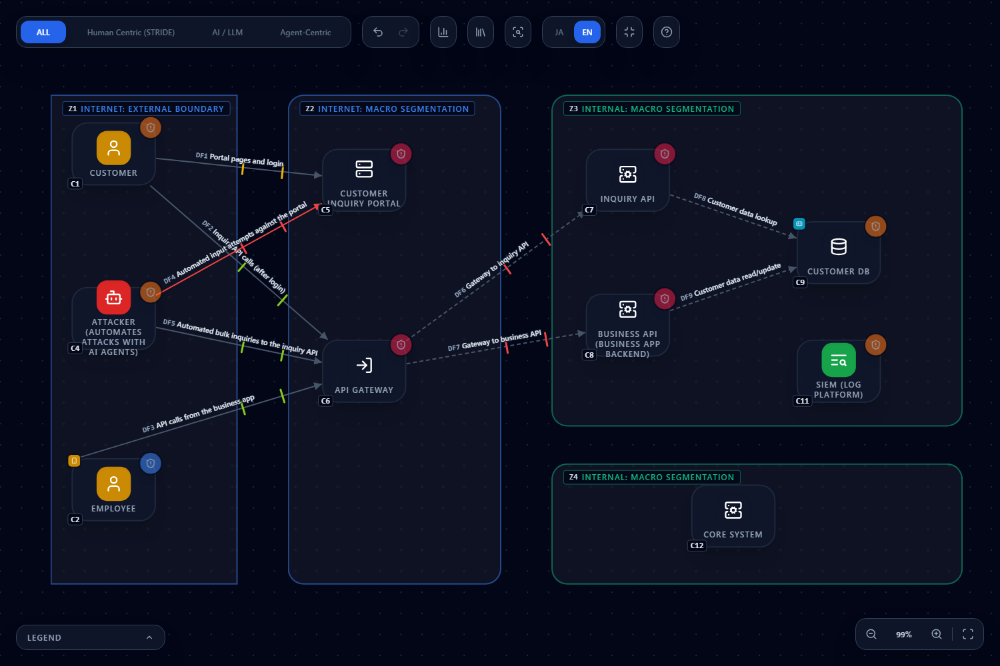
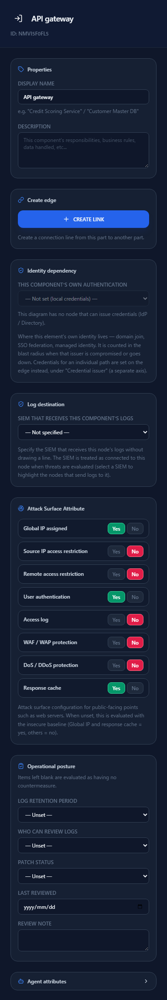
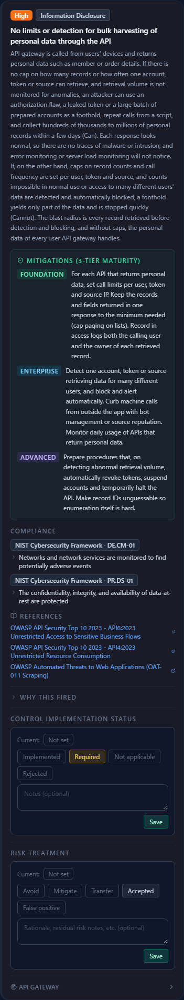
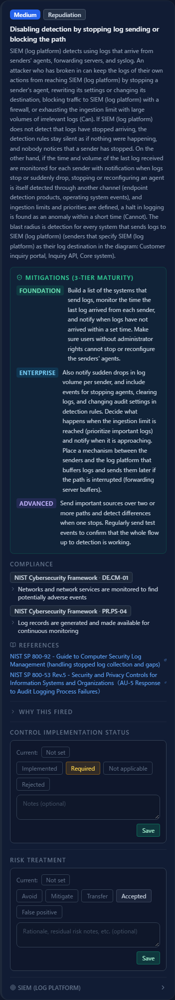
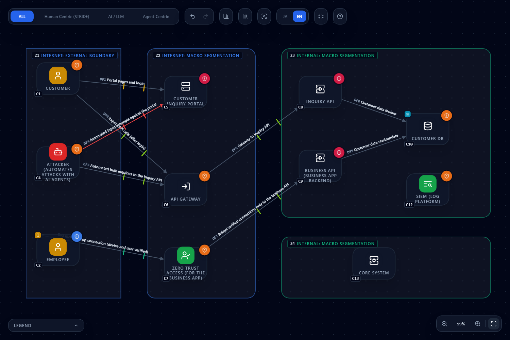

# Preparing public web apps and APIs for automated attacks by AI agents (October 2026)

**English** | [日本語](ai-agent-attack-2026-10.ja.md)

> This page explains how to check, with CyberRiskScape's diagram and an imaginary set of public web apps and APIs as the example,
> the trend toward "attacks automated with AI agents" and the recommended measures described in the following three reports.
>
> - A Zscaler ThreatLabz blog post (14 October 2026; [source 1](#references))
> - CrowdStrike's press release on the "2026 Global Threat Report" (24 February 2026; [source 2](#references))
> - CrowdStrike's "2026 Threat Hunting Report" (covering 1 July 2025 to 30 June 2026; [source 3](#references))
>
> It is not produced, certified, or endorsed by Zscaler or CrowdStrike. The reports' contents are summarized here, not reproduced.
> The names and inner workings of the tools used in the attack, the attack procedure, and the names of the affected organizations are not given here.
> Indicators of compromise (IoCs: IP addresses and domains) are not reproduced either; see the originals. Always read the originals for the exact measures and the latest information.
> Counts are measured values as of writing (October 2026).

---

## 1. What you will learn, and prerequisites

- Follow the attack flow in the reports (**reaching the public apps → exploiting input and authentication weaknesses → bulk data retrieval → exfiltration**) as **where on the diagram, and which rules, fire**
- When AI agents change the **speed, parallelism, and persistence** of attacks, how **measures that only make attacks tedious** differ from **measures that make them impossible**
- Sort the reports' recommended measures into **what a diagram can check and what must be checked on the live system**
- How the counts change on the after-remediation diagram, **what disappears and what remains**, and how to record what remains in the "control implementation status" and the "risk treatment"
- The questions the diagram raises when you **use an AI pentesting tool yourself**

**Summary of the reports**

- **Zscaler ThreatLabz (source 1):** reports a case in which a threat actor abused an agentic-AI penetration-testing framework.
  The targets were **public, peripheral web apps and APIs outside the core systems** (a customer-facing inquiry portal and the backend of an employee mobile app).
  The techniques are classified as **SQL injection** and **authentication bypass**, and the **personal data of about 67,000 people** (name, phone number, annual income, and credit limit) was affected.
  The recommended measures are: reducing external exposure and zero trust access, server-side authorization, limiting responses to the fields that are needed,
  monitoring and rate-limiting consecutive queries and large numbers of lookups per session, deception, authorization testing on every change, DLP, and isolating pentesting tools from production without putting production credentials on them
- **CrowdStrike 2026 Global Threat Report (source 2):** activity by adversaries using AI rose **89% year over year**. The eCrime **breakout time** (from initial access to the start of lateral movement) averaged **29 minutes, with the fastest at 27 seconds**.
  At **more than 90 organizations**, malicious prompts were injected into GenAI tools
- **CrowdStrike 2026 Threat Hunting Report (source 3):** about **24 hours** passed from the publication of a working PoC (proof-of-concept code) to its exploitation.
  Detection leads originating from AI agents grew at **2.5 times the rate** of those originating from humans

What the three have in common is that **attack attempts are becoming faster, more numerous, and tireless**. Defenses that assume human effort (limits on attempts, complicated procedures) still buy time, but their power to stop attacks weakens.

**What CyberRiskScape covers**

CyberRiskScape is a tool that **finds threats from the design (the diagram)**. On the diagram it checks **design-level weaknesses** such as "an authorization question applies to this API",
"this public entry point lacks a setting", or "this screen does not need to be public", and produces material for deciding where to start remediating and inspecting.
**Whether you have been compromised, whether any access matches the IoCs, and whether the real web apps and APIs have vulnerabilities cannot be known from a diagram.**
Check those on the live system, in logs, and with tests (sections 5 and 8).

**Prerequisites for this page:** the operations in [Getting started](getting-started.md), plus [Reading the threat panel](reading-threats.md) and
[Creating and using templates](templates.md). How to read the five rules that fire on API backends is covered in detail in
[section 4 of the NICT A2B attack guide](a2b-attack-2026-10.md#4-check-the-four-targeted-vulnerabilities-one-by-one), so read it alongside this page.

---

## 2. The example architecture: load the template and review it

We draw an **imaginary membership service** (think of a financial service where customers can look up their loans).

- Customers open the inquiry portal in a browser, log in, and from the screen call the **inquiry API through the API gateway**
- Employees call the **business API through the same API gateway** from the business app on their smartphones (the business API is also exposed to the internet)
- The inquiry API and the business API query and update the customer DB (personal data)
- **The core system is in a separate segment** and is not directly connected to the peripheral web apps and APIs (to show that what was targeted was outside the core systems)
- The attacker automates attacks with AI agents and sends requests directly to the portal and the gateway

The following templates can be loaded as they are (loading works as in [the templates chapter](templates.md#3-importing)).
**Load "before" first.** Start from an empty project with **New project** in the left sidebar (**Create without saving**) before loading; the nodes and flows are then numbered from C1 and DF1, as in the tables below (if another diagram remains, numbering continues from it).

| File | Contents |
|---|---|
| [`templates/ai-agent-attack-before.en.json`](templates/ai-agent-attack-before.en.json) ([Japanese](templates/ai-agent-attack-before.ja.json)) | Before: the business API is exposed to the internet, and the public entry points' defenses and operational posture are blank or set to problematic values |
| [`templates/ai-agent-attack-after.en.json`](templates/ai-agent-attack-after.en.json) ([Japanese](templates/ai-agent-attack-after.ja.json)) | After: the diagram once the reports' recommended measures that a diagram can express have been taken (section 6) |

**Contents of the diagram:** 12 components, 9 data flows, 4 trust boundaries (loading it detects **76 threats**: Critical 8, High 47, Medium 21).
The node numbers (C1 onward) and flow numbers (DF1 onward) match the tables below.

| Where | What is drawn (type) |
|---|---|
| Internet side (external boundary) | C1 Customer (`User`, trust category Guest), C2 Employee (`User`, containing C3 Employee's smartphone (`Smartphone`, with the business app)), C4 Attacker (`Agentic Attacker`) |
| Public segment (Public Area) | C5 Customer inquiry portal (`Front-end Server`), C6 API gateway (`API gateway`). Both take Attack Surface Attribute input |
| Internal segment (Security Zone) | C7 Inquiry API (`Backend API`), C8 Business API (`Backend API`, the business app's backend), C9 Customer DB (`Database`, containing C10 Customer personal data (`Personal data`)), C11 SIEM (`SIEM / log platform`) |
| Core segment (Security Zone) | C12 Core system (`Backend API`, no lines drawn) |

| Flow | Authentication, encryption, network |
|---|---|
| DF1 Customer → portal (pages and login) | ID/password, TLS, public network |
| DF2 Customer → gateway (inquiry API calls), DF3 Smartphone → gateway (business app calls) | Token, TLS, public network |
| DF4 Attacker → portal (automated input attempts) | No authentication, TLS, public network |
| DF5 Attacker → gateway (automated bulk inquiries to the inquiry API) | Token, TLS, public network (assumes APIs behind login are targeted too) |
| DF6 Gateway → inquiry API, DF7 Gateway → business API | No authentication, plaintext, closed network |
| DF8 Inquiry API → customer DB, DF9 Business API → customer DB | ID/password, plaintext, closed network |

> **Drawing notes.** The attacker is an **external actor**, not part of the victim organization, so it sits in the **internet-side boundary**, not in a DMZ.
> The SIEM is not connected with lines; instead each node names it in its **"Log destination"** (node panel). In "before", only the portal, the inquiry API, and the core system send logs to the SIEM;
> **the gateway, the business API, and the customer DB do not**.
> In "before", the operational posture mixes **blank fields, old review dates, and problematic values** (the portal's WAF and access log are "No"; most of the gateway's attack surface and all of its posture are blank;
> the business API's posture is blank; the customer DB's encryption is "None" and its logs are "Not collected"; the portal and inquiry API have "Missing" patches; and the personal data's necessity of holding is "Under review").
> **Blank fields are evaluated "the same as a bad value"** (the card carries an "Assumed" mark; [Reading the threat panel, section 4](reading-threats.md#4-reduce-the-assumed-findings)).

---

## 3. Follow the attack flow on the diagram

For each stage, we list **where on the diagram, and which rules, fire**. Rule IDs appear in the threat card's "Why this fired" and in the CSV. Counts are measured on the "before" diagram.

**(1) Reach the public apps**

- **Where:** C4 Attacker, DF4 and DF5, and the exposure of C5 portal and C6 gateway (Attack Surface Attribute)
- **Threats that fire:**
  - AI-accelerated attackers defeating friction-only defenses `zt-agentic-attacker-ai-accelerated-001` (C4, High). It states the premise that the cost of each attempt drops to almost zero, so **defenses that deter through effort only buy time**
  - The unauthenticated public-network line `stride-edge-unauth-internet-001` (DF4, Critical) and unauthenticated internet ingress into the front-end `stride-web-unauth-internet-ingress-001` (DF4, High)
  - Missing defenses at the public entry points: unrestricted source IP access `stride-web-no-source-ip-restriction-001` (High), exposed remote management interface `stride-web-remote-mgmt-exposed-001` (Critical),
    direct global IP exposure `stride-web-global-ip-exposure-001`, and missing DoS/DDoS protection `stride-web-no-ddos-protection-001` (each fires on both C5 and C6)
- **How to think about it:** AI agents try **every entry point they can reach, all at once, without rest**. The first question is "does this entry point need to be reachable from the internet?"
  The customer portal has to be public, but **the API used by the employees' business app does not need to be reachable by anyone on the internet**. An entry point that cannot be reached cannot be attacked, however many times it is tried

**(2) Exploit input and authentication weaknesses**

- **Where:** C5 portal, C6 gateway, C7 inquiry API and C8 business API (the firing condition is "receives input from a caller", that is, it has an inbound line), DF1 to DF3 and DF5
- **Threats that fire:**
  - Missing application-layer attack protection (no WAF) `stride-web-no-waf-001` (C5, C6; High)
  - SQL / NoSQL injection through API parameters `api-backend-query-injection-001` (C7, C8; High). This corresponds to the first technique in the report
  - Token and session validation flaws in the API `api-token-session-validation-gap-001` (C6, High) and broken function level authorization (BFLA) `api-backend-function-level-authorization-001` (C7, C8; High). These correspond to the second technique (authentication bypass)
  - Theft and replay of bearer tokens without sender constraint `zt-bearer-token-replay-001` (DF2, DF3, DF5; High) and password- or API-key-only authentication over a public network `stride-edge-password-internet-001` (DF1, High)
  - Web shell planted by exploiting a public-facing application `webserver-webshell-implant-001` (C5, Critical) and missing patches `posture-patch-missing-001` (Critical on C5 and C6, High on C7, C8, and C11).
    **The gateway's and the business API's patch status is blank, yet it fires at the same severity as "Missing"**
  - C7 and C8 also get SSRF `api-backend-ssrf-001` and remote code execution `api-backend-remote-code-execution-001` (Critical) (how to read them: [A2B guide, section 4](a2b-attack-2026-10.md#4-check-the-four-targeted-vulnerabilities-one-by-one))
- **How to think about it:** A WAF reduces known patterns, but against an attacker who keeps changing the pattern and trying again, it **extends the time until a pattern that slips through is found**.
  On the other hand, if every query is built with placeholders (parameterized), values are **treated only as data** and never become query syntax, however many times they are tried.
  Tokens are the same: if the server verifies signature, expiry, and scope on every request, a tampered token does not get through.
  At a speed of about 24 hours from PoC publication to exploitation (source 3), **entering and keeping the patch status up to date** is itself a prerequisite for the measures

**(3) Retrieve data in bulk**

- **Where:** C6 gateway (the entry point for APIs called from user devices), C7 and C8, C9 customer DB and C10 personal data
- **Threats that fire:**
  - No limits or detection for bulk harvesting of personal data through the API `api-bulk-data-harvesting-001` (C6, High). It fires on "an API with a path on which it is called from users or devices"
  - Broken object and property level authorization (BOLA / BOPLA) `api-backend-object-level-authorization-001` (C7, C8; High). The question is whether rewriting an ID lets someone see another person's record, and whether responses return unneeded fields
  - Authorization boundary gap at the gateway `stride-gateway-elevation-of-privilege-001` (C6, High)
  - Information disclosure from the customer DB `stride-data-store-info-disclosure-001` (C9, High)
  - Unneeded or unreviewed data is kept `posture-data-minimization-001` (C10, Medium). It fires because the personal data's "necessity of holding" is "Under review"

  

- **How to think about it:** As the bulk-retrieval card says, **each individual response looks normal**, so error or load monitoring will not notice it.
  Rate limiting is necessary, but when the requests are spread over many accounts, tokens, and sources and kept up without rest, it only **slows down how fast the data is taken**.
  What sets the upper bound on how much can be taken is **authorization checked on the server** (other people's records are not returned), **the fields returned in responses** (unused fields are not returned), and **the data you hold** (what you do not hold cannot be stolen)

**(4) Exfiltrate — and can you notice?**

- **Where:** the access logs of C5 and C6, the logs of C7 to C9, C11 SIEM and the "Log destination", and the internal flows DF6 to DF9
- **Threats that fire:**
  - Missing access log `stride-web-no-access-log-001` (C5, C6; Medium) and blind perimeter: public and unlogged `stride-web-blind-perimeter-001` (C5, C6; High)
  - Logs are not collected `posture-log-not-collected-001` (Medium on C8, High on C9), and log retention too short `posture-log-retention-short-001` (C7, C8; High) and `posture-log-retention-short-003` (C11, High)
  - Disabling detection by stopping log sending or blocking the path `netinfra-siem-collection-blinding-001` (C11, Medium). The end of the card lists **the sources that name this SIEM as their log destination** (in "before": the portal, the inquiry API, and the core system).
    **The fact that the gateway, the business API, and the customer DB are not listed** is exactly "where the SIEM cannot see"
  - Data is not encrypted at rest `posture-encryption-at-rest-missing-001` (C9, High) and irregular account review `posture-account-review-missing-001` (C9, C11; Medium)
  - Eavesdropping (internal traffic) `stride-edge-plain-encryption-001` (DF6 to DF9, High)

  

- **How to think about it:** With breakout averaging 29 minutes and the fastest at 27 seconds (source 2), an operation in which people go and read the logs is too slow.
  The prerequisites are that **logs reach the SIEM** and that **there is enough history to look back on**; on top of that, consecutive queries and large numbers of lookups per session are detected and blocked automatically.
  The diagram can confirm the prerequisites (collection, retention, destination); whether the detection rules and thresholds work is checked on the live system (section 5)

---

## 4. What AI agents change: "tedious" versus "impossible"

When AI agents make attacks **faster** (about 24 hours from PoC to exploitation, breakout as fast as 27 seconds) and **more numerous** (activity by adversaries using AI up 89% year over year),
measures that assume human effort become a way to **buy time** rather than a way to stop attacks. The mitigation on the C4 attacker card (`zt-agentic-attacker-ai-accelerated-001`) likewise says
to plan to replace measures that "only make things tedious" with structural ones.

| What the attacker does | Measures that only make it tedious (buying time) | Measures that make it impossible (more attempts do not break through) | How to check on the diagram |
|---|---|---|---|
| Looks for public entry points and tries them | Non-standard ports, hard-to-guess URLs, app obfuscation | **Stop exposing it** (put it behind zero trust access, which relays only connections from verified devices and users). There is no path to reach it at all | Put a `ZTNA / identity-aware proxy` in front of the business API and remove the lines from the attacker and the device to the gateway (section 6) |
| Keeps trying SQL injection in different forms | Relying on WAF signatures alone | **Parameterized queries** and server-side checks of type and shape. Values are never interpreted as syntax | The question in `api-backend-query-injection-001`. **Check the implementation with SAST, DAST, and tests**, and record the result in the control implementation status |
| Bypasses authentication, keeps using stolen tokens | Password complexity, login attempt limits, CAPTCHA | **Phishing-resistant authentication** (device-bound certificates, passkeys), server-side token validation, **sender constraint** (tokens bound with DPoP or mTLS) | The line's authentication method (`Certificate` / `Passkey`). Token validation is the question in `api-token-session-validation-gap-001` |
| Changes IDs in sequence to get other people's data | Hard-to-guess IDs (not sequential) | **Server-side authorization** that checks the ownership between caller and record every time | The question in `api-backend-object-level-authorization-001` (check the implementation with API tests) |
| Spreads over many accounts and sources to take data in bulk | Rate limiting alone | **Limit response fields to the minimum** and **do not hold the data** (review the necessity of holding). Use rate limiting and monitoring alongside, as measures that set **the upper bound on what is taken and the time until you notice** | The personal data's "necessity of holding" and `api-bulk-data-harvesting-001` on the gateway |

**This does not mean rate limiting, monitoring, or WAFs are unnecessary.** They are important measures that determine the size of the damage and the time until you notice.
But against the speed and parallelism of AI agents, **relying on them alone means "it gets through eventually"**, so the order of thinking is: first build what **"does not get through"** in the design of reachability,
authentication, authorization, and held data, and then layer monitoring and rate limiting on top.

---

## 5. The reports' recommended measures, and how to check them on the diagram

We sort the recommended measures in the report (source 1) by whether CyberRiskScape can check them. Items marked "on the live system" cannot be known from a diagram.

| Recommended measure in the report | What the diagram can check | What to check on the live system |
|---|---|---|
| Reducing external exposure and zero trust access | Draw the nodes you expose and remove unneeded public lines. Putting a `ZTNA / identity-aware proxy` in front of the business API removes the gateway's embedded-secret item and the token replay on the business app's line (section 6). The public entry points' "source IP restriction" and "remote access restriction" are also entered as attributes | Inventory of the hosts and APIs that are actually public (DNS, certificates, cloud consoles). Public assets you have not drawn are not evaluated ([Reducing internet exposure](exposure-reduction.md)) |
| Server-side authorization | `api-backend-object-level-authorization-001`, `api-backend-function-level-authorization-001`, and `api-token-session-validation-gap-001` show which APIs the question applies to | The authorization implementation (API tests that call with another person's ID or a weaker token). Record the result in the control implementation status. Steps to check over HTTP: [the Postman guide](postman.md) |
| Limiting responses to the fields that are needed | Included in the mitigations of the BOLA card and the bulk-retrieval card. The fields you hold are recorded in the personal data's "necessity of holding" and "record volume" | Whether real responses contain unneeded fields (checking API responses, comparing with the specification) |
| Monitoring and rate-limiting consecutive queries and large numbers of lookups per session | `api-bulk-data-harvesting-001` raises the question. The prerequisites (access log, log retention, log destination (SIEM)) are entered as attributes | Whether the rate-limit and detection thresholds are appropriate and automatic blocking works (live configuration and tests) |
| Deception (decoy assets) | **Cannot be expressed** (no matching type or rule) | Deploying decoys, and detection and notification when they are touched |
| Authorization testing on every change | The authorization cards' mitigations say "run tests that specify another person's ID in CI every time". To watch diagram changes in PRs, see [Integrating with AI-driven development CI](ci-integration.md) | The tests themselves (API tests in CI) |
| DLP | **Cannot be expressed** (no matching type or rule) | Configuration for detecting and blocking exfiltration |
| Isolating pentesting tools from production without putting production credentials on them | Drawing the tool adds questions about how it is used (section 7). Drawing the test environment in a separate trust boundary with no line to the production DB records the isolation design on the diagram | That the tool's runtime environment holds no production credentials (checking configuration and secret management) |

The techniques in the report (SQL injection, authentication bypass) raise questions through `api-backend-query-injection-001`, `api-token-session-validation-gap-001`, and
`api-backend-function-level-authorization-001`, as in section 3 (2). **A question being raised is not the same as a vulnerability existing.** Inspect the implementation and record the result.

---

## 6. After remediation: how the counts change

Loading the **"after" template** ([`ai-agent-attack-after.en.json`](templates/ai-agent-attack-after.en.json)) gives the diagram once the reports' recommended measures that a diagram can express have been taken.
What changed from "before" is below. **The operational posture in "after" is an example entry that assumes "everything has been confirmed"** (in your own diagram, enter only the values you have actually confirmed).

| Target | Before to after |
|---|---|
| The business app's path (DF3) | Smartphone → gateway (token, public network) is removed and replaced by smartphone → **zero trust access (`ZTNA / identity-aware proxy`, the new C7)** (certificate, TLS, public network) → business API (token, TLS, closed network) (the zero trust access also collects logs, with the SIEM as its destination). **The line from the gateway to the business API (DF7) is removed** (the business API is no longer exposed to the internet) |
| Customer inquiry portal (C5), API gateway (C6) | Source IP restriction (restricting access from abroad), remote access restriction, access log, WAF, DDoS protection: No or blank to Yes. Log retention: one year or more. Patch: up to date. The gateway's log destination: SIEM |
| Inquiry API, business API | Logs collected, retention of one year or more, patch up to date. Log destination: SIEM |
| Customer DB | Logs: Not collected to Collected, one year or more. Encryption at rest: None to Yes (customer-managed key). Account review: Irregular to Periodic. Log destination: SIEM |
| Customer personal data | Necessity of holding: Under review to Required (after deleting items no longer used) |
| SIEM | Retention: under 90 days to one year or more. Patch up to date, account review periodic |
| DF1 Customer → portal | ID/password to MFA |
| DF6 Gateway → inquiry API, DF8 and DF9 APIs → customer DB | No authentication, plaintext to token, TLS (DF6); plaintext to TLS (DF8, DF9) |
| Every node | Last reviewed: 2026-10-14 |

In "after", the zero trust access becomes C7, so the numbers of the nodes after it shift by one (C8 is the inquiry API, C9 the business API, C10 the customer DB, and so on).
For flows, DF3 becomes smartphone → zero trust access, and DF7 becomes zero trust access → business API.

**Threat count: 76 to 46** (Critical 8 to 4, High 47 to 25, Medium 21 to 17; measured; `diff` shows "3 added, 33 resolved").

| | Before | After |
|---|---|---|
| Total detected | 76 | 46 |
| Critical / High / Medium | 8 / 47 / 21 | 4 / 25 / 17 |
| Count of the five API backend rules (`api-backend-*`) | 10 (2 nodes x 5) | 10 (2 nodes x 5) |

**What disappeared (33)**

- **Disappeared by entering the public entry points' attributes (12):** on each of C5 and C6, unrestricted source IPs, remote management exposed (Critical), no access log, no WAF, no DDoS protection, and blind perimeter
- **Disappeared by entering operational posture (14):** 5 missing patches (including the Critical ones on C5 and C6), 2 for log collection and 3 for log retention, 1 for encryption at rest, 2 for account review, and 1 for necessity of holding
- **Disappeared by revising internal flows (4):** eavesdropping on DF6 to DF9
- **Disappeared by moving customer login to MFA (1):** password-only authentication on DF1
- **Disappeared by routing the business app through zero trust access (2):** the gateway's "verifying the caller with a secret embedded in the mobile app" and the token replay on the business app's line

**What was added (3)** — adding a measure raises **questions about that measure itself**.

- Concentration and bypass of access decisions at a ZTNA / identity-aware proxy `netinfra-ztna-proxy-access-concentration-001` (C7, High)
- AiTM phishing session-token theft (MFA bypass) `zt-aitm-session-token-theft-001` (DF1, Medium)
- Client certificate private-key theft, missing revocation checks, and outages from expiry `zt-client-certificate-lifecycle-001` (DF3, Medium)

**What remains (46)**

- **The five API backend rules:** five each on the inquiry API and the business API (10 in all, including 2 Critical remote code execution). They include SQL injection and broken object- and function-level authorization.
  **Attributes do not remove them.** Even after zero trust access narrows the path to the business API, **the inquiry API is exposed to customers, so its questions stay as they are**. These are what you inspect and **record in the control implementation status**
- **Gateway:** missing limits and detection for bulk retrieval, flawed token validation (because the path from customer devices remains), direct global IP exposure, flawed authorization boundary, DoS,
  and three reverse-proxy questions (cache poisoning, forwarded-header spoofing, request smuggling; the response cache is blank, so "Yes" is assumed)
- **The portal and the attacker's line:** web shell implant (Critical), direct global IP exposure, and on DF4 the unauthenticated public-network line (Critical) and unauthenticated ingress. **As long as the login page is public, reachability before authentication does not go away**
- **Customer and lines:** account takeover and client-side information disclosure, local credentials on DF1, token replay on DF2 and DF5
- **Data:** information disclosure, tampering, and audit trail on the customer DB
- **Other:** the SIEM's 3 items (stopping log delivery, tampering, concentration of sensitive logs), the attacker (AI acceleration), smartphone loss, and crypto inventory and future decryption (PQC; [Supporting PQC migration](pqc-migration.md))

**Not everything disappears.** For what remains: (1) items that need inspection of the implementation (the five API backend rules, token validation, bulk-retrieval limits) are **recorded in the control implementation status**
(when you mark one implemented, write what you confirmed and the date in the note; [Reading the threat panel, section 5](reading-threats.md#5-recording-decisions--two-independent-layers)), and
(2) items that are facts of the architecture, such as being public or PQC, get a **risk treatment (reduce, accept, transfer, avoid) and a reason recorded** in Analytics.
**Showing, honestly and as remaining, what attributes cannot remove** is how this template is meant to be used.
Records are not carried in templates, so save them in the project file (**File (Save / Open)** in the left sidebar).

---

## 7. Cautions when you use an AI pentesting tool yourself

In the case in the report (source 1), what was abused was an agentic-AI penetration-testing tool that defenders normally use.
In addition, malicious prompts were injected into GenAI tools at more than 90 organizations (source 2). If you use an AI pentesting tool yourself, check in the design **whether the tool itself could become an entry point or a weapon**.
This section is written in general terms, not about any specific product.

Add to the "after" diagram your own AI pentesting tool as an `AI agent`, an approval gate that reviews tool execution as a `Guardrail`, and the tool that sends scans and requests as an `External tool / API`,
and connect them as `AI agent` → `Guardrail` → `External tool / API` → the target being tested (a public-network line). The following three rules fire (measured; this is not included in the templates).

| Rule | When it fires | Question |
|---|---|---|
| Gaps in the tool execution approval gate `owasp-asi02-tool-approval-gate-gap-001` (High) | A `Guardrail` is connected by a line to an `External tool / API` or an `MCP server` | Does it allow by default calls that match no rule, are some tools left out of review, and can the agent or users disable the deny rules? |
| Agent tools acting outside the authorized scope `owasp-asi02-tool-action-scope-escape-001` (High) | A public-network line leaves an `External tool / API` | Are the targets that may be tested (domains, IP addresses) enforced outside the runtime environment (egress firewall, proxy) rather than by prompt instructions? If the target is mistaken, it becomes an attack on a third party's systems |
| Agents expanding their own capabilities `owasp-asi03-agent-self-capability-expansion-001` (High) | The `AI agent`'s autonomy level is Autonomous and its blast radius is Admin (**blank values are also treated as the worst case, so it fires**) | Can the agent register or change its own tools, MCP servers, skills, or approval rules? Are changes limited to human approval and signed distribution? |

General AI agent threats, such as prompt injection, also fire on the added `AI agent`.

**To record the report's recommendation (isolate pentesting tools from production and put no production credentials on them) on the diagram:** draw the tool in a trust boundary separate from production (a test environment), and draw no lines to the production DB, SIEM, or management interfaces.
**Whether production credentials are actually absent cannot be known from the diagram.** Check it through the runtime configuration and secret management.

Defending the platform itself when you run this class of tool legitimately — treating the loss of concentrated findings, traffic recordings, and keys as the worst case — is covered in detail in
[Running an Agentic Penetration-Testing Tool Yourself](agentic-pentest-operation.md).
Conversely, for where to cut the attack path assuming an attacker **abuses** this class of tool, see
[Deciding Where to Cut the Attack Path When an Attacker Abuses an Agentic Penetration-Testing Tool](agentic-attacker-paths.md).

---

## 8. Limits (what cannot be confirmed)

- **Whether compromise has occurred is unknown.** Anomalies in logs, access that matches IoCs, and whether data was stolen must be investigated on the live system, in logs, and in each service's console
- **Whether the real web apps and APIs have vulnerabilities is unknown.** The five API backend rules show that "this question applies to this API"; they do not detect that a vulnerability exists (they are no substitute for vulnerability assessment, penetration testing, or code review)
- **Detection speed cannot be measured.** You can enter log collection, retention, and destination, but whether the detection rules and thresholds work, and whether they keep up with breakout speeds (source 2), must be checked with exercises and tests on the live system
- **Deception and DLP cannot be expressed.** There is no matching type or rule, so manage these two recommendations in the report outside the diagram
- **Judgments rest on the diagram.** Public apps, APIs, and test environments you have not drawn are not evaluated. The quality of the diagram is the quality of your inventory
- **The firing condition is coarse.** If a backend API has a caller's line, the injection rule also fires on APIs that do not use SQL. If it does not apply, record **Not applicable** (with a note)
- **Operational posture is an input, not an observation**
- What is drawn here is an **imaginary architecture**. The counts will differ in your diagram
- **Incident response, management decisions, and engaging specialist investigators** are outside the tool. The [PDF report](report-export.md) can serve as material for reporting

---

## References

1. Zscaler ThreatLabz blog post (14 October 2026)
   <https://www.zscaler.com/blogs/security-research/threat-actor-abuses-agentic-ai-pentesting-framework-target-south-korean>
2. CrowdStrike, "2026 CrowdStrike Global Threat Report" press release (24 February 2026)
   <https://www.crowdstrike.com/en-us/press-releases/2026-crowdstrike-global-threat-report/>
3. CrowdStrike, "2026 Threat Hunting Report"
   <https://www.crowdstrike.com/en-us/resources/reports/threat-hunting-report/>

For IoCs (IP addresses and domains), see the original of source 1.

## What to read next

- [Checking NICT's October 2026 A2B Attack Alert with a Member-App Diagram](a2b-attack-2026-10.md): read the five API backend rules one by one and record the inspection results
- [Reducing internet exposure](exposure-reduction.md): inventorying public assets and cutting needless exposure
- [Verifying threats with Postman](postman.md): check questions such as authorization and rate limiting over real HTTP
- [Reading the threat panel](reading-threats.md): recording the control implementation status and the risk treatment
