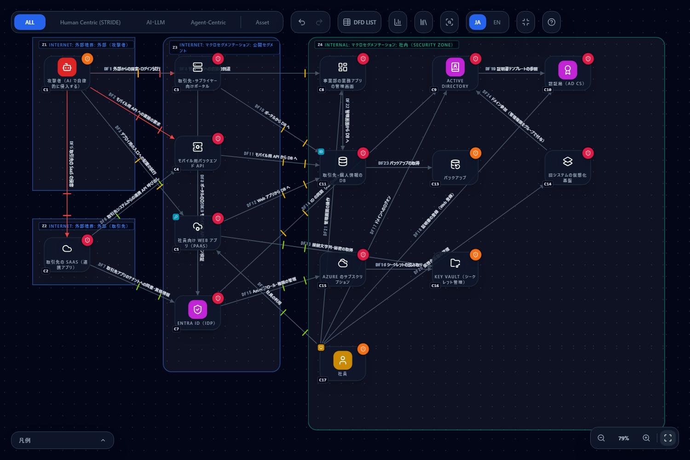
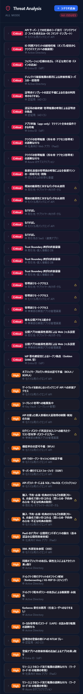
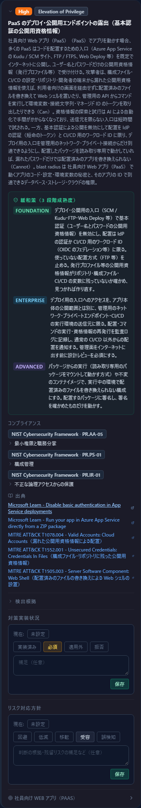
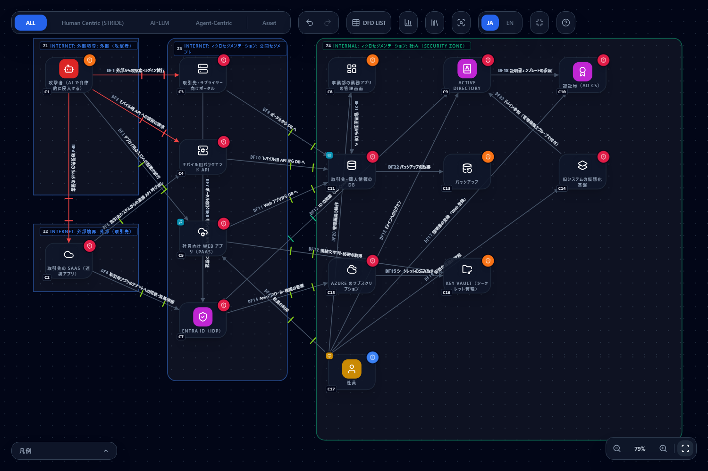
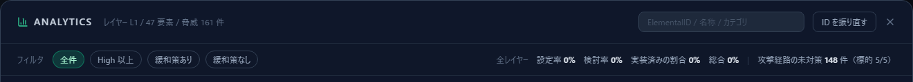
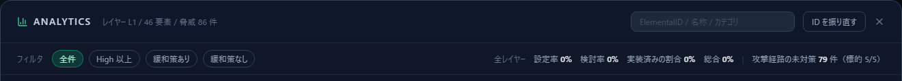

# 米国 FBI の FLASH「AI 自律攻撃」（2026 年 11 月）への備えを、取引先ポータルと周辺系の図で確かめる

[English](ai-autonomous-attack-2026-11.md) | **日本語**

> このページは、米国 FBI の FLASH（FLASH-20261113-001、2026 年 11 月 13 日、TLP:CLEAR。[出典 1](#参考リンク)）が挙げる
> 「LLM で動く自律的な侵入」への推奨策を、CyberRiskScape の構成図・取り込み・書き出しでどう確かめるかを、
> 架空の取引先ポータルと周辺系を例にまとめたものです。
> FBI が作成・認定・推奨するものではありません。FLASH の内容は日本語で要約しており、原文の転載ではありません。
> 対策の正確な内容・最新の情報は、必ず原文を確認してください。件数・出力は執筆時点（2026 年 11 月）の実測値です。
> 例に出てくる組織名・ホスト名・アプリ名はすべて架空です。

---

## 1. このページで分かること・前提

- FLASH の推奨策 16 項目を、**CyberRiskScape のどの画面・コマンドで確かめるか**（§4）
- 取引先ポータル・モバイル用 API・PaaS の Web アプリ・管理画面・Entra ID・AD・認証局・Azure・Key Vault・バックアップを持つ架空の図（テンプレート）と、
  **対策前・対策後**で脅威の件数と「攻撃経路の未対策」がどう変わるか（§2・§5）
- 図の属性では消せないものを、残ったまま示す方法（§5・§6）

**FLASH の要旨**

LLM で動く自律的な侵入の枠組みが悪用され、偵察から権限の奪取、データの持ち出しまでを機械の速さで進める事例が報告されています。
着手から特権の奪取まで 3 時間未満の例があります。狙われるのは、取引先・サプライヤー向けのポータル、モバイル用のバックエンド、
社員向けのアプリ、旧システム、事業部ごとのアプリなど、**手薄になりがちな周辺系**です。クラウドの資格情報、取引先のテナントからの信頼、
取引先のアプリを経由して、上流の組織へ入ります。

**CyberRiskScape が担う範囲**

CyberRiskScape は**設計（構成図）から脅威を洗い出し、他の製品の結果を図に重ねて文脈をつける**ツールです。
診断・ASM・ログ分析の**実行**はしません。「悪用できる」「検知できる」とも言いません。
出すのは、図と取り込んだ記録から読み取れる**事実と推奨**で、判断は人が行います（§7）。

**前提**

- 前提となる知識：[はじめに](getting-started.ja.md)、[脅威パネルの読み方](reading-threats.ja.md)、[テンプレートを作る・使う](templates.ja.md)
- コマンドは `dist-cli/main.js` を使います。`npm run build:cli` で作ります（[AI駆動開発のCIに組み込む](ci-integration.ja.md)）

---

## 2. 題材の取引先ポータルと周辺系 — テンプレートを読み込む

**架空の組織**を想定します。

- 取引先・サプライヤーが使うポータルと、モバイル用のバックエンド API を公開している。社員向けの Web アプリは PaaS で動かしている
- 事業部の業務アプリの管理画面がある。既定では外から届いてしまう
- ID は Entra ID と社内の Active Directory（AD）で、証明書は社内の認証局（AD CS）が発行する。旧システムの仮想化基盤が残る
- Azure のサブスクリプションと Key Vault に、接続文字列などの秘密がある。個人情報の DB とバックアップがある
- 取引先の SaaS が、モバイル用 API を呼び、Entra ID のテナントに連携アプリとして入っている
- 攻撃者（AI で自律的に侵入する）は、標的を個人情報の DB にしている。外部の組織（攻撃者・取引先）は、DMZ ではなく**インターネットの境界**で囲んでいる

| ファイル | 内容 |
|---|---|
| [`templates/ai-autonomous-attack-before.ja.json`](templates/ai-autonomous-attack-before.ja.json)（[英語版](templates/ai-autonomous-attack-before.en.json)） | 対策前。アプリに読み込む（[読み込み方](templates.ja.md#3-読み込むimport)） |
| [`templates/ai-autonomous-attack-after.ja.json`](templates/ai-autonomous-attack-after.ja.json)（[英語版](templates/ai-autonomous-attack-after.en.json)） | 対策後。対策を図の属性として入力した版（§5） |
| `templates/ai-autonomous-attack-{before,after}-project.{ja,en}.json` | 同じ図をプロジェクト JSON にしたもの。CLI にそのまま渡せる |
| [`templates/ai-autonomous-attack-sample-secrets.sarif.json`](templates/ai-autonomous-attack-sample-secrets.sarif.json) | §4 の ⑮ で使う架空の SARIF（秘密の走査の結果の形） |

> **読み込みの手順（番号がずれないように）。** 左サイドバーの**新規作成 → 保存せずに作成**で空の図にしてから、**Template → Import**で読み込み、**適用**を押します。
> 図が残ったまま読み込むと、ノードの連番（C 番号）が続きの番号になり、このページの C 番号と合いません。



**図の中身：** コンポーネント 18・データフロー 25（対策後は 24）・境界 4（外部 2・公開セグメント 1・社内 1）。
読み込むと **161 件**の脅威が検出されます（Critical 25・High 80・Medium 56。画面のヘッダーの ISSUES と CLI の件数は一致）。

| 場所 | 描いたもの（型） |
|---|---|
| 外部（攻撃者・取引先） | C1 攻撃者（`AIエージェント攻撃者`）、C2 取引先の SaaS（`SaaS`） |
| 公開セグメント | C3 取引先ポータル（`フロントエンドサーバー`）、C4 モバイル用バックエンド API（`バックエンドAPI`）、C5 社員向け Web アプリ（`PaaS`。C6 配置用の資格情報を内包）、C7 Entra ID（`IdP`） |
| 社内（Security Zone） | C8 業務アプリの管理画面（`管理画面`）、C9 Active Directory（`ディレクトリ`）、C10 認証局（`認証局（CA）`）、C11 個人情報の DB（C12 個人情報を内包）、C13 バックアップ、C14 旧システムの仮想化基盤、C15 Azure のサブスクリプション（`IaaS`）、C16 Key Vault（`シークレット管理`）、C17 社員（C18 PC を内包） |

**意図的に未入力にしたもの。** 運用状況（ログ・パッチ・暗号化・アカウント棚卸し）、ポータル・モバイル用 API の WAF・DDoS 保護・レート制限・アクセスログは未入力です。
CyberRiskScape は**未入力を悪い値と同じ扱い**で脅威を出します（画面では「仮定検出」の印）。実態を入力すると消えます。

---

## 3. 手薄な周辺系で出る脅威

読み込んだ直後の図で、FLASH の筋書きに当たるもの（件数は図の実測）。



| FLASH の筋書き | 出る脅威 | 重大度 |
|---|---|---|
| 配置用の入口から配置済みのファイルを書き換える | PaaS のデプロイ・公開用エンドポイントの露出（C5） | High |
| 管理画面・公開アプリへの到達 | 管理面リモートアクセス（C3・C4・C8）、Web シェル設置（C3・C8） | Critical |
| 取引先のアプリ・テナントからの信頼を経由して上流へ | 外部アプリへの委任の同意、アプリ単独の特権、登録アプリへの資格情報の追加（C7） | High〜Critical |
| 証明書で任意の利用者になりすます | 証明書テンプレートの設定不備、認証局の秘密鍵・管理権限の奪取（C10） | Critical |
| ディレクトリの権限を奪う | Kerberoasting、複製権限の悪用（DCSync）、LAPS の過剰な読み取り権限、Kerberos 委任の悪用（C9） | High〜Critical |
| 業務 API を大量・高速に使う | 個人情報の大量取得の制限・検知の欠如、BOLA、業務フローの自動化（C3・C4） | High |
| 手口（内部） | XXE・SSRF・任意のコード実行（テンプレートを含む）（C4）、エラー応答による内部情報の露出（C4） | Medium〜Critical |
| 証拠の保全 | ログを取得していない、ログの保持期間が短い（各ノード） | Medium〜High |



> **カードは「問い」です。** 脆弱性があると断定するものではなく、「この構成にこの問いが立つ」ことを示します。
> PaaS の配置口のルールは、PaaS に接続があれば出ます（攻撃面属性を持たない型のため）。対策の実装状況は**カードの「対策実装状況」に記録**してください。

---

## 4. FLASH の推奨策と CyberRiskScape の対応

「図で確かめる」は図・取り込みで見られること、「実機で」は図からは分からないことです。

### 4.1 外部の攻撃面を減らす

| 推奨策 | 図で確かめる | 実機で・しないこと |
|---|---|---|
| ① 周辺系を含む公開アプリの棚卸し | Project Edit の**担当範囲**（ホスト・ドメイン配下・CIDR・API の URL プレフィックス）を入力し、`asm-reconcile` で「担当範囲の中で図に無い観測」（描き漏れの候補）を出す。観測した API も分ける。`export-scope` で ASM・DAST の探索の起点を書き出す。API の台帳は OpenAPI の定義を `import-openapi` で取り込み、`asm-reconcile` で観測した API のうち「定義に無い API」（台帳外・古い版の候補）を出す。取り込み時に認証の指定が無い操作も報告に出る。クラウドの内側は、IaaS・PaaS の検査結果（OCSF）を `import-ocsf` で取り込むと、検査に出たリソースが資産になり（ID はアカウントを含む完全な形）、`asm-reconcile` で「図に無いクラウドのリソース」が出る | ASM・検査の実行。観測・検査の範囲外は出ない |
| ② クラウド管理・ネットワーク機器・配置口・ハイパーバイザ・バックアップを信頼できる経路に限定 | 管理面リモートアクセス（`stride-web-remote-mgmt-exposed-001`。属性「リモートアクセス制限」）、API 管理プレーン（`api-control-plane-internet-exposure-001`。`API管理プレーン` 型を置いたとき）、PaaS の配置口（`api-paas-deployment-endpoint-exposure-001`）、仮想化基盤の管理面の奪取（`netinfra-hypervisor-management-takeover-001`）、バックアップの破壊（`storage-backup-ransomware-destruction-001`） | 実際の到達制御の確認 |
| ③ 基本認証での配置の無効化・配置用の資格情報の制限 | 上の PaaS のルール。配置用の資格情報は `認証情報` を内包させて表す（§4.3 ⑮ の対象になる）。攻撃者から PaaS への線の認証方式（対策後は IdP のトークン） | 発行プロファイルの失効はクラウドの管理画面で |
| ④ 配置済みのファイルを書き換えにくい配置方式（パッケージからの実行） | 同じ PaaS のルールの緩和策（Advanced）。**属性では消えない**ので、カードの対策実装状況に記録 | 実際の配置方式の確認 |
| ⑤ パブリック IP の割り当ての統制・公開前の設計レビュー | 攻撃面属性の「Global IP」。`asm-reconcile` の「非公開と入力したのに外から見える」。図を変更したら `export-test-plan --changed-from` で再診断の対象を絞る | IP の割り当て台帳の管理 |
| ⑥ ゼロトラストのアクセスへの移行 | zero-trust-access のルール群（例：`zt-bearer-token-replay-001`・`zt-agentic-attacker-ai-accelerated-001`、IdP の単一障害点）。線の認証を IdP 経由（`authProviderId`）・MFA に直すと「IdP を経由しない資格情報」が消える | ゼロトラスト製品の設定の確認 |

### 4.2 ID とアクセスを固める

| 推奨策 | 図で確かめる | 実機で・しないこと |
|---|---|---|
| ⑦ マルチテナントのアプリの権限・同意を最小に | `import-entra-apps`（[ガイド](entra-apps.ja.md)）で、強い権限を持つ外部アプリを指摘として IdP に載せる。ルール `identity-idp-app-only-privilege-001`・`identity-idp-external-app-consent-001` | 同意の取り消しは Entra ID で |
| ⑧ 資格情報の追加・特権の付与・アプリ単独の動作を監視 | ルール `identity-idp-app-credential-addition-001`。`import-bloodhound` の Entra ID の問い合わせ（[ガイド](bloodhound.ja.md)）。`export-detection-requirements --format sigma` で、攻撃経路上の監視要件を Sigma ルールの下書き（要件ごと。検知の条件は空欄で `status: unsupported`）として書き出し、SIEM の検知を作る起点にする | 監視そのものは SIEM の領分。検知の条件は環境のログに合わせて書く |
| ⑨ 取引先のアプリが入っている（入っていた）テナントの点検 | `import-entra-apps` の「図に無い」の印（図に描いていない外部アプリ）。図には取引先の SaaS と IdP の線を描く | 過去に入っていたアプリの調査は実機で |
| ⑩ サービスプリンシパルのサインインと監査記録の確認 | **範囲外**（§7） | ログ分析は SIEM で |
| ⑪ 証明書の発行の承認・Web 登録の保護（AD CS） | 型「認証局（CA）」と 3 ルール（`identity-ca-template-impersonation-001`・`identity-ca-enrollment-ntlm-relay-001`・`identity-ca-private-key-forgery-001`）。`import-bloodhound` の AD CS の問い合わせ | テンプレートの設定は CA で確認 |

### 4.3 アプリの保護

| 推奨策 | 図で確かめる | 実機で・しないこと |
|---|---|---|
| ⑫ 影響の大きい業務 API のガードレール（速度・件数・金額の上限） | 攻撃面属性の「レート制限」（ログイン・パスワード再設定への総当たり `api-login-credential-guessing-001`）、`api-bulk-data-harvesting-001`、機微な業務フロー（運用状況で「持つ」と宣言したときだけ出る `api-sensitive-business-flow-abuse-001`）、費用の上限 | 閾値の妥当性は実機で |
| ⑬ 連番の参照・大量取得の検知、サーバー側の認可、応答の項目の限定 | BOLA（`api-backend-object-level-authorization-001`）・大量取得のルール。**認可の実装は図の属性では表せない**ので、API テストの結果をカードの対策実装状況に記録 | 認可の実装の検証 |
| ⑭ スタックトレース・SQL エラー等を返さない | エラー応答の露出（`api-error-response-disclosure-001`）。外部の呼び出し元（取引先の SaaS・端末）からの線があるノードに出る | 本番のエラー応答の確認 |
| ⑮ 構成・環境変数・IaC・CI/CD・DB に埋め込まれた秘密の継続的な走査 | SARIF を出力する秘密の走査ツールの結果を、`import-sarif --category secrets` で取り込む。すべての結果を「認証材料の静的保管・スプロール」（`認証情報` ノード）に結ぶ。報告は規則ごとの件数だけで、秘密の値・場所は、`--show-secrets` を付けたときだけ報告に出る（プロジェクト JSON・書き出し・画面には入れない）。次のとおり | 走査の実行。値は保存しない |

```bash
node dist-cli/main.js import-sarif guide/templates/ai-autonomous-attack-before-project.ja.json \
  --sarif guide/templates/ai-autonomous-attack-sample-secrets.sarif.json \
  --scope secrets-2026-11 --category secrets --node C6 -o step1.json
```

```text
- scope: secrets-2026-11 / run 1 件 / 保存 3 件
- ノード: C6 配置用の資格情報（発行プロファイル）
## 件数の内訳（規則ごと。ファイル 3 件）
| generic-api-key | 2 |
| azure-publish-profile | 1 |
SARIF の結果を取り込みました（run 1 / 保存した指摘 3 / 上限で除外 0）        （終了コード 0）
```

`analyze --fail-on-findings Medium` で、しきい値以上の指摘が残る間は公開を止められます。

### 4.4 証拠の保全と対応

| 推奨策 | 図で確かめる | 実機で・しないこと |
|---|---|---|
| ⑯ ログ・監査記録の保全 | 運用状況の「ログの取得」「保持期間」（未入力は「対策なし」）。`log-not-collected`・保持期間のルール。侵害の疑いがあるときは `export-investigation-plan` で、ノードごとに「どこを・何を調べるか」と「調べられない恐れ」を出す | ログ自体の保全は実機で |

**手口（内部）について。** Kerberoasting（`identity-directory-kerberos-offline-cracking-001`）・DCSync（`identity-directory-replication-credential-dump-001`）・
LAPS の読み取り（`identity-directory-local-admin-password-overread-001`）・委任の悪用（`identity-directory-kerberos-delegation-abuse-001`）はディレクトリ（C9）に、
XXE（`api-backend-xml-external-entity-001`）・SSRF・テンプレートを含むコード実行（`api-backend-remote-code-execution-001`）・Web シェルは公開アプリ（C3・C4）に出ます。
BloodHound CE の問い合わせで、AD・Entra ID・Azure の**実データから裏づけ**ができます。

```bash
node dist-cli/main.js import-bloodhound step1.json --in ./bloodhound-responses --scope ad -o step2.json
node dist-cli/main.js import-entra-apps step2.json --in ./graph-responses --tenant-id <自組織のテナント ID> -o step3.json
```

---

## 5. 対策後 — 件数と「攻撃経路の未対策」がどう変わるか

**対策後のテンプレート**は、次を図の属性として入力した版です。**「すべて確かめた」と仮定した入力例**なので、自分の図では実際に確かめた値だけを入力してください。

| 対象 | 対策前 → 対策後 |
|---|---|
| 管理画面（C8） | Global IP 有り → 無し。送信元 IP 制限・リモートアクセス制限・認証・アクセスログ・WAF・レート制限：有り。攻撃者からの直接の線を削除。社員の PC からは MFA |
| ポータル（C3）・モバイル用 API（C4） | リモートアクセス制限・アクセスログ・WAF・DDoS 保護・レート制限：有り。機微な業務フロー：持つ・対策あり。パッチ・ログの保持：入力 |
| PaaS への配置の線 | ID/パスワード → IdP のトークン |
| DB・IdP・AD・認証局・Azure・Key Vault・バックアップ・仮想化基盤・PaaS | ログ取得・保持期間 1 年以上・パッチ最新・保管時の暗号化・アカウント棚卸し：入力。最終点検日 |
| 内部の線 | ID/パスワード → トークン・MFA・証明書。認証の発行元（IdP・AD）を入力 |



**脅威の件数：161 件 → 86 件**（Critical 25 → 18・High 80 → 42・Medium 56 → 26。画面のヘッダーと CLI の件数は一致。`diff` では「追加 1 件・解消 76 件」。追加の 1 件は、配置の線をトークンにしたことで出る「ベアラートークンの窃取・再利用」）。

```bash
node dist-cli/main.js analyze guide/templates/ai-autonomous-attack-after-project.ja.json --format json
node dist-cli/main.js diff guide/templates/ai-autonomous-attack-before-project.ja.json guide/templates/ai-autonomous-attack-after-project.ja.json
node dist-cli/main.js indicators guide/templates/ai-autonomous-attack-after-project.ja.json
```

**全体の物差し：攻撃経路の未対策。** Analytics の右上と PDF の指標です（[PDF・書き出し](report-export.ja.md)）。
図に AI エージェント攻撃者のノードがあると計算されます。攻撃者から重要資産へ届く経路の上にある、**対策が実装済みでない脅威の数**です。

| | 対策前 | 対策後 |
|---|---|---|
| 脅威の件数 | 161 | 86 |
| 攻撃経路の未対策（件数） | 148 | 79 |
| 重みつきの値（Critical 8・High 4・Medium 2・Low 1） | 594 | 344 |
| 届く標的 | 5/5 | 5/5 |





- 5 つの標的はどちらも届いたままです。**入口を減らしても、経路が残る限り標的には届く**と読みます
- 経路の列挙が上限に達したため、数字は「少なくともこれだけ」です（どちらも打ち切りあり）
- 実装状況を**カードに「実装済み」と記録する**と、この数字はさらに下がります（属性で消せない 86 件が対象）

**残ったもの（86 件）。** 配置口の問い・認証局・ディレクトリ・Entra ID の権限（アプリ単独の特権・外部アプリの同意・資格情報の追加）・Azure の管理権限・
バックアップの破壊・仮想化基盤・BOLA・XXE・SSRF・コード実行・Web シェル・攻撃者の加速などです。
属性では消えません。①実装の点検が必要なものは**対策実装状況に記録**し、②構成上の事実は Analytics の**リスク対応方針**に理由を記録します。

---

## 6. 運用

1. **取り込みは同じ scope で取り直す。** Entra ID・BloodHound・秘密の走査の結果は、取り直すと置き換わります
2. **観測と図を定期的に突き合わせる。** `asm-reconcile --previous 前回.json`
3. **変更のたびに再診断の範囲を絞る。** `export-test-plan --changed-from`
4. **残ったものは記録する。** 実装済み・適用外・拒否は補足つきで

---

## 7. 限界

- **ログ分析は範囲外です（⑩）。** サービスプリンシパルのサインイン・監査記録の確認は、SIEM などで行います。CyberRiskScape は、ログを取れているか・何日残るかの**設計側の問い**を出します
- **侵害の有無・実機の脆弱性は分かりません。** 脅威は「この構成に立つ問い」で、診断・ペネトレーションテストの代わりではありません
- **判定は図に基づきます。** 描いていない周辺系は評価されません。棚卸し（①）の質が図の質を決めます
- **運用状況の入力は宣言であって、観測ではありません。** 対策後のテンプレートは仮定の入力例です
- **到達は推論です。** 実際に通信できるかを測ったものではありません
- 例は**架空の構成**です。件数はあなたの図では変わります
- FLASH の推奨策と CyberRiskScape の機能の対応は、**CyberRiskScape 側の解釈**です。FBI が定めたものではありません

---

## 参考リンク

1. 米国 FBI の FLASH（FLASH-20261113-001、2026 年 11 月 13 日、TLP:CLEAR）。原文は FBI の公表資料で確認してください

## 次に読むもの

- [国家サイバー統括室の注意喚起（2026 年 11 月）の対策を、会員サイトとアプリの図で確かめる](nco-advisory-2026-11.ja.md)
- [Microsoft Graph の外部アプリ・同意の在庫を取り込む](entra-apps.ja.md)
- [BloodHound CE の結果を構成図に載せる](bloodhound.ja.md)
- [AI エージェント攻撃者の攻撃経路](agentic-attacker-paths.ja.md)
- [PDF・書き出し](report-export.ja.md)
