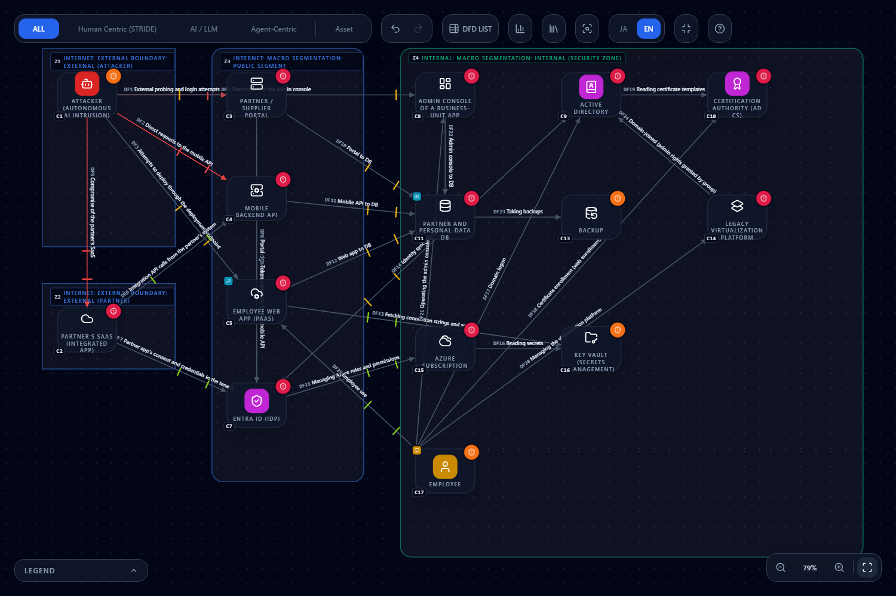
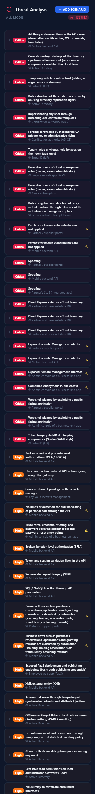
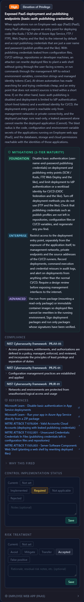
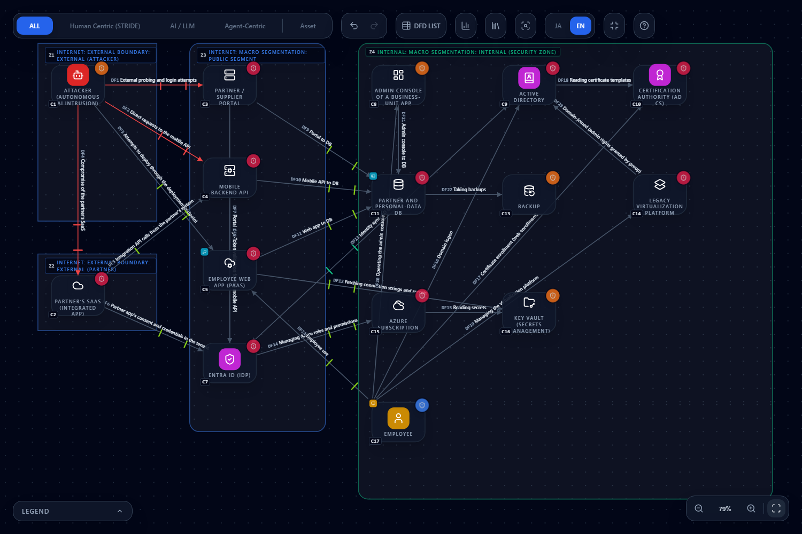
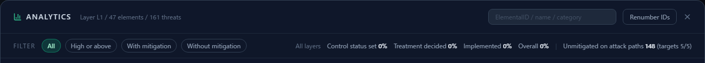
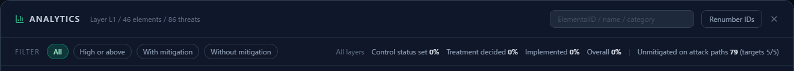

# Preparing for AI Autonomous Attacks (FBI FLASH, November 2026) — Checking It on a Partner-Portal Diagram

**English** | [日本語](ai-autonomous-attack-2026-11.ja.md)

> This page explains how to check the recommendations of a U.S. FBI FLASH (FLASH-20261113-001, November 13, 2026, TLP:CLEAR; [source 1](#references))
> on "autonomous intrusion driven by LLMs" using CyberRiskScape diagrams, imports and exports, with a fictional partner portal and its peripheral systems as the example.
> It is not produced, certified or endorsed by the FBI. The FLASH content is summarized here and is not a reproduction of the original.
> Always read the original for the exact measures and the latest information. Counts and outputs are measured values at the time of writing (November 2026).
> All organization, host and app names in the examples are fictional.

---

## 1. What this page covers, and prerequisites

- How to check the FLASH's 16 recommendations with **CyberRiskScape screens and commands** (§4)
- A fictional diagram (template) with a partner portal, mobile API, PaaS web app, admin console, Entra ID, AD, certification authority, Azure, Key Vault and backups, and how the **threat count and "unmitigated on attack paths" change before and after** measures (§2, §5)
- How to show, rather than hide, what attributes cannot remove (§5, §6)

**Summary of the FLASH**

A framework for autonomous intrusion driven by LLMs has been abused to run everything from reconnaissance to privilege takeover and data exfiltration at machine speed.
Some cases went from start to privilege takeover in under three hours. Targets are the **thinly defended peripheral systems**: partner and supplier portals, mobile backends, employee apps,
legacy systems and per-business-unit apps. Attackers move upstream through cloud credentials, trust from partner tenants, and partners' apps.

**What CyberRiskScape does and does not do**

CyberRiskScape **finds threats from the design (the diagram) and gives context by overlaying other products' results on it**.
It does not **run** diagnostics, ASM or log analysis. It also never says "exploitable" or "detectable".
It outputs **facts and recommendations** that can be read from the diagram and imported records; decisions are made by people (§7).

**Prerequisites**

- Background: [Getting Started](getting-started.md), [Reading Threats](reading-threats.md), [Creating and Using Templates](templates.md)
- Commands use `dist-cli/main.js`, built with `npm run build:cli` ([Putting it in CI for AI-driven development](ci-integration.md))

---

## 2. The example: a partner portal and peripheral systems — load the template

Imagine a **fictional organization**.

- It exposes a portal for partners and suppliers and a mobile backend API. The employee web app runs on PaaS
- A business unit's app has an admin console that, by default, is reachable from outside
- Identity is Entra ID plus an on-premises Active Directory (AD); certificates come from an internal certification authority (AD CS). A legacy virtualization platform remains
- An Azure subscription and a Key Vault hold secrets such as connection strings. There is a personal-data DB and a backup
- A partner's SaaS calls the mobile API and is in the Entra ID tenant as an integrated app
- The attacker (autonomous AI intrusion) targets the personal-data DB. External organizations (attacker, partner) are enclosed in **Internet boundaries**, not a DMZ

| File | Contents |
|---|---|
| [`templates/ai-autonomous-attack-before.en.json`](templates/ai-autonomous-attack-before.en.json) ([Japanese](templates/ai-autonomous-attack-before.ja.json)) | Before. Load it in the app ([how to import](templates.md#3-importing)) |
| [`templates/ai-autonomous-attack-after.en.json`](templates/ai-autonomous-attack-after.en.json) ([Japanese](templates/ai-autonomous-attack-after.ja.json)) | After. The version with measures entered as diagram attributes (§5) |
| `templates/ai-autonomous-attack-{before,after}-project.{ja,en}.json` | The same diagrams as project JSON, which can be passed straight to the CLI |
| [`templates/ai-autonomous-attack-sample-secrets.sarif.json`](templates/ai-autonomous-attack-sample-secrets.sarif.json) | A fictional SARIF in the shape of secret-scanning results, used for item 15 in §4 |

> **Import procedure (so numbers do not drift).** In the left sidebar choose **New → Create without saving** to get an empty diagram, then **Template → Import**, and press **Apply**.
> If you import onto an existing diagram, node numbers (C numbers) continue from the old sequence and will not match this page.



**What is in the diagram:** 18 components, 25 data flows (24 after), 4 boundaries (2 external, 1 public segment, 1 internal).
Loading it detects **161 threats** (Critical 25, High 80, Medium 56; the ISSUES count in the screen header matches the CLI).

| Where | What is drawn (type) |
|---|---|
| External (attacker, partner) | C1 Attacker (`Agentic Attacker`), C2 Partner's SaaS (`SaaS`) |
| Public segment | C3 Partner portal (`Front-end server`), C4 Mobile backend API (`Backend API`), C5 Employee web app (`PaaS`, containing C6 deployment credentials), C7 Entra ID (`IdP`) |
| Internal (Security Zone) | C8 Admin console, C9 Active Directory (`Directory`), C10 Certification authority (`Certification authority (CA)`), C11 Personal-data DB (containing C12 personal information), C13 Backup, C14 Legacy virtualization platform, C15 Azure subscription (`IaaS`), C16 Key Vault (`Secrets manager`), C17 Employee (containing C18 PC) |

**Deliberately left blank.** Posture (logs, patches, encryption, account review) and the WAF, DDoS protection, rate limit and access log of the portal and mobile API are blank.
CyberRiskScape treats **blank as the same as a bad value** when raising threats (marked as assumed on screen). Entering the real state removes them.

---

## 3. Threats that appear on thinly defended systems

Threats on the freshly loaded diagram that match the FLASH's storyline (counts are measured on the diagram).



| FLASH storyline | Threats raised | Severity |
|---|---|---|
| Rewrite deployed files through the deployment entry point | Exposed PaaS deployment and publishing endpoints (C5) | High |
| Reaching admin consoles and public apps | Exposed remote management interface (C3, C4, C8); web shell planting (C3, C8) | Critical |
| Moving upstream through partner apps and tenant trust | Delegated consent to external apps, app-only privileges, adding credentials to registered apps (C7) | High to Critical |
| Impersonating any user with certificates | Misconfigured certificate templates; theft of the CA private key or admin rights (C10) | Critical |
| Taking directory privileges | Kerberoasting, abuse of replication rights (DCSync), excessive LAPS read permission, Kerberos delegation abuse (C9) | High to Critical |
| Using business APIs in bulk and at speed | No limits or detection for bulk harvesting of personal data, BOLA, automation of business flows (C3, C4) | High |
| Techniques (internal) | XXE, SSRF, arbitrary code execution including templates (C4); internal information exposed in error responses (C4) | Medium to Critical |
| Preserving evidence | Logs not collected, log retention too short (each node) | Medium to High |



> **A card is a question.** It does not assert that a vulnerability exists; it shows that this configuration raises the question.
> The PaaS deployment-endpoint rule fires whenever the PaaS has a connection (the type has no attack surface attribute). Record implementation status in the card's **implementation status**.

---

## 4. The FLASH recommendations and how CyberRiskScape maps to them

"Check on the diagram" is what you can see in the diagram and imports; "On the real systems / not done" is what the diagram cannot tell you.

### 4.1 Reduce the external attack surface

| Recommendation | Check on the diagram | On the real systems / not done |
|---|---|---|
| 1. Inventory public apps, including peripheral ones | Enter the **scope of responsibility** in Project Edit (hosts, domains, CIDRs, API URL prefixes) and run `asm-reconcile` to list "observations inside the scope but not in the diagram" (candidates you forgot to draw). Observed APIs are separated too. `export-scope` writes out starting points for ASM and DAST | Running ASM. Anything outside the observed range does not appear |
| 2. Restrict cloud management, network devices, deployment entry points, hypervisors and backups to trusted paths | Exposed remote management (`stride-web-remote-mgmt-exposed-001`; attribute "remote access restriction"), API control plane (`api-control-plane-internet-exposure-001`; when you place an `API control plane` type), PaaS deployment endpoint (`api-paas-deployment-endpoint-exposure-001`), hypervisor management takeover (`netinfra-hypervisor-management-takeover-001`), backup destruction (`storage-backup-ransomware-destruction-001`) | Verifying actual reachability controls |
| 3. Disable basic-auth deployment; restrict deployment credentials | The PaaS rule above. Show deployment credentials by placing a `Credential` inside the PaaS (it becomes a target for item 15). The auth method on the line from the attacker to the PaaS (token via the IdP after measures) | Revoking publish profiles is done in the cloud console |
| 4. A deployment method where deployed files are hard to rewrite (run from package) | The mitigation (Advanced) of the same PaaS rule. **Attributes do not remove it**, so record it in the card's implementation status | Verifying the actual deployment method |
| 5. Control public IP assignment; design review before exposure | The attack surface attribute "Global IP". `asm-reconcile` "visible from outside although entered as private". After a diagram change, narrow re-testing with `export-test-plan --changed-from` | Managing the IP assignment register |
| 6. Move to zero-trust access | The zero-trust-access rules (e.g. `zt-bearer-token-replay-001`, `zt-agentic-attacker-ai-accelerated-001`, the IdP single point of failure). Moving line authentication to the IdP (`authProviderId`) and MFA removes "credentials outside the IdP" | Verifying zero-trust product settings |

### 4.2 Harden identity and access

| Recommendation | Check on the diagram | On the real systems / not done |
|---|---|---|
| 7. Minimize permissions and consent of multi-tenant apps | `import-entra-apps` ([guide](entra-apps.md)) places external apps with strong permissions on the IdP as findings. Rules `identity-idp-app-only-privilege-001` and `identity-idp-external-app-consent-001` | Revoking consent is done in Entra ID |
| 8. Monitor credential additions, privilege grants and app-only actions | Rule `identity-idp-app-credential-addition-001`. The Entra ID queries of `import-bloodhound` ([guide](bloodhound.md)) | Monitoring itself belongs to the SIEM |
| 9. Review tenants where partners' apps are (or were) present | The "not in the diagram" mark of `import-entra-apps` (external apps you did not draw). Draw the partner SaaS and its line to the IdP | Investigating apps that were present in the past is done on the real systems |
| 10. Review service principal sign-ins and audit records | **Out of scope** (§7) | Log analysis belongs to the SIEM |
| 11. Approval of certificate issuance; protect web enrollment (AD CS) | The `Certification authority (CA)` type and its 3 rules (`identity-ca-template-impersonation-001`, `identity-ca-enrollment-ntlm-relay-001`, `identity-ca-private-key-forgery-001`). The AD CS queries of `import-bloodhound` | Template settings are checked on the CA |

### 4.3 Protect the application

| Recommendation | Check on the diagram | On the real systems / not done |
|---|---|---|
| 12. Guardrails on high-impact business APIs (rate, count, amount) | The attack surface attribute "rate limit" (brute force against login and password reset, `api-login-credential-guessing-001`), `api-bulk-data-harvesting-001`, sensitive business flows (`api-sensitive-business-flow-abuse-001`, which fires only when you declare the posture "has one"), cost limits | Whether the thresholds are adequate is checked on the real systems |
| 13. Detect sequential-ID access and bulk retrieval; server-side authorization; limit response fields | BOLA (`api-backend-object-level-authorization-001`) and the bulk-harvesting rule. **An authorization implementation cannot be expressed by attributes**, so record API test results in the card's implementation status | Verifying the authorization implementation |
| 14. Do not return stack traces, SQL errors and the like | Error response exposure (`api-error-response-disclosure-001`). Appears on nodes that have a line from an external caller (a partner's SaaS, a device) | Checking production error responses |
| 15. Continuously scan configuration, environment variables, IaC, CI/CD and DBs for embedded secrets | Import the results of a secret-scanning tool that outputs SARIF with `import-sarif --category secrets`. All results are tied to "static storage and sprawl of credentials" (the `Credential` node). The report shows only per-rule counts; secret values and locations appear in the report only when you add `--show-secrets` (never in the project JSON, exports or the screen). See below | Running the scan. Values are not stored |

```bash
node dist-cli/main.js import-sarif guide/templates/ai-autonomous-attack-before-project.en.json \
  --sarif guide/templates/ai-autonomous-attack-sample-secrets.sarif.json \
  --scope secrets-2026-11 --category secrets --node C6 -o step1.json
```

The report (in the CLI's output language) shows the counts per rule (here `generic-api-key` 2 and `azure-publish-profile` 1; 3 findings saved) and ends with exit code 0.

`analyze --fail-on-findings Medium` stops a release while findings at or above the threshold remain.

### 4.4 Preserve evidence and respond

| Recommendation | Check on the diagram | On the real systems / not done |
|---|---|---|
| 16. Preserve logs and audit records | Posture "log collection" and "retention" (blank counts as no measure). The `log-not-collected` and retention rules. When a compromise is suspected, `export-investigation-plan` lists, per node, "where and what to examine" and "what may be impossible to examine" | Preserving the logs themselves is done on the real systems |

**Techniques (internal).** Kerberoasting (`identity-directory-kerberos-offline-cracking-001`), DCSync (`identity-directory-replication-credential-dump-001`),
reading LAPS passwords (`identity-directory-local-admin-password-overread-001`) and delegation abuse (`identity-directory-kerberos-delegation-abuse-001`) appear on the directory (C9);
XXE (`api-backend-xml-external-entity-001`), SSRF, code execution including templates (`api-backend-remote-code-execution-001`) and web shells appear on the public apps (C3, C4).
BloodHound CE queries can **back them up with real data** from AD, Entra ID and Azure.

```bash
node dist-cli/main.js import-bloodhound step1.json --in ./bloodhound-responses --scope ad -o step2.json
node dist-cli/main.js import-entra-apps step2.json --in ./graph-responses --tenant-id <your tenant ID> -o step3.json
```

---

## 5. After the measures — how the counts and "unmitigated on attack paths" change

The **after template** is the version with the following entered as diagram attributes. It is an **example input that assumes everything was verified**; in your own diagram, enter only values you actually verified.

| Target | Before to after |
|---|---|
| Admin console (C8) | Global IP yes to no. Source IP restriction, remote access restriction, authentication, access log, WAF, rate limit: yes. The direct line from the attacker removed. From employee PCs, MFA |
| Portal (C3), mobile API (C4) | Remote access restriction, access log, WAF, DDoS protection, rate limit: yes. Sensitive business flow: has one, protected. Patch and log retention entered |
| The deployment line to the PaaS | ID/password to IdP token |
| DB, IdP, AD, CA, Azure, Key Vault, backup, virtualization platform, PaaS | Log collection, retention of one year or more, patches current, encryption at rest, account review: entered. Last review date |
| Internal lines | ID/password to token, MFA, certificate. The issuer of the authentication (IdP, AD) entered |



**Threat count: 161 to 86** (Critical 25 to 18, High 80 to 42, Medium 56 to 26; the screen header and the CLI agree. `diff` reports "added 1, resolved 76". The 1 added is "theft and replay of bearer tokens", which appears because the deployment line became a token).

```bash
node dist-cli/main.js analyze guide/templates/ai-autonomous-attack-after-project.en.json --format json
node dist-cli/main.js diff guide/templates/ai-autonomous-attack-before-project.en.json guide/templates/ai-autonomous-attack-after-project.en.json
node dist-cli/main.js indicators guide/templates/ai-autonomous-attack-after-project.en.json
```

**The overall yardstick: unmitigated on attack paths.** It appears at the top right of Analytics and in the PDF ([PDF and exports](report-export.md)).
It is computed when the diagram has an AI agent attacker node: the **number of threats without an implemented measure** on the paths from the attacker to critical assets.

| | Before | After |
|---|---|---|
| Threat count | 161 | 86 |
| Unmitigated on attack paths (count) | 148 | 79 |
| Weighted value (Critical 8, High 4, Medium 2, Low 1) | 594 | 344 |
| Targets reached | 5/5 | 5/5 |





- All 5 targets are still reached. Read this as: **fewer entry points do not help if a path remains to the target**
- Path enumeration hit its limit, so the numbers mean "at least this many" (truncated in both)
- **Recording "implemented" on a card** lowers the number further (the 86 that attributes cannot remove)

**What remains (86).** The deployment-endpoint question, the CA, the directory, Entra ID permissions (app-only privileges, external-app consent, credential addition), Azure management permissions,
backup destruction, the virtualization platform, BOLA, XXE, SSRF, code execution, web shells and the AI-accelerated attacker, among others.
Attributes do not remove them. Record (1) items needing an implementation check in **implementation status**, and (2) structural facts with a reason under Analytics' **risk treatment**.

---

## 6. Operating it

1. **Re-import with the same scope.** Entra ID, BloodHound and secret-scan results are replaced when re-imported
2. **Reconcile observations with the diagram regularly.** `asm-reconcile --previous previous.json`
3. **Narrow re-testing on every change.** `export-test-plan --changed-from`
4. **Record what remains.** Implemented, not applicable or rejected, with a note

---

## 7. Limits

- **Log analysis is out of scope (item 10).** Reviewing service principal sign-ins and audit records is done in a SIEM or similar. CyberRiskScape raises the **design-side questions** of whether logs are collected and how many days they are kept
- **It does not tell you whether a compromise happened or whether real systems are vulnerable.** A threat is "a question this configuration raises"; it is no substitute for diagnostics or penetration testing
- **Judgments are based on the diagram.** Peripheral systems you did not draw are not assessed. The quality of the inventory (item 1) sets the quality of the diagram
- **Posture input is a declaration, not an observation.** The after template is an assumed example input
- **Reachability is inferred.** It is not a measurement of whether communication is actually possible
- The example is a **fictional configuration**. Counts will differ in your diagram
- The mapping between the FLASH recommendations and CyberRiskScape features is **CyberRiskScape's own interpretation**, not defined by the FBI

---

## References

1. U.S. FBI FLASH (FLASH-20261113-001, November 13, 2026, TLP:CLEAR). Read the original in the FBI's published materials

## What to read next

- [Checking the November 2026 Japanese Government Advisory with a Member-Site and App Diagram](nco-advisory-2026-11.md)
- [Importing the Microsoft Graph inventory of external apps and consents](entra-apps.md)
- [Putting BloodHound CE results on the diagram](bloodhound.md)
- [Attack paths of AI agent attackers](agentic-attacker-paths.md)
- [PDF and exports](report-export.md)
