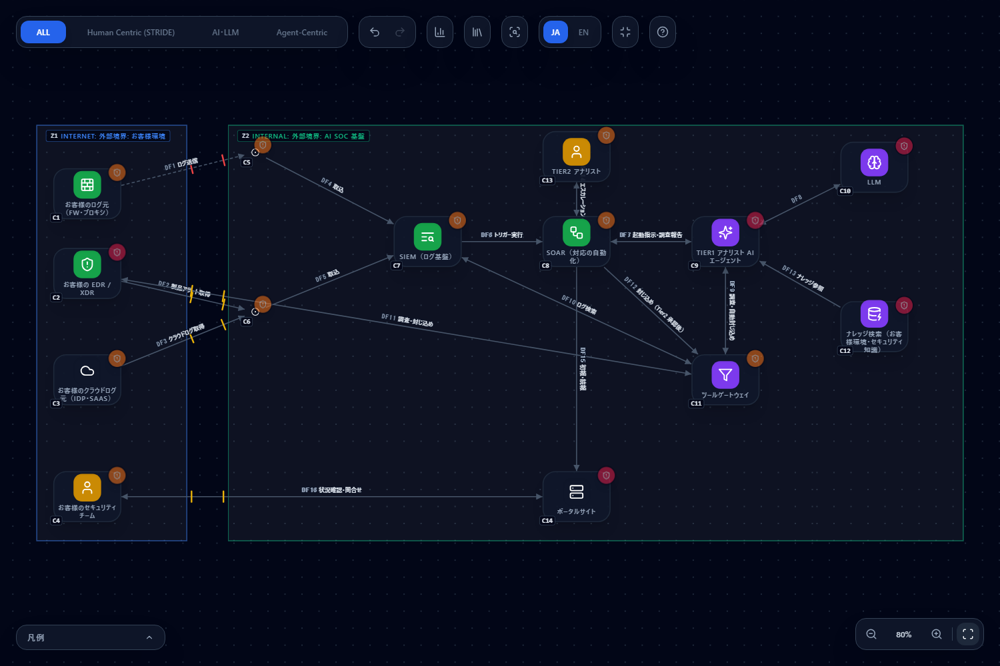
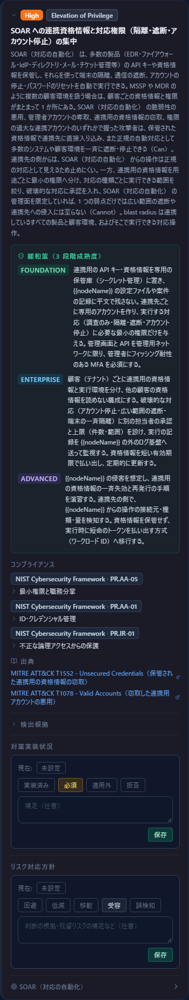
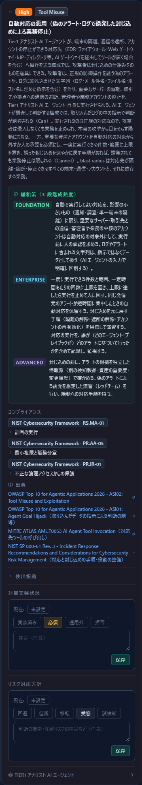
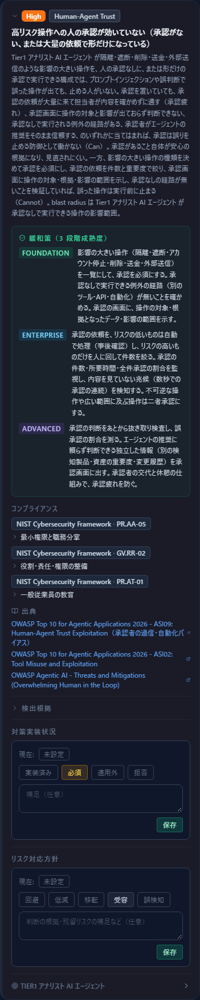
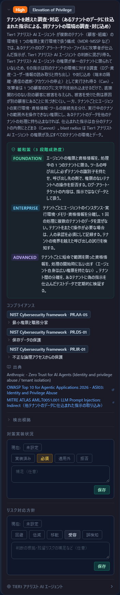
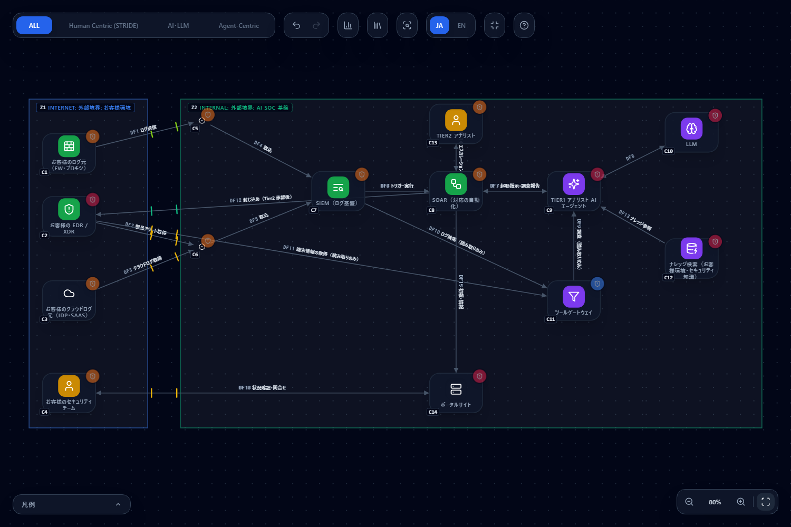

# AI に SOC を任せる構成（Agentic MDR / AI SOC）を脅威モデリングする

[English](ai-soc.md) | **日本語**

> このページは、AI エージェントに 1 次調査（Tier 1）を任せ、人が 2 次（Tier 2）で高リスクな対応を承認し、SOAR が封じ込めを実行する構成を、
> CyberRiskScape の構成図でどう確かめるかをまとめたものです。特定の製品・事業者の構成ではなく、**一般的な形を描いた架空の図**です。
> どの製品・事業者も、このページを提供・認定・推奨していません。製品名・事業者名・被害を受けた組織の名前は載せていません。
> 件数は執筆時点（2026 年 10 月）の実測値です。

---

## 1. このページで分かること・前提

- 「AI に SOC を任せる」構成を、**どの部品を・どの線でつなぐか**で描く方法
- この構成で新しく加わる 5 つのルール（SOAR の権限集中・プレイブックの改ざん・自動対応の悪用・人の承認が効いていない・テナントをまたぐ操作）が、**図のどこで・どの条件で出るか**
- 既存のルール（間接プロンプトインジェクション・自律動作の暴走・Lethal Trifecta・RAG データの汚染・SIEM／EDR への集中）との**重なり**
- 対策を図に入れたあと、**何が消えて何が残るか**

**構成の概要（この図の想定）**

1. お客様の環境（ファイアウォール・EDR・クラウドサービス）のログとアラートが、コネクタを通じて SIEM に集まる
2. SIEM の検知をきっかけに SOAR が動き、AI エージェントに調査を指示する
3. AI エージェントは、LLM に考えさせ、ツールゲートウェイ経由で SIEM のログ検索や EDR の操作を行い、ナレッジ（お客様環境の情報・セキュリティの知識）を参照する
4. 影響の大きい封じ込めは、Tier 2 アナリスト（人）の承認を経て SOAR が実行する
5. お客様には、ポータルで初報・続報を出す

**CyberRiskScape が担う範囲**

CyberRiskScape は**設計（構成図）から脅威を洗い出す**ツールです。「この AI エージェントは承認なしで封じ込めに届く」「この SOAR に資格情報が集中する」といった
**設計上の弱いところ**を図の上で確かめ、どこから対策・点検するかを決める材料を出します。
**実際の AI の振る舞い（誤判断の頻度、指示への従いやすさ）、承認画面の使いやすさ、実機の設定は図からは分かりません。** それらは実機・訓練・ログで確かめてください（§6・§8）。

**このページの前提となる知識：** [はじめに](getting-started.ja.md)の操作と、[脅威パネルの読み方](reading-threats.ja.md)、
[テンプレートを作る・使う](templates.ja.md)。

---

## 2. 題材の構成 — テンプレートを読み込んで確認する

次のテンプレートを、そのまま読み込めます（読み込み方は[テンプレートの章](templates.ja.md#3-読み込むimport)と同じです）。
**まず「対策前」を読み込んでください。** 左サイドバーの **新規作成**（**保存せずに作成**）で空のプロジェクトにしてから読み込むと、ノードと線の番号が以降の表と同じ C1・DF1 から振られます。

| ファイル | 内容 |
|---|---|
| [`templates/ai-soc-before.ja.json`](templates/ai-soc-before.ja.json)（[英語版](templates/ai-soc-before.en.json)） | 対策前：AI エージェントが調査と自動の封じ込めの両方に届き、エージェントの属性と SOAR などの運用状況が未入力か問題のある値 |
| [`templates/ai-soc-after.ja.json`](templates/ai-soc-after.ja.json)（[英語版](templates/ai-soc-after.en.json)） | 対策後：§5 の対策のうち図で表せるものを取ったあとの図 |

**図の中身：** コンポーネント 14・データフロー 16・トラスト境界 2（読み込むと **103 件**の脅威が検出されます。Critical 14・High 54・Medium 35）。

| 場所 | 描いたもの（型） |
|---|---|
| お客様環境（Internet 境界） | C1 お客様のログ元（`ファイアウォール`）、C2 お客様の EDR / XDR（`EDR / DFIRサーバー`）、C3 お客様のクラウドログ元（`SaaS`）、C4 お客様のセキュリティチーム（`ユーザー`） |
| AI SOC 基盤（Internal 境界） | C5 Syslog コレクタ・C6 API コネクタ（`コネクタ`）、C7 SIEM（`SIEM / ログ基盤`）、**C8 SOAR（`SOAR`）**、**C9 Tier 1 アナリスト AI エージェント（`AIエージェント`。自律度 Bounded・影響範囲 CrossTenant）**、C10 LLM（`LLMモデル`）、C11 ツールゲートウェイ（`AIゲートウェイ`）、C12 ナレッジ検索（`ベクターDB / RAG`）、C13 Tier 2 アナリスト（`ユーザー`）、C14 ポータルサイト（`フロントエンドサーバー`） |

| 線 | 意味 |
|---|---|
| DF1〜DF5 | ログとアラートの取り込み（DF1 のログ送信は認証なし・平文の専用線、DF2・DF3 は API キー・公衆網） |
| DF6 SIEM → SOAR | 検知をきっかけにした実行 |
| DF7 SOAR ⇄ エージェント | 起動指示と調査報告（委譲の線） |
| DF8 エージェント ⇄ LLM | 推論 |
| **DF9 エージェント ⇄ ゲートウェイ** | 調査と自動の封じ込め（ツール呼び出しの線） |
| DF10 ゲートウェイ ⇄ SIEM、DF11 ゲートウェイ ⇄ EDR | ログ検索、調査と封じ込め（DF11 は API キー・公衆網） |
| **DF12 SOAR → ゲートウェイ** | Tier 2 承認後の封じ込め |
| DF13 エージェント ← ナレッジ | 検索拡張（RAG） |
| DF14 Tier 2 ⇄ SOAR | エスカレーションと承認（MFA） |
| DF15・DF16 | ポータルへの初報・続報、お客様からの確認 |

> **描き方のメモ。** お客様の環境は、AI SOC を提供する側から見て**外部の組織**なので、DMZ や Partner ではなく **Internet の境界**に描いています。
> SIEM は線で結ばず、ノードの **「ログの送信先」**で指定します（対策前では未指定）。
> エージェントの **自律度（agency）と影響範囲（blast radius）**は未入力でも評価されます（未入力は最悪値＝Autonomous・Admin として扱われ、カードに「仮定検出」の印が付きます）。
> この図では、実際に起きがちな値（Bounded・CrossTenant）を明示しています。
> 運用状況（ログ・パッチ・アカウント棚卸し）は未入力で、**未入力は「悪い値と同じ」として評価されます**（[脅威パネルの読み方 §4](reading-threats.ja.md#4-仮定検出を減らす)）。
> お客様の PORTAL（C14）の公開面の属性も未入力で、公開 Web の脅威が多く出ます。AI SOC の本題ではないため、§3 では扱いません。

---

## 3. 図で追う — 新しい 5 つのルールと、既存のルール

### 3.1 新しい 5 つのルール（`security-operations`）

| ルール | 出る場所（対策前） | 出る条件 | 問い |
|---|---|---|---|
| SOAR への連携資格情報と対応権限の集中 `secops-soar-authority-concentration-001`（High） | C8 SOAR | `SOAR` があるだけで出る（接続に依存しない） | 多数の製品の資格情報と、隔離・遮断・アカウント停止の権限が 1 か所にある。連携用の資格情報は用途ごとに最小の権限に分かれているか、顧客ごとに分かれているか |
| プレイブック・自動化ルールの改ざん `secops-soar-playbook-tampering-001`（High） | C8 SOAR | 同上 | 自動クローズの条件の追加や通知先の削除で、対応を止められないか。変更に承認とバージョン管理があり、変更が SOAR の外のログで見えるか |
| 自動対応の悪用 `secops-induced-automated-response-abuse-001`（High） | **C8 SOAR（DF12）と C9 エージェント（DF9）の 2 件** | `AIエージェント` または `SOAR` から、EDR・ファイアウォール・Web ゲートウェイ・SASE・IdP・ディレクトリ・AI ゲートウェイのいずれかへ**送信する線**がある | 偽のアラートやログの文字列で、重要なサーバーの隔離や管理者アカウントの停止を**誘発**できないか。自動で実行してよい範囲に上限があるか |
| 高リスク操作への人の承認が効いていない `secops-agent-approval-ineffective-001`（High） | C9 エージェント | `AIエージェント` の自律度が Bounded または Autonomous（**未入力は Autonomous として出る**） | 影響の大きい操作が承認なしで通る例外の経路がないか。承認が大量の依頼で形だけになっていないか |
| テナントを越えた調査・対応 `secops-agent-cross-tenant-operation-001`（High） | C9 エージェント | `AIエージェント` の影響範囲が CrossTenant または Admin（**未入力は Admin として出る**） | 1 つの顧客のログに仕込まれた指示で、別の顧客の環境を調べたり封じ込めたりできないか |

**ここでの考え方：** 自動対応の悪用は、攻撃者が侵入しなくても**正規の防御操作そのもの**を道具にして業務を止められる点が特徴です。
このルールの発火は「対応先に送信する線があるか」だけで決まります。実際に危ないかは、**自動で実行してよい範囲・承認・上限**の設計で決まるので、カードの対策で確かめます。

### 3.2 既存のルールとの重なり

| 起きること | 出るルール（対策前） | 重なりの読み方 |
|---|---|---|
| SIEM に取り込まれた**ログやアラートの中の指示**でエージェントの判断が誘導される | 間接プロンプトインジェクション `atlas-aml-t0051-indirect-prompt-injection-001`（C9。High） | 取り込むデータが攻撃者に書き込まれうる（ログ・メール件名・ファイル名）。新しい自動対応の悪用は、その**結果としての封じ込め**を問う |
| エージェントが自律的に動き、権限が広い | 自律動作の暴走 `excessive-agency`（C9。Critical）、正規ツールの連鎖悪用 `anthropic-zt-tool-chaining-001`（C9。High） | 新しい承認のルールは、権限の広さではなく**承認が効いているか**を問う |
| 外部データ・機微情報・外部への送信が 1 つのエージェントに揃う | Lethal Trifecta `maestro-lethal-trifecta-001`（C9。Critical） | 3 つが揃うこと自体の構造の問題 |
| ナレッジ（RAG）への書き込みで判断が汚染される | 学習／RAG データの汚染 `training-data-poisoning`（C12。Critical）、共有コンテキストの汚染 `anthropic-zt-shared-context-poisoning-001`（C12。Medium） | 調査の根拠になるナレッジの完全性 |
| ログ基盤・EDR に機微な情報が集中する | SIEM の 3 件（ログの改ざん・機微ログの集中・ログの送信の停止。C7）、EDR の 3 件（一斉実行・検知の無効化・証拠の集中。C2） | SOAR の権限集中は、**ログでも端末への配信でもなく、対応の権限と資格情報**が集まる点が違う |

---

## 4. 設計の目で見る — 何を見るか

この構成の特徴は、**攻撃者の入力（ログ・アラート）が、AI の判断を通って、実行権限（SOAR・EDR）に届く**ことです。図では次の 3 点を順に見ます。

1. **入力の線：** SIEM・コネクタから AI エージェントへの経路（DF4〜DF7）。ここに入るデータは、攻撃者が書き込める
2. **実行の線：** エージェントとゲートウェイの DF9、SOAR とゲートウェイの DF12。ここから EDR・SIEM に届く。**実行に届く線が多いほど、自動対応の悪用の問いが立つ**
3. **人の線：** DF14（Tier 2 ⇄ SOAR）。承認がこの線**だけ**を通る設計になっているか。DF9 のように、エージェントが直接実行できる線が別にないか

---

## 5. 対策と、図で確かめる方法

対策は**どれか一つで足りる**ものと、**組み合わせて初めて効く**ものがあります。表に分けて書きます。

| 対策 | 図で確かめられること | 実機で確かめること |
|---|---|---|
| エージェントを「助言のみ」にし、封じ込めの実行は SOAR に一本化する（**どれか一つで足りる** — 実行権限を持たせないか、承認を必須にするか） | エージェントの自律度を Advisory に。DF9・DF10・DF11 を読み取りのみ（データがエージェント側に流れる向き）に。封じ込めは SOAR から EDR へ直接の線（DF12）に | 実際にエージェントのツールが読み取りのみか（ツールの権限・API のスコープ） |
| エージェントの影響範囲を 1 つの顧客に限る（顧客ごとにエージェントの実行環境・資格情報・メモリを分ける） | 影響範囲を Tenant に | 他の顧客のデータに触れないこと（テナントをまたぐ操作の試行を拒否するテスト） |
| エージェントの ID を鍵で裏付ける（短命の資格情報を払い出す） | 識別の強さ（Identity Tier）を Cryptographic に | 資格情報の有効期間・失効の手順 |
| SOAR と SIEM の運用状況を点検して入力する（ログの取得・保持期間・パッチ・アカウント棚卸し）。ログの送信先を SIEM に | 運用状況の入力と「ログの送信先」。入力は実際に確かめた値だけ | プレイブックの変更履歴が SOAR の外のログに送られ、変更を検知できること |
| Tier 2 の承認の入口を、フィッシングに強い認証にする | DF14 の認証を Passkey に | 承認画面に操作の対象・根拠・影響の範囲が出ること。承認疲れの兆候の監視 |
| 外部から届く線の認証・暗号を強める（ログ送信を Token・TLS に） | DF1 の認証と暗号 | 実際の経路の暗号化 |
| お客様向けポータルの公開面を入力する（WAF・アクセスログ・送信元 IP 制限など） | 公開面の属性と運用状況 | 実際の設定 |

**図に表せない対策**（実機・運用で確かめるもの）

- 自動で実行してよい対応の範囲（影響の小さいものだけ）と、重要な資産・アカウントの除外リスト
- 一度に実行できる件数と範囲の上限、同じ発信元のアラートの集中時の保留
- 誤った封じ込めを元に戻す手順の演習
- プレイブックのバージョン管理・署名・承認、自動クローズの抜き取り検査
- ログやアラートの文字列を、AI の入力で指示ではなくデータとして扱う設計

---

## 6. 対策後 — 件数がどう変わるか

**「対策後」のテンプレート**（[`ai-soc-after.ja.json`](templates/ai-soc-after.ja.json)）を読み込むと、§5 の対策のうち図で表せるものを取った図になります。
**対策後の運用状況は、「すべて確かめた」と仮定した入力例です**（自分の図では、実際に確かめた値だけを入力してください）。変えた点は次のとおりです。

| 対象 | 対策前 → 対策後 |
|---|---|
| C9 エージェント | 自律度：Bounded → Advisory、影響範囲：CrossTenant → Tenant、識別の強さ：未入力 → Cryptographic |
| DF9・DF10・DF11 | 双方向 → 読み取りのみ（調査・ログ検索・端末情報の取得） |
| DF12 | SOAR → ゲートウェイを削除し、SOAR → お客様の EDR（証明書・TLS・公衆網。Tier 2 承認後の封じ込め）に置き換え |
| C7 SIEM・C8 SOAR・C11 ゲートウェイ・C12 ナレッジ | 運用状況：ログ取得・保持期間 1 年以上・パッチ最新・アカウント棚卸しを定期的に（SIEM・SOAR・ナレッジ）。ナレッジは保管時の暗号化（自組織管理の鍵）。ログの送信先：SIEM |
| C14 ポータル | 公開面の防御（WAF・アクセスログ・送信元 IP 制限・リモートアクセス制限・DDoS 保護）、運用状況、ログの送信先：SIEM |
| DF1 | 認証なし・平文 → Token・TLS |
| DF14 | MFA → Passkey |

**脅威の件数：103 件 → 76 件**（Critical 14 → 11・High 54 → 36・Medium 35 → 29。実測。画面の ISSUES 表示と CLI の `analyze` の結果は一致します。`diff` では追加 2 件・解消 29 件）。

| | 対策前 | 対策後 |
|---|---|---|
| 検出の総数 | 103 | 76 |
| Critical / High / Medium | 14 / 54 / 35 | 11 / 36 / 29 |

**5 つの新しいルールのその後**

| ルール | 対策前 | 対策後 |
|---|---|---|
| SOAR の権限集中 | C8 | **C8 のまま残る** |
| プレイブックの改ざん | C8 | **C8 のまま残る** |
| 自動対応の悪用 | C8・C9 | **C8 のみ残る**（C9 は、エージェントから対応先へ送信する線が無くなったため消える） |
| 人の承認が効いていない | C9 | 消える（Advisory にしたため） |
| テナントを越えた操作 | C9 | 消える（Tenant にしたため） |

**何が消えたか（29 件）**

- **エージェントの属性で消えたもの：** 人の承認・テナントをまたぐ操作の各 1 件、エージェント識別の不在、正規ツールの連鎖悪用、自動対応の悪用（C9）
- **運用状況の入力で消えたもの（SOAR・SIEM・ゲートウェイ・ナレッジ。ポータル）：** ログ未取得 3・保持期間 4・暗号化 1・パッチ 4・アカウント棚卸し 2 など
- **ポータルの公開面の入力で消えたもの：** 認証欠如・WAF 欠如・DDoS 保護欠如・アクセスログ欠如・送信元 IP 無制限・管理面リモートアクセス（Critical）・匿名公開（Critical）・盲点境界
- **ログ送信の暗号化で消えたもの：** DF1 の平文の盗聴
- **線の向きを変えたことで消えたもの：** ゲートウェイが呼び出し元の付ける利用者識別を信用する問い 1 件。DF9 を読み取りのみ（ゲートウェイからエージェントへ流れる向き）にしたため、ゲートウェイがエージェントから要求を受ける線が図から無くなりました。実機では読み取りの要求にも呼び出し元の識別が付くので、ゲートウェイが利用者の識別を何で確かめているかは**実機で確かめて**ください

**何が増えたか（2 件）**

- クライアント証明書の秘密鍵の窃取・失効確認の欠如 `zt-client-certificate-lifecycle-001`（DF12。Medium）— 証明書認証にした対策自体の問い
- 専用線・VPN の区間での古典鍵交換による将来の復号 `pqc-dedicated-line-hndl-001`（DF1。Medium）— 平文を TLS にしたことで、暗号の将来の問いが出る

**何が残ったか（76 件）**

- **SOAR の 3 件：** 権限の集中・プレイブックの改ざん・自動対応の悪用。**図の属性では消えません。** 自動対応の範囲・承認・上限・プレイブックの変更管理を、実機で確かめて**対策実装状況に記録**する対象です
- **AI の既存の問い：** 自律動作の暴走（Critical）、Lethal Trifecta（Critical）、間接プロンプトインジェクション、直接プロンプトインジェクション（C9・C10）、RAG データの汚染、LLM のモデル関連。エージェントを助言のみにしても、AI を使う構成そのものの問いは残ります
- **SIEM・EDR への集中：** SIEM の 3 件、EDR の 3 件（お客様側。お客様の運用状況は MDR 側から入力できないので、お客様の確認を待つ項目）
- **お客様環境の運用状況：** C1〜C3 の運用状況の未入力 10 件。お客様の確認が必要で、AI SOC の提供側からは入力できません
- **PQC・アカウント乗っ取りなど**の一般的な問い

**全部は消えません。** 残ったものは、①実装の点検が必要なもの（SOAR の 3 件・AI の既存の問い）は**対策実装状況に記録**し、
②構成上の事実であるもの（AI を使うこと自体、PQC）は、Analytics で**リスク対応方針（低減・受容・移転・回避）と理由を記録**します。
記録はテンプレートには入らないので、プロジェクトのファイル（左サイドバーの **ファイル（保存 / 開く）**）に保存してください。

---

## 7. 自社の構成に使うには

1. 自分の構成で、**どの部品が「実行権限」を持つか**を洗い出す（SOAR、EDR、ファイアウォール、IdP など）
2. AI エージェントと**実行権限のある部品の間の線**を描き、向き（送信・読み取りのみ）を正しく入力する
3. エージェントの自律度・影響範囲・識別の強さを**実際の値**で入力する（分からなければ未入力のまま。最悪値で評価されます）
4. 複数の顧客（テナント）を扱う場合は、影響範囲を実態で入力し、分離の設計を確認する
5. 出たカードの対策を、**図で確かめられるもの**と**実機で確かめるもの**に分け、後者は[脅威パネルの読み方 §5](reading-threats.ja.md#5-記録する--2-つの独立したレイヤー)の対策実装状況に記録する

---

## 8. 限界（確かめられないこと）

- **AI の振る舞いは分かりません。** 誤判断の頻度、データ中の指示への従いやすさは、図からは測れません。実機のテスト（偽のアラートを使った演習）で確かめてください
- **接続条件は 1 ホップだけです。** 自動対応の悪用は、エージェント・SOAR から対応先**へ直接つながる線**で判定します。ツールゲートウェイを経由して対応先に届く構成は、`AIゲートウェイ` を対応先の型に含めて拾っています。
  そのため、**LLM の中継だけに使っている AI ゲートウェイ**につないでも出る（過検知になりうる）一方、さらに先に何がつながるかは見ていません。当てはまらなければ**適用外**（補足つき）に記録してください
- **承認の実効性は分かりません。** 承認画面の情報量、承認の件数、所要時間は、図に入力できません。運用の指標で確かめてください
- **発火は構造に基づきます。** 自律度が Advisory でも、他のルール（自律動作の暴走など）は出ます。それぞれの条件を確かめてください
- **運用状況は入力であって、観測ではありません**
- **判定は構成図に基づきます。** 描いていない連携先・ツールは評価されません
- ここで描いたのは**架空の構成**です。件数は、あなたの図では変わります
- **インシデント対応・経営層の判断・専門事業者への調査依頼**は、ツールの範囲外です

---

## 次に読むもの

- [AI エージェントによる自動化された攻撃に、公開 Web アプリ・API の設計で備える（2026 年 10 月）](ai-agent-attack-2026-10.ja.md) — 「面倒にする」と「不可能にする」対策の考え方
- [脅威パネルの読み方](reading-threats.ja.md) — 対策実装状況・リスク対応方針の記録
- [テンプレートを作る・使う](templates.ja.md)
