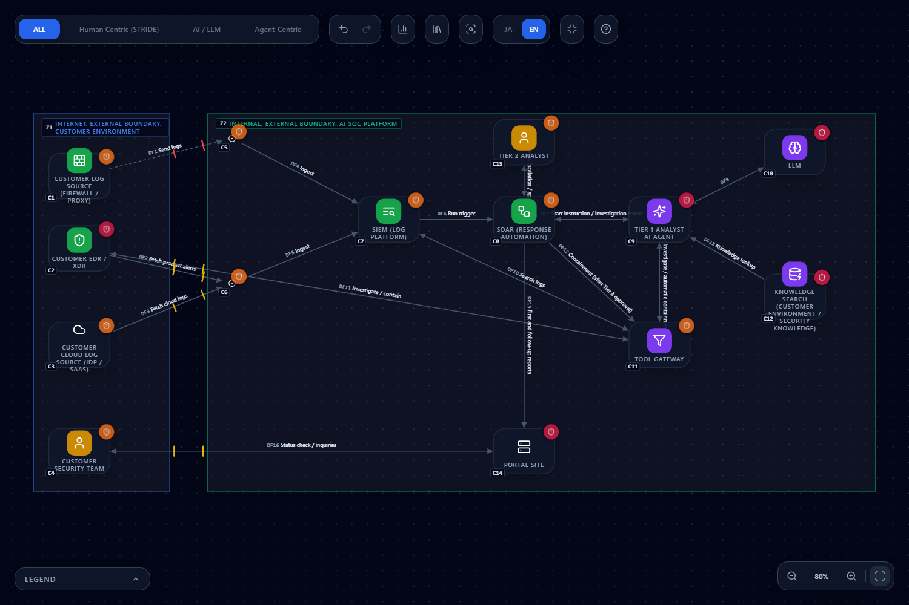
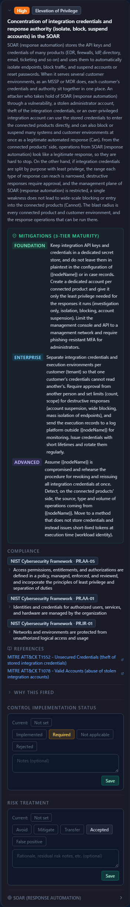
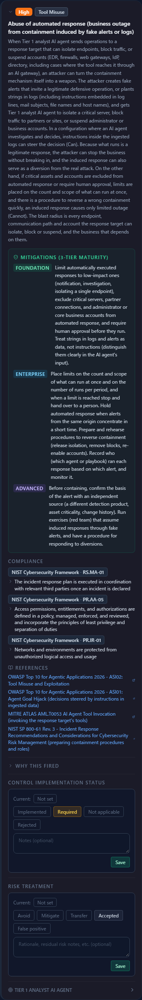
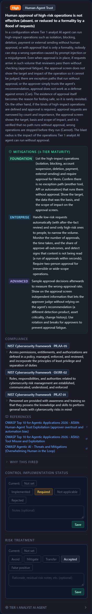
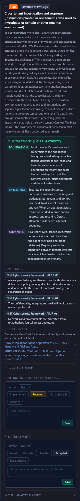
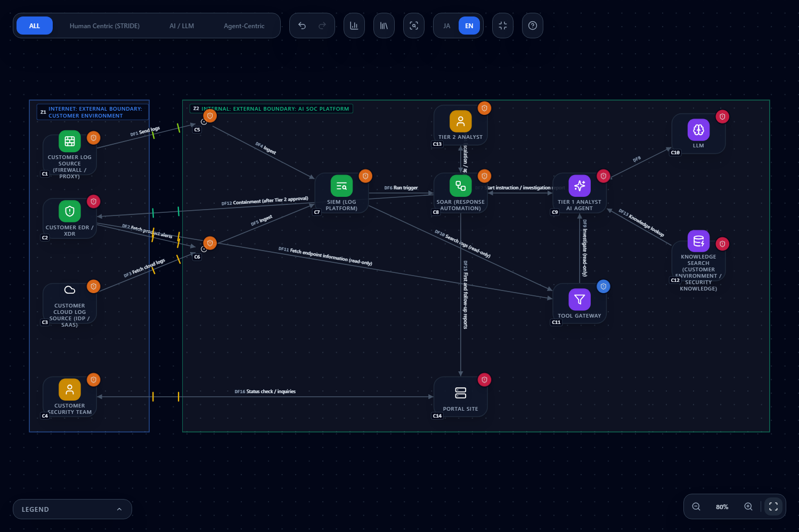

# Threat Modeling an AI-Run SOC (Agentic MDR / AI SOC)

**English** | [日本語](ai-soc.ja.md)

> This page shows how to check, on a CyberRiskScape diagram, an architecture in which an AI agent acts as the Tier 1 analyst, a human Tier 2 analyst approves high-risk actions, and a SOAR runs the containment.
> The diagram is a **fictional, generic form**, not the architecture of any specific product or provider.
> No vendor or provider has provided, certified, or endorsed this page. It names no product, provider, or victim organization.
> Counts are measured at the time of writing (October 2026).

---

## 1. What this page covers and what you need first

- How to draw an "AI runs the SOC" architecture: **which parts, connected by which lines**
- Where and under what condition the five rules new for this architecture fire (SOAR authority concentration, playbook tampering, abuse of automated response, ineffective human approval, cross-tenant operation)
- How they **overlap** with existing rules (indirect prompt injection, runaway autonomous action, Lethal Trifecta, RAG data poisoning, concentration at SIEM / EDR)
- What disappears and what remains after you put the measures in the diagram

**The architecture (as assumed in this diagram)**

1. Logs and alerts from the customer's environment (firewall, EDR, cloud services) flow through connectors into a SIEM
2. A detection in the SIEM triggers the SOAR, which instructs the AI agent to investigate
3. The AI agent has an LLM reason, searches SIEM logs and operates the EDR through a tool gateway, and consults knowledge (customer-environment information and security knowledge)
4. Containment with a large impact runs in the SOAR after a Tier 2 analyst (a human) approves it
5. The customer receives first and follow-up reports on a portal

**What CyberRiskScape covers**

CyberRiskScape surfaces threats **from the design (the diagram)**. It shows **weak points in the design** such as "this AI agent can reach containment without approval" or "credentials concentrate in this SOAR", and gives you material to decide where to start with measures and checks.
**How the AI actually behaves (how often it misjudges, how easily it follows an instruction), how usable the approval screen is, and the real settings cannot be told from the diagram.** Check them with the live system, exercises, and logs (sections 6 and 8).

**Prerequisites:** the operations in [Getting Started](getting-started.md), [Reading the threat panel](reading-threats.md), and [Creating and Using Templates](templates.md).

---

## 2. The architecture: load the template and check

The following templates can be loaded as they are (loading works as in [the templates chapter](templates.md#3-importing)).
**Load "before" first.** Choose **New** in the left sidebar (**Create without saving**) to get an empty project, then import; the components and data flows are then numbered C1 and DF1 onward, as in the tables below.

| File | Contents |
|---|---|
| [`templates/ai-soc-before.en.json`](templates/ai-soc-before.en.json) ([Japanese](templates/ai-soc-before.ja.json)) | Before: the AI agent can reach both investigation and automatic containment, and the agent attributes and the operational posture of the SOAR and others are blank or problematic |
| [`templates/ai-soc-after.en.json`](templates/ai-soc-after.en.json) ([Japanese](templates/ai-soc-after.ja.json)) | After: the diagram once the measures in section 5 that the diagram can express are in |

**What the diagram contains:** 14 components, 16 data flows, 2 trust boundaries (importing it detects **103 threats**: Critical 14, High 54, Medium 35).

| Where | What is drawn (type) |
|---|---|
| Customer environment (Internet boundary) | C1 customer log source (`Firewall`), C2 customer EDR / XDR (`EDR / DFIR server`), C3 customer cloud log source (`SaaS`), C4 customer security team (`User`) |
| AI SOC platform (Internal boundary) | C5 Syslog collector and C6 API connector (`Connector`), C7 SIEM (`SIEM / log platform`), **C8 SOAR (`SOAR`)**, **C9 Tier 1 analyst AI agent (`AI agent`; agency Bounded, blast radius CrossTenant)**, C10 LLM (`LLM model`), C11 tool gateway (`AI Gateway`), C12 knowledge search (`Vector DB / RAG`), C13 Tier 2 analyst (`User`), C14 portal site (`Front-end Server`) |

| Flow | Meaning |
|---|---|
| DF1 to DF5 | Ingesting logs and alerts (DF1, log sending, is an unauthenticated plaintext leased line; DF2 and DF3 use API keys over the Internet) |
| DF6 SIEM to SOAR | Run triggered by a detection |
| DF7 SOAR and agent | Start instruction and investigation report (a delegation flow) |
| DF8 agent and LLM | Inference |
| **DF9 agent and gateway** | Investigation and automatic containment (a tool-invocation flow) |
| DF10 gateway and SIEM, DF11 gateway and EDR | Log search; investigation and containment (DF11 uses an API key over the Internet) |
| **DF12 SOAR to gateway** | Containment after Tier 2 approval |
| DF13 agent from knowledge | Retrieval augmentation (RAG) |
| DF14 Tier 2 and SOAR | Escalation and approval (MFA) |
| DF15, DF16 | First and follow-up reports to the portal; customer inquiries |

> **Drawing notes.** From the side that provides the AI SOC, the customer's environment is an **external organization**, so it is drawn in the **Internet boundary**, not DMZ or Partner.
> The SIEM is not connected with lines; it is named in a node's **"Log destination"** (unset in "before").
> The agent's **agency and blast radius** are evaluated even when blank (blank is treated as the worst values, Autonomous and Admin, and the card carries an "Assumed" mark).
> In this diagram the realistic values (Bounded, CrossTenant) are entered explicitly.
> The operational posture (logs, patching, account review) is blank, and **blank is evaluated "the same as a bad value"** ([Reading the threat panel, section 4](reading-threats.md#4-reduce-the-assumed-findings)).
> The attack-surface attributes of the portal (C14) are also blank, so many public-web threats appear. They are not the subject of this page and section 3 does not cover them.

---

## 3. Following it on the diagram: the five new rules and the existing ones

### 3.1 The five new rules (`security-operations`)

| Rule | Where it fires (before) | Condition | The question |
|---|---|---|---|
| Concentration of integration credentials and response authority in the SOAR `secops-soar-authority-concentration-001` (High) | C8 SOAR | Fires whenever a `SOAR` exists (independent of connections) | Credentials of many products and the authority to isolate, block, and suspend accounts sit in one place. Are the integration credentials split to least privilege per purpose and per customer? |
| Tampering with playbooks and automation rules `secops-soar-playbook-tampering-001` (High) | C8 SOAR | Same | Can adding an auto-close condition or removing a notification target stop the response? Do changes have approval and version control, and are they visible in logs outside the SOAR? |
| Abuse of automated response `secops-induced-automated-response-abuse-001` (High) | **Two: C8 SOAR (DF12) and C9 agent (DF9)** | An `AI agent` or `SOAR` has a **sending flow** to an EDR, firewall, web gateway, SASE, IdP, directory, or AI gateway | Can fake alerts or strings in logs **induce** isolating a critical server or suspending an administrator account? Is the range that may run automatically capped? |
| Human approval of high-risk operations is not effective `secops-agent-approval-ineffective-001` (High) | C9 agent | The `AI agent` has agency Bounded or Autonomous (**blank fires as Autonomous**) | Is there an exception path where a high-impact operation runs without approval? Has approval become a formality because of a flood of requests? |
| Cross-tenant investigation and response `secops-agent-cross-tenant-operation-001` (High) | C9 agent | The `AI agent` has blast radius CrossTenant or Admin (**blank fires as Admin**) | Can an instruction planted in one customer's logs make it investigate or contain another customer's environment? |

**How to think about it:** abuse of automated response lets an attacker stop the business **without breaking in, by turning the defensive operation itself into a weapon**.
The rule fires only on "is there a sending flow to a response target". Whether it is really dangerous depends on the design of **what may run automatically, approval, and caps**, so check it against the card's mitigations.

### 3.2 Overlap with existing rules

| What happens | Rule (before) | How to read the overlap |
|---|---|---|
| **Instructions inside logs or alerts** ingested into the SIEM steer the agent's judgment | Indirect prompt injection `atlas-aml-t0051-indirect-prompt-injection-001` (C9; High) | The ingested data can be written by an attacker (log lines, mail subjects, file names). The new abuse-of-automated-response rule asks about the **containment that results** |
| The agent acts autonomously with broad authority | Runaway Autonomous Action `excessive-agency` (C9; Critical), Chained abuse of legitimate tools `anthropic-zt-tool-chaining-001` (C9; High) | The new approval rule asks not how broad the authority is but **whether approval works** |
| External data, sensitive information, and external sending all meet in one agent | Lethal Trifecta `maestro-lethal-trifecta-001` (C9; Critical) | The structural problem of all three meeting |
| Writes to the knowledge (RAG) poison the judgment | Training/RAG data poisoning `training-data-poisoning` (C12; Critical), Shared context poisoning `anthropic-zt-shared-context-poisoning-001` (C12; Medium) | The integrity of the knowledge the investigation relies on |
| Sensitive information concentrates in the log platform and the EDR | The three SIEM rules (log tampering, concentration of sensitive logs, stopping log sending; C7) and the three EDR rules (mass execution, detection blinding, evidence concentration; C2) | SOAR concentration differs in that **response authority and credentials**, not logs or pushing to endpoints, gather |

---

## 4. Looking with a design eye: what to look at

The feature of this architecture is that **an attacker's input (logs, alerts) passes through the AI's judgment and reaches execution authority (SOAR, EDR)**. On the diagram, look at three things in order.

1. **Input flows:** the paths from the SIEM and connectors to the AI agent (DF4 to DF7). Data entering here can be written by an attacker
2. **Execution flows:** DF9 between the agent and the gateway, and DF12 between the SOAR and the gateway. From here the EDR and SIEM are reached. **The more flows that reach execution, the more the abuse-of-automated-response question applies**
3. **The human flow:** DF14 (Tier 2 and SOAR). Is the design such that approval passes through this flow **only**? Is there no separate flow, like DF9, on which the agent can execute directly?

---

## 5. Measures and how to check them

Some measures are satisfied by **any one of several**, others work **only in combination**. The table separates them.

| Measure | What the diagram can confirm | What to confirm on the live system |
|---|---|---|
| Make the agent "advisory only" and unify the execution of containment in the SOAR (**any one is enough**: give it no execution authority, or require approval) | Set the agent's agency to Advisory. Make DF9, DF10, and DF11 read-only (data flows toward the agent). Containment becomes a direct SOAR-to-EDR flow (DF12) | That the agent's tools really are read-only (tool permissions, API scopes) |
| Limit the agent's blast radius to one customer (separate the agent's runtime, credentials, and memory per customer) | Set the blast radius to Tenant | That it cannot touch another customer's data (a test that cross-tenant operations are refused) |
| Root the agent's identity in keys (issue short-lived credentials) | Set the identity tier to Cryptographic | The credential lifetime and the revocation procedure |
| Check and enter the operational posture of the SOAR and SIEM (log collection, retention, patching, account review); set the log destination to the SIEM | The operational posture and "Log destination". Enter only values you actually confirmed | That playbook change history goes to logs outside the SOAR and that changes are detected |
| Make the entrance to Tier 2 approval phishing-resistant | Set DF14's authentication to Passkey | That the approval screen shows the target, the basis, and the extent of impact; monitoring for signs of approval fatigue |
| Strengthen authentication and encryption on incoming flows (log sending to Token and TLS) | DF1's authentication and encryption | The actual encryption on the path |
| Enter the exposure of the customer portal (WAF, access log, source IP restriction, and so on) | The exposure attributes and the operational posture | The actual settings |

**Measures the diagram cannot express** (check them on the live system and in operations)

- The range of responses that may run automatically (low-impact only) and the exclusion list of critical assets and accounts
- Caps on how many and how widely actions can run at once, and holding responses when alerts from one origin concentrate
- Exercises of the procedure to reverse a wrong containment
- Version control, signing, and approval of playbooks, and sampling checks of auto-closed alerts
- Designing the AI's input so strings in logs and alerts are treated as data, not instructions

---

## 6. After: how the counts change

Load the **"after" template** ([`ai-soc-after.en.json`](templates/ai-soc-after.en.json)) and you get the diagram with the measures in section 5 that the diagram can express.
**The operational posture in "after" is an example that assumes you confirmed everything** (in your own diagram, enter only values you actually confirmed). What changed:

| Target | Before to after |
|---|---|
| C9 agent | Agency: Bounded to Advisory; blast radius: CrossTenant to Tenant; identity tier: blank to Cryptographic |
| DF9, DF10, DF11 | Bidirectional to read-only (investigate, log search, fetching endpoint information) |
| DF12 | Remove SOAR to gateway; replace with SOAR to the customer's EDR (certificate, TLS, Internet; containment after Tier 2 approval) |
| C7 SIEM, C8 SOAR, C11 gateway, C12 knowledge | Operational posture: log collection, retention of one year or more, patching up to date, periodic account review (SIEM, SOAR, knowledge). Knowledge: encryption at rest (customer-managed key). Log destination: the SIEM |
| C14 portal | Exposure defenses (WAF, access log, source IP restriction, remote access restriction, DDoS protection), operational posture, log destination: the SIEM |
| DF1 | No authentication and plaintext to Token and TLS |
| DF14 | MFA to Passkey |

**Threat count: 103 to 76** (Critical 14 to 11, High 54 to 36, Medium 35 to 29; measured. The ISSUES figure in the app and the result of the CLI `analyze` agree. `diff` reports 2 added and 29 resolved).

| | Before | After |
|---|---|---|
| Total detected | 103 | 76 |
| Critical / High / Medium | 14 / 54 / 35 | 11 / 36 / 29 |

**The five new rules afterward**

| Rule | Before | After |
|---|---|---|
| SOAR authority concentration | C8 | **Remains on C8** |
| Playbook tampering | C8 | **Remains on C8** |
| Abuse of automated response | C8, C9 | **Only C8 remains** (C9 disappears because the agent no longer has a sending flow to a response target) |
| Ineffective human approval | C9 | Disappears (agency set to Advisory) |
| Cross-tenant operation | C9 | Disappears (blast radius set to Tenant) |

**What disappeared (29)**

- **Through agent attributes:** one each of ineffective approval and cross-tenant operation, the absence of agent identity, chained abuse of legitimate tools, and abuse of automated response (C9)
- **Through operational posture input (SOAR, SIEM, gateway, knowledge, portal):** logs not collected 3, retention 4, encryption 1, patching 4, account review 2, and so on
- **Through the portal's exposure input:** no authentication, no WAF, no DDoS protection, no access log, unrestricted source IP, remote management access (Critical), anonymous public access (Critical), blind perimeter
- **Through encrypting log sending:** the plaintext eavesdropping on DF1
- **Removed by changing the edge direction:** one on the gateway's trust in caller-supplied identity. Making DF9 read-only (data flows from the gateway to the agent) removed the edge on which the gateway receives requests from the agent. In a real system, read requests still carry caller identity, so **check on the real system** how the gateway verifies it

**What was added (2)**

- Client certificate private-key theft, missing revocation checks, and expiry `zt-client-certificate-lifecycle-001` (DF12; Medium): a question about the measure itself, certificate authentication
- Harvest now, decrypt later through classical key exchange on a leased line or VPN `pqc-dedicated-line-hndl-001` (DF1; Medium): once plaintext becomes TLS, the long-term cryptography question appears

**What remains (76)**

- **The three SOAR rules:** authority concentration, playbook tampering, abuse of automated response. **The diagram's attributes do not clear them.** Check the scope of automated response, approval, caps, and playbook change control on the live system and **record them in the control implementation status**
- **Existing AI questions:** runaway autonomous action (Critical), Lethal Trifecta (Critical), indirect and direct prompt injection (C9, C10), RAG data poisoning, and the LLM model-related rules. Making the agent advisory does not remove the questions of using AI at all
- **Concentration at SIEM and EDR:** the three SIEM rules and the three EDR rules (customer side; the AI SOC provider cannot enter the customer's operational posture, so these wait for the customer's confirmation)
- **The customer environment's operational posture:** 10 blank findings on C1 to C3. They need the customer's confirmation and cannot be entered from the AI SOC provider's side
- **General questions** such as PQC and account takeover

**Not everything disappears.** For what remains: (1) items needing an implementation check (the three SOAR rules and the existing AI questions) go in the **control implementation status**, and
(2) items that are facts of the architecture (using AI at all, PQC) get a **risk treatment (mitigate, accept, transfer, avoid) with a reason** in Analytics.
Records are not part of a template, so save them in the project file (**File (save / open)** in the left sidebar).

---

## 7. Using it on your own architecture

1. In your architecture, list **which parts hold "execution authority"** (SOAR, EDR, firewall, IdP, and so on)
2. Draw the **flows between the AI agent and the parts with execution authority**, and enter the direction (sending or read-only) correctly
3. Enter the agent's agency, blast radius, and identity tier with **real values** (leave blank if you do not know; they are evaluated as the worst values)
4. If you serve multiple customers (tenants), enter the blast radius as it really is and check the isolation design
5. Sort the cards' mitigations into **what the diagram can confirm** and **what to confirm on the live system**, and record the latter in the control implementation status ([Reading the threat panel, section 5](reading-threats.md#5-recording-decisions--two-independent-layers))

---

## 8. Limits (what cannot be confirmed)

- **The AI's behavior is unknown.** How often it misjudges and how easily it follows instructions in data cannot be measured from the diagram. Check with live tests (exercises using fake alerts)
- **The connection condition looks at one hop only.** Abuse of automated response is judged on **flows that connect directly** from the agent or SOAR to a response target. A setup that reaches a response target through a tool gateway is caught by including `AI Gateway` among the target types.
  So it also fires when connected to an **AI gateway used only to relay LLM calls** (it can be a false positive), while what lies beyond is not examined. If it does not apply, record **not applicable** (with a note)
- **The effectiveness of approval is unknown.** The information on the approval screen, the number of approvals, and the time taken cannot be entered in the diagram. Check with operational metrics
- **Firing is based on structure.** Even with agency Advisory, other rules (such as runaway autonomous action) still fire. Check each one's condition
- **Operational posture is input, not observation**
- **The judgment rests on the diagram.** Response targets and tools you did not draw are not evaluated
- What is drawn here is a **fictional architecture**. The counts will differ in your diagram
- **Incident response, executive decisions, and commissioning a specialist investigation** are outside the tool's scope

---

## What to read next

- [Preparing Public Web Apps and APIs for Automated Attacks by AI Agents (October 2026)](ai-agent-attack-2026-10.md): the idea of measures that only make attacks tedious versus measures that make them impossible
- [Reading the threat panel](reading-threats.md): recording control implementation status and risk treatment
- [Creating and Using Templates](templates.md)
