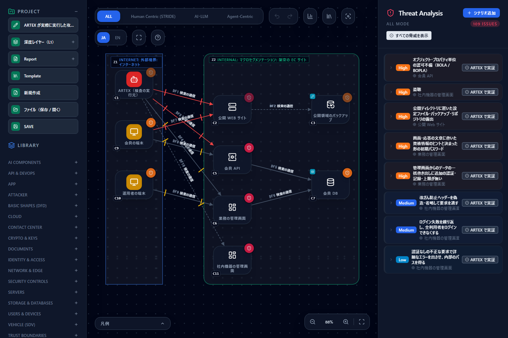
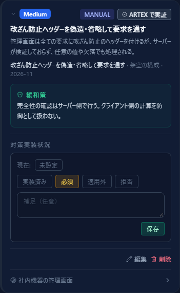
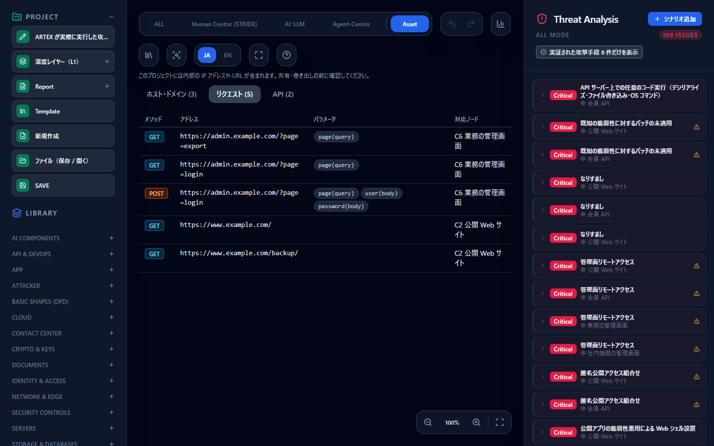

# ARTEX が実際に実行した攻撃手段を脅威カードで見る — 実証された攻撃手段の取り込みと表示

[English](artex.md) | **日本語**

> ARTEX は各権利者の名称です。このページは「ARTEX（AI 自律ペネトレーションテストのツール）の実行結果から、実際に通った攻撃手段を
> CyberRiskScape の脅威カードに載せる方法」を説明するもので、ARTEX の開発者が提供・認定・推奨するものではありません。
> 記述的な使用です。

> **このページの攻撃手段は、CyberRiskScape の開発者が ARTEX で実際に検証した内容に限られており、網羅したものではありません。**
> 載っていない攻撃手段が「通らない」「安全」という意味ではありません。

> **実行してよい範囲** — ARTEX のようなペネトレーションテストのツールを実行するのは、**自組織が管理する、または診断を許可された対象だけ**にしてください。
> 許可のない対象への実行は、法令や契約に反するおそれがあります。このページの取り込みは、実行済みの結果を読むだけで、
> 新しく攻撃は実行しません。

---

## 1. このページで分かること・前提

- ARTEX が**実際に実行して成立した攻撃手段**を、設計図から出た脅威カードの上に「実証」として表示する方法
- **サンプルで確認する**：架空の構成に、ARTEX が実行した 8 件の攻撃手段を載せた図（オンラインデモで開ける）
- **自分の結果を取り込む**：指摘を台帳 YAML に書き、CLI の `import-pentest` で図に載せる
- 何を意味し、何を意味しないか（§6）

**前提**：[はじめに](getting-started.ja.md)の操作と、[脅威パネルの読み方](reading-threats.ja.md)。
サンプルの構成は**架空**です。実際の検証環境ではありません。

---

## 2. デモで見る

[オンラインデモ](https://takashi-ohmoto-git.github.io/CyberRiskScape/)を開き、次の順に操作します。

1. 左の **Template** を開き、**Import** タブを選ぶ。
2. **「サンプル：ARTEX が実際に実行した攻撃手段（架空の構成）」** を選び、**置き換えて適用** を押して、確認で **置き換える** を押す。
3. 右の脅威一覧の上部にある **「実証された攻撃手段 8 件だけを表示」** を押す。

> **プロジェクト全体が置き換わります。** 編集中の図があるブラウザでは開かないでください。



実証された脅威のカードには、実行した攻撃手段・深刻度・観測日が表示されます。



サンプルのファイル：[`templates/artex-verified-attacks.ja.json`](templates/artex-verified-attacks.ja.json)
（[英語版](templates/artex-verified-attacks.en.json)）。読み込み方は [テンプレートを作る・使う](templates.ja.md) を参照してください。

---

### 2.1 資産を Asset タブで見る

サンプルを開いたまま、画面上部の **Asset** を押します。ARTEX が見つけた資産を、3 つの見方で切り替えられます。

| 見方 | 想定する人 | 1 行の単位 |
|---|---|---|
| **ホスト・ドメイン** | インフラ・セキュリティの担当者 | IP またはドメイン（開放ポートを並べる） |
| **リクエスト** | 開発者 | メソッド＋URL |
| **API** | 開発者・API の担当者 | API ごとにまとめた メソッド＋URL |

行を押すと、右の脅威一覧がそのノードの脅威だけになります。同じ行をもう一度押すと元に戻ります。脅威のタブ（ALL など）を押すと図に戻ります。4 つ目の **SBOM** の見方は [SBOM・CBOM・AI BOM のガイド](sbom.ja.md) を参照してください。



エンドポイントは、次のどちらかに当てはまれば API に、それ以外はリクエストに載ります。URL に `/api/` が含まれるかどうかでは判定しません。

- 結びついたノードが API 系の型（バックエンド API・API ゲートウェイ等）である
- 出どころが API 定義である（現在、API 定義を資産として取り込む経路はありません）

## 3. ARTEX が実際に実行した攻撃手段

> **これは CyberRiskScape の開発者が実際に検証した内容に限った一覧で、網羅していません。** 攻撃の手順や値は載せていません。

サンプルの図（架空）で、ARTEX が実行して成立した 8 件です。

| # | 攻撃手段 | 図の要素 | 深刻度 | カード |
|---|---|---|---|---|
| 1 | 版を示すヘッダーだけで、未認証のまま会員一覧 API を呼び出す | 会員 API | High | ルール（canonicalId `api-object-level-authorization`、`api-backend-object-level-authorization-001`） |
| 2 | 公開ディレクトリの一覧からバックアップの DB ダンプを取得する | 公開 Web サイト | High | ルール（`web-public-dir-sensitive-file-exposure`、`webserver-public-dir-sensitive-file-exposure-001`） |
| 3 | 画面の注記にある初期パスワードの決まりから、管理画面にログインする | 業務の管理画面 | High | ルール（`web-content-credential-hint`、`webapp-content-credential-hint-001`） |
| 4 | 管理画面の書き出し機能で、会員情報を一括で取得する | 業務の管理画面 | High | ルール（`admin-bulk-export-unguarded`、`admin-console-bulk-export-unguarded-001`） |
| 5 | 改ざん防止ヘッダーを偽造・省略して要求を通す | 社内機器の管理画面 | Medium | 手動脅威（該当ルールなし） |
| 6 | ログイン失敗を繰り返し、全利用者をログインできなくする | 社内機器の管理画面 | Medium | 手動脅威（該当ルールなし） |
| 7 | HTTP（平文）のままログイン処理を実行する | 社内機器の管理画面 | High | 平文の通信のカード「盗聴」（canonicalId `plaintext-transmission`） |
| 8 | 認証なしの不正な要求で詳細なエラーを出させ、内部のパスを得る | 社内機器の管理画面 | Low | 手動脅威（このノードでは `api-error-information-disclosure` が発火しないため） |

---

## 4. 何が分かるか

- 設計図から出た多数の脅威（サンプルは全 109 件）のうち、**どれが実際に通ったか**を絞って見られます。対策の優先順位を決める根拠の 1 つになります。
- 実証が付いたカードは、そのカードの**緩和策**に対応づきます。何を直せば同じ手段が通らなくなるかを、そのまま読めます。
- **手動脅威**になるのは、ライブラリに該当するルールが無いか（上の #5・#6）、そのノードではルールが発火しない発見です（#8）。ライブラリの穴を知る手がかりにもなります。

---

## 5. 自分の結果を取り込む（CLI）

ARTEX の実行結果を台帳 YAML に書き、CLI で図に載せます。**CLI 専用**です。画面から YAML を読み込む機能はありません。

```bash
npm ci && npm run build:cli
node dist-cli/main.js import-pentest my-project.json --in registry.yaml --scope task-1 -o my-project.pentest.json
```

- `--in`：台帳 YAML（必須）
- `--scope`：この scope の項目だけ取り込む。他の scope の指摘は触りません
- `-o`：指摘を保存したプロジェクト JSON の出力先。報告（Markdown）は標準出力に出ます

### 5.1 台帳の書式

架空の例です。

```yaml
schemaVersion: 1
source:
  product: ARTEX
findings:
  - externalId: F-001
    scope: task-1
    title: 公開ディレクトリの一覧からバックアップの DB ダンプを取得する
    severity: High
    status: open
    canonicalIds: [web-public-dir-sensitive-file-exposure]
    node: C2
    observedAt: "2026-11-01"
```

- `status` は `open`・`fixed`・`false-positive`。**取り込まれるのは `open` だけ**です。
- `outcome: attempted` を付けると、カードの表示が「実証」ではなく「ARTEX 試行」になります（攻撃手段として試行したが、成立は確認していない指摘）。省略すると「実証」です。脅威一覧の「試行された攻撃手段だけを表示」で絞れます。
- `canonicalIds` で既存の脅威カードに結びつけます。載るカードが無い指摘は、手動脅威（STRIDE）として足します。
- `node` は図の C 番号またはノード ID です（ラベルでは指定できません）。
- ほかに `description`・`mitigation` が書けます。
- **未知のキーは読み込みエラー**です（証拠・要求・応答・鍵などを台帳に持ち込ませないため）。証拠や鍵は台帳に書かないでください。

### 5.2 取り込み直しと画面での確認

- 取り込み直しは **source.product × scope** の単位で置き換えます。
- ノードの C 番号は図ごとに違うので、**1 つの scope は 1 つの図**に対応させてください。
- 結果は **Template → Import → 「JSON ファイルを選択」** で開けます。指摘を持つプロジェクト JSON は**プロジェクト全体を置き換え**ます。
- `analyze --format sarif --with-findings` でも書き出せます。
- 台帳への転記は**手作業**です。分類（`canonicalIds`・`node`）の対応づけは人が確かめます。
- `source.product` を変えれば、ARTEX 以外のペネトレーションテストの結果にも使える汎用の取り込み口です。

---

### 5.3 資産を取り込む

ARTEX の資産 API の応答（JSON）を保存して、プロジェクト JSON に取り込みます。

```bash
node dist-cli/main.js import-artex-assets my-project.json \
  --services services.json --endpoints endpoints.json \
  --scope task-3 --map asset-map.json -o with-assets.json
```

- `--services`：`GET /api/assets?type=service&task_id=N` の応答
- `--endpoints`：`GET /api/assets?type=endpoint&task_id=N` の応答
- どちらか一つで足ります。ログインしたブラウザで URL を開いて保存できます
- `--scope`：置き換えの範囲（必須）。同じ scope の資産だけを置き換えます
- `--map`：ホストとノードの対応表（`{"<IP かドメイン>": "<C 番号かノード ID>"}`）。`--node` で、対応表に無いホストをまとめて 1 つのノードに結びつけることもできます。どちらも無いホストは **未対応** と表示します。推測では結びつけません
- `-o`：資産を保存したプロジェクト JSON の出力先

**取り込むものと取り込まないもの**

- パラメータは**名前と場所だけ**を保存し、値は保存しません。URL の資格情報と、名前が秘密に見えるクエリの値も伏せます
- `task_source` が `agent` の資産だけを使います。それ以外は、そのタスクで観測した資産ではないからです
- それでも内部の IP や URL はプロジェクト JSON に入ります。**ファイルを共有するときは中身を確認してください**
- ARTEX の応答ファイルにはパラメータの値が含まれることがあるので、取り込みが済んだら削除してください

## 6. 限界

- **CyberRiskScape の開発者が実際に検証した内容に限られ、網羅していません。** 載っていない攻撃手段は、通らない・安全という意味ではありません。
- 「実証」は、**その対象で実行して成立した事実**です。攻撃者が必ず使う手口の証明ではありません。
- 「試行」は、**その対象に試した記録**です。成立したことも、成立しないことも示しません。
- Asset タブの一覧は**観測できた資産だけ**です。載っていない資産が存在しないという意味ではありません。技術の列は製品の報告で、未検証です。
- 製品の版・設定・環境で結果は変わります。同じ攻撃手段が別の環境で通るとは限らず、通らないとも限りません。
- サンプルの図は**架空**で、実際の検証環境ではありません。
- CyberRiskScape には ARTEX を**実行する機能はありません**。ファイル（台帳 YAML・資産の JSON）での連携だけです。
- ARTEX の結果が正しいかどうかは、利用者が確かめてください。

---

## 次に読むもの

- 攻撃者の視点で経路を調べる — [攻撃経路分析](attack-paths.ja.md)
- 診断の計画を作る — [脅威モデルからペネトレーションテスト計画書を作る](pentest-plan.ja.md)
- エージェント型の攻撃者を想定する — [エージェント型ペネトレーションツールを攻撃者が悪用する前提で、攻撃経路のどこを切るかを図で決める](agentic-attacker-paths.ja.md)
- 脅威の読み方 — [脅威パネルの読み方](reading-threats.ja.md)
