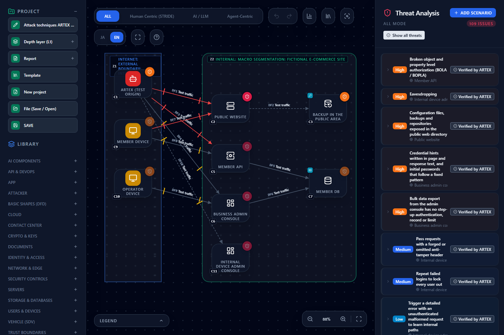
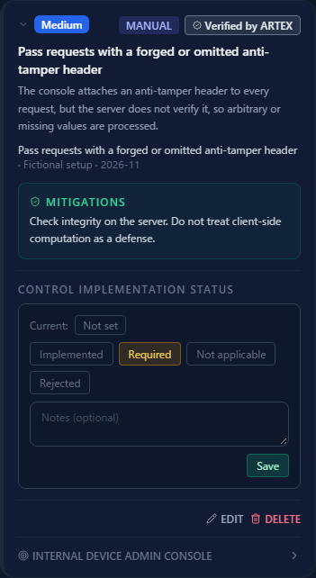

# Seeing the Attack Techniques ARTEX Actually Executed on Threat Cards — Importing and Showing Verified Techniques

**English** | [日本語](artex.ja.md)

> ARTEX is a name belonging to its respective rights holders. This page explains how to put the attack techniques that actually worked
> in a run of ARTEX (an AI autonomous penetration testing tool) onto CyberRiskScape threat cards. It is not provided, certified, or
> endorsed by ARTEX's developer. The name is used descriptively.

> **The attack techniques on this page are limited to what the CyberRiskScape developer actually verified with ARTEX. They are not exhaustive.**
> A technique that is not listed is not evidence that it fails or that the system is safe.

> **Authorized scope** — Run a penetration testing tool such as ARTEX only against targets **your organization manages or that you
> are authorized to test**. Running it against targets without permission may violate laws or contracts. The import on this page only
> reads results that already exist; it does not run any new attack.

---

## 1. What this page covers and prerequisites

- How to show the attack techniques that **ARTEX actually executed and that succeeded** as "verified" on the threat cards generated from the design diagram
- **See it in a sample**: a diagram of a fictional setup carrying 8 attack techniques ARTEX executed (openable in the online demo)
- **Import your own results**: write findings into a registry YAML and put them on the diagram with the CLI's `import-pentest`
- What "verified" means and does not mean (§6)

**Prerequisites**: the operations in [Getting Started](getting-started.md) and [Reading the Threat Panel](reading-threats.md).
The sample setup is **fictional**. It is not an actual test environment.

---

## 2. See it in the demo

Open the [online demo](https://takashi-ohmoto-git.github.io/CyberRiskScape/) and follow these steps.

1. Open **Template** on the left and choose the **Import** tab.
2. Choose **"Sample: attack techniques ARTEX actually executed (fictional setup)"**, click **Replace and apply**, then click **Replace** at the confirmation.
3. In the threat list on the right, press **"Show only the 8 verified attack techniques"** at the top.

> **This replaces the entire project.** Do not open it in a browser where you are editing a diagram.



A verified threat's card shows the technique that was executed, its severity, and the observation date.



Sample files: [`templates/artex-verified-attacks.en.json`](templates/artex-verified-attacks.en.json)
([Japanese version](templates/artex-verified-attacks.ja.json)). To load them, see [Creating and Using Templates](templates.md).

---

## 3. Attack techniques ARTEX actually executed

> **This list is limited to what the CyberRiskScape developer actually verified. It is not exhaustive.** Attack steps and values are not included.

These are the 8 techniques ARTEX executed successfully against the sample diagram (fictional).

| # | Attack technique | Diagram element | Severity | Card |
|---|---|---|---|---|
| 1 | Call the member list API unauthenticated, using only a version header | Member API | High | Rule (canonicalId `api-object-level-authorization`, `api-backend-object-level-authorization-001`) |
| 2 | Fetch a database dump from a listed public directory | Public website | High | Rule (`web-public-dir-sensitive-file-exposure`, `webserver-public-dir-sensitive-file-exposure-001`) |
| 3 | Log in to the admin console using the initial-password convention noted on the screen | Business admin console | High | Rule (`web-content-credential-hint`, `webapp-content-credential-hint-001`) |
| 4 | Bulk-retrieve member data through the admin console export | Business admin console | High | Rule (`admin-bulk-export-unguarded`, `admin-console-bulk-export-unguarded-001`) |
| 5 | Pass requests with a forged or omitted anti-tamper header | Internal device admin console | Medium | Manual threat (no matching rule) |
| 6 | Repeat failed logins to lock every user out | Internal device admin console | Medium | Manual threat (no matching rule) |
| 7 | Run the login process over plain HTTP | Internal device admin console | High | The plaintext communication card "Eavesdropping" (canonicalId `plaintext-transmission`) |
| 8 | Trigger a detailed error with an unauthenticated malformed request to learn internal paths | Internal device admin console | Low | Manual threat (`api-error-information-disclosure` does not fire on this node) |

---

## 4. What you learn

- Out of the many threats the design diagram produced (109 in the sample), you can narrow the view to **which ones actually worked**. This is one basis for prioritizing countermeasures.
- A card with a verified technique maps to that card's **mitigations**, so you can read directly what to fix so the same technique no longer works.
- A **manual threat** is a finding with no matching rule in the library (#5 and #6 above), or whose rule does not fire on that node (#8). It also hints at gaps in the library.

---

## 5. Import your own results (CLI)

Write the ARTEX results into a registry YAML and put them on the diagram with the CLI. This is **CLI only**. There is no way to load the YAML from the screen.

```bash
npm ci && npm run build:cli
node dist-cli/main.js import-pentest my-project.json --in registry.yaml --scope task-1 -o my-project.pentest.json
```

- `--in`: the registry YAML (required)
- `--scope`: import only the items of this scope; findings in other scopes are left untouched
- `-o`: where to write the project JSON that holds the findings. The report (Markdown) goes to standard output

### 5.1 Registry format

A fictional example.

```yaml
schemaVersion: 1
source:
  product: ARTEX
findings:
  - externalId: F-001
    scope: task-1
    title: Fetch a database dump from a listed public directory
    severity: High
    status: open
    canonicalIds: [web-public-dir-sensitive-file-exposure]
    node: C2
    observedAt: "2026-11-01"
```

- `status` is `open`, `fixed`, or `false-positive`. **Only `open` is imported.**
- `canonicalIds` ties a finding to existing threat cards. A finding with no card to land on is added as a manual threat (STRIDE).
- `node` is the diagram's C number or a node ID (labels cannot be used).
- `description` and `mitigation` can also be written.
- **Unknown keys are a load error** (so evidence, requests, responses, and keys cannot be carried into the registry). Do not write evidence or keys into the registry.

### 5.2 Re-importing and checking on screen

- A re-import replaces by **source.product × scope**.
- Node C numbers differ from diagram to diagram, so keep **one scope per diagram**.
- Open the result with **Template → Import → "Select JSON file"**. A project JSON that holds findings **replaces the entire project**.
- `analyze --format sarif --with-findings` can also write them out.
- Copying into the registry is **manual**. A person checks the mapping of classification (`canonicalIds`, `node`).
- By changing `source.product`, this is a general import path that also works for penetration test results other than ARTEX.

---

## 6. Limits

- **Limited to what the CyberRiskScape developer actually verified; not exhaustive.** A technique that is not listed does not mean it fails or that the system is safe.
- "Verified" is **a fact that the technique was executed against that target and succeeded**. It is not proof that attackers will always use that technique.
- Results change with product version, configuration, and environment. The same technique may or may not work in another environment.
- The sample diagram is **fictional** and is not an actual test environment.
- CyberRiskScape has **no feature to run ARTEX**. It only integrates through a file (the registry YAML).
- Whether ARTEX's results are correct is for you to confirm.

---

## What to read next

- Investigate paths from the attacker's view — [Attack Path Analysis](attack-paths.md)
- Plan the test — [Creating a Penetration Test Plan from the Threat Model](pentest-plan.md)
- Assume an agentic attacker — [Deciding where to cut the attack path when an attacker abuses an agentic penetration-testing tool](agentic-attacker-paths.md)
- How to read threats — [Reading the Threat Panel](reading-threats.md)
