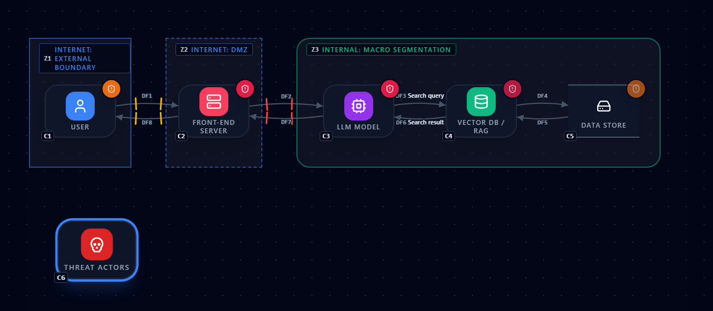
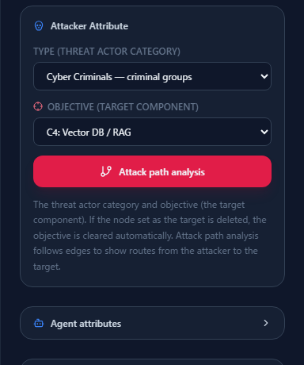
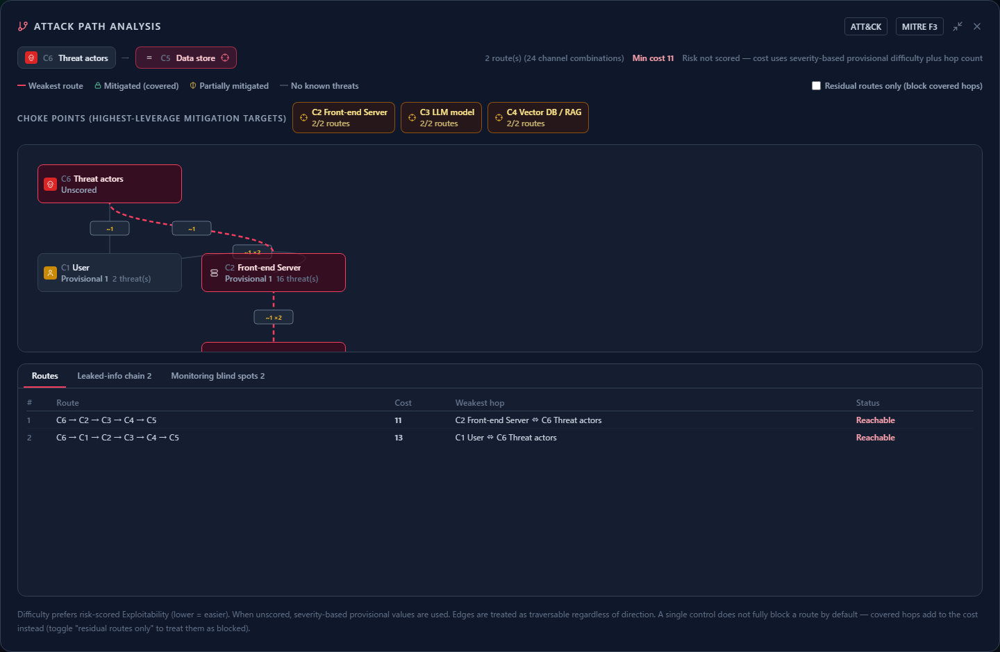
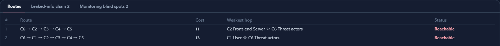
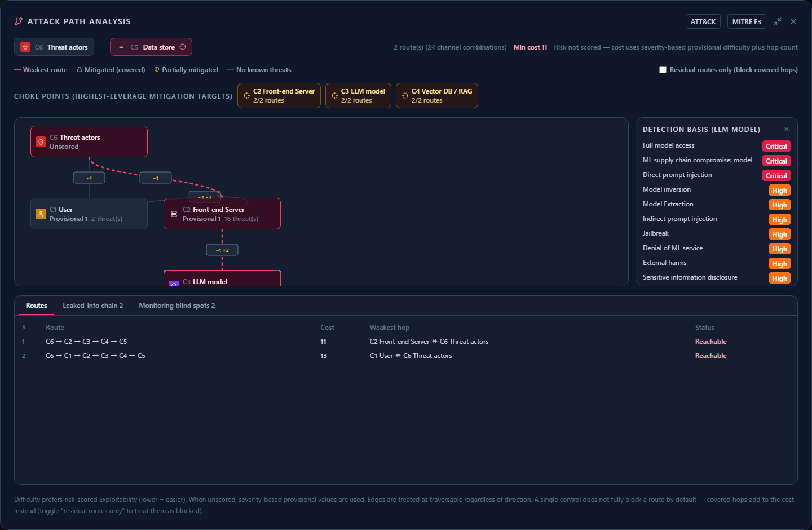

# Attack Path Analysis

**English** | [日本語](attack-paths.ja.md)

A list of threats tells you what could happen. It does not tell you **where a single control buys
you the most**. That is what attack path analysis is for.

This page follows on from [Assessing Risk in Analytics](analytics-assessment.md) — the risk scores
and control implementation status you record there feed directly into this analysis, so read that
first. The diagram is the AI chatbot built in [Your First Threat Model](first-threat-model.md).

---

## 1. What it tells you

It enumerates the routes from an attacker component to a target component **by following the
connections in your diagram**, and reports three things:

1. **How easy each route is** (its cost) — which route is the attacker's path of least resistance
2. **Choke points** — which element, if you put one control on it, covers the most routes
3. **The evidence for each hop** — the threats that make that hop passable

**Counting routes is not the point.** The point is deciding where to spend a limited mitigation
budget.

---

## 2. Setup — put an attacker and a target on the diagram

Two pieces of information have to exist on the canvas first.

### 2.1 Place an attacker and connect it to an entry point

From the `Attacker` category in the left sidebar, place an attacker (Threat actors, Insider Threats
or Agentic Attacker) and connect it to **whatever it touches first**.

There can be more than one entry point. In the example the attacker reaches both the user (phishing
and the like) and the Front-end Server (a direct attack on the public surface).
**The more entry points there are, the more the choke point analysis is worth.**

### 2.2 Set TYPE and OBJECTIVE

Selecting the attacker puts **Attacker Attribute** in the right pane.

- **TYPE** — cyber criminals, nation-state actors, insiders, and so on
- **OBJECTIVE** — the component the attacker is ultimately after

**The "Attack path analysis" button stays disabled until OBJECTIVE is set**, because there is no
route to draw until you have said who is coming and what they want.

Delete the component you named as the target and the objective is cleared automatically.

### 2.3 Entry candidates for an AI agent attacker

When the attacker is an **AI agent attacker**, the tool looks for nodes that could be entered from
outside without you drawing a line, and adds them to the routes as **entry candidates** through
virtual lines from the attacker (purple dotted lines, not saved). Toggle this with "Include entry
candidates in routes" in the analysis. These nodes become entry candidates:

| Entry candidate | Technique assumed |
|---|---|
| Public servers with a global IP, nodes that receive a line over the Internet, and nodes inside an Internet boundary | Attacking externally visible assets directly |
| User endpoints (user, PC, smartphone) inside an Internet boundary that have a line to a remote-access device (VPN gateway, ZTNA proxy, bastion, admin console) | Compromising an external endpoint such as a maintenance contractor's (phishing, infostealer malware) and entering with its credentials over the legitimate connection |
| Nodes the attacker has a line to (user endpoints included) | A technique you drew yourself. For example, a member account takeover enters the routes when you draw a line from the attacker to the member |

Users who only use a public site, such as members, do not become entry candidates automatically
(there would be too many). To include an account takeover in the routes, draw a line from the
attacker to that user.

The virtual line from the attacker to an entry **inherits the threats on the lines the entry receives
from the Internet**. For example, if a maintenance VPN device carries "known vulnerabilities in an
Internet-exposed boundary device" on the line from the maintenance contractor, that threat also
counts toward the difficulty of the step where the attacker attacks the VPN device directly.

---

## 3. Reading the result

Press "Attack path analysis" and the analysis opens. From the top: the summary and toggles, the graph (with the evidence on its right), and the tabs at the bottom.
It opens filling the screen. The button at the top right makes it smaller (it opens full-screen again next time).

### The header

- **2 route(s) (24 channel combinations)** — two routes reach the target (the data store). The number
  in parentheses counts combinations of parallel data flows and is **informational only**: routes
  through the same sequence of components count as **one route**, however many channels connect them.
  The round-trip flows make 24 combinations here, but there are still two routes.
- **Min cost 11** — the cost of the easiest route. Lower means easier for the attacker.
- **Risk not scored…** — the note shown while no risk assessment exists (see below).

### The graph

**The attacker is at the top, the target at the bottom.** Each component is drawn as **a single
card** no matter how many routes pass through it, and the red dashed line marks the
**weakest route** — the cheapest one.

Every card shows the element's **difficulty** and **how many threats fired on it**.

| Label | Meaning |
|---|---|
| Difficulty n | Derived from the Exploitability score (lower = easier to pass) |
| Provisional n | No risk score, so a value inferred from severity |
| Unscored | Nothing to judge from |

The small chips between cards are **logical hops**. Where several parallel channels connect the same
two elements they collapse into one hop labelled `×2` — every hop shows `×2` here, because the
diagram carries both directions. The reasoning is that **the attacker picks whichever channel is
easiest**, so covering one of them does not close the hop.

---

## 4. Choke points

This is the feature's main value. It counts **how many of the routes pass through each element** and
shows the top three (only elements on two or more routes).

Here the Front-end Server, the LLM model and the Vector DB / RAG each carry "2/2 routes" — put a
control on any of them and **both routes are affected at once**. Hardening only the path through the
user would leave the direct attack on the public surface untouched.

Before designing a separate control per entry point, cover **what every route has to pass through**.
That is the order with the best return.

The attacker and the target themselves are excluded, since they are obvious by definition.

---

## 5. The route table

The tabs below the graph switch between the **route table**, the **leaked-info chain** (threats whose leaked values become the key to the next step) and **monitoring blind spots** (stretches of a route where logs do not reach a monitoring destination).
The leaked-info chain and blind spots are shown as evidence only and do not change route costs or ranking. The route table lists the routes.

| Column | Meaning |
|---|---|
| Route | The sequence of components traversed |
| Cost | Total difficulty of reaching the target (lower favors the attacker) |
| Weakest hop | The easiest step on that route — **the first candidate for a control** |
| Status | Reachable or blocked |

Work from the cheapest row down. Above, `C6 → C2 → C3 → C4 → C5` (cost 11) is the easiest route,
which the attacker would prefer over the one through the user (cost 13).

---

## 6. Checking the evidence

Click a card or a hop in the graph and you get **the threats that fired there**.

This is where you see **which threats support the claim that a hop is passable**. It follows the same
idea as "Why this fired" in the threat panel: you never have to take a number on faith.

The evidence for a component lists its own threats and also **the threats on lines into this node**
(the same list you see when you select the component on the canvas). For route cost, a line's
threats are counted on the line (the hop).

An element with no threats at all is greyed out as "no known threats". **That does not mean it is
safe.** The tool assumes worst-case lateral movement, so it treats such an element as passable
anyway — the grey only distinguishes assumption from evidence.

---

## 7. How difficulty and cost are derived

Knowing where the numbers come from keeps you from over-trusting them.

**Difficulty per element:**

| Condition | Difficulty |
|---|---|
| Risk scored | `4 − max(Exploitability)` |
| Threats present but not scored | Provisional, from severity (Critical/High → 1, Medium → 2, Low → 3) |
| No threats | Neutral 2 |

**Route cost** is the sum of the difficulties of the components and channels traversed, plus a
penalty for how well the hop is covered.

| Coverage | Added |
|---|---|
| Partially mitigated | +1 |
| Mitigated (covered) | +8 (treated as blocked in "residual routes only" mode) |

**Coverage comes from the control implementation status you recorded** in
[Analytics](analytics-assessment.md). Of
the threats that fired on that element, if **all** are marked "Implemented" or "Not applicable" it
counts as covered; if only some are, it is partially covered.

> **The more risk you score, the more accurate this gets.**
> With nothing scored, cost is effectively "provisional severity values plus hop count". The screen
> says so when that is the case — do not treat the numbers as settled.

---

## 8. "Residual routes only"

Tick the checkbox at the top right and **fully covered hops are treated as blocked**, leaving only
the routes that survive.

- Normal mode: controls add cost. A single control is not assumed to stop a route outright.
- Residual mode: covered hops are impassable, showing **the risk that remains after mitigation**.

Work in normal mode day to day, and switch to residual mode when you want to see what your controls
actually bought you.

---

## 9. Viewing the routes as an ATT&CK or MITRE F3 matrix

The **ATT&CK** and **MITRE F3** buttons at the top right show the techniques used by the threats
detected on the top 3 routes, laid out as a matrix with one column per tactic (the buttons are
disabled when there is no route).

| Matrix | What it shows |
|---|---|
| **ATT&CK** | MITRE ATT&CK Enterprise (v20.0) |
| **MITRE F3** | MITRE Fight Fraud Framework (a catalogue of fraud techniques). Names are shown as in the original |

- **Coloured cells** are matching techniques, coloured by threat severity. Techniques on a route
  carry the **step number** at which they appear; those detected only on elements off the routes are
  marked "Detected off path".
- When only a sub-technique matches, the cell shows "Sub matched". **Expand all** opens every one at once.
- **Click a cell** to list the matching threats on the right.
- Techniques come only from the references (`complianceRefs`) written in the threat rules, so
  **rules without an ATT&CK or F3 ID do not appear**. F3 in particular has been mapped to only some
  rules as a trial; an empty cell does not mean the technique is absent.

The same top routes can also be exported as an ATT&CK Navigator layer (JSON), from **Report** in the
left sidebar or with the CLI's `export-attack-navigator`.

---

## 10. Assumptions and limits

The analysis rests on the following. **Check them before drawing conclusions.**

- **Connections are traversed without regard to direction.** Even a one-way data flow is treated as
  passable both ways for lateral movement — a worst-case assumption.
- **Enumeration is capped.** Beyond 8 hops deep or 50 routes, some are omitted and the screen says
  so.
- **Choke points are a simple hit count**, not an exact minimum cut. That is deliberate: an exact
  solution would be overkill at diagram scale.
- **Only what the threat library covers can serve as evidence.** "No known threats" is not proof of
  safety.

---

## Where to go next

- How to assess and record — [Assessing Risk in Analytics](analytics-assessment.md)
- Reading the threat cards — [Reading the Threat Panel](reading-threats.md)
- Lining threats up against standards — [The Compliance Map](compliance-map.md)
- How to draw the diagram — [Your First Threat Model](first-threat-model.md)
- The operations in detail — [Getting Started with CyberRiskScape](getting-started.md)
