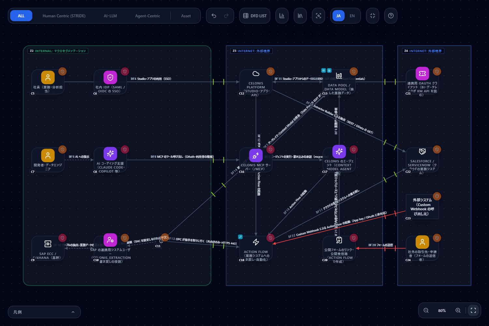
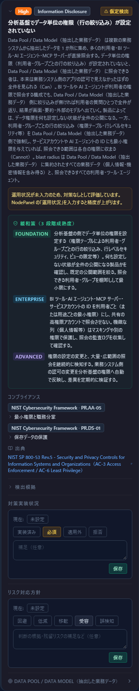
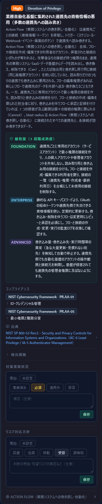
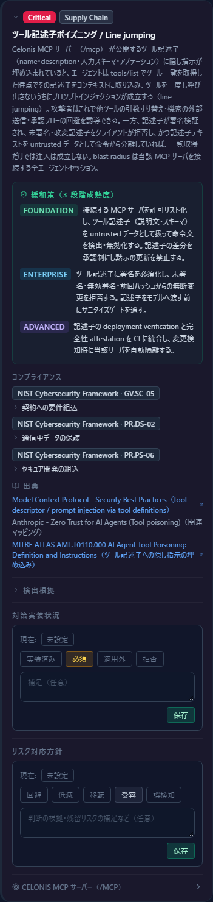

# Celonis（プロセスマイニング）を使う構成を脅威モデリングする — 抽出・書き戻し・MCP を 1 枚の図で評価する

[English](celonis.md) | **日本語**

> Celonis は Celonis SE の商標、SAP は SAP SE の商標です。そのほか本文の製品名はそれぞれの所有者の商標です。このページは
> 「Celonis を使う構成を CyberRiskScape で脅威モデル化する方法」を説明するもので、Celonis 社が提供・認定・推奨するものではありません。
> 記述的な使用です。製品の仕様は変わりうるため、最新は各リンク先の公式の情報で確認してください。
>
> **件数は執筆時点の実測値です。** 本文の脅威の件数（読み込むと 140 件など）は、2026 年 11 月 13 日時点の脅威ライブラリと
> テンプレートで CLI の `analyze` を実行して数えたものです。ルールや属性を変えると増減します。

---

## 1. このページで分かること・前提

- Celonis の構成要素（データ抽出・Data Pool / Data Model・Action Flow・MCP サーバー）を、CyberRiskScape のコンポーネント型に**どう対応づけるか**
- SAP から抽出して Celonis に集め、Action Flow で書き戻し、MCP で AI エージェントから照会する構成の**構成図テンプレート**（読み込むだけで使えます）と、
  それに対して**実際に検出される脅威**
- 新しく加わった 2 つの型（**業務自動化 / iPaaS**・**分析基盤 / DWH**）と、2 つのルール
  （`automation-platform-credential-aggregation-001`・`analytics-data-permission-missing-001`）の読み方
- 同じ型で Workato・Zapier・Power Automate・n8n などの iPaaS や、Snowflake・BigQuery などの DWH を描く方法
- Celonis の MCP サーバーと CyberRiskScape の MCP サーバーを、同じ AI エージェントから使うときの注意

**前提：Celonis の概要**（執筆時点の公式ドキュメントの記載による。2026 年 11 月 13 日に確認）

- 業務システム（SAP など）から取り込んだデータは、**データ接続 → 抽出・変換ジョブ → Data Pool → Data Model → Studio のビュー・アプリ**の順に流れます。
  接続の種類は、ネイティブコネクタ・JDBC・Extractor Builder（REST / OData の GET）・Standard Data Ingestion API（S3 互換の PutObject）・ファイルのアップロードです
  （[出典 4](#参考リンク)）。
- オンプレミスの SAP との接続には **On-Premise Client（OPC）** を使います。OPC は受け身の仲介で、Celonis へ外向きに接続し、受信ポートを開けません。
  1 つの SAP 接続が、**抽出と Action Flow の書き戻しの両方**に使われます（[出典 6](#参考リンク)）。
- **Action Flow** は、SAP・Oracle・ServiceNow などで処理を起動する自動化の仕組みです（[出典 9](#参考リンク)）。
- Celonis は、テナントごとの **MCP サーバー**を提供しており、Claude などの AI クライアントから使えます（[出典 3](#参考リンク)・[出典 10](#参考リンク)）。

**このページの前提となる知識**：[はじめに](getting-started.ja.md)の操作と、[テンプレートを作る・使う](templates.ja.md)の読み込み手順、[脅威パネルの読み方](reading-threats.ja.md)。

> **確度の表記について** — docs.celonis.com の一部のページは、サインインしないと読めないことがあります。本文では
> 「執筆時点の公式ドキュメントの記載では」と書いた項目だけを事実として扱い、確認できなかったことは「確認できていない」と明記しています。

---

## 2. Celonis の構成要素と CyberRiskScape の型の対応

型の名前は、画面に出る**現在の表示名**で書いています。

| Celonis の構成要素 | CyberRiskScape の型 | 設定のポイント |
|---|---|---|
| Celonis Platform（Studio・アプリ・API） | SaaS | 利用者は IdP の SSO（または Celonis ID）でサインインする |
| Data Pool / Data Model | **分析基盤 / DWH**（`ANALYTICS_PLATFORM`） | 運用状況の「データ単位の権限」を、権限テーブルを設定したら **Enforced** にする（§4.2） |
| Action Flow | **業務自動化 / iPaaS**（`AUTOMATION_PLATFORM`） | 連携先への線（書き戻し）を描く。Webhook の呼び出し元・公開フォームも描く（§4.3） |
| On-Premise Client（OPC） | コネクタ | 外向きのみの仲介。受信の線を引かない |
| SAP の連携用システムユーザー | サービスアカウント | 抽出と書き戻しで 1 つを共用していないかを確認する（§4.1） |
| SAP ECC / S/4HANA | バックエンドAPI | 抽出の元であり、書き戻しの先でもある（双方向の線） |
| Celonis MCP サーバー（`/mcp`） | MCPサーバー | OAuth（Authorization Code ＋ PKCE）で、サインインした利用者の権限で動く |
| Celonis のエージェント（Context Model agent など） | AIエージェント | MCP の `execute_agent` などから起動できる |
| AI クライアント（Claude Code・Copilot など） | AIエージェント | 社員側。Celonis MCP への線は Token で描く |
| 保存された接続の資格情報 | 認証情報 | Action Flow から連携先へ向かう資格情報の集まり |
| 連携用 OAuth クライアント（BI・データレイクが KM API を読む） | OAuthクライアント | Client Credentials。長期のシークレットになりやすい |
| 公開フォーム・公開受信箱 | Webフォーム | 社外の送信者から Action Flow の先へ入る入口 |
| Salesforce・ServiceNow など連携先 | CRM | 書き戻しと抽出の先 |

> **ひとこと** — SAP を「バックエンドAPI」に置いたのは、図の型を寄せたことによる割り切りです。この型には API サーバー向けの汎用ルール
> （BOLA・SSRF など。§4.1）が当たるため、SAP 固有の事情に照らして読み替えてください。

---

## 3. 構成図の例

| ファイル | 内容 |
|---|---|
| [`templates/celonis-process-mining.ja.json`](templates/celonis-process-mining.ja.json) | 日本語版 |
| [`templates/celonis-process-mining.en.json`](templates/celonis-process-mining.en.json) | 英語版 |

**中身：** コンポーネント 20・データフロー 19・トラスト境界 3（社内＝Internal、Celonis のクラウド＝Internet、社外の送信者・連携 OAuth クライアント＝Internet）。

- **抽出の流れ** — SAP ← 連携用システムユーザー ← OPC → Data Pool。OPC は外向きに Celonis へ接続する
- **書き戻しの流れ** — OPC が Action Flow の指示を取りに行き、SAP へ書き戻す。Action Flow → Salesforce / ServiceNow
- **AI エージェントの流れ** — AI コーディング支援 → Celonis MCP サーバー → Data Pool・Celonis のエージェント → Action Flow
- **外から入る流れ** — 社外の送信者 → 公開フォーム → Celonis のエージェント。外部システム → Action Flow（Custom Webhook）

読み込み方は[テンプレートの章](templates.ja.md#3-読み込むimport)と同じです。左サイドバーの **Template** → **Import** で JSON を選び、**置き換えて適用**します。

**読み込むと 140 件**（Critical 18・High 79・Medium 43）の脅威が検出されます（執筆時点の実測値）。

### 3.1 図の前提（仮置きの属性）

テンプレートの属性は**一般的な構成を想定した仮置き**です。運用状況（ログ・パッチ・暗号化・データ単位の権限など）は**未入力**のままにしてあり、
「未入力は悪い値と同じ扱い」の方針で脅威が出ます。カードに「仮定検出」の印が付くのはそのためで、実態を入力すれば消えます。

| 要素 | 設定 | 直したくなる場面 |
|---|---|---|
| SAP への RFC 接続 | 暗号 Plain（SNC を設定しなければ平文） | SNC を設定しているなら暗号を上げる |
| 連携用システムユーザー | 認証 Password | 公式の記載では、パスワードを持つ専用のシステムユーザー |
| MCP サーバー | グローバル IP あり・利用者認証あり・レート制限あり | 送信元 IP の制限（§4.5）を入れたら属性を直す |
| Webhook・フォームの線 | 認証 None・Internet | 実際の認証（署名・シークレットなど）に合わせて直す |
| Data Pool | データ単位の権限が未入力 | 設定したら `Enforced` にする（§4.2） |

---

## 4. 押さえるべき脅威

各項目に「検出されるルール」と「Celonis での意味」を書きます。ルール ID は執筆時点の実測です。**検出されないことも正直に書きます。**

### 4.1 SAP との接続：システムユーザーの権限と平文の RFC

執筆時点の公式ドキュメントの記載では、SAP 側には**専用のシステムユーザー（パスワード）**を作り、配布される役割 `CELONIS_EXTRACTION` が
`S_TABU_DIS` の `DICBERCLS = *`（すべてのテーブル権限グループ）・`S_DATASET` の `FILENAME *`・`S_BTCH_JOB` の `JOBGROUP *` を与える、とされています
（[出典 7](#参考リンク)）。同じ記載で、`DICBERCLS` を権限グループに絞る、`S_TABU_NAM` を使う、`FILENAME` を目的のパスに絞る、といった絞り込みが可能と書かれています。
書き戻し（自動化）の権限は、**手で足す**運用です。OPC の 1 つの SAP 接続が抽出と書き戻しの両方に使われるため（§1）、
**読み取り専用の抽出ユーザーのつもりが、書き込みもできるユーザーになる**ことが構造上あり得ます。

| ルール | 重大度 | 発火する要素 | 読み方 |
|---|---|---|---|
| NHI の過剰な権限（`nhi-overprivileged-001`） | High | システムユーザー・連携用 OAuth クライアント | 全テーブルの読み取り＋書き戻しは過大になりやすい |
| NHI の長期の静的シークレット（`nhi-long-lived-secret-001`） | High | 同上 | パスワード・クライアントシークレットを回しているか |
| NHI の使い回し（`nhi-reuse-001`） | Medium | システムユーザー | 抽出と書き戻しで 1 ユーザーを共用していないか |
| NHI の不適切なオフボーディング（`nhi-improper-offboarding-001`）・環境分離の不備（`nhi-environment-isolation-001`） | Medium | システムユーザー・連携用 OAuth クライアント | 所有者の不在・開発と本番の共用 |
| 盗聴（`stride-edge-plain-encryption-001`） | High | OPC → システムユーザー・システムユーザー → SAP の線（ほか AI への指示の線） | **SNC を設定しない RFC は平文**。図では暗号 Plain で表している |

SAP は「バックエンドAPI」の型なので、API 向けの汎用ルール（`api-backend-remote-code-execution-001`（Critical）・`api-backend-object-level-authorization-001`・
`api-backend-function-level-authorization-001`・`api-backend-ssrf-001`・`api-backend-query-injection-001`）も出ます。これは型の割り切りによるもので、
SAP 固有の評価ではありません。実態に合わない項目は、対応方針で「対象外」にして理由を残します。

**検出されないもの** — 役割 `CELONIS_EXTRACTION` に実際に付いた権限（`DICBERCLS` を絞ったか）は読み取れません。SAP の実効権限は人が確認します。

### 4.2 Data Pool：データ単位の権限が未設定だと全員が見られる

執筆時点の公式ドキュメントの記載では、Data Integration の権限は**サービス・Data Pool・Data Model の 3 つの粒度**で付けられ、
**Data Model にデータ権限が 1 つも割り当てられていなければ、読み込み後は全ユーザー・全グループが Studio からそのデータにアクセスできる**とされています
（[出典 8](#参考リンク)）。

上の画面は、Data Pool のカードです。「仮定検出」の印は、運用状況が未入力のため対策なしとして評価したことを示します。

| ルール | 重大度 | 発火する要素 | 読み方 |
|---|---|---|---|
| 分析基盤でデータ単位の権限（行の絞り込み）が設定されていない（`analytics-data-permission-missing-001`、**新規**） | High | Data Pool / Data Model | 運用状況の「データ単位の権限」が**未入力または None**のとき発火する |
| 情報漏洩（`stride-data-store-info-disclosure-001`）・データ改ざん（`stride-data-store-tampering-001`） | High | Data Pool / Data Model | データストアの汎用ルール |
| 監査追跡不能（`stride-data-store-repudiation-001`） | Medium | 同上 | 照会の記録を集めているか |
| 不要・要検討のデータを保有し続けている（`posture-data-minimization-001`） | High | 個人情報・業務データ | 抽出するテーブルと列を絞ったか |

**直し方** — 権限テーブルなどでデータ単位の権限を設定したら、Data Pool の運用状況の「データ単位の権限（利用者・グループごとの行の絞り込み）」を **Enforced** にします。
このテンプレートで試すと、発火は `analytics-data-permission-missing-001` の 1 件が消え、**140 件が 139 件**（High 78）になります。

### 4.3 Action Flow：集約された資格情報・Webhook・公開フォーム

執筆時点の公式ドキュメントの記載では、Action Flow はモジュールごとに認証方式（App key または OAuth 2.0）を持ち、**新しい App key の接続は作れなくなっています**。
**Custom Webhook のモジュールはどちらの方式にも対応しません**。また、**公開フォームのリンクや公開受信箱を作るモジュール**があり、
URL で起動する Webhook は Studio のビューのデータを渡せます（Studio のスマート入力を使うほうが望ましいとされています）
（[出典 9](#参考リンク)）。

| ルール | 重大度 | 発火する要素 | 読み方 |
|---|---|---|---|
| 業務自動化基盤に集約された連携先の資格情報の悪用（`automation-platform-credential-aggregation-001`、**新規**） | High | Action Flow | 連携先への線がある図で発火する。1 つの侵害が多数の連携先の読み書きに及ぶ |
| 認証材料の静的保管・スプロール（`zt-credential-sprawl-static-secret-001`） | High | 保存された接続の資格情報 | 接続ごとの静的な鍵の棚卸し |
| 送信者制約のないベアラートークンの窃取・再利用（`zt-bearer-token-replay-001`） | High | トークンの線（OPC・書き戻し・KM API など） | 盗まれたトークンはそのまま使える |
| 中間コネクタ改ざん（`stride-connector-tampering-001`） | High | OPC・Action Flow | 仲介が改ざんされると書き戻しの内容が変わる |
| なりすまし（`stride-edge-unauth-internet-001`） | Critical | 「フォームの送信」・「Webhook による起動」の線 | 認証なしで Internet から入る入口 |
| なりすまし（`stride-external-entity-spoofing-001`）・否認（`stride-external-entity-repudiation-001`） | High・Medium | 外部システム（Webhook の呼び出し元） | 署名・シークレットを検証できない呼び出し元 |
| フォーム入力値による下流システムへのインジェクション（`webform-input-injection-001`） | High | 公開フォーム | フォームの値が Action Flow・SAP へ流れる |
| 添付ファイル経由の Web シェル設置（`webform-webshell-upload-001`） | Critical | 公開フォーム | 公開受信箱が添付を受け取るなら確認する |
| Bot による大量投稿と自動返信メールの踏み台化（`webform-automated-abuse-001`） | Medium | 公開フォーム | |

**公開フォームから AI エージェントへ**：図では、公開フォームの内容を Celonis のエージェントが読みます。外の人が書いた文章を、社内のエージェントが
「データ」として読む構造なので、**業務アプリのデータを経由する間接プロンプトインジェクション**（`owasp-llm01-indirect-business-record-001`、High）と、
信頼境界外からのプロンプト入力（`maestro-agent-untrusted-ingress-001`、High）が出ます。

**検出されないもの** — どの Action Flow モジュールが App key か OAuth かは読み取れません。Webhook の署名検証の有無は、線の認証の属性で人が表します。

### 4.4 MCP：利用者の権限で動くツールと、AI エージェントの影響範囲

執筆時点の公式ドキュメントの記載では、MCP サーバーは `https://[team].[realm].celonis.cloud/mcp`（streamable HTTP）にあり、Claude は**登録済みの公開 OAuth クライアント**
（`client_id` は `claude_mcp`、PKCE・シークレットなし）で Authorization Code グラントを使い、**サインインした利用者の権限を引き継ぎます**。API キーや App key は使えません
（[出典 3](#参考リンク)・[出典 10](#参考リンク)・[出典 11](#参考リンク)）。スコープは `mcp:read` と `mcp:write` で、`mcp:write` では `deploy_package`・`delete_branch`・
`dp_execute_pipeline`・`execute_agent`・`approve_context_model_agent_write` などのツールが加わります。読み取りのツールには `query_data_lake`・`query_context_model` があります。
権限の表では、**Data Pool の照会に Data Pool の EDIT、Context Model の読み取りに Context Model の EDIT が必要**とされ（[出典 12](#参考リンク)）、
MCP では**読み取り専用の最小権限にできない**ことになります。利用者が実行できないツールも一覧には出ることがあるとされています。
アセットごとの Agent Tools（MCP）サーバーもあり、既定のレート制限は 1 アセットあたり 1 分 500 回です。対応するクライアントには、Claude・Codex・Cursor・
GitHub Copilot・Google Antigravity・Microsoft Copilot Studio・OpenCode・Slack があります。

| ルール | 重大度 | 発火する要素 | 読み方 |
|---|---|---|---|
| ツール記述子ポイズニング / Line jumping（`mcp-tool-descriptor-poisoning-001`） | Critical | MCP サーバー | ツール一覧の取得だけで隠し指示が取り込まれうる |
| MCP サーバなりすまし / タイポスクワッティング（`mcp-server-impersonation-typosquatting-001`） | High | MCP サーバー | 接続先の URL の確認 |
| グローバルIP直接公開（`stride-web-global-ip-exposure-001`）・送信元IP無制限アクセス（`stride-web-no-source-ip-restriction-001`）・盲点境界：公開×無ログ（`stride-web-blind-perimeter-001`） | High | MCP サーバー | 送信元 IP の制限は §4.5 |
| 自律動作の暴走（`excessive-agency`） | Critical | AI クライアント・Celonis のエージェント | `mcp:write` の影響範囲 |
| 高リスク操作への人の承認が効いていない（`secops-agent-approval-ineffective-001`） | High | 同上 | **エージェント自身が `approve_context_model_agent_write` で承認できると、人の承認にならない** |
| Lethal Trifecta（`maestro-lethal-trifecta-001`） | Critical | 同上 | 攻撃者制御のデータの取込 × 機密データ × 外部送信 |
| 直接プロンプトインジェクション（`owasp-llm01-prompt-injection-001`） | Critical | 同上 | |
| 同意画面型 OAuth の付与の散在（`identity-oauth-consent-grant-sprawl-001`） | Medium | AI クライアント → MCP の線 | IdP から見えない委任 |
| 作業フォルダの秘密情報の外部送信（`dev-agent-workspace-secret-exfiltration-001`） | Critical | AI クライアント・エージェント | |

**推奨**

- AI エージェントには、まず **`mcp:read` だけ**を渡す。書き込みが要るときだけ `mcp:write` を足す
- エージェント専用の**権限の低い Celonis ユーザー**を作る（利用者の権限を引き継ぐため、管理者でサインインしたクライアントに管理者の権限が渡る）
- エージェントの書き込みの承認は、**人が行う**。`approve_context_model_agent_write` をエージェントに呼ばせない

**検出されないもの** — 「MCP の読み取りに EDIT 権限が要る」ことは、ルールではなくこのページの注意です。実際に付いているスコープと権限は読み取れません。

### 4.5 利用者の認証・IdP・ネットワーク制限

執筆時点の公式ドキュメントの記載では、Celonis は SAML / OIDC の SSO・Celonis ID（メールとパスワード）・SCIM・SAML の JIT プロビジョニング・
**IP アドレスによるアクセス制限**（CIDR。ブラウザ・API・OPC の通信に適用）・同時セッション 5 件までを備え、検証済みドメインでの自由登録も設定できます
（[出典 13](#参考リンク)・[出典 14](#参考リンク)）。**Celonis ID の多要素認証は、セキュリティ機能のページには記載がなく、確認できていません。**
監査ログは、SIEM 連携向けの API（v2）が記載されています。Permissions API はデータ単位の権限を含みません（[出典 5](#参考リンク)）。

| ルール | 重大度 | 発火する要素 |
|---|---|---|
| フェデレーション信頼の改ざん（`identity-idp-federation-trust-tampering-001`）・IdP 署名鍵侵害によるトークン偽造（`zt-idp-signing-key-compromise-001`） | Critical | IdP |
| 認証の単独依存（`idp-single-point-of-failure`）・認証イベントの記録・保全の欠如（`identity-idp-authentication-log-gap-001`） | High・Medium | IdP |
| アカウント乗っ取り（`stride-user-spoofing-001`） | High | 社員・開発者・社外の送信者 |
| ログの保持期間が短い・取得していない（`posture-log-retention-short-001`・`posture-log-not-collected-001`）・アカウント棚卸しの運用がない（`posture-account-review-missing-001`） | High・Medium | IdP・Celonis・Data Pool・Action Flow ほか |

**検出されないもの** — Celonis の IP 制限（CIDR）や SSO の設定内容は評価できません。設定したら、MCP サーバーの「送信元 IP の制限」の属性に反映します。

### 4.6 API 連携（KM API・BI からの照会）

執筆時点の公式ドキュメントの記載では、API は OAuth 2.0（client credentials / authorization code）を使い、**スコープはクライアントの権限を超えて付与されません**。
KM API の既定の制限は 1 日 6000 リクエスト・毎秒 20 リクエストで、**大量の生データの書き出しには向かない**とされています（[出典 1](#参考リンク)・[出典 2](#参考リンク)）。
図では「連携用 OAuth クライアント」に、`nhi-overprivileged-001`・`nhi-long-lived-secret-001`・`zt-bearer-token-replay-001` が出ます。**スコープは権限を足さない**ため、
クライアントに付けた Celonis の権限がそのまま効きます。クライアントごとに権限を最小にしてください。

---

## 5. 攻撃経路分析で、守りどころを探す

[攻撃経路分析](attack-paths.ja.md)で、攻撃者を「社外の取引先・申請者」に置き、標的を Action Flow や Data Pool にすると、公開フォーム → Celonis のエージェント → Action Flow（または Data Pool）
という経路が候補になります（執筆時点では、この経路は図の線から読み取った見立てで、画面での分析は行っていません）。**公開フォームとエージェントの間**が、経路を断つ場所の候補です。この攻撃者はテンプレートには含まれません。試すときは自分で追加してください。

---

## 6. ほかの iPaaS・DWH を描く

新しい 2 つの型は Celonis 専用ではありません。

| 製品の例 | 使う型 | 描き方 |
|---|---|---|
| Workato・Zapier・Power Automate・n8n・MuleSoft など | **業務自動化 / iPaaS** | 連携先（業務システム・SaaS）への線を描く。保存された接続は**認証情報**で表すと、集約の様子が見える |
| Snowflake・BigQuery・Redshift・Databricks など | **分析基盤 / DWH** | BI・AI エージェント・MCP サーバーからの照会の線を描く。行レベルの権限を設定したら「データ単位の権限」を Enforced にする |

注意：iPaaS の型は、**連携先への線を描かない図では** `automation-platform-credential-aggregation-001` が出ません（連携先が不明なまま「資格情報の集約」を言うと根拠がないため）。
抽出の中継だけをする仲介（OPC のようなもの）は「コネクタ」のままで構いません。

---

## 7. Celonis の MCP と CyberRiskScape の MCP を、同じエージェントから使う

Claude Code などの 1 つの AI エージェントに、**Celonis の MCP サーバー**と **CyberRiskScape の MCP サーバー**（[コーディングエージェントから使う](mcp-integration.ja.md)）の
両方をつなぐと、エージェントが両方の文脈を突き合わせられます。たとえば「Celonis が示す、止まると影響の大きい業務プロセス（受発注・請求など）を支えるシステムを挙げ、
CyberRiskScape で、その構成要素に当たっている Critical・High の脅威を調べて」と頼む使い方です。ビジネス上の重要度と脅威を並べることで、対策の優先順位をつけやすくなります。

**安全上の注意** — このとき、エージェントは**業務データの文脈と脅威モデルの両方**を持ちます。Celonis 側は §4.4 のとおり **`mcp:read` のみ**にし、
エージェント専用の権限の低いユーザーでつなぎます。2 つのサーバーは互いに通信せず、つなぐのはエージェントです。
Celonis のツール記述子や、照会結果に紛れた指示（間接プロンプトインジェクション）に従って、脅威モデルを書き換えさせない運用（書き込みの承認は人）も保ちます。

---

## 8. 限界

- **CyberRiskScape は Celonis の設定を読み取りません**（取り込み機能はありません）。ロール・権限テーブル・接続の方式・IP 制限・MCP のスコープは、図の属性に人が反映します。
- 「MCP の読み取りに EDIT 権限が要る」という点は、**ルールではなくこのページの注意**です。
- Celonis の AI 機能が使う LLM の提供元とデータの扱いは、**確認できていません**。契約と公式の記載で確認してください。
- Celonis 固有の既定値（既定のレート制限・権限の既定など）は変わりえます。
- テンプレートの属性は仮置きです（§3.1）。検出件数は、属性や接続の置き方で変わります。
- SAP を「バックエンドAPI」に置いているため、SAP 固有ではない API 向けのルールが出ます（§4.1）。

---

## 参考リンク

公式ドキュメントは、2026 年 11 月 13 日に確認しました。docs.celonis.com はサインインが必要な場合があります。

1. 認証（Celonis API） — <https://developer.celonis.com/celonis-apis/auth>
2. レート制限 — <https://developer.celonis.com/celonis-apis/rate-limiting>
3. MCP サーバーの概要 — <https://developer.celonis.com/mcp-server-asset/overview>
4. Standard Data Ingestion API — <https://developer.celonis.com/data-ingestion-api/standard/standard_overview>
5. Platform Usage API（監査ログ・権限） — <https://developer.celonis.com/celonis-apis/platform-usage-apis>
6. On-Premise Client — <https://docs.celonis.com/en/on-prem-clients.html>
7. SAP 接続用ユーザーの作成 — <https://docs.celonis.com/en/creating-users-for-sap-connection.html>
8. Data Integration の権限 — <https://docs.celonis.com/en/data-integration-service-permissions.html>
9. Action Flows の認証方式 — <https://docs.celonis.com/en/action-flows-authentication-methods.html>
10. MCP 連携 — <https://docs.celonis.com/en/mcp-integrations.html>
11. MCP 連携（Claude） — <https://docs.celonis.com/en/mcp-integration-claude.html>
12. MCP 連携の権限 — <https://docs.celonis.com/en/mcp-integration-permissions.html>
13. セキュリティ機能 — <https://docs.celonis.com/en/security-features.html>
14. IP アドレスによる制限 — <https://docs.celonis.com/en/ip-based-restrictions.html>

---

## 次に読むもの

- 検出された脅威の読み方 — [脅威パネルの読み方](reading-threats.ja.md)
- 経路から守りどころを探す — [攻撃経路分析](attack-paths.ja.md)
- 非人間アカウントの評価 — [NHI と ID 基盤を脅威モデリングする](nhi-identity.ja.md)
- コーディングエージェントから使う — [コーディングエージェントから使う](mcp-integration.ja.md)・[ユースケースで学ぶ MCP 連携](mcp-use-cases.ja.md)
- 連携できる製品の一覧 — [連携ガイド](integrations.ja.md)
