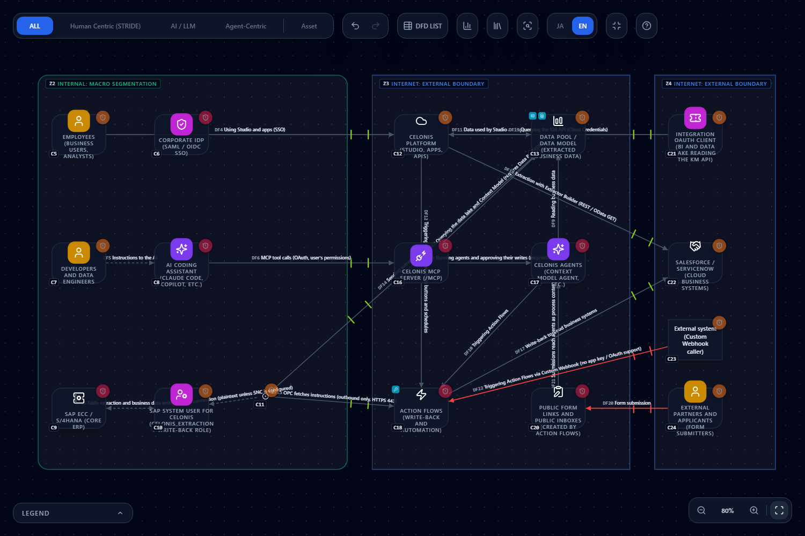
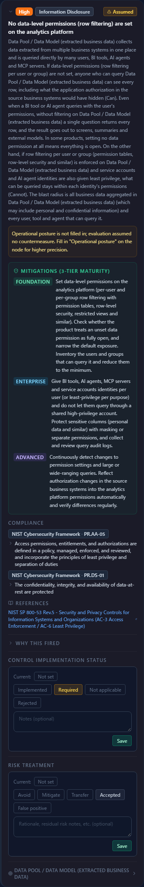
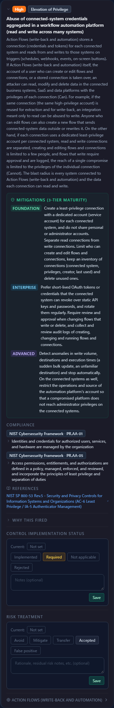
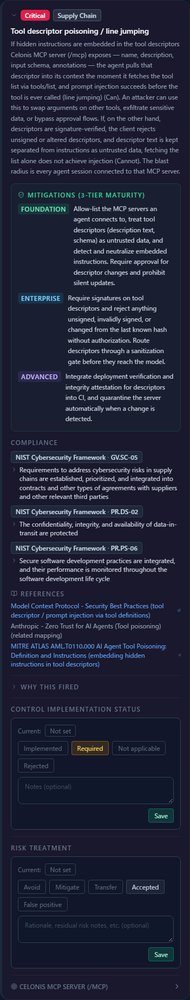

# Threat Modeling a Celonis (Process Mining) Setup — Extraction, Write-back and MCP in One Diagram

**English** | [日本語](celonis.ja.md)

> Celonis is a trademark of Celonis SE, and SAP is a trademark of SAP SE. Other product names in the text are trademarks of their
> respective owners. This page describes how to threat-model a Celonis setup in CyberRiskScape. It is not provided, certified or
> endorsed by Celonis. This is descriptive use. Product behavior changes over time, so check the official sources linked below for the latest.
>
> **Counts are measured at the time of writing.** The threat counts in this page (for example, 140 on import) were obtained by running
> the CLI `analyze` command on the threat library and template as of 13 November 2026. They change when rules or attributes change.

---

## 1. What this page covers, and assumptions

- How to **map the building blocks of Celonis** (data extraction, Data Pool / Data Model, Action Flows, the MCP server) to CyberRiskScape component types
- A **diagram template** (import it and go) for a setup that extracts from SAP into Celonis, writes back through Action Flows, and is queried by AI agents over MCP, and the **threats actually detected** on it
- The two newly added types (**Workflow automation / iPaaS** and **Analytics platform / data warehouse**) and the two new rules
  (`automation-platform-credential-aggregation-001` and `analytics-data-permission-missing-001`)
- How to draw other iPaaS products (Workato, Zapier, Power Automate, n8n) and data warehouses (Snowflake, BigQuery) with the same types
- What to watch for when one AI agent uses both the Celonis MCP server and the CyberRiskScape MCP server

**Assumption: Celonis overview** (per the official documentation at the time of writing, checked on 13 November 2026)

- Data taken from business systems such as SAP flows through **data connections, extraction and transformation jobs, a Data Pool, a Data Model, and then Studio views and apps**.
  Connection types are native connectors, JDBC, the Extractor Builder (REST / OData GET), the Standard Data Ingestion API (S3-compatible PutObject), and file upload
  ([source 4](#references)).
- Connections to on-premise SAP use the **On-Premise Client (OPC)**. The OPC is a passive mediator that connects outbound to Celonis and opens no inbound ports.
  A single SAP connection serves **both extraction and Action Flow write-back** ([source 6](#references)).
- **Action Flows** are automations that trigger processing in SAP, Oracle, ServiceNow and others ([source 9](#references)).
- Celonis offers a per-tenant **MCP server** that AI clients such as Claude can use ([source 3](#references), [source 10](#references)).

**Background you need**: the operations in [Getting started](getting-started.md), the import steps in [Creating and using templates](templates.md), and [Reading the threat panel](reading-threats.md).

> **A note on confidence** — Some pages on docs.celonis.com may require sign-in to read. Only items marked "per the official documentation at the time of writing"
> are treated as fact; anything we could not confirm is stated as "not confirmed".

---

## 2. Celonis building blocks and CyberRiskScape types

Type names are the **current display names** shown in the UI.

| Celonis building block | CyberRiskScape type | Setting notes |
|---|---|---|
| Celonis Platform (Studio, apps, APIs) | SaaS | Users sign in through the IdP SSO (or Celonis ID) |
| Data Pool / Data Model | **Analytics platform / data warehouse** (`ANALYTICS_PLATFORM`) | Set the posture "data-level permissions" to **Enforced** once permission tables are configured (§4.2) |
| Action Flows | **Workflow automation / iPaaS** (`AUTOMATION_PLATFORM`) | Draw the lines to the connected systems (write-back). Also draw webhook callers and public forms (§4.3) |
| On-Premise Client (OPC) | Connector | An outbound-only mediator. Draw no inbound line |
| SAP system user for Celonis | Service account | Check whether one user is shared by extraction and write-back (§4.1) |
| SAP ECC / S/4HANA | Backend API | Both the source of extraction and the target of write-back (a bidirectional line) |
| Celonis MCP server (`/mcp`) | MCP server | Runs with the signed-in user's permissions over OAuth (Authorization Code + PKCE) |
| Celonis agents (Context Model agents and others) | AI agent | Can be started from MCP tools such as `execute_agent` |
| AI client (Claude Code, Copilot, etc.) | AI agent | On the employee side. Draw the line to the Celonis MCP server as Token |
| Stored connection credentials | Credentials | The pool of credentials going from Action Flows to connected systems |
| Integration OAuth client (BI or data lake reading the KM API) | OAuth client | Client credentials. Tends to be a long-lived secret |
| Public form links and public inboxes | Web form | An entry for outside senders into what comes after Action Flows |
| Connected systems such as Salesforce and ServiceNow | CRM | The target of write-back and extraction |

> **A note** — SAP is placed as "Backend API" as a simplification of the diagram. That type draws the generic API-server rules
> (BOLA, SSRF and others, §4.1), so read them with SAP's own circumstances in mind.

---

## 3. An example diagram

| File | Contents |
|---|---|
| [`templates/celonis-process-mining.en.json`](templates/celonis-process-mining.en.json) | English |
| [`templates/celonis-process-mining.ja.json`](templates/celonis-process-mining.ja.json) | Japanese |

**Contents:** 20 components, 19 data flows, 3 trust boundaries (internal = Internal, the Celonis cloud = Internet, outside senders and the integration OAuth client = Internet).

- **Extraction** — SAP, the system user, the OPC, then the Data Pool. The OPC connects outbound to Celonis
- **Write-back** — the OPC fetches instructions from Action Flows and writes back to SAP. Action Flows write to Salesforce / ServiceNow
- **AI agents** — AI coding assistant, then the Celonis MCP server, then the Data Pool, the Celonis agents and Action Flows
- **Inbound from outside** — outside sender, then the public form, then the Celonis agents. An external system calls Action Flows (Custom Webhook)

Import works as described in [the templates page](templates.md#3-importing). Open **Template** → **Import** in the left sidebar, choose the JSON, and **replace and apply**.

**Importing it detects 140 threats** (Critical 18, High 79, Medium 43), measured at the time of writing.

### 3.1 Assumptions in the diagram (placeholder attributes)

The template attributes are **placeholders for a typical setup**. Posture items (logs, patches, encryption, data-level permissions and so on) are **left unset**,
so threats appear under the "unset is treated like the worst value" policy. That is why cards carry the "Assumed" mark; it disappears once you enter the real state.

| Element | Setting | When to change it |
|---|---|---|
| RFC connection to SAP | Encryption Plain (plaintext unless SNC is configured) | Raise it if SNC is configured |
| System user | Authentication Password | The official documentation describes a dedicated system user with a password |
| MCP server | Global IP, user authentication, rate limit | Update after adding a source-IP restriction (§4.5) |
| Webhook and form lines | Authentication None, Internet | Match the real authentication (signature, secret, etc.) |
| Data Pool | Data-level permissions unset | Set to `Enforced` once configured (§4.2) |

---

## 4. Threats to watch

Each item lists the rules that fire and what they mean for Celonis. Rule IDs are as measured at the time of writing. **What is not detected is stated plainly.**

### 4.1 The SAP connection: system user privileges and plaintext RFC

Per the official documentation at the time of writing, SAP gets a **dedicated system user (with a password)**, and the delivered role `CELONIS_EXTRACTION`
grants `S_TABU_DIS` with `DICBERCLS = *` (all table authorization groups), `S_DATASET` with `FILENAME *`, and `S_BTCH_JOB` with `JOBGROUP *` ([source 7](#references)).
The same page notes that you can narrow `DICBERCLS` to authorization groups, use `S_TABU_NAM`, and narrow `FILENAME` to the target path.
Write-back (automation) permissions are **added by hand**. Because one OPC SAP connection serves both extraction and write-back (§1),
**a user meant to be a read-only extraction user can structurally become a user that can also write**.

| Rule | Severity | Fires on | How to read it |
|---|---|---|---|
| Overprivileged NHI (`nhi-overprivileged-001`) | High | System user, integration OAuth client | Read access to all tables plus write-back tends to be excessive |
| Long-lived static secrets on an NHI (`nhi-long-lived-secret-001`) | High | Same | Are the password and client secret rotated? |
| NHI reuse (`nhi-reuse-001`) | Medium | System user | Is one user shared by extraction and write-back? |
| Improper offboarding of NHIs (`nhi-improper-offboarding-001`), insufficient environment isolation (`nhi-environment-isolation-001`) | Medium | System user, integration OAuth client | No owner; shared between development and production |
| Eavesdropping (`stride-edge-plain-encryption-001`) | High | OPC to system user and system user to SAP (and the instruction line to the AI assistant) | **RFC without SNC is plaintext.** The diagram expresses it as encryption Plain |

Because SAP is a "Backend API", the generic API rules also fire (`api-backend-remote-code-execution-001` (Critical), `api-backend-object-level-authorization-001`,
`api-backend-function-level-authorization-001`, `api-backend-ssrf-001`, `api-backend-query-injection-001`). This comes from the type simplification and is not an SAP-specific assessment.
For items that do not fit, mark them not applicable in the treatment and record why.

**Not detected** — The privileges actually granted to the `CELONIS_EXTRACTION` role (whether `DICBERCLS` was narrowed) cannot be read. A person checks SAP's effective permissions.

### 4.2 Data Pool: without data-level permissions, everyone can see it

Per the official documentation at the time of writing, Data Integration permissions can be set at **three levels: service, Data Pool and Data Model**, and
**if no data permission is assigned to a Data Model, every user and group can access that data through Studio once it is loaded** ([source 8](#references)).

The screenshot is the Data Pool card. The "Assumed" mark shows the threat was evaluated as having no countermeasure because the posture is unset.

| Rule | Severity | Fires on | How to read it |
|---|---|---|---|
| No data-level permissions (row filtering) are set on the analytics platform (`analytics-data-permission-missing-001`, **new**) | High | Data Pool / Data Model | Fires when the posture "data-level permissions" is **unset or None** |
| Information disclosure (`stride-data-store-info-disclosure-001`), data tampering (`stride-data-store-tampering-001`) | High | Data Pool / Data Model | Generic data store rules |
| Loss of audit trail (`stride-data-store-repudiation-001`) | Medium | Same | Are queries recorded? |
| Unneeded or unreviewed data is kept (`posture-data-minimization-001`) | High | Personal data, business records | Did you narrow the extracted tables and columns? |

**How to fix it** — After configuring data-level permissions (permission tables and the like), set the Data Pool posture "data-level permissions (row filtering per user or group)" to **Enforced**.
On this template, that removes the single `analytics-data-permission-missing-001` finding, taking **140 threats to 139** (High 78).

### 4.3 Action Flows: aggregated credentials, webhooks and public forms

Per the official documentation at the time of writing, each Action Flow module has an authentication method (App key or OAuth 2.0), and **new App-key connections can no longer be created**.
**The Custom Webhook module supports neither method.** There are also **modules that create public form links and public inboxes**, and
a webhook triggered by URL can pass data from Studio views (smart inputs in Studio are recommended instead) ([source 9](#references)).

| Rule | Severity | Fires on | How to read it |
|---|---|---|---|
| Abuse of connected-system credentials aggregated in a workflow automation platform (`automation-platform-credential-aggregation-001`, **new**) | High | Action Flows | Fires when the diagram has lines to connected systems. One compromise reaches reads and writes across many systems |
| Static storage and sprawl of credentials (`zt-credential-sprawl-static-secret-001`) | High | Stored connection credentials | Inventory the static keys per connection |
| Theft and replay of bearer tokens without sender constraint (`zt-bearer-token-replay-001`) | High | Token lines (OPC, write-back, KM API, etc.) | A stolen token can be used as is |
| In-transit connector tampering (`stride-connector-tampering-001`) | High | OPC, Action Flows | A tampered mediator changes what is written back |
| Spoofing (`stride-edge-unauth-internet-001`) | Critical | The "form submission" and "webhook trigger" lines | An unauthenticated entry from the Internet |
| Spoofing (`stride-external-entity-spoofing-001`), repudiation (`stride-external-entity-repudiation-001`) | High, Medium | External system (webhook caller) | A caller whose signature or secret cannot be verified |
| Injection into downstream systems through form input (`webform-input-injection-001`) | High | Public form | Form values flow into Action Flows and SAP |
| Web shell planted through a file attachment (`webform-webshell-upload-001`) | Critical | Public form | Check this if the public inbox accepts attachments |
| Bot flooding and abuse of auto-reply mail as a relay (`webform-automated-abuse-001`) | Medium | Public form | |

**From the public form to the AI agent**: in the diagram, the Celonis agents read what comes from the public form. An internal agent reads text written by an outsider as "data",
so **indirect prompt injection through business application data** (`owasp-llm01-indirect-business-record-001`, High) and
prompt input from outside the trust boundary (`maestro-agent-untrusted-ingress-001`, High) fire.

**Not detected** — Which Action Flow modules use App key or OAuth cannot be read. Whether a webhook verifies a signature is expressed by a person through the line's authentication attribute.

### 4.4 MCP: tools that run with the user's permissions, and the agent's blast radius

Per the official documentation at the time of writing, the MCP server lives at `https://[team].[realm].celonis.cloud/mcp` (streamable HTTP). Claude uses a **pre-registered public OAuth client**
(`client_id` `claude_mcp`, PKCE, no secret) with the Authorization Code grant, and **inherits the signed-in user's permissions**. API keys and App keys cannot be used
([source 3](#references), [source 10](#references), [source 11](#references)). The scopes are `mcp:read` and `mcp:write`; `mcp:write` adds tools such as `deploy_package`, `delete_branch`,
`dp_execute_pipeline`, `execute_agent` and `approve_context_model_agent_write`. Read tools include `query_data_lake` and `query_context_model`.
In the permission matrix, **querying a Data Pool requires Data Pool EDIT, and reading a Context Model requires Context Model EDIT** ([source 12](#references)),
so with MCP **a read-only least-privilege setup is not possible**. Tools may also be listed even when the user cannot run them.
There are also per-asset Agent Tools (MCP) servers, with a default rate limit of 500 calls per minute per asset. Supported clients include Claude, Codex, Cursor,
GitHub Copilot, Google Antigravity, Microsoft Copilot Studio, OpenCode and Slack.

| Rule | Severity | Fires on | How to read it |
|---|---|---|---|
| Tool descriptor poisoning / line jumping (`mcp-tool-descriptor-poisoning-001`) | Critical | MCP server | Hidden instructions can be pulled in just by listing tools |
| MCP server impersonation / typosquatting (`mcp-server-impersonation-typosquatting-001`) | High | MCP server | Check the connection URL |
| Direct global IP exposure (`stride-web-global-ip-exposure-001`), unrestricted source IP access (`stride-web-no-source-ip-restriction-001`), blind perimeter: public and unlogged (`stride-web-blind-perimeter-001`) | High | MCP server | Source-IP restriction is covered in §4.5 |
| Runaway autonomous action (`excessive-agency`) | Critical | AI client, Celonis agents | The blast radius of `mcp:write` |
| Human approval of high-risk operations is not effective (`secops-agent-approval-ineffective-001`) | High | Same | **If the agent can approve through `approve_context_model_agent_write`, it is not human approval** |
| Lethal Trifecta (`maestro-lethal-trifecta-001`) | Critical | Same | Attacker-controlled data in, sensitive data, external send |
| Direct prompt injection (`owasp-llm01-prompt-injection-001`) | Critical | Same | |
| Sprawl of consent-screen OAuth grants (`identity-oauth-consent-grant-sprawl-001`) | Medium | AI client to MCP line | Delegation invisible to the IdP |
| Exfiltration of secrets in the working folder (`dev-agent-workspace-secret-exfiltration-001`) | Critical | AI client, agents | |

**Recommendations**

- Give AI agents **`mcp:read` only** at first. Add `mcp:write` only when writes are needed
- Create a **low-privilege Celonis user** dedicated to the agent (the client inherits the user's permissions, so an admin sign-in hands admin rights to the client)
- Keep approval of agent writes **with a human**. Do not let the agent call `approve_context_model_agent_write`

**Not detected** — "MCP reads need EDIT permission" is guidance on this page, not a rule. The scopes and permissions actually granted cannot be read.

### 4.5 User authentication, the IdP and network restrictions

Per the official documentation at the time of writing, Celonis offers SAML / OIDC SSO, Celonis ID (email and password), SCIM, SAML JIT provisioning,
**IP-based restrictions** (CIDR; applied to browser, API and OPC traffic) and up to 5 concurrent sessions, and open sign-up for verified domains can also be configured
([source 13](#references), [source 14](#references)). **MFA for Celonis ID is not described on the security features page, and we could not confirm it.**
An audit log API (v2) for SIEM integration is documented. The Permissions API excludes data-level permissions ([source 5](#references)).

| Rule | Severity | Fires on |
|---|---|---|
| Tampering with federation trust (`identity-idp-federation-trust-tampering-001`), token forgery via IdP signing-key compromise (`zt-idp-signing-key-compromise-001`) | Critical | IdP |
| Sole authentication dependency (`idp-single-point-of-failure`), missing recording and preservation of authentication events (`identity-idp-authentication-log-gap-001`) | High, Medium | IdP |
| Account takeover (`stride-user-spoofing-001`) | High | Employees, developers, outside senders |
| Log retention too short or logs not collected (`posture-log-retention-short-001`, `posture-log-not-collected-001`), no account review (`posture-account-review-missing-001`) | High, Medium | IdP, Celonis, Data Pool, Action Flows and others |

**Not detected** — Celonis's IP restriction (CIDR) and SSO settings cannot be evaluated. Once configured, reflect them in the MCP server's source-IP restriction attribute.

### 4.6 API integration (KM API, BI queries)

Per the official documentation at the time of writing, the APIs use OAuth 2.0 (client credentials / authorization code), and **scopes do not grant permissions beyond the client's own**.
The KM API's default limits are 6,000 requests per day and 20 requests per second, and it is **not built to export raw data at large scale** ([source 1](#references), [source 2](#references)).
In the diagram, the "integration OAuth client" draws `nhi-overprivileged-001`, `nhi-long-lived-secret-001` and `zt-bearer-token-replay-001`. Because **scopes do not add permissions**,
the Celonis permissions given to the client apply as they are. Minimize permissions per client.

---

## 5. Use attack path analysis to find where to defend

In [attack path analysis](attack-paths.md), place an attacker as "outside partners and applicants" and set the target to Action Flows or the Data Pool; the candidate path is
public form, then the Celonis agents, then Action Flows (or the Data Pool) (at the time of writing, this path is a reading of the diagram's lines, not an analysis run in the UI).
**Between the public form and the agents** is a candidate place to cut the path. This attacker is not part of the template; add it yourself to try it.

---

## 6. Drawing other iPaaS products and data warehouses

The two new types are not specific to Celonis.

| Product examples | Type to use | How to draw |
|---|---|---|
| Workato, Zapier, Power Automate, n8n, MuleSoft and similar | **Workflow automation / iPaaS** | Draw lines to the connected systems (business systems, SaaS). Showing stored connections as **Credentials** makes the aggregation visible |
| Snowflake, BigQuery, Redshift, Databricks and similar | **Analytics platform / data warehouse** | Draw the query lines from BI, AI agents and MCP servers. When row-level permissions are enforced, set "data-level permissions" to Enforced |

Note: for the iPaaS type, `automation-platform-credential-aggregation-001` does not fire in **a diagram with no lines to connected systems** (claiming credential aggregation without knowing the connected systems has no basis).
A mediator that only relays extraction (like the OPC) can stay a "Connector".

---

## 7. Using the Celonis MCP and the CyberRiskScape MCP from the same agent

If you connect **the Celonis MCP server** and **the CyberRiskScape MCP server** ([Using it from coding agents](mcp-integration.md)) to a single AI agent such as Claude Code,
the agent can cross-reference both contexts. For example: "List the systems that support the business processes Celonis shows as high impact if they stop (order-to-cash, invoicing, and so on),
then look up the Critical and High threats CyberRiskScape detects on those components." Putting business criticality next to threats makes it easier to prioritize countermeasures.

**Security note** — The agent then holds **both the business-data context and the threat model**. On the Celonis side, use **`mcp:read` only** (§4.4) and connect with a
dedicated low-privilege user. The two servers do not talk to each other; the agent is what links them. Also keep the practice that approval of writes is human, so that
neither tool descriptors nor instructions hidden in query results (indirect prompt injection) can get the agent to rewrite the threat model.

---

## 8. Limits

- **CyberRiskScape does not read Celonis configuration** (there is no import). Roles, permission tables, connection methods, IP restrictions and MCP scopes are reflected in the diagram attributes by a person.
- "MCP reads need EDIT permission" is **guidance on this page, not a rule**.
- The LLM provider and data handling of Celonis AI features are **not confirmed**. Check your contract and the official documentation.
- Celonis-specific defaults (default rate limits, default permissions and so on) may change.
- The template attributes are placeholders (§3.1). Detection counts change with how attributes and connections are set.
- Because SAP is placed as a "Backend API", generic API rules that are not SAP-specific appear (§4.1).

---

## References

Official documentation was checked on 13 November 2026. docs.celonis.com may require sign-in.

1. Authentication (Celonis APIs) — <https://developer.celonis.com/celonis-apis/auth>
2. Rate limiting — <https://developer.celonis.com/celonis-apis/rate-limiting>
3. MCP server overview — <https://developer.celonis.com/mcp-server-asset/overview>
4. Standard Data Ingestion API — <https://developer.celonis.com/data-ingestion-api/standard/standard_overview>
5. Platform Usage APIs (audit logs, permissions) — <https://developer.celonis.com/celonis-apis/platform-usage-apis>
6. On-Premise Client — <https://docs.celonis.com/en/on-prem-clients.html>
7. Creating users for the SAP connection — <https://docs.celonis.com/en/creating-users-for-sap-connection.html>
8. Data Integration permissions — <https://docs.celonis.com/en/data-integration-service-permissions.html>
9. Action Flows authentication methods — <https://docs.celonis.com/en/action-flows-authentication-methods.html>
10. MCP integrations — <https://docs.celonis.com/en/mcp-integrations.html>
11. MCP integration with Claude — <https://docs.celonis.com/en/mcp-integration-claude.html>
12. MCP integration permissions — <https://docs.celonis.com/en/mcp-integration-permissions.html>
13. Security features — <https://docs.celonis.com/en/security-features.html>
14. IP-based restrictions — <https://docs.celonis.com/en/ip-based-restrictions.html>

---

## What to read next

- How to read detected threats — [Reading the threat panel](reading-threats.md)
- Finding where to defend from the paths — [Attack path analysis](attack-paths.md)
- Evaluating non-human accounts — [Threat Modeling NHIs and Identity Infrastructure](nhi-identity.md)
- Using it from coding agents — [Using it from coding agents](mcp-integration.md), [MCP use cases](mcp-use-cases.md)
- The list of products you can integrate with — [Integrations](integrations.md)
