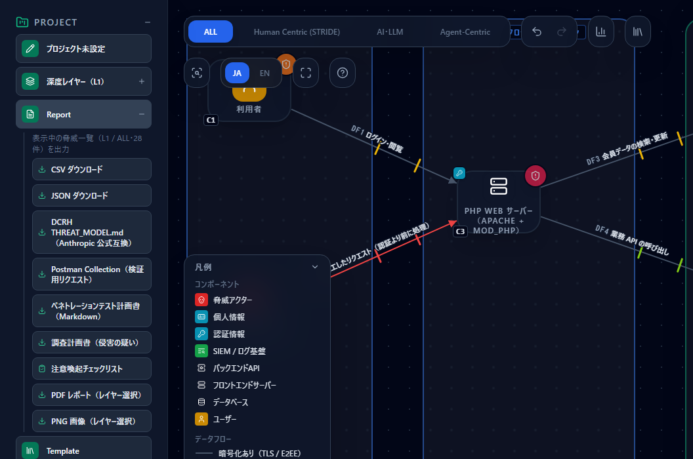

# 侵害の疑いがあるときに、脅威モデルで調べる範囲を決め、結果を報告する

[English](compromise-investigation.md) | **日本語**

> 脆弱性の勧告が出た、不審なエラーが急に増えた — そうしたときに、システムを止めて「侵害されていないか」を確かめることがあります。
> このページでは、CyberRiskScape の脅威モデルを使って、**どこを・何を調べるかの計画**を作り、**集めた証拠を図のノードに重ねて報告する**流れを、
> [PHP の RCE 脆弱性のガイド](php-rce-2026-10.ja.md)の会員サイトを例に説明します。
>
> **CyberRiskScape は侵害の有無を判定しません。** 痕跡が見つからないことは、侵害が無かったことの証明になりません。
> 報告は「何を調べ、何が見つかり、何を調べられなかったか」を示すもので、稼働再開などの判断は、それを読んだ人が行います。

---

## 1. このページで分かること・前提

- 脅威モデルから**調査計画書**を書き出す（画面・CLI）。攻撃経路上のノードごとに「確かめること」「見るログ」「調べられない恐れ」が並ぶ
- 証拠を集める 2 つの方法：**同梱のトリアージスクリプト**（`tools/triage/crs_triage.py`）と、**Velociraptor** の収集結果
- 集めた証拠を図のノードに重ねる**調査報告**（CLI）。ノードごとに「痕跡あり」「否定できない」「未調査」「痕跡なし（調べた期間つき）」と、図に無いホストを示す
- 図の側で、調査に備えて入力しておくこと（ログの取得・保持期間）
- この流れの**限界**

**このページの前提となる知識：** [攻撃経路分析](attack-paths.ja.md)（攻撃者と標的を図に置く）と、[PHP の RCE 脆弱性のガイド](php-rce-2026-10.ja.md) §2（題材の構成）。

> **調べる対象について** — 自分が管理する、または調査の許可を得たシステムだけを対象にしてください。
> ログとファイルは**コピー**を使い、元の環境に手を加えないでください。証拠の保全（いつ・誰が・どこから取ったか）の記録は、組織の手順に従ってください。

---

## 2. 全体の流れ

| 段階 | 使うもの | 出てくるもの |
|---|---|---|
| ① どこを調べるか決める | 画面の **Report → 調査計画書（侵害の疑い）**、または CLI の `export-investigation-plan` | 攻撃経路上のノードごとの「確かめること」「見るログ」「調べられない恐れ」 |
| ② 証拠を集める | `tools/triage/crs_triage.py`（ログのコピーを読む）、または Velociraptor（エージェントで端末から収集） | クラッシュ・メモリ不足・`POST` ＋ 5xx・Web ルートで最近変わったファイルなどの結果と、**読めなかったファイルの一覧** |
| ③ 何が分かったかを報告する | CLI の `investigation-report` | ノードごとの状態・調べた期間・証拠の要約と、図に無いホスト |

①の観点と、②で探す文字列（パターン）は、どちらも `data/investigation-templates/compromise.yaml` にあります（コードではなくデータです）。

---

## 3. 調査計画書を書き出す

### 3.1 題材を読み込む

[PHP の RCE 脆弱性のガイド](php-rce-2026-10.ja.md) §2 のテンプレート [`templates/php-rce-before.ja.json`](templates/php-rce-before.ja.json) を読み込みます。
左サイドバーの **新規作成**（**保存せずに作成**）で空のプロジェクトにしてから、**Template → Import** で読み込みます。

この図には、攻撃者（C2）と、攻撃者の標的（OBJECTIVE）として会員 DB（C5）が設定されています。調査計画の対象は、**攻撃者から標的へ至る経路上のノード**です。
攻撃者や標的が無い図では、すべてのノードが対象になります。

### 3.2 画面から

左サイドバーの **Report** を開き、**「調査計画書（侵害の疑い）」**を押します。`investigation-plan_<システム名>_<レイヤー>_<日付>.md` がダウンロードされます。



### 3.3 CLI から

図を **ファイル（保存 / 開く）** でプロジェクトの JSON（ここでは `model.json`）に保存してから実行します。

```bash
npm ci && npm run build:cli
node dist-cli/main.js export-investigation-plan model.json --tool velociraptor --out plan.md
```

`--tool velociraptor` は、証拠の収集に Velociraptor を使う場合（§4.2）だけ付けます。付けると、各観点に Velociraptor の artifact 名とパラメータの手がかりが加わります（画面からの書き出しには載りません）。
同梱のトリアージスクリプト（§4.1）だけを使う場合は、付けずに書き出すか、画面から書き出した計画書で足ります。
`--layer`・`--locale ja|en`・`--format md|json` も指定できます。

### 3.4 計画書の読み方

会員サイトの図では、対象ノードが 2 つになります（抜粋）。

```markdown
### C3 PHP Web サーバー（Apache + mod_php）（FRONT_END_SERVER）

- 通る攻撃経路の数: 1

**想定外のコード実行の痕跡がないか（脅威: 既知の脆弱性に対するパッチの未適用, 公開アプリの脆弱性悪用による Web シェル設置）**

- [ ] Web ルートやアプリの配置先で、最近追加・変更された実行可能なファイルがないか調べる。
- [ ] Web サーバーやアプリのプロセスから起動されたシェルやコマンドがないか調べる。
- [ ] エラーログに、メモリ上限の超過やワーカーの異常終了（OOM・セグメンテーション違反）の急増がないか調べる。
- [ ] 想定外の宛先への外向き通信がないか調べる。

velociraptor の手がかり:
- `Linux.Search.FileFinder` — `SearchFilesGlob=/var/www/**`
- `Linux.Sys.LogGrep` — `TargetGlob=/var/log/**`, `GrepRegex=Allowed memory size of ...`

**調べられない恐れ**

- 図の入力上は、ログの取得と保存期間に懸念はありません（実態は別途確認してください）。

### C5 会員 DB（DATABASE）

**データへの想定外のアクセスがないか（脅威: データ改ざん）**

- [ ] DB の監査ログで、想定外の大量の読み出し・権限の変更・スキーマの変更がないか調べる。
```

- **観点は、検出した脅威から選ばれます。** 脅威の canonicalId（同じ脅威をまとめるための ID）が観点の対応表にあれば、その観点が載ります。同じノードに同じ観点が複数の脅威から当たる場合は 1 回だけ載ります
- **リスク受容とした脅威も対象に含めます**（判断を添えて載せます）。受け入れたリスクが現実になっていないかを確かめるためです。誤検知とした脅威だけを外します
- **「調べられない恐れ」は、図のノードの運用状況から出ます。** ログの取得が「取得していない」・未入力、保持期間が「90日未満」・未入力のノードには、遡れない恐れが書かれます。**未入力は悪い値と同じに扱います**

| 観点 | 当たる主な脅威 |
|---|---|
| 想定外のコード実行の痕跡がないか | Web シェルの設置・API サーバーでのコード実行・パッチの未適用・ネットワーク機器の脆弱性悪用・エージェントのコード実行 |
| 認証情報が不正に使われていないか | 認証情報の散在・長期間有効な秘密情報・IdP 外のローカル認証情報・秘密情報の保管庫への集中 |
| データへの想定外のアクセスがないか | データの改ざん・プライベートエンドポイントからの持ち出し |
| ログが欠けている・消されている区間がないか | ログの収集の無効化・ログ基盤の改ざん・ログを集めていない・アクセスログが無い・EDR の検知の無効化 |
| 管理サーバーから端末へ一斉に実行されていないか | EDR / DFIR サーバーからの一斉実行（§6.2） |

---

## 4. 証拠を集める

証拠を集める方法は 2 つあります。**どちらか一方だけで、③の調査報告まで進めます。** 両方を使う場合は、③でまとめて渡せます。

| 方法 | 向いている場合 |
|---|---|
| **4.1 同梱のトリアージスクリプト** | ほとんどの場合はこちら。ログ（と Web ルート）のコピーがあれば、追加の製品なしで使えます |
| **4.2 Velociraptor** | すでに Velociraptor を運用している、または多数の端末から同じ項目を集めたい場合 |

4.1 だけを使う場合は、§3.3 の `--tool velociraptor` は不要です。

### 4.1 同梱のトリアージスクリプトで、ログのコピーを調べる

`tools/triage/crs_triage.py` は、ログ（と Web ルート）の**コピー**を読み、次のものを探すオフラインのツールです。Python 3.8 以上の標準ライブラリだけで動き、外部と通信しません。

- カーネルの OOM（メモリ不足でプロセスが止められた記録）・ワーカーのクラッシュ・PHP のメモリ上限の超過
- アクセスログの `POST` ＋ 5xx と、その前後のクラッシュ・メモリ不足の突き合わせ（クライアント IP ごと）
- Web ルートで、最近追加・変更された実行可能なファイル（`.php`・`.phtml`・`.user.ini` など）

**実行の前提条件**（詳細は [`tools/triage/README.ja.md`](../tools/triage/README.ja.md) の「実行の前提条件」）

- **ネットワークと名前解決は不要です。** ホスト名は `--host` に指定した文字列をそのまま使い、DNS には問い合わせません。
  省略すると実行したマシンのホスト名になるため、**別のマシンでコピーを調べるときは元のホスト名を `--host` で指定します**。この名前を §5.1 の対応表と照合します
- ログを読める権限が要ります（`/var/log` の多くは root や adm グループのみ）。読めなかったファイルは止まらずに「読めなかったもの」に記録されます
- `--days` は**実行した時点から**数えます。コピーから日が経ってから実行するときは、その日数を足します
- **コピーすると ctime はコピーした時刻になります**（どの OS でも）。コピーした Web ルートでは全ファイルが「最近」に出るため、mtime を保ってコピーし（`cp -a`・`tar -p`・`rsync -a`）、レポートの mtime の列で見ます。調査報告の `recent-file` の件数も同じ理由で増えるので、各行の `mtime=` を見て判断します

探す文字列はスクリプトに組み込まれていません。CLI で書き出したパターンのファイルを渡します。

```bash
# 1. パターンを書き出す（モデルは不要）
node dist-cli/main.js export-triage-patterns --out patterns.json

# 2. ログのコピーに対して実行する（--host は元のホスト名）
python3 tools/triage/crs_triage.py --patterns patterns.json \
  --logs ./logs_copy --webroot ./www_copy --days 3 --host web01 \
  --output report.md --json report.json
```

`report.md` は人が読むためのレポート、`report.json` は③の調査報告に渡す入力です。
**調べるホストごとに実行します。** 計画書の対象ノードが複数あれば（例：Web サーバーと DB サーバー）、それぞれのログのコピーに `--host` を変えて実行し、出力の JSON を分けます
（例：`--host db01 --json report-db01.json`）。実行しなかったホストのノードは、③で「未調査」になります。
**`skipped`（読めなかったもの）を必ず確かめてください。** systemd journal やバイナリのログは読みません。
`journalctl -k -o short-iso > kernel.log` などでテキストに書き出してから渡します。オプションと限界の詳細は [`tools/triage/README.ja.md`](../tools/triage/README.ja.md) にあります。

### 4.2 Velociraptor で収集する

[Velociraptor](https://docs.velociraptor.app/) は、端末に置いたエージェントからファイルやログを収集するオープンソースの DFIR ツールです。
§3.3 の `--tool velociraptor` で書き出した計画書の artifact を、オフラインコレクター（エージェントを入れていない端末向けの収集用の実行ファイル）
またはサーバーからの収集（hunt）で実行します。

| 観点 | artifact | ③で痕跡として数えるか |
|---|---|---|
| 想定外のコード実行 | `Linux.Search.FileFinder`（Web ルート）・`Generic.Detection.Yara.Glob`・`Linux.Sys.LogGrep`（OOM・クラッシュの文字列） | 数える（結果の行があれば「痕跡あり」） |
| 想定外のコード実行 | `Linux.Sys.Pslist`・`Linux.Forensics.Journal`・`Linux.Network.Netstat` | 数えない（参考情報として件数だけ載せる） |
| 認証情報の不正使用 | `Linux.Syslog.SSHLogin` | 数えない（通常のログインも当たるため） |
| ログの欠け | `Linux.Forensics.Journal` | 数えない |

収集結果の zip は、**展開してから**③に渡します。CyberRiskScape は zip と CSV を読みません。展開したフォルダーの中から、
`results/` を持つフォルダー（1 台分の収集結果）を探して読みます。ホスト名は収集結果の `client_info.json` から取ります。

> 収集結果は、調査対象から持ち出したデータです。信頼できないデータとして扱い、**空のフォルダーに展開**してください。
> Velociraptor のサーバーは全端末でコマンドを実行できるため、それ自体が重要な資産です（§6.2）。

---

## 5. 調査報告を作る

### 5.1 ホスト名とノードの対応表を用意する

証拠のホスト名と、図のノードの番号を結び付けるファイルです。図の JSON は変更しません。

```json
{"hosts": [{"host": "web01", "node": "C3"}, {"host": "db01", "node": "C5"}]}
```

ホスト名は大文字小文字を区別せず、FQDN の先頭のラベルでも一致します（`DB01.example.local` は `db01` と一致）。

### 5.2 実行する

トリアージスクリプト（§4.1）だけを使った場合：

```bash
node dist-cli/main.js investigation-report model.json \
  --evidence report.json --evidence report-db01.json \
  --hosts hosts.json --out investigation-report.md
```

Velociraptor（§4.2）だけを使った場合は、収集結果を展開したフォルダーを渡します。両方を使った場合は、両方を並べます。

```bash
# Velociraptor だけ
node dist-cli/main.js investigation-report model.json --evidence ./velociraptor --hosts hosts.json --out investigation-report.md
# 両方
node dist-cli/main.js investigation-report model.json --evidence report.json --evidence ./velociraptor --hosts hosts.json --out investigation-report.md
```

`--evidence` は何度でも指定できます。トリアージの JSON、または Velociraptor の収集結果を展開したフォルダーです。`--format json` で機械処理用の JSON、`--locale en` で英語になります。

### 5.3 報告の読み方

会員サイトの図に、Web サーバー（web01）のトリアージ結果と、DB サーバー（db01）の Velociraptor の収集結果（プロセス一覧だけ）を重ねた例です（抜粋）。
2 つの方法の結果がどう表れるかを示すために両方を使っています。web01 のトリアージ結果だけを渡した場合は、C3 は同じく「痕跡あり」、証拠の無い C5 は「未調査」になります。

```markdown
- 概要: 痕跡あり 1 ／ 否定できない 1 ／ 未調査 0 ／ 痕跡なし 0（証拠 2 件・図に無いホスト 0 件・読めなかった入力 0 件）

### C3 PHP Web サーバー（Apache + mod_php）（FRONT_END_SERVER）

- 状態: 痕跡あり
- 調べた期間: 2026-10-20 〜 2026-10-23（証拠から観測した値）
- 証拠:
  - トリアージ・ホスト `web01`・`report.json`・収集日 2026-10-23
    - 痕跡とみなす結果: 12 件（kernel-oom 3, post-5xx 3, recent-file 3, crash 2, oom 1）
    - 上位:
      - kernel-oom: `logs_copy/messages:1` `Oct 21 12:35:05 web01 kernel: Out of memory: Killed process 1234 (php-fpm) ...`
      - post-5xx: `logs_copy/apache2/access.log:1` `203.0.113.45 - - [21/Oct/2026:12:34:50 +0900] "POST /upload.php HTTP/1.1" 502 ...`
    - 読めなかったもの:
      - `logs_copy/system@abc.journal` — `systemd journal（バイナリ）。...テキストに書き出してから渡す`

### C5 会員 DB（DATABASE）

- 状態: 否定できない
- 調べた期間: 収集日（2026-10-23）から少なくとも 1 年前まで（図のログ保存期間の入力による。観測値ではない）
- 否定できない理由:
  - 痕跡を探す結果が含まれていない（参考情報の件数だけ）。
- 証拠:
  - Velociraptor・ホスト `db01`・`velociraptor/db01`・収集日 2026-10-23
    - 参考情報（件数のみ）: Linux.Sys.Pslist 1
```

**ノードの状態**

| 状態 | 意味 | 次にすること |
|---|---|---|
| 痕跡あり | 対応づいた証拠のどれかに、痕跡とみなす結果がある | 上位の行から、原因を調べる。メモリ不足やクラッシュは攻撃以外でも起きるので、**痕跡あり＝侵害ではない** |
| 否定できない | 証拠はあるが、調べた期間が分からない／読めなかったファイルがある／痕跡を探す結果が含まれていない | 理由に書かれた不足を補って、集め直す |
| 未調査 | 対応づいた証拠が無い | 証拠を集める。対応表にホストが入っているかも確かめる |
| 痕跡なし | 証拠があり、痕跡とみなす結果が無く、調べた期間が分かり、読めなかったファイルも無い | 調べた期間と観点を、判断する人に伝える。**侵害が無かったことは意味しない** |

**調べた期間** は、トリアージの結果に記録されたログの最初と最後の時刻（観測値）を優先します。観測値が無いときは、収集日と、図のノードの
**ログの保持期間**（運用状況）から推定し、「観測値ではない」と明記します。どちらも無ければ「否定できない」になります。

**図に無いホスト** は、証拠はあるのに図のノードに対応づかなかったホストです。対応表に無い、対応表のノード番号が図に無い、
またはノードが攻撃経路の外にある、のいずれかです。**図に描かれていないサーバーが動いている**ことを示している場合があります。図を直すきっかけにしてください。

---

## 6. 図の側で備えておくこと

### 6.1 ログの取得と保持期間を入力しておく

ノードを選び、右パネルの**運用状況**で **ログの取得** と **ログの保持期間** を入力しておくと、調査計画の「調べられない恐れ」と、調査報告の「調べた期間」の推定に使われます。
入力のしかたは [IPA の注意喚起のガイド](ipa-alert-2026-10.ja.md) を参照してください。

### 6.2 EDR / DFIR サーバーを図に描く

Velociraptor のように、全端末にエージェントを置いて一斉に収集・コマンド実行できる管理サーバーは、ライブラリの **Security Controls → 「EDR / DFIRサーバー」** で描けます。
次の 3 つのルールが当たります。

| ルール ID | 重大度 | 内容 |
|---|---|---|
| `netinfra-edr-fleet-mass-execution-001` | Critical | 端末へ一斉に配信できる管理サーバーの乗っ取りによる全端末での収集・コマンド実行 |
| `netinfra-edr-detection-blinding-001` | High | 除外設定の追加・検知ポリシーの書き換え・エージェントの停止による全端末の検知の無効化 |
| `netinfra-edr-evidence-concentration-001` | High | 調査・検知のために集めた証拠（メモリの写し・ファイル・認証情報）の 1 か所への集中と漏えい |

あわせて、運用状況（パッチ・アカウント棚卸し・ログの保持期間）の未入力・不足のルールも当たります。調査に使う道具そのものが、攻撃者にとって最も価値のある標的になりうることを、図で示せます。

---

## 7. 限界

- **侵害の有無は判定しません。** 「痕跡なし」は、その期間・その観点で痕跡が見つからなかったことだけを示します。アプリがログを書く前に起きる問題は痕跡が残らないことがあり、ログが欠けたり改ざんされたりしている場合もあります
- **「痕跡あり」も侵害の証拠ではありません。** メモリ不足・クラッシュ・`POST` ＋ 5xx・最近変わったファイルは、正常な運用でも起きます。優先度付けに使ってください
- **図にないものは計画にも報告にも出ません。** 描いていないサーバーは「図に無いホスト」として出るだけで、観点は付きません
- Velociraptor の結果は、**artifact の名前で**痕跡かどうかを決めます。行の中身は解釈しません。対応表（YAML）に無い artifact は参考情報になります
- Velociraptor の収集結果は、公式ドキュメントにある収集結果の形式（`results/<artifact>.json` の JSON Lines、`client_info.json`、`log.json`）に基づいて読みます。版によって形式が変わる場合があります
- 読み込むのは JSON だけです。zip・CSV は読みません。1 ファイル 64MB、1 行 1MB を超えるもの、シンボリックリンクは読みません
- ファイルの時刻は偽装でき、コピーや展開で変わります。**Windows でコピーを調べると、ctime は作成時刻**になるため、すべてのファイルが「最近」に見えることがあります
- 「調べた期間」の推定は、図の入力（ログの保持期間）に基づきます。実際にログが残っている期間は、ログそのもので確かめてください

---

## 参考リンク

1. NIST SP 800-61 Rev. 3「Incident Response Recommendations and Considerations for Cybersecurity Risk Management」（英語）
   <https://csrc.nist.gov/pubs/sp/800/61/r3/final>
2. NIST SP 800-92「Guide to Computer Security Log Management」（英語）
   <https://csrc.nist.gov/pubs/sp/800/92/final>
3. Velociraptor ドキュメント（英語）
   <https://docs.velociraptor.app/docs/>
4. Velociraptor アーティファクト リファレンス（英語）
   <https://docs.velociraptor.app/artifact_references/>

Velociraptor は、その所有者の商標です。このページは CyberRiskScape での使い方を説明するもので、提供元が提供・認定・推奨するものではありません。

## 次に読むもの

- [PHP の RCE 脆弱性（2026 年 10 月 21 日の勧告）を、攻撃経路分析で確かめる](php-rce-2026-10.ja.md) — 題材の構成と、更新の前後で脅威がどう変わるか
- [攻撃経路分析](attack-paths.ja.md) — 攻撃者と標的を図に置く
- [IPA の注意喚起（2026 年 10 月）の対策を、会員サイトの図で確かめる](ipa-alert-2026-10.ja.md) — ログの取得・保持期間などの運用状況の入力
- [連携ガイド](integrations.ja.md) — ほかのツールとの連携の一覧
