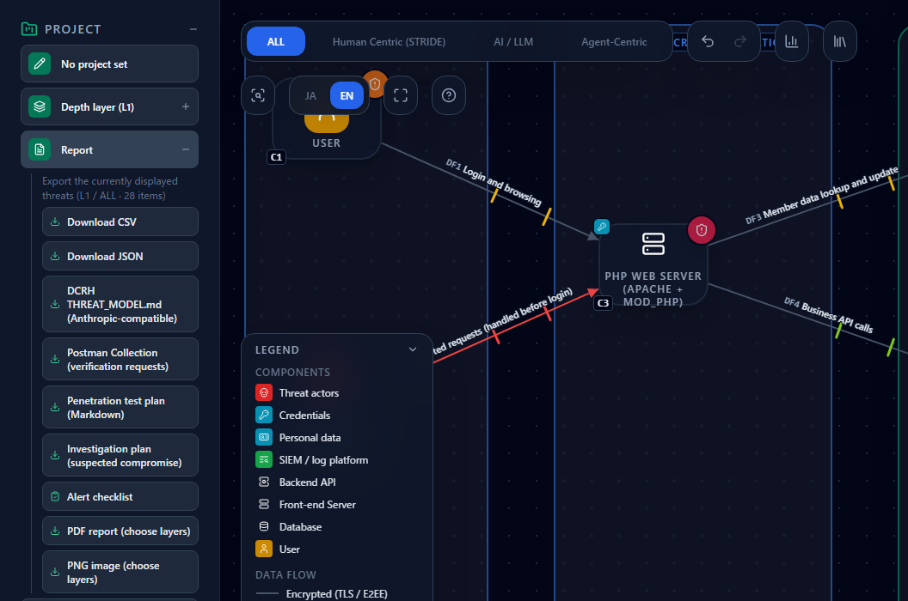

# Scoping and reporting a suspected-compromise investigation with your threat model

**English** | [日本語](compromise-investigation.ja.md)

> A vulnerability advisory has just come out, or unexplained errors have suddenly increased. In such cases you may stop a system and check whether it was compromised.
> This page shows how to use a CyberRiskScape threat model to build a **plan of where to look and what to check**, and to **overlay the evidence you collect on the nodes of the diagram as a report**.
> The example is the membership site from the [PHP RCE guide](php-rce-2026-10.md).
>
> **CyberRiskScape does not determine whether a compromise occurred.** Finding no traces is not proof that there was no compromise.
> The report shows what was examined, what was found, and what could not be examined. Decisions such as resuming operation are made by the people who read it.

---

## 1. What this page covers and prerequisites

- Exporting an **investigation plan** from the threat model (UI and CLI). For each node on the attack routes, it lists what to check, which logs to review, and the risk of not being able to investigate
- Two ways to collect evidence: the **bundled triage script** (`tools/triage/crs_triage.py`) and **Velociraptor** collections
- The **investigation report** (CLI), which overlays the evidence on the diagram's nodes. For each node it shows "traces found", "cannot rule out", "not investigated" or "no traces (with the period examined)", and it lists hosts that are not in the diagram
- What to enter in the diagram beforehand to prepare for an investigation (log collection and retention)
- The **limits** of this workflow

**Background you need:** [Attack Path Analysis](attack-paths.md) (placing an attacker and an objective in the diagram) and §2 of the [PHP RCE guide](php-rce-2026-10.md) (the example system).

> **About what you investigate** — Investigate only systems you manage or have permission to investigate.
> Work on **copies** of logs and files, and do not change the original environment. Record evidence handling (when, by whom and from where it was taken) according to your organization's procedures.

---

## 2. The workflow

| Stage | What you use | What you get |
|---|---|---|
| ① Decide where to look | **Report → Investigation plan (suspected compromise)** in the UI, or `export-investigation-plan` in the CLI | For each node on the attack routes: what to check, logs to review, and the risk of not being able to investigate |
| ② Collect evidence | `tools/triage/crs_triage.py` (reads copies of logs), or Velociraptor (collects from endpoints through its agent) | Results such as crashes, out-of-memory events, `POST` + 5xx, and recently changed files under the web root, plus **a list of files that could not be read** |
| ③ Report what was found | `investigation-report` in the CLI | The status, period examined and evidence summary for each node, and hosts that are not in the diagram |

The viewpoints in ① and the search strings (patterns) in ② both live in `data/investigation-templates/compromise.yaml` (data, not code).

---

## 3. Export the investigation plan

### 3.1 Load the example

Load the template [`templates/php-rce-before.en.json`](templates/php-rce-before.en.json) from §2 of the [PHP RCE guide](php-rce-2026-10.md).
Start an empty project with **New project** (**Create without saving**) in the left sidebar, then load it with **Template → Import**.

This diagram has an attacker (C2), with the member DB (C5) set as the attacker's objective (OBJECTIVE). The plan covers **the nodes on the routes from the attacker to the objective**.
In a diagram without an attacker or objective, every node is covered.

### 3.2 From the UI

Open **Report** in the left sidebar and click **Investigation plan (suspected compromise)**. The file `investigation-plan_<system name>_<layer>_<date>.md` is downloaded.



### 3.3 From the CLI

Save the diagram as a project JSON file (here, `model.json`) with **File (Save / Open)**, then run:

```bash
npm ci && npm run build:cli
node dist-cli/main.js export-investigation-plan model.json --tool velociraptor --locale en --out plan.md
```

Add `--tool velociraptor` only if you collect evidence with Velociraptor (§4.2). With it, each viewpoint also lists Velociraptor artifact names and parameters as hints (the UI export does not include them).
If you use only the bundled triage script (§4.1), export without it, or use the plan exported from the UI.
You can also use `--layer` and `--format md|json`.

### 3.4 Reading the plan

For the membership site, two nodes are covered (excerpt).

```markdown
### C3 PHP web server (Apache + mod_php) (FRONT_END_SERVER)

- Attack routes passing through: 1

**Is there any trace of unexpected code execution? (threats: Patches for known vulnerabilities are not applied, Web shell planted by exploiting a public-facing application)**

- [ ] Look for executable files recently added or changed under web roots and application directories.
- [ ] Look for shells or commands started from web server or application processes.
- [ ] Look in error logs for a surge of memory-limit overruns or abnormal worker exits (OOM, segmentation faults).
- [ ] Look for outbound connections to unexpected destinations.

Hints for velociraptor:
- `Linux.Search.FileFinder` — `SearchFilesGlob=/var/www/**`
- `Linux.Sys.LogGrep` — `TargetGlob=/var/log/**`, `GrepRegex=Allowed memory size of ...`

**Risk of not being able to investigate**

- According to the diagram, log collection and retention raise no concern (confirm the actual state separately).

### C5 Member DB (DATABASE)

**Is there any unexpected access to data? (threats: Data Tampering)**

- [ ] In the DB audit log, look for unexpected bulk reads, permission changes and schema changes.
```

- **Viewpoints are chosen from the detected threats.** If a threat's canonicalId (the ID that groups the same threat across sources) is in the viewpoint table, that viewpoint is listed. If several threats on the same node lead to the same viewpoint, it is listed once
- **Threats whose risk you accepted are still included** (with the decision noted), so that you can check whether an accepted risk has materialized. Only threats marked as false positives are excluded
- **The risk of not being able to investigate comes from each node's operational posture.** Nodes whose log collection is "Not collected" or unset, or whose log retention period is "Under 90 days" or unset, are flagged as possibly not reaching far enough back. **Unset values are treated the same as the bad value**

| Viewpoint | Main threats that lead to it |
|---|---|
| Is there any trace of unexpected code execution? | Web shell planting, code execution on an API server, unpatched vulnerabilities, exploitation of network edge devices, code execution by an agent |
| Are credentials being misused? | Credential sprawl, long-lived secrets, local credentials outside the IdP, concentration in a secrets vault |
| Is there any unexpected access to data? | Data tampering, exfiltration through a private endpoint |
| Are there periods where logs are missing or deleted? | Blinding log collection, tampering with the log platform, logs not collected, no access log, blinding EDR detection |
| Has a management server run something on all endpoints at once? | Mass execution from an EDR / DFIR server (§6.2) |

---

## 4. Collect evidence

There are two ways to collect evidence. **Either one alone is enough to go on to the investigation report in ③.** If you use both, pass them together in ③.

| Method | When it fits |
|---|---|
| **4.1 The bundled triage script** | Most cases. If you have copies of the logs (and the web root), you can use it without any additional product |
| **4.2 Velociraptor** | You already run Velociraptor, or you want to collect the same items from many endpoints |

If you use only 4.1, you do not need `--tool velociraptor` in §3.3.

### 4.1 Examine copies of logs with the bundled triage script

`tools/triage/crs_triage.py` is an offline tool that reads **copies** of logs (and the web root) and looks for the following. It uses only the Python 3.8+ standard library and does not communicate externally.

- Kernel OOM events (processes killed for lack of memory), worker crashes, and PHP memory-limit overruns
- `POST` + 5xx in the access log, correlated with nearby crashes and out-of-memory events (per client IP)
- Executable files recently added or changed under the web root (`.php`, `.phtml`, `.user.ini` and so on)

The search strings are not built into the script. You pass a pattern file exported by the CLI.

```bash
# 1. Export the patterns (no model needed)
node dist-cli/main.js export-triage-patterns --out patterns.json

# 2. Run it on the copies of the logs (--host is the original host name)
python3 tools/triage/crs_triage.py --patterns patterns.json \
  --logs ./logs_copy --webroot ./www_copy --days 3 --host web01 \
  --output report.md --json report.json
```

`report.md` is for people to read; `report.json` is the input to the investigation report in ③.
**Run it once per host.** If the plan covers several nodes (for example, a web server and a DB server), run it on the log copies from each one with a different `--host`, and write separate JSON files
(for example, `--host db01 --json report-db01.json`). Nodes whose hosts you did not examine are "not investigated" in ③.
**Always check `skipped` (what could not be read).** The script does not read systemd journals or binary logs.
Export them to text first, for example with `journalctl -k -o short-iso > kernel.log`. See [`tools/triage/README.md`](../tools/triage/README.md) for options and limits. The script's report text is in Japanese.

### 4.2 Collect with Velociraptor

[Velociraptor](https://docs.velociraptor.app/) is an open-source DFIR tool that collects files and logs from endpoints through an agent.
Run the artifacts from the plan you exported with `--tool velociraptor` (§3.3), either with an offline collector (a standalone collection executable for endpoints without the agent)
or as a collection (hunt) from the server.

| Viewpoint | Artifact | Counted as a trace in ③? |
|---|---|---|
| Unexpected code execution | `Linux.Search.FileFinder` (web root), `Generic.Detection.Yara.Glob`, `Linux.Sys.LogGrep` (OOM and crash strings) | Yes (any result row makes the node "traces found") |
| Unexpected code execution | `Linux.Sys.Pslist`, `Linux.Forensics.Journal`, `Linux.Network.Netstat` | No (listed as reference counts only) |
| Credential misuse | `Linux.Syslog.SSHLogin` | No (normal logins also match) |
| Missing logs | `Linux.Forensics.Journal` | No |

**Extract** the collection zip before passing it to ③. CyberRiskScape does not read zip or CSV files. It searches the extracted folder for folders that contain `results/` (one host's collection)
and reads them. The host name is taken from the collection's `client_info.json`.

> A collection is data taken out of the system under investigation. Treat it as untrusted, and **extract it into an empty folder**.
> A Velociraptor server can run commands on every endpoint, so it is a critical asset in its own right (§6.2).

---

## 5. Create the investigation report

### 5.1 Prepare a host-to-node map

This file links host names in the evidence to node numbers in the diagram. The diagram JSON is not changed.

```json
{"hosts": [{"host": "web01", "node": "C3"}, {"host": "db01", "node": "C5"}]}
```

Host names are matched case-insensitively, and the first label of an FQDN also matches (`DB01.example.local` matches `db01`).

### 5.2 Run it

If you used only the triage script (§4.1):

```bash
node dist-cli/main.js investigation-report model.json \
  --evidence report.json --evidence report-db01.json \
  --hosts hosts.json --locale en --out investigation-report.md
```

If you used only Velociraptor (§4.2), pass the folder with the extracted collections. If you used both, pass both.

```bash
# Velociraptor only
node dist-cli/main.js investigation-report model.json --evidence ./velociraptor --hosts hosts.json --locale en --out investigation-report.md
# Both
node dist-cli/main.js investigation-report model.json --evidence report.json --evidence ./velociraptor --hosts hosts.json --locale en --out investigation-report.md
```

You can pass `--evidence` as many times as you need: a triage JSON file, or a folder with extracted Velociraptor collections. Use `--format json` for machine-readable JSON.

### 5.3 Reading the report

This example overlays the triage result from the web server (web01) and a Velociraptor collection from the DB server (db01, process list only) on the membership-site diagram (excerpt).
It uses both methods to show how each appears. If you pass only the triage result for web01, C3 is still "traces found", and C5, which has no evidence, is "not investigated".

```markdown
- Summary: traces found 1 / cannot rule out 1 / not investigated 0 / no traces 0 (evidence 2, hosts not in the diagram 0, unreadable inputs 0)

### C3 PHP web server (Apache + mod_php) (FRONT_END_SERVER)

- Status: Traces found
- Period examined: 2026-10-20 to 2026-10-23 (observed in the evidence)
- Evidence:
  - Triage, host `web01`, `report.json`, collected 2026-10-23
    - Results treated as traces: 12 (kernel-oom 3, post-5xx 3, recent-file 3, crash 2, oom 1)
    - Top results:
      - kernel-oom: `logs_copy/messages:1` `Oct 21 12:35:05 web01 kernel: Out of memory: Killed process 1234 (php-fpm) ...`
      - post-5xx: `logs_copy/apache2/access.log:1` `203.0.113.45 - - [21/Oct/2026:12:34:50 +0900] "POST /upload.php HTTP/1.1" 502 ...`
    - Unreadable:
      - `logs_copy/system@abc.journal` — (systemd journal: export it to text before passing it)

### C5 Member DB (DATABASE)

- Status: Cannot rule out
- Period examined: at least 1 year before the collection date (2026-10-23) (from the log retention entered in the diagram; not observed)
- Why it cannot be ruled out:
  - The evidence has no result that searches for traces (reference counts only).
- Evidence:
  - Velociraptor, host `db01`, `velociraptor/db01`, collected 2026-10-23
    - Reference only (counts): Linux.Sys.Pslist 1
```

**Node status**

| Status | Meaning | What to do next |
|---|---|---|
| Traces found | Some mapped evidence contains a result treated as a trace | Investigate the cause, starting from the top results. Out-of-memory events and crashes also happen without an attack, so **traces found does not mean compromised** |
| Cannot rule out | There is evidence, but the period examined is unknown, some files could not be read, or it contains no result that searches for traces | Fill the gap given as the reason and collect again |
| Not investigated | No evidence is mapped to the node | Collect evidence. Also check that the host is in the map |
| No traces | There is evidence, nothing treated as a trace, the period examined is known, and no file was unreadable | Tell the decision makers the period and the viewpoints examined. **It does not mean there was no compromise** |

**The period examined** prefers the first and last log timestamps recorded in the triage result (observed values). Without them, it is estimated from the collection date and the node's
**log retention period** (operational posture), and labeled "not observed". If neither is available, the node is "cannot rule out".

**Hosts not in the diagram** are hosts with evidence that could not be mapped to a node: they are missing from the map, the map's node number is not in the diagram,
or the node is outside the attack routes. This may mean **a server that is not drawn in the diagram is running**. Use it as a prompt to fix the diagram.

---

## 6. Prepare the diagram

### 6.1 Enter log collection and retention

Select a node and enter **Log collection** and **Log retention period** under **Operational posture** in the right panel. They are used for the plan's "risk of not being able to investigate" and for estimating the report's "period examined".
See the [IPA alert guide](ipa-alert-2026-10.md) for how to enter them.

### 6.2 Draw your EDR / DFIR server

A management server that places an agent on every endpoint and can collect and run commands on all of them at once, such as Velociraptor, can be drawn with **Security Controls → "EDR / DFIR server"** in the library.
These three rules apply to it.

| Rule ID | Severity | Description |
|---|---|---|
| `netinfra-edr-fleet-mass-execution-001` | Critical | Mass collection and command execution on every endpoint through takeover of a management server that can push to all endpoints |
| `netinfra-edr-detection-blinding-001` | High | Disabling detection on every endpoint by adding exclusions, rewriting detection policy, and stopping agents |
| `netinfra-edr-evidence-concentration-001` | High | Concentration and leakage of collected evidence (memory images, files, credentials) in one place |

The rules for unset or insufficient operational posture (patches, account reviews, log retention) also apply. The diagram can show that the very tool used for investigation can be the attacker's most valuable target.

---

## 7. Limits

- **It does not determine whether a compromise occurred.** "No traces" only means no traces were found for that period and those viewpoints. Problems that occur before an application writes a log may leave no trace, and logs may be missing or tampered with
- **"Traces found" is not proof of compromise either.** Out-of-memory events, crashes, `POST` + 5xx and recently changed files also occur in normal operation. Use them to prioritize
- **Anything not in the diagram is not in the plan or the report.** Undrawn servers only appear as hosts not in the diagram, without viewpoints
- For Velociraptor results, whether something is a trace is decided **by artifact name**. The contents of rows are not interpreted. Artifacts that are not in the table (YAML) are reference information
- Velociraptor collections are read according to the collection format in the official documentation (`results/<artifact>.json` in JSON Lines, `client_info.json`, `log.json`). The format may change between versions
- Only JSON is read. Zip and CSV files are not. Files over 64 MB, lines over 1 MB, and symbolic links are not read
- File timestamps can be forged and change when files are copied or extracted. **When you examine copies on Windows, ctime is the creation time**, so every file may look "recent"
- The estimated period examined is based on what was entered in the diagram (log retention). Confirm the period that logs actually cover from the logs themselves

---

## References

1. NIST SP 800-61 Rev. 3, "Incident Response Recommendations and Considerations for Cybersecurity Risk Management"
   <https://csrc.nist.gov/pubs/sp/800/61/r3/final>
2. NIST SP 800-92, "Guide to Computer Security Log Management"
   <https://csrc.nist.gov/pubs/sp/800/92/final>
3. Velociraptor documentation
   <https://docs.velociraptor.app/docs/>
4. Velociraptor artifact reference
   <https://docs.velociraptor.app/artifact_references/>

Velociraptor is a trademark of its owner. This page describes how to use it with CyberRiskScape and is not provided, certified or endorsed by its provider.

## What to read next

- [Checking PHP's RCE vulnerabilities (21 October 2026 advisory) with attack path analysis](php-rce-2026-10.md) — the example system, and how the threats change before and after the update
- [Attack Path Analysis](attack-paths.md) — placing an attacker and an objective in the diagram
- [Checking the measures in IPA's October 2026 alert with a membership-site diagram](ipa-alert-2026-10.md) — entering operational posture such as log collection and retention
- [Integrations](integrations.md) — a list of integrations with other tools
