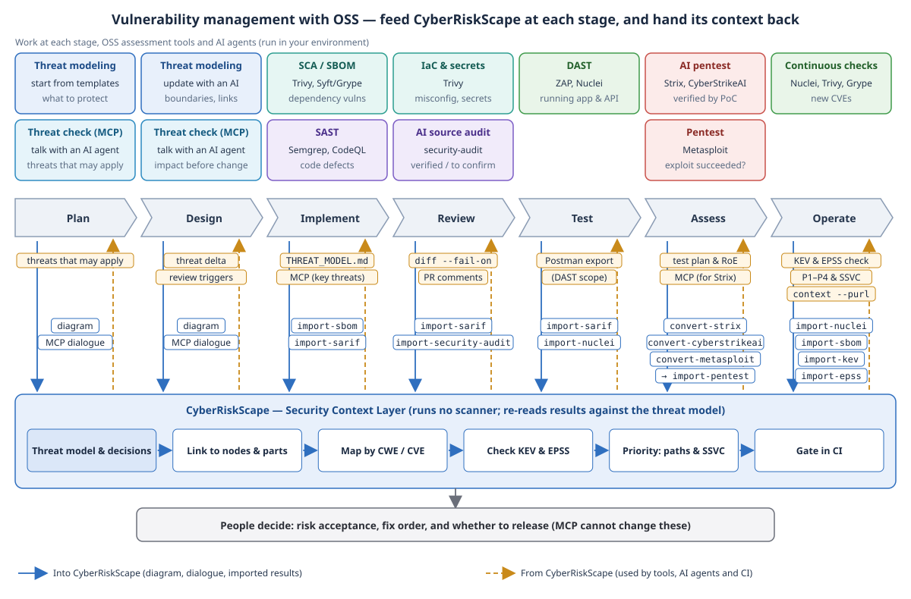

# Vulnerability Management with OSS Scanners — Reading Scanner Results in the Context of Attack Paths

**English** | [日本語](oss-vulnerability-management.ja.md)

> Product names on this page are names of their respective owners. This page explains how to import the output of OSS assessment tools into
> CyberRiskScape. It is not provided, certified, or endorsed by the developers of those tools; the use of the names is descriptive. The output
> formats follow the official documentation and source code as of the time of writing (November 2026). Check the official information for the latest.

> **Scope of assessment** — Run assessment tools only against **targets you manage or are authorized to assess**. The import on this page only
> reads result files that already exist. CyberRiskScape does not run assessment tools and does not connect to the targets.

---

## 1. What this page covers and prerequisites

Attackers use AI to automate vulnerability discovery and attacks. Defenders also need to automate assessment and keep running it.
By combining OSS assessment tools, you can run assessments at each stage of development without paying for tools.

However, the findings from assessment tools are **numerous, and they do not tell you which to fix first**. Two findings with the same severity
should be fixed in a different order depending on whether the node is reachable from the internet or deep inside the network, and whether it is
on a path that reaches important data.

This page explains how to import the results of OSS assessment tools into a CyberRiskScape diagram and **prioritize them in the context of attack paths**.

| Who | Role |
|---|---|
| **OSS assessment tools** | Run the assessment and produce findings (each section of this page) |
| **CyberRiskScape** | Link findings to nodes and components on the diagram, and prioritize them by attack paths, KEV, and exposure. Gate releases in CI by a threshold |
| **People** | Decide which risks to accept, the order of fixes, and whether to release |

**Prerequisites**

- You have a CyberRiskScape project JSON (a saved diagram) to put the findings on.
- Node.js works. Build the CLI first (`npm ci && npm run build:cli`).
- **CLI only.** You can load the output project JSON in the app with **Template** → **Import**.

**Background knowledge for this page**: the operations in [Getting Started](getting-started.md) and [Reading the Threat Panel](reading-threats.md).

---

## 2. The common flow



Every tool follows the same flow. Only the output format in step 1 and the import command in step 2 differ by tool.

1. **Assess**: Have the tool write its results in a format CyberRiskScape can read (SARIF, CycloneDX, and so on).
2. **Import**: Save the results into the project JSON. Use `--node` to specify the node the findings are linked to.
3. **Check against known exploitation**: Use `import-kev` to check the findings against CISA's KEV catalog (vulnerabilities known to be exploited).
   Use `fill-patch-status` to set the patch status to "Missing" on nodes that have findings with a CVE and whose patch status is unset (values already entered are not overwritten).
4. **Prioritize**: Use `findings-priority` to put the findings on the attack paths and get a recommended priority P1–P4 with reasons (exposure, reachable targets, KEV, chaining).
   Evaluating exposure requires an attacker (AI agent attacker) node on the diagram (or specify one with `--attacker`; without either, only findings listed in KEV become P1).
5. **Gate the release**: Run `analyze --fail-on-findings High` in CI and stop while findings at or above the threshold remain.

```bash
# 3. Check against KEV (download the catalog from https://www.cisa.gov/known-exploited-vulnerabilities-catalog)
node dist-cli/main.js import-kev my-project.json --kev known_exploited_vulnerabilities.json -o my-project.json
node dist-cli/main.js fill-patch-status my-project.json -o my-project.json

# 4. Prioritize
node dist-cli/main.js findings-priority my-project.json

# 5. exit 1 if findings at or above the threshold remain
node dist-cli/main.js analyze my-project.json --fail-on-findings High
```

Re-imports **replace findings per product × `--scope`**. Findings of the same product and the same scope are replaced with the latest results;
findings in other scopes are kept. Use a separate scope for each repository or environment.

---

## 3. Trivy — dependency vulnerabilities, IaC misconfigurations, and secrets

Trivy is an OSS tool that scans container images, file systems, and repositories (Apache-2.0). In CyberRiskScape, import each kind of result
in its own output format.

| Trivy result | Output format | Import | How it appears on the diagram |
|---|---|---|---|
| **Vulnerabilities in dependencies and OS packages** | CycloneDX (`--scanners vuln` required) | `import-sbom` | Linked as components to the `--node` node; the findings map to the threat "Patches for known vulnerabilities are not applied". Can be checked against KEV |
| **IaC misconfigurations and secrets** | SARIF | `import-sarif` | Shown as findings on the `--node` node. Not linked to threat cards (§3.3) |

### 3.1 Dependency vulnerabilities (CycloneDX)

```bash
# Scan a container image (without --scanners vuln, the CycloneDX output has no vulnerabilities)
trivy image --scanners vuln --format cyclonedx --output app.cdx.json <image>

# To scan the lock files in a repository
trivy fs --scanners vuln --format cyclonedx --output app.cdx.json .

# Save the components and vulnerabilities, linked to the application node
node dist-cli/main.js import-sbom my-project.json --sbom app.cdx.json --scope app-image --node <application node> -o my-project.json
```

- **Always add `--scanners vuln`.** By default, Trivy's CycloneDX output lists only the components and contains no vulnerabilities.
- Each vulnerability becomes **one finding per affected component**. Because the components are linked to nodes on the diagram, when a severe
  vulnerability is announced you can find the affected nodes with `context --purl <purl>`.
- Vulnerabilities marked in VEX as not_affected, false_positive, or resolved are not imported.
- The CWE attached to a vulnerability is not used. Linking a library CVE to a threat through its CWE would be misread as a defect in the
  application's own code. The mapped threat is always "Patches for known vulnerabilities are not applied".

### 3.2 IaC misconfigurations and secrets (SARIF)

```bash
# Misconfigurations in IaC (Terraform, Kubernetes manifests, and so on)
trivy config --format sarif --output iac.sarif.json ./infra

# Secrets committed to the repository
trivy fs --scanners secret --format sarif --output secret.sarif.json .

# Save the findings, linked to the target node (use a separate scope for each result)
node dist-cli/main.js import-sarif my-project.json --sarif iac.sarif.json --scope iac --node <target node> -o my-project.json
node dist-cli/main.js import-sarif my-project.json --sarif secret.sarif.json --scope secret --node <target node> -o my-project.json
```

- Severity is taken from Trivy's `security-severity` (the CVSS v3 score, or a fixed value per severity).
- **Not saved**: message text and code snippets. Only the path relative to the repository and the line number are kept; drive names and user
  names are removed. Secret values do not enter CyberRiskScape.

### 3.3 Limitations

- **Trivy's SARIF contains no CWE.** Misconfiguration and secret findings are therefore not linked to threat cards; they only appear as findings
  on the node. To reflect cloud misconfigurations in the node's operational status, use the [Prowler import](prowler.md) (AWS only).
- Vulnerabilities can also be written as SARIF, but then they are not linked to threat cards. **Import vulnerabilities as CycloneDX** (§3.1).
- Components are linked to diagram nodes only through `--node`. Run a separate import for each image or repository.

---

## 4. CyberStrikeAI — results verified by autonomous AI penetration testing

CyberStrikeAI is an OSS platform in which AI agents combine assessment tools to carry out penetration tests (Apache-2.0).
In CyberRiskScape, the **vulnerabilities** recorded by CyberStrikeAI are converted into the penetration-test registry YAML, checked by a person,
and then imported with `import-pentest`. Vulnerabilities confirmed to hold are shown as "verified" on threat cards
(the same registry format as the [ARTEX import](artex.md)).

> **Declare the scope you are authorized to assess before you start.** Autonomous AI penetration testing may explore beyond the scope you gave it.
> Prepare the rules of engagement (RoE) / scope declaration in [Running an agentic penetration-testing tool yourself](agentic-pentest-operation.md) §5
> and a [test plan](pentest-plan.md) first, and assess only authorized targets.
> This page covers only importing the results; it does not cover how to use CyberStrikeAI's assessment or attack features.

### 4.1 Why go through the registry

CyberStrikeAI's vulnerabilities have no CVE or CWE, and the kind (`type`) is free text written by the AI. Inferring threats from it automatically
would put "verified" on the wrong threat cards. The converted registry therefore leaves **`node` (which node) and `canonicalIds` (which threat)
empty for a person to check and fill in**. Above each finding, the registry has a comment with `type` and `target` (with the URL query removed) as clues.

### 4.2 Steps

```bash
# 1. Convert (one of the two)
#   a. From a file: the JSON saved from the GET /api/vulnerabilities response
node dist-cli/main.js convert-cyberstrikeai vulns.json --scope task-1 -o cyberstrikeai.yaml

#   b. From the API: pass the token in an environment variable (only GET is called; 100 items per page)
export CYBERSTRIKEAI_TOKEN=<token>
node dist-cli/main.js convert-cyberstrikeai --api https://cyberstrikeai.example.internal --project-id <ID> --scope task-1 -o cyberstrikeai.yaml

# 2. Open cyberstrikeai.yaml and, for each finding, check and fill in node (C number or ID) and canonicalIds

# 3. Import
node dist-cli/main.js import-pentest my-project.json --in cyberstrikeai.yaml -o my-project.json
```

- Use `https` for the API URL. `http` is allowed only when it runs on the same machine (`localhost`, `127.0.0.1`).
  Redirects are not followed, so the token is not sent to another host.
- To re-import, convert again with the same `--scope` and replace the registry.

### 4.3 Status mapping

| CyberStrikeAI status | In the registry |
|---|---|
| `confirmed` | **Verified** (confirmed to hold). Counted by gates and prioritization |
| `open` (default) | **Attempted only** (found by the AI but not confirmed). Excluded from gates and prioritization |
| `fixed` | Fixed (kept in the registry, but not imported by `import-pentest`) |
| `false_positive` | False positive (same as above) |
| `ignored` | Not written to the registry |

Only findings a person has marked `confirmed` are treated as verified, so that findings merely found by the AI (`open`) do not block a release.
If the node has no threat card for the threat written in `canonicalIds`, the finding is added as a **manual threat** (a candidate threat missing from the diagram).

### 4.4 What is not saved, and limitations

- **Not copied**: evidence (POC), reproduction steps, preconditions, description, impact, recommendation, and retest records, because they may
  contain response bodies or values used in the attack. `target` stays only in the registry comments and does not enter the project JSON.
- Assets (`/api/assets`) are not imported.
- The shape of CyberStrikeAI's API was checked against the official source (main branch) at the time of writing. It has not been checked against a running instance.

---

## 5. ZAP — assessing running applications (DAST)

ZAP is an OSS tool that assesses running web applications and APIs from the outside (Apache-2.0; currently named "ZAP by Checkmarx").
Import its results written as SARIF with `import-sarif`. ZAP's SARIF carries a CWE for each finding, so findings whose CWE is in the CWE mapping
(`data/finding-maps/cwe.yaml`) map to threats on the diagram.

### 5.1 Writing SARIF

Scripts such as `zap-baseline.py` have no option for SARIF, so specify the `sarif-json` template in the Automation Framework's `report` job.

```yaml
# zap.yaml (list only targets you are authorized to assess in urls)
env:
  contexts:
    - name: app
      urls:
        - https://app.example.com
jobs:
  - type: spider
  - type: passiveScan-wait
  - type: report
    parameters:
      template: sarif-json
      reportDir: /zap/wrk
      reportFile: zap.sarif.json
    risks: [high, medium, low]          # exclude informational (info)
    confidences: [high, medium, low]    # exclude findings marked as false positives (falsepositive) in ZAP
```

```bash
docker run --rm -v "$(pwd)":/zap/wrk ghcr.io/zaproxy/zaproxy:stable zap.sh -cmd -autorun /zap/wrk/zap.yaml

# Save, linked to the node of the target site (use a separate scope for each site)
node dist-cli/main.js import-sarif my-project.json --sarif zap.sarif.json --scope dast-app --node <site node> -o my-project.json
```

- **Remove false positives on the ZAP side.** Findings marked as false positives in ZAP are excluded from the report by `confidences` above.
  CyberRiskScape does not judge false positives.
- Severity is taken from the SARIF `level` (error = High, warning = Medium, note = Low).
- Decide the list of target URLs (what to assess) with the [Postman export](postman.md) or the [test plan](pentest-plan.md), so that the entry
  points the threat model marks as important are not missed.

### 5.2 What is not saved, and cautions

- **Not saved**: requests and responses (headers, cookies, bodies), the values used in attacks (`attack`), evidence snippets, and message text.
  The finding title is the name of the ZAP check.
- **The location URL is saved as is, including the query string.** If values used in the assessment or tokens are in the query, they remain in
  the project JSON. Check the finding locations before committing the project JSON to a repository or handing it to others.
- Only findings whose CWE is in the mapping map to threats on the diagram. XSS (CWE-79), CSRF (CWE-352), and similar are not in the mapping because
  they rarely correspond to threats on an architecture diagram. They appear as findings on the node and are counted in the import report as findings whose CWE is not in the dictionary and cannot be mapped to a threat.
- One import links to one node. If you assessed several sites, split the reports by site and import each one.

---

## 6. Nuclei — checking known vulnerabilities and exposures with templates

Nuclei is an OSS tool that checks known vulnerabilities, misconfigurations, and exposures under conditions written in templates (YAML) (MIT).
In CyberRiskScape, import its **JSONL** results with `import-nuclei`. JSONL carries CVE, CWE, and EPSS, so the findings feed into KEV checks
and prioritization on attack paths.

> Nuclei's SARIF output (`-se`) has no CVE, CWE, or host name, so this page does not use it.

### 6.1 Steps

```bash
# Scan (authorized targets only; -es info drops informational results and keeps the output small)
nuclei -u https://app.example.com -es info -omit-raw -jle nuclei.jsonl

# Save, linked to the target node (use a separate scope for each target)
node dist-cli/main.js import-nuclei my-project.json --in nuclei.jsonl --scope dast-app --node <target node> -o my-project.json
```

- With `-omit-raw`, request and response bodies are not written to the result file. CyberRiskScape does not read them either way,
  but the result file itself becomes safer to handle.
- JSON written with `-je` (an array) can also be read.

### 6.2 Mapping to threats

| Result | Mapped threat | Usable steps |
|---|---|---|
| **Has a CVE** (CVE templates) | Only "Patches for known vulnerabilities are not applied". CWE is not used for threat mapping | `import-kev`, `fill-patch-status`, `findings-priority` (§2) |
| **No CVE, has a CWE** | The threat in the CWE mapping (`data/finding-maps/cwe.yaml`), if listed | `findings-priority` |
| Neither | Not mapped; shown as a finding on the node | — |

- Severity is the template's severity (critical, high, medium, low) as is.
- **Informational results and results whose matchers did not match are not saved.** Only their counts appear in the report.

### 6.3 What is not saved, and limitations

- **Not saved**: requests and responses, curl commands, extracted values (extracted-results), out-of-band interaction records, and template bodies.
  Only the URL origin and path are kept for the location; **the query and user information are removed** (Nuclei locations often contain the values used in checks).
- One import links to one node. If you scanned several targets, split the results by target and import each one.
- The shape of Nuclei's results was checked against the official source (v3.11 series) at the time of writing.

---

## 7. Strix — results verified with PoCs by autonomous AI penetration testing

Strix is an OSS penetration testing tool in which AI agents actually run the target, assess it, and confirm findings with PoCs (Apache-2.0).
It can run in CI and can call external MCP servers. Connect it with CyberRiskScape **in both directions**.

| Direction | What to do | What to use |
|---|---|---|
| **CRS → Strix** | Pass the authorized scope and the threat model (what to protect, what matters) | RoE export, `THREAT_MODEL.md` (`--instruction-file`), the CRS MCP server |
| **Strix → CRS** | Show results confirmed with PoCs as "Verified by Strix" on threat cards | `convert-strix` → `import-pentest` |

> **Declare the scope you are authorized to assess before you start.** Strix's official documentation states that keeping to scope is the user's
> responsibility and shows no mechanism that enforces it technically. Prepare the RoE in
> [Running an agentic penetration-testing tool yourself](agentic-pentest-operation.md) §5 and a [test plan](pentest-plan.md) first, and assess only authorized targets.

### 7.1 Passing context from CRS to Strix

**Pass the scope and the threat model as instructions.** Export the RoE, combine it with the "DCRH THREAT_MODEL.md" from Report
([Turning Your Threat Model into an AI-Readable Security Context](security-context.md)) into an instruction file, and pass it with `--instruction-file`.

```bash
node dist-cli/main.js export-roe my-project.json --out roe.md
# Create instructions.md combining roe.md and THREAT_MODEL.md, and pass it to Strix
strix --target https://app.example.com --instruction-file instructions.md
```

**Let Strix look up the threat model during the assessment (MCP).** Strix can call MCP servers listed in `~/.strix/mcp-servers.json` (a JSON list).
Register the CyberRiskScape MCP server so that Strix's agents can ask "what are the important threats in this architecture?".
**Allow only the read tools with `allowed_tools`.** Do not allow `apply_model_changes`, which changes the diagram.

```json
[
  {
    "name": "cyberriskscape",
    "transport": "stdio",
    "command": "node",
    "args": ["/path/to/CyberRiskScape/dist-cli/main.js", "mcp", "--root", "/path/to/threat-models"],
    "allowed_tools": ["get_model", "analyze_threats", "get_threat", "lookup_context", "lookup_threat_rules"],
    "notes": "Threat models of the assessment targets. Use them to check important threats and attack paths. Do not change the architecture."
  }
]
```

See the [MCP Server Setup Guide](mcp-integration.md) for how to run the MCP server.

### 7.2 Importing Strix results

Strix creates `strix_runs/<run name>/` for each run and writes `findings.sarif` into it. `convert-strix` reads it and converts it into the
penetration-test registry YAML.

```bash
# 1. Convert (specify findings.sarif or the run directory; --node links every finding to one node)
node dist-cli/main.js convert-strix strix_runs/<run name> --scope strix-run-1 --node <target node> -o strix.yaml

# 2. Open strix.yaml and check node, canonicalIds, and outcome

# 3. Import
node dist-cli/main.js import-pentest my-project.json --in strix.yaml -o my-project.json
```

| Registry field | How it is filled | What a person checks |
|---|---|---|
| Which threat (`canonicalIds`) | "Patches for known vulnerabilities are not applied" if there is a CVE; otherwise from the CWE mapping | Remove threats that do not apply; add missing ones |
| Which node (`node`) | Filled for every finding when `--node` is given; otherwise empty | Whether each finding is on the right node |
| Verified or not (`outcome`) | **Only findings with Strix confidence high are verified**; medium, low, or none are **attempted only** | Remove `outcome` on findings you confirmed to make them verified; set doubtful ones to `attempted` |

- Above each finding, the registry has a comment with the confidence, CWE, CVE, endpoint, and code location. The query is removed from endpoint URLs.
- Attempted-only findings are excluded from CI thresholds and prioritization. If the node has no card for a threat in `canonicalIds`, the finding is added as a manual threat.
- Records of what was examined (coverage) are not findings and are not written to the registry.

### 7.3 What is not saved, and limitations

- **Not copied**: PoC scripts (Strix itself keeps them out of the SARIF), evidence, technical analysis, impact, fix proposals, code snippets, and counterevidence.
- Strix's confidence is the AI's own judgment. Have a person check the results before treating them as verified.
- The shape of Strix's output was checked against the official source (v1.7) and documentation at the time of writing.

---

## 8. Syft / Grype — creating an SBOM and finding vulnerabilities from it

Syft is an OSS tool that creates an SBOM (a list of components) from container images and directories; Grype is an OSS tool that finds known
vulnerabilities in images, directories, and SBOMs (both Apache-2.0). Write both results as CycloneDX and import them with `import-sbom`
(handled the same way as Trivy in §3.1).

| Tool | Output | Import | How it appears on the diagram |
|---|---|---|---|
| **Syft** | CycloneDX (components only; no vulnerabilities) | `import-sbom` | Linked as components to the `--node` node. When a severe vulnerability is announced, `context --purl` finds the affected nodes |
| **Grype** | CycloneDX (components + vulnerabilities) | `import-sbom` | Linked to components; the findings map to the threat "Patches for known vulnerabilities are not applied". Can be checked against KEV |

```bash
# 1. Create an SBOM with Syft (keep it as the component inventory)
syft <image> -o cyclonedx-json --file app.cdx.json

# 2. Find vulnerabilities from the SBOM with Grype (you can also give the image directly)
grype sbom:app.cdx.json -o cyclonedx-json --file app-vulns.cdx.json

# 3. Save the components and vulnerabilities, linked to the application node
node dist-cli/main.js import-sbom my-project.json --sbom app-vulns.cdx.json --scope app-image --node <application node> -o my-project.json
```

- Grype's CycloneDX output also contains the component list, so importing Grype's output alone is enough. Keeping Syft's SBOM as the component
  inventory lets you re-check it with Grype when new vulnerabilities are published.
- **In Windows PowerShell, write with `--file`, not `>`.** With `>`, the file may be written in UTF-16 and fail to load.
- Remove vulnerabilities that do not affect you on the Grype side (`--vex` with OpenVEX or CSAF, or `ignore` in `.grype.yaml`).
- Grype's SARIF output has no CWE and uses "vulnerability ID + package name" as the rule ID, so this page does not use it.

---

## 9. Other tools

Sections are added to this page as each integration is confirmed.

- SAST results in SARIF (Semgrep, CodeQL, and so on) can already be imported with `import-sarif`. Findings with a CWE are matched against threat
  cards (using the same CWE mapping as [Fixing Veracode Findings with AI](veracode-remediation.md)).
- Results verified by autonomous AI penetration testing are imported in the same registry format as
  [Seeing the Attack Techniques ARTEX Actually Executed on Threat Cards](artex.md).

---

## References

1. Trivy (GitHub) — <https://github.com/aquasecurity/trivy>
2. Trivy documentation (report formats) — <https://trivy.dev/latest/docs/configuration/reporting/>
3. CISA Known Exploited Vulnerabilities Catalog — <https://www.cisa.gov/known-exploited-vulnerabilities-catalog>

---

## Next reading

- The map of the whole process — [Secure by Design and Threat Modeling in AI-Driven Development](ai-driven-development.md)
- Handling components — [Importing SBOM, CBOM, and AI BOM and Exporting SPDX and CycloneDX](sbom.md)
- Deciding the scope and focus of assessments — [Creating a Penetration Test Plan from the Threat Model](pentest-plan.md)
- Thresholds in CI — [Integrating with AI-Driven Development CI](ci-integration.md)
