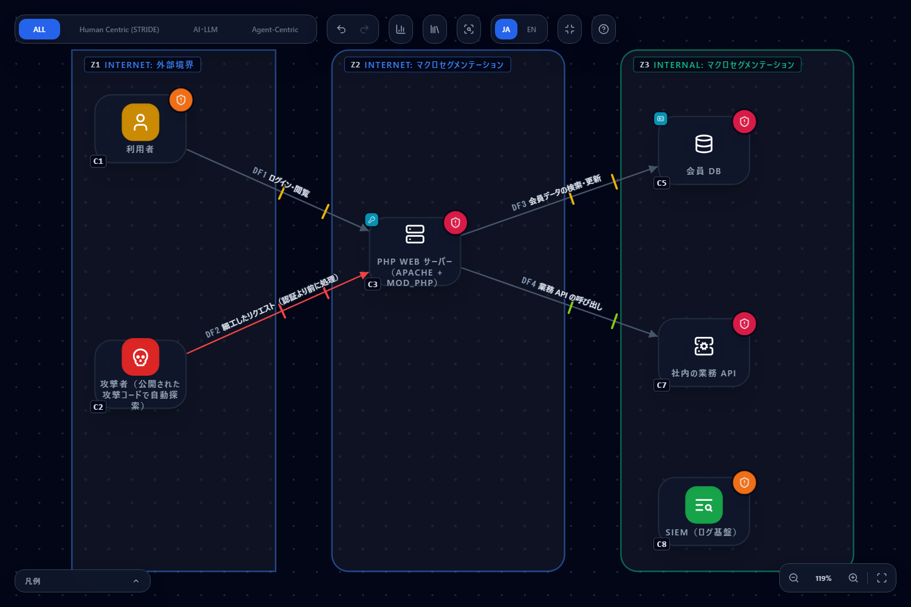
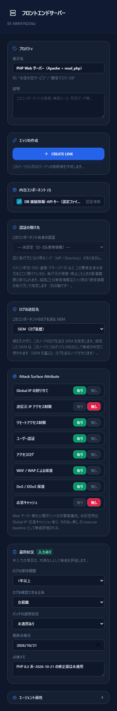
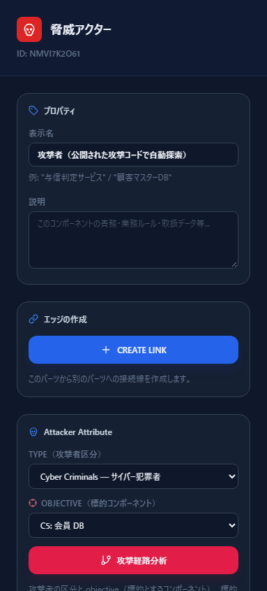
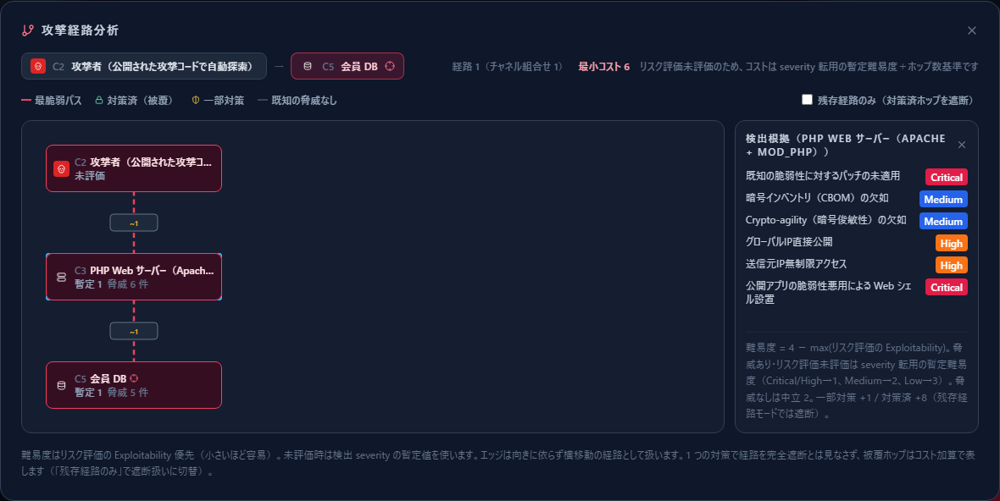
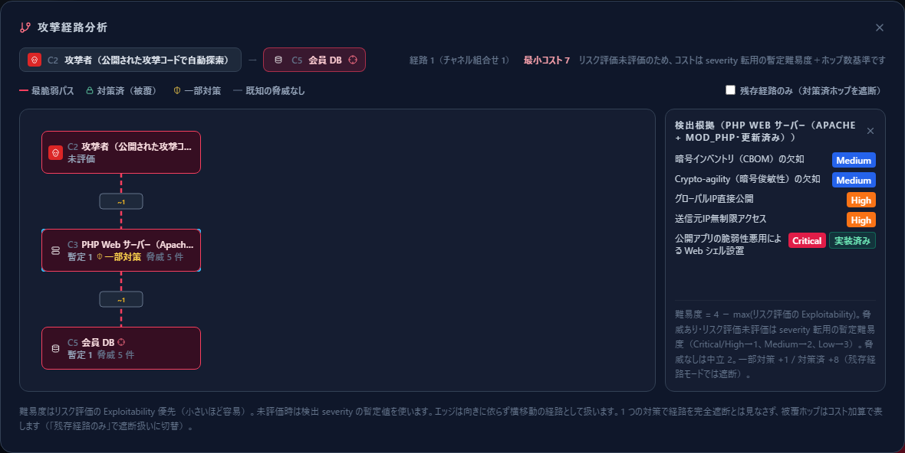

# PHP の RCE 脆弱性（2026 年 10 月 21 日の勧告）を、攻撃経路分析で確かめる

[English](php-rce-2026-10.md) | **日本語**

> このページは、PHP プロジェクトが 2026 年 10 月 21 日に公表したセキュリティ勧告
> 「Critical remote code execution vulnerabilities, update now」（[出典 1](#参考リンク)）について、
> なぜ攻撃が成立するのか、なぜ更新が必要なのかを、CyberRiskScape の構成図と攻撃経路分析で確かめる方法を、架空の会員サイトを例にまとめたものです。
> PHP プロジェクトが作成・認定・推奨するものではありません。勧告の内容は日本語で要約しており、原文の転載ではありません。
> 攻撃の手順や攻撃コードはここに載せていません。脆弱性の詳細・対象の版・緩和策の正確な設定は、必ず原文と各 CVE の勧告を確認してください。
> 件数は執筆時点（2026 年 10 月）の実測値です。

---

## 1. このページで分かること・前提

- 攻撃者を図に置き、**攻撃経路分析（Attack Tree）で、攻撃がどこを通って標的に届くか**を確かめる
- 攻撃が成立する条件を**目標から分解**し、**WAF やログイン（MFA）があっても止まらない理由**を図の上で確かめる
- PHP を更新すると、脅威カードと攻撃経路のコストがどう変わるか。**「不可能にする」対策（更新）と「面倒にする」対策（緩和策）**の違い
- 勧告の対策のうち、**図で確かめられるものと、実機で確かめるもの**の仕分け

**勧告の要旨**

- 修正版は **PHP 8.5.12・8.4.27・8.3.36・8.2.35** です。2 つの脆弱性は、どちらも**認証なしでの任意のコード実行**につながりえます。深刻度は前日の事前告知で CVSS v4.0 **9.2** とされています
  - **CVE-2026-109618：** メモリ不足の処理が、リクエストの内部データの初期化が途中の状態で処理を中断させ、その後の後始末の処理が不正なデータを正しいものとして扱うことがある
  - **CVE-2026-109619：** リクエストに属する内部の状態が、それを支えるメモリの解放後も残り、同じワーカーが処理する次のリクエストが、通常の初期化より前にその状態を使うことがある
- 対象は、**Web リクエストを処理するすべての PHP**（PHP-FPM・Apache の mod_php・php-cgi・FrankenPHP・LiteSpeed）です。
  勧告は **mod_php の危険が最も高い**としています。実証された攻撃は、**アプリのコードが動く前に、認証なしのリクエストで**成立するためです
- **完全な対策は更新だけ**です。Linux ディストリビューション・LTS の提供元には事前に修正が渡されています。**PHP 8.1 以前**は PHP プロジェクトの更新がないので、提供元に確認するか、サポートされている版へ移ります。
  **PHP 8.2 は 2026 年 12 月 31 日にサポートが終わります**
- すぐに更新できない場合の緩和策（メモリの上限・リクエストの大きさの制限・`session.upload_progress` の無効化など）も示されていますが、勧告は**「露出を減らすが、安全にはしない」**と明記しています。設定を変えたら、**すべてのワーカーを再起動**します

**CyberRiskScape が担う範囲**

CyberRiskScape は**設計（構成図）から脅威を洗い出す**ツールです。ここで確かめるのは「この PHP サーバーが構成のどこにあり、乗っ取られたらどこまで届くか」「どこが攻撃経路の要所か」「更新の状況を記録できているか」です。
**PHP の版・動かし方（mod_php か FPM か）・php.ini の設定は、図に入力する項目がありません。** サーバーが実際に修正版になっているか、侵害されていないかは、図からは分かりません（§5・§6）。

**このページの前提となる知識：** [はじめに](getting-started.ja.md)の操作と、[脅威パネルの読み方](reading-threats.ja.md)、[攻撃経路分析](attack-paths.ja.md)。

---

## 2. 題材の構成 — テンプレートを読み込んで確認する

**架空の会員サイト**を描きます。PHP の Web サーバーには、WAF・ログイン（MFA）・アクセスログ・DDoS 保護・SIEM へのログの送信が**そろっています**。違うのは、**PHP が 2026-10-21 の修正版になっていない**ことだけです。
「ほかの対策がそろっていても、更新しなければ止まらない」ことを確かめるための構成です。

次のテンプレートを、そのまま読み込めます。左サイドバーの **新規作成**（**保存せずに作成**）で空のプロジェクトにしてから、**Template → Import** で読み込むと、ノードと線の番号が以降の表と同じ C1・DF1 から振られます。

| ファイル | 内容 |
|---|---|
| [`templates/php-rce-before.ja.json`](templates/php-rce-before.ja.json)（[英語版](templates/php-rce-before.en.json)） | 未更新：PHP Web サーバーのパッチの状況が「未適用あり」 |
| [`templates/php-rce-after.ja.json`](templates/php-rce-after.ja.json)（[英語版](templates/php-rce-after.en.json)） | 更新後：パッチの状況を「最新」にし、点検メモに更新した版を記録（§4） |



**図の中身：** コンポーネント 8・データフロー 4・トラスト境界 3（読み込むと **28 件**の脅威が検出されます。Critical 5・High 13・Medium 10）。

| 場所 | 描いたもの（型） |
|---|---|
| インターネット側（外部境界） | C1 利用者（`ユーザー`）、C2 攻撃者（`脅威アクター`。公開された攻撃コードで自動探索） |
| 公開セグメント（Public Area） | C3 PHP Web サーバー（`フロントエンドサーバー`。Apache + mod_php）。C4 DB 接続情報・API キー（`認証情報`。設定ファイル）を内包 |
| 内部セグメント（Security Zone） | C5 会員 DB（`データベース`。C6 会員の個人情報（`個人情報`）を内包）、C7 社内の業務 API（`バックエンドAPI`）、C8 SIEM（`SIEM / ログ基盤`） |

| 線 | 認証・暗号・経路 |
|---|---|
| DF1 利用者 → PHP サーバー（ログイン・閲覧） | MFA・TLS・公衆網 |
| DF2 攻撃者 → PHP サーバー（細工したリクエスト。認証より前に処理） | 認証なし・TLS・公衆網 |
| DF3 PHP サーバー → 会員 DB（会員データの検索・更新） | ID/パスワード・TLS・閉域網 |
| DF4 PHP サーバー → 業務 API（業務 API の呼び出し） | トークン・TLS・閉域網 |



> **描き方のメモ。**
> - PHP サーバーの Attack Surface Attribute は、送信元 IP の制限と応答キャッシュ以外を**すべて「有り」**にしています（利用者が誰でもアクセスする公開サイトなので、送信元 IP は制限できない前提です）。
>   運用状況は、ログの保持期間 1 年以上・パッチの状況「**未適用あり**」・点検メモ「PHP 8.3 系・2026-10-21 の修正版は未適用」です。
> - DF2 を**認証なし**で描いているのは、勧告のとおり、この攻撃が**ログインより前**に成立するからです。利用者の線（DF1）が MFA でも、攻撃者は DF1 を通りません。
> - 攻撃者は、被害を受ける側の組織ではなく**外部の主体**なので、DMZ ではなく**インターネット側の境界**に置いています。

---

## 3. なぜ攻撃が成立するか — 攻撃経路分析で見る

### 3.1 攻撃者と標的を設定して、攻撃経路分析を開く

C2 攻撃者を選ぶと、右のパネルに **Attacker Attribute** が出ます。テンプレートでは、**TYPE（攻撃者区分）** をサイバー犯罪者、**OBJECTIVE（標的コンポーネント）** を **C5 会員 DB** にしてあります。
**攻撃経路分析** ボタンを押すと、攻撃者から標的までの経路が開きます（設定の詳細は[攻撃経路分析の §2](attack-paths.ja.md#2-準備--攻撃者と標的を図に置く)）。



### 3.2 経路を読む



- **経路は 1 本だけ：** C2 攻撃者 → **C3 PHP Web サーバー** → C5 会員 DB（最小コスト 6）
- **標的に届く道は、必ず C3 を通ります。** C3 が、この構成の**要所**（ほかに迂回路がない、1 か所で経路全体が決まる場所）です
- C3 をクリックすると**検出根拠**が出ます。6 件のうち 2 件が **Critical** です
  - 既知の脆弱性に対するパッチの未適用 `posture-patch-missing-001`（**Critical**。Global IP を持つ公開サーバーで未適用なので Critical になります）
  - 公開アプリの脆弱性悪用による Web シェル設置 `webserver-webshell-implant-001`（**Critical**）
  - ほかに、グローバル IP 直接公開・送信元 IP 無制限アクセス（High）、PQC の 2 件（Medium）
- 難易度は「**暫定 1**」（最も容易）です。リスク評価が未入力なので、検出された重大度から暫定の難易度を付けています（[攻撃経路分析の §7](attack-paths.ja.md)）

### 3.3 攻撃が成立する条件を、目標から分解する

攻撃経路分析が示すのは「どこを通るか」です。ここでは、勧告と脅威カードをもとに、**目標「会員 DB の個人情報を取る」**が成立する条件を分解します（AND はすべてそろう必要があり、OR はどれか 1 つで足ります）。

```
目標：会員 DB の個人情報を取る
└─ AND
   ├─ ① PHP サーバーに届く
   ├─ ② 修正されていない PHP が動いている
   ├─ ③ 脆弱性を突く ─── OR ─┬─ CVE-2026-109618（メモリ不足の処理）
   │                          └─ CVE-2026-109619（次のリクエストに残る状態）
   └─ ④ 乗っ取ったサーバーの権限で先へ進む ─── OR ─┬─ 設定ファイルの DB 接続情報で会員 DB へ
                                                     ├─ 業務 API のトークンで社内へ
                                                     └─ Web シェルを置いて居座る
```

| 条件 | 図での根拠（ルール） | ここでの考え方 |
|---|---|---|
| ① PHP サーバーに届く | DF2 の認証のない公衆網の線 `stride-edge-unauth-internet-001`（Critical）・フロントエンドへの未認証の流入 `stride-web-unauth-internet-ingress-001`（High）、C3 のグローバル IP 直接公開 `stride-web-global-ip-exposure-001`・送信元 IP 無制限アクセス `stride-web-no-source-ip-restriction-001`（High） | 誰でもアクセスする公開サイトなので、**この条件は外せません** |
| ② 修正されていない PHP が動いている | パッチの未適用 `posture-patch-missing-001`（Critical） | **更新で外せる唯一の条件**です。8.1 以前は PHP プロジェクトの修正がないので、版を上げるか提供元の修正が要ります |
| ③ 脆弱性を突く | （CVE ごとのルールはありません。② のカードが受け止めます） | 勧告では、**アプリのコードより前に、認証なしで**成立しうるとされています。勧告が確認済みとしている経路は `session.upload_progress` と、8.5 の fatal error backtraces です |
| ④ 先へ進む | 設定ファイルの認証情報 `zt-credential-sprawl-static-secret-001`（C4。High）、公開セグメントから会員 DB への直接の線 `stride-edge-internet-exposed-sensitive-001`（DF3。Critical）、Web シェル設置 `webserver-webshell-implant-001`（C3。Critical） | 被害の範囲（blast radius）は、**PHP のプロセスが触れられるものすべて**です |

### 3.4 なぜ WAF やログインでは止まらないのか

- **ログイン・MFA：** 認証はアプリのコードの中で行われます。勧告は、mod_php では**アプリのコードが動く前**に、認証なしのリクエストで成立するとしています。**認証より前に起きる攻撃に、認証の強さは関係しません**
- **WAF・前段でのリクエストの制限：** 勧告は、前段でリクエストの大きさや件数を制限することを緩和策に挙げていますが、**「露出を減らすが、安全にはしない」**と書いています
- **図でも同じ結果になります：** C3 の WAF・ユーザー認証・アクセスログ・DDoS 保護・リモートアクセス制限をすべて「有り」にしても、**パッチの未適用の Critical は消えません**。① と ④ は構成上の事実で、外せるのは ② だけです

---

## 4. 対策の重要性 — 更新すると何が変わるか

### 4.1 更新後の図

**「更新後」のテンプレート**（[`php-rce-after.ja.json`](templates/php-rce-after.ja.json)）では、C3 の運用状況を次のように変えています。**入力例です。** 自分の図では、実際に確かめた値だけを入力してください。

| 項目 | 未更新 → 更新後 |
|---|---|
| パッチの適用状況 | 未適用あり → **最新** |
| 点検メモ | PHP 8.3 系・2026-10-21 の修正版は未適用 → **PHP 8.3.36 に更新（CVE-2026-109618 / CVE-2026-109619 の修正版）。全ワーカーを再起動済み** |
| 最終点検日 | 2026-10-21 |

**脅威の件数：28 件 → 27 件**（Critical 5 → 4。実測）。消えるのは**パッチの未適用（Critical）の 1 件だけ**です。

### 4.2 対策実装状況を記録して、攻撃経路を見直す

残った「Web シェル設置」は、**公開アプリの脆弱性を期限内に直しているか**を問うカードで、PHP の更新を 1 回したことでは消えません。修正版を期限内に当てる運用にしているなら、その事実を記録します（[脅威パネルの読み方 §5](reading-threats.ja.md#5-記録する--2-つの独立したレイヤー)）。

1. C3 の「公開アプリの脆弱性悪用による Web シェル設置」のカードを開く
2. **対策実装状況** で **実装済み** を選び、補足に確かめた内容と日付（例：「公開アプリ・PHP の脆弱性は修正版の公開から期限内に適用する運用。2026-10-21 に PHP 8.3.36 を適用し全ワーカーを再起動」）を書いて **保存**
3. もう一度、攻撃者から **攻撃経路分析** を開く



- C3 の検出根拠から**パッチの未適用（Critical）が消え**、Web シェル設置に**実装済み**の印が付きます
- C3 は**一部対策**になり、**最小コストが 6 → 7** に上がります
- 記録はテンプレートには入りません。プロジェクトのファイル（左サイドバーの **ファイル（保存 / 開く）**）に保存してください

### 4.3 変化は小さく見えるが、意味は大きい

件数は 1 件、コストは +1 しか変わりません。攻撃経路分析は、**1 つの対策で経路が完全に止まるとは見なさない**作りだからです（[攻撃経路分析の §8](attack-paths.ja.md)）。
しかし、更新の意味は件数では測れません。

- **更新は「不可能にする」対策です。** 修正版では、この 2 つの脆弱性を突く攻撃そのものが成り立ちません。条件 ② が外れるので、AND でつながった目標全体が成立しなくなります
- **緩和策は「面倒にする」対策です。** 勧告自身が「安全にはしない」と書いています。更新までのつなぎであって、更新の代わりにはなりません
- **急ぐ理由：** 認証なしで任意のコードを実行され、事前告知では CVSS v4.0 9.2 です。別の報告では、有効な PoC（概念実証コード）の公開から悪用まで約 24 時間とされています（[出典 2](#参考リンク)）。
  攻撃者は公開された情報をもとに、インターネット上の公開サーバーを自動で探します
- **要所であることの意味：** この構成では、会員 DB へ届く経路はすべて C3 を通ります。C3 の更新が遅れると、**ほかの対策がどれだけそろっていても、経路全体が開いたまま**になります。逆に、C3 を確実に更新し続けることが、構成全体を守る最も効く一手です
- **更新後にすること：** 勧告のとおり、**すべてのワーカーを再起動**します（状態が次のリクエストに残る脆弱性なので、古いワーカーが残ると意味がありません）。8.2 を使っているなら、2026-12-31 のサポート終了までに次の版への移行を計画します

---

## 5. 勧告の対策と、図で確かめる方法

| 勧告の対策 | 図で確かめられること | 実機で確かめること |
|---|---|---|
| 修正版（8.5.12・8.4.27・8.3.36・8.2.35）への更新 | PHP を動かすノードのパッチの状況・最終点検日・点検メモ（更新した版）を記録する。**未入力も「未適用あり」と同じ Critical で出る**ので、確かめていないサーバーが一覧で分かる | 実際の版（`php -v`・パッケージの版）と、全ワーカーの再起動 |
| ディストリビューション・LTS の提供元の修正 | 点検メモに、提供元の修正（パッケージの版）を記録する | 提供元の勧告とパッケージの版 |
| PHP 8.1 以前・8.2 のサポート終了 | **表せません**（サポート終了を表す属性・ルールがありません）。点検メモに版を書いておくと、棚卸しの手がかりになります | 版の棚卸しと移行計画 |
| メモリの上限・リクエストの大きさの上限（CVE-2026-109618 の緩和策） | **表せません**（php.ini と前段の制限の属性がありません） | php.ini・FPM プール・Web サーバー・プロキシの設定 |
| `session.upload_progress` の無効化・8.5 の `fatal_error_backtraces` の無効化（CVE-2026-109619 の緩和策） | **表せません** | php.ini・FPM プールの設定と、全ワーカーの再起動 |
| 乗っ取られた場合の被害の範囲を絞る | PHP サーバーから DB・API・秘密情報への線と、攻撃経路分析。設定ファイルの認証情報（C4）のカードが、秘密情報の置き方を問う | DB の接続アカウントの権限、秘密情報の管理、侵害の痕跡の調査 |

**緩和策を取っても、パッチの状況は「最新」にしないでください。** 勧告のとおり緩和策は安全を保証しないので、図の上でも Critical が残るのが正しい状態です。緩和策を取ったことと更新の予定日は、点検メモに書いておきます。

---

## 6. 限界（確かめられないこと）

- **サーバーが実際に修正版になっているかは分かりません。** パッチの状況は入力であって、観測ではありません
- **侵害の有無は分かりません。** 勧告の公表前に攻撃されていないか、Web シェルが置かれていないかは、実機・ログで調べてください
- **PHP の版・動かし方（mod_php か FPM か）・php.ini の設定は、図に入力する項目がありません。** パッチの状況は「最新／未適用あり」の 2 値です
- **CVE ごとのルールはありません。** 脅威ルールは設計の問いを扱うもので、個々の CVE は「パッチの未適用」のカードが受け止めます
- **攻撃経路分析のコストは、リスク評価が未入力だと検出の重大度から付けた暫定値です。** 1 つの対策で経路が完全に止まるとは見なしません
- **判定は構成図に基づきます。** 描いていない PHP のサーバー（管理画面・検証環境・バッチ）は評価されません
- ここで描いたのは**架空の構成**です。件数は、あなたの図では変わります

---

## 参考リンク

1. PHP「News Archive - 2026」（2026 年 10 月 21 日のセキュリティ勧告と各版のリリース。英語）
   <https://www.php.net/archive/2026.php#2026-10-21-5>
2. CrowdStrike「2026 Threat Hunting Report」（英語）
   <https://www.crowdstrike.com/en-us/resources/reports/threat-hunting-report/>

各 CVE の詳細は、出典 1 からリンクされている php-src のセキュリティ勧告を確認してください。

## 次に読むもの

- [攻撃経路分析](attack-paths.ja.md) — チョークポイント・経路テーブル・「残存経路のみ」の使い方
- [IPA の注意喚起（2026 年 10 月）の対策を、会員サイトの図で確かめる](ipa-alert-2026-10.ja.md) — パッチ・ログ・棚卸しなど運用状況の記録と、注意喚起チェックリスト
- [インターネット露出を減らす](exposure-reduction.ja.md) — 公開しているサーバーの洗い出しと、要らない露出の削減
- [AI エージェントによる自動化された攻撃に、公開 Web アプリ・API の設計で備える](ai-agent-attack-2026-10.ja.md) — 「面倒にする」と「不可能にする」対策の考え方
