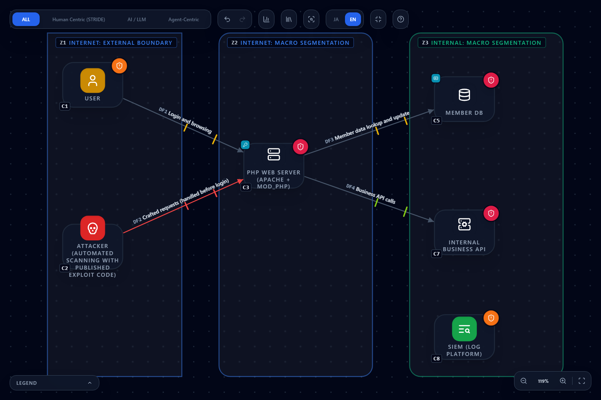
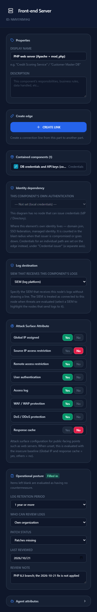
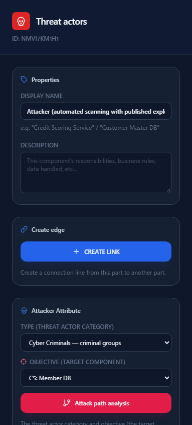
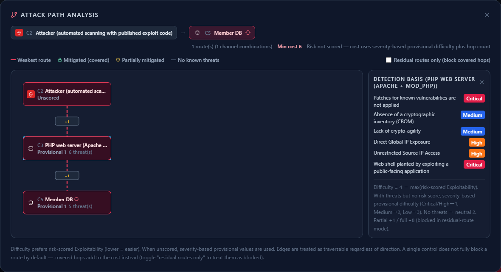
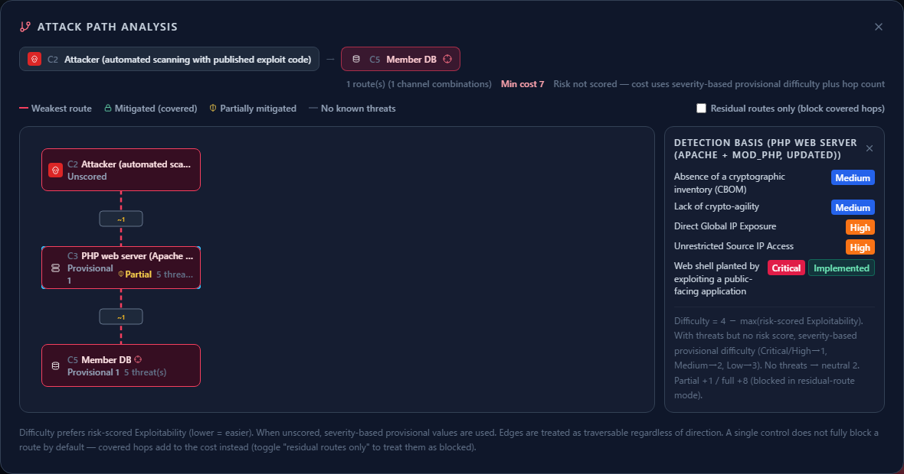

# Checking PHP's RCE vulnerabilities (21 October 2026 advisory) with attack path analysis

**English** | [日本語](php-rce-2026-10.ja.md)

> This page explains, with CyberRiskScape's diagram and attack path analysis and an imaginary membership site as the example,
> why the attack described in the security advisory "Critical remote code execution vulnerabilities, update now" published by the PHP project on 21 October 2026 ([source 1](#references)) works,
> and why updating is necessary.
> It is not produced, certified, or endorsed by the PHP project. The advisory's contents are summarized here, not reproduced.
> Attack procedures and exploit code are not given here. Always read the original and each CVE's advisory for the vulnerability details, affected versions, and the exact mitigation settings.
> Counts are measured values as of writing (October 2026).

---

## 1. What you will learn, and prerequisites

- Put an attacker on the diagram and use **attack path analysis (Attack Tree) to see where the attack passes on its way to the target**
- **Break down the conditions for the attack from the goal**, and confirm on the diagram **why a WAF or login (MFA) does not stop it**
- How updating PHP changes the threat cards and the attack path cost, and the difference between a measure that **makes the attack impossible (updating)** and measures that **only make it tedious (mitigations)**
- Sort the advisory's measures into **what a diagram can check and what must be checked on the live system**

**Summary of the advisory**

- The fixed versions are **PHP 8.5.12, 8.4.27, 8.3.36, and 8.2.35**. Both vulnerabilities can lead to **unauthenticated remote code execution**. The pre-announcement the day before rated them CVSS v4.0 **9.2**
  - **CVE-2026-109618:** out-of-memory handling can interrupt PHP while internal request data is only partially initialized, and request cleanup may then treat the invalid data as valid
  - **CVE-2026-109619:** request-owned internal state can survive after its backing memory is freed, and a later request handled by the same worker may use that stale state before normal initialization resets it
- **Every PHP installation that serves web requests** is affected (PHP-FPM, Apache with mod_php, php-cgi, FrankenPHP, LiteSpeed).
  The advisory considers **mod_php the highest risk**, because the demonstrated exploit works **with an unauthenticated request before any application code runs**
- **Updating is the only complete fix.** Linux distributions and LTS vendors received the patches in advance. **PHP 8.1 and older** get no updates from the PHP project, so check with your vendor or move to a supported version.
  **PHP 8.2 reaches end of life on 31 December 2026**
- Mitigations for when you cannot update immediately are given (memory limit, request size limits, disabling `session.upload_progress`, and so on), but the advisory states that they **"reduce exposure but do not make an installation safe"**. After changing settings, **restart every worker**

**What CyberRiskScape covers**

CyberRiskScape is a tool that **finds threats from the design (the diagram)**. What we check here is "where this PHP server sits in the architecture and how far a takeover would reach", "which point is the key point of the attack path", and "whether the update status is recorded".
**There are no fields for the PHP version, how it runs (mod_php or FPM), or php.ini settings.** Whether a server is actually on a fixed version, and whether it has been compromised, cannot be known from a diagram (sections 5 and 6).

**Prerequisites for this page:** the operations in [Getting started](getting-started.md), plus [Reading the threat panel](reading-threats.md) and [Attack path analysis](attack-paths.md).

---

## 2. The example architecture: load the template and review it

We draw an **imaginary membership site**. The PHP web server **has** a WAF, login (MFA), access logs, DDoS protection, and logs sent to the SIEM. The only difference is that **PHP is not on the 2026-10-21 fixed version**.
This architecture is for confirming that "even with all other measures in place, it is not stopped unless you update".

The following templates can be loaded as they are. Start from an empty project with **New project** in the left sidebar (**Create without saving**), then load with **Template → Import**; the nodes and flows are then numbered from C1 and DF1, as in the tables below.

| File | Contents |
|---|---|
| [`templates/php-rce-before.en.json`](templates/php-rce-before.en.json) ([Japanese](templates/php-rce-before.ja.json)) | Not updated: the PHP web server's patch status is "Patches missing" |
| [`templates/php-rce-after.en.json`](templates/php-rce-after.en.json) ([Japanese](templates/php-rce-after.ja.json)) | Updated: patch status set to "Up to date", with the updated version recorded in the review note (section 4) |



**Contents of the diagram:** 8 components, 4 data flows, 3 trust boundaries (loading it detects **28 threats**: Critical 5, High 13, Medium 10).

| Where | What is drawn (type) |
|---|---|
| Internet side (external boundary) | C1 User (`User`), C2 Attacker (`Threat actors`, automated scanning with published exploit code) |
| Public segment (Public Area) | C3 PHP web server (`Front-end Server`, Apache + mod_php), containing C4 DB credentials and API keys (`Credentials`, config file) |
| Internal segment (Security Zone) | C5 Member DB (`Database`, containing C6 Member personal data (`Personal data`)), C7 Internal business API (`Backend API`), C8 SIEM (`SIEM / log platform`) |

| Flow | Authentication, encryption, network |
|---|---|
| DF1 User → PHP server (login and browsing) | MFA, TLS, public network |
| DF2 Attacker → PHP server (crafted requests, handled before login) | No authentication, TLS, public network |
| DF3 PHP server → member DB (member data lookup and update) | ID/password, TLS, closed network |
| DF4 PHP server → business API (business API calls) | Token, TLS, closed network |



> **Drawing notes.**
> - On the PHP server, every Attack Surface Attribute **except source IP restriction and response cache is "Yes"** (a public site that anyone uses cannot restrict source IPs).
>   The operational posture is log retention of one year or more, patch status "**Patches missing**", and the review note "PHP 8.3 branch; the 2026-10-21 fix is not applied".
> - DF2 is drawn **without authentication** because, as the advisory says, this attack works **before login**. Even though the user's line (DF1) uses MFA, the attacker does not go through DF1.
> - The attacker is an **external actor**, not part of the victim organization, so it sits in the **internet-side boundary**, not in a DMZ.

---

## 3. Why the attack works: look at it with attack path analysis

### 3.1 Set the attacker and target, and open attack path analysis

Select C2 Attacker and the right panel shows the **Attacker Attribute**. In the template, **TYPE** is Cyber Criminals and **OBJECTIVE (target component)** is **C5 Member DB**.
Press the **Attack path analysis** button to open the routes from the attacker to the target (details: [Attack path analysis, section 2](attack-paths.md#2-setup--put-an-attacker-and-a-target-on-the-diagram)).



### 3.2 Read the route



- **There is only one route:** C2 Attacker → **C3 PHP web server** → C5 Member DB (min cost 6)
- **Every way to the target passes through C3.** C3 is the **key point** of this architecture (a place with no detour, where a single spot decides the whole route)
- Click C3 to see the **detection basis**. Two of the six items are **Critical**:
  - Patches for known vulnerabilities are not applied `posture-patch-missing-001` (**Critical**; it becomes Critical because the public server has a global IP and is unpatched)
  - Web shell planted by exploiting a public-facing application `webserver-webshell-implant-001` (**Critical**)
  - Also direct global IP exposure and unrestricted source IP access (High), and two PQC items (Medium)
- The difficulty is "**Provisional 1**" (easiest). Because no risk score is entered, a provisional difficulty is derived from the detected severity ([Attack path analysis, section 7](attack-paths.md))

### 3.3 Break down the conditions for the attack from the goal

Attack path analysis shows "where it passes". Here, based on the advisory and the threat cards, we break down the conditions under which **the goal "take the personal data in the member DB"** is achieved (AND means all are required; OR means any one is enough).

```
Goal: take the personal data in the member DB
└─ AND
   ├─ (1) Reach the PHP server
   ├─ (2) Unfixed PHP is running
   ├─ (3) Exploit a vulnerability ─── OR ─┬─ CVE-2026-109618 (out-of-memory handling)
   │                                       └─ CVE-2026-109619 (state left for the next request)
   └─ (4) Move on with the hijacked server's privileges ─── OR ─┬─ DB credentials in the config file → member DB
                                                                 ├─ Business API token → internal systems
                                                                 └─ Plant a web shell and stay
```

| Condition | Evidence on the diagram (rules) | How to think about it |
|---|---|---|
| (1) Reach the PHP server | On DF2, the unauthenticated public-network line `stride-edge-unauth-internet-001` (Critical) and unauthenticated internet ingress into the front-end `stride-web-unauth-internet-ingress-001` (High); on C3, direct global IP exposure `stride-web-global-ip-exposure-001` and unrestricted source IP access `stride-web-no-source-ip-restriction-001` (High) | A public site that anyone uses, so **this condition cannot be removed** |
| (2) Unfixed PHP is running | Patches for known vulnerabilities are not applied `posture-patch-missing-001` (Critical) | **The only condition that updating removes.** 8.1 and older get no fix from the PHP project, so you need to upgrade or get a vendor fix |
| (3) Exploit a vulnerability | (There is no rule per CVE; the card in (2) covers it) | According to the advisory, it can work **before application code, without authentication**. The paths the advisory lists as confirmed are `session.upload_progress` and, on 8.5, fatal error backtraces |
| (4) Move on | Static storage and sprawl of credentials `zt-credential-sprawl-static-secret-001` (C4, High), direct exposure across a trust boundary from the public segment to the member DB `stride-edge-internet-exposed-sensitive-001` (DF3, Critical), and web shell planted `webserver-webshell-implant-001` (C3, Critical) | The blast radius is **everything the PHP process can touch** |

### 3.4 Why a WAF or login does not stop it

- **Login and MFA:** authentication happens inside the application code. The advisory says that with mod_php the attack works with an unauthenticated request **before any application code runs**. **The strength of authentication does not matter for an attack that happens before authentication**
- **WAF and request limits at the front:** the advisory lists limiting request size and counts at the web server or proxy as a mitigation, but writes that it **"reduces exposure but does not make an installation safe"**
- **The diagram gives the same result:** even with C3's WAF, user authentication, access log, DDoS protection, and remote access restriction all set to "Yes", **the Critical for missing patches does not go away**. (1) and (4) are facts of the architecture; only (2) can be removed

---

## 4. Why remediation matters: what changes when you update

### 4.1 The updated diagram

In the **"updated" template** ([`php-rce-after.en.json`](templates/php-rce-after.en.json)), C3's operational posture is changed as follows. **This is an example entry.** In your own diagram, enter only the values you have actually confirmed.

| Field | Not updated → updated |
|---|---|
| Patch status | Patches missing → **Up to date** |
| Review note | PHP 8.3 branch; the 2026-10-21 fix is not applied → **Updated to PHP 8.3.36 (fixes CVE-2026-109618 / CVE-2026-109619). All workers restarted** |
| Last reviewed | 2026-10-21 |

**Threat count: 28 to 27** (Critical 5 to 4; measured). **Only the one item for missing patches (Critical)** disappears.

### 4.2 Record the control implementation status and look at the attack path again

The remaining "web shell planted" card asks **whether vulnerabilities in the public app are fixed within a deadline**, and a single PHP update does not remove it. If you apply fixes within a deadline, record that fact ([Reading the threat panel, section 5](reading-threats.md#5-recording-decisions--two-independent-layers)).

1. Open C3's "Web shell planted by exploiting a public-facing application" card
2. Under **Control implementation status**, choose **Implemented**, write what you confirmed and the date in the note (for example, "Fixes for the public app and PHP are applied within a set deadline after release. PHP 8.3.36 applied on 2026-10-21 and all workers restarted"), and **Save**
3. Open **Attack path analysis** again from the attacker



- **Missing patches (Critical) disappears** from C3's detection basis, and web shell planted carries an **Implemented** mark
- C3 becomes **partially mitigated**, and **the min cost rises from 6 to 7**
- Records are not carried in templates. Save them in the project file (**File (Save / Open)** in the left sidebar)

### 4.3 The change looks small, but it means a lot

The count changes by only one, and the cost by only +1. That is because attack path analysis **does not assume a single control fully blocks a route** ([Attack path analysis, section 8](attack-paths.md)).
But the value of updating is not measured by the count.

- **Updating makes the attack impossible.** On the fixed version, the attack that exploits these two vulnerabilities simply does not work. Condition (2) is removed, so the whole goal, joined by AND, can no longer be achieved
- **Mitigations only make it tedious.** The advisory itself says they do not make an installation safe. They bridge the gap until you update; they do not replace updating
- **Why hurry:** this is unauthenticated remote code execution, rated CVSS v4.0 9.2 in the pre-announcement. Another report puts the time from publication of a working PoC (proof-of-concept code) to exploitation at about 24 hours ([source 2](#references)).
  Attackers use published information to search automatically for public servers on the internet
- **What being the key point means:** in this architecture, every route to the member DB passes through C3. If updating C3 is delayed, **the whole route stays open however many other measures are in place**. Conversely, keeping C3 reliably updated is the single most effective move for protecting the whole architecture
- **After updating:** as the advisory says, **restart every worker** (the vulnerability leaves state for the next request, so old workers that keep running defeat the point). If you run 8.2, plan the move to a later version before end of life on 2026-12-31

---

## 5. The advisory's measures, and how to check them on the diagram

| Measure in the advisory | What the diagram can check | What to check on the live system |
|---|---|---|
| Updating to a fixed version (8.5.12, 8.4.27, 8.3.36, 8.2.35) | Record the patch status, last reviewed date, and review note (the version you updated to) on every node that runs PHP. **A blank field fires at the same Critical as "Patches missing"**, so the servers you have not checked show up in the list | The actual version (`php -v`, package versions) and restarting every worker |
| Fixes from distributions and LTS vendors | Record the vendor fix (package version) in the review note | The vendor's advisory and package versions |
| PHP 8.1 and older, and 8.2 end of life | **Cannot be expressed** (no attribute or rule for end of support). Writing the version in the review note helps with inventory | Version inventory and migration plan |
| Memory limit and request size limits (mitigation for CVE-2026-109618) | **Cannot be expressed** (no attribute for php.ini or front-end limits) | php.ini, FPM pool, web server, and proxy settings |
| Disabling `session.upload_progress`, and `fatal_error_backtraces` on 8.5 (mitigation for CVE-2026-109619) | **Cannot be expressed** | php.ini and FPM pool settings, and restarting every worker |
| Limiting the damage if the server is taken over | Lines from the PHP server to the DB, APIs, and secrets, plus attack path analysis. The card on the config-file credentials (C4) asks how secrets are stored | DB account privileges, secret management, and investigating traces of compromise |

**Do not set the patch status to "Up to date" just because you applied mitigations.** As the advisory says, mitigations do not guarantee safety, so the Critical remaining on the diagram is the correct state. Write the mitigations you applied and the planned update date in the review note.

---

## 6. Limits (what cannot be confirmed)

- **Whether a server is actually on a fixed version is unknown.** Patch status is an input, not an observation
- **Whether compromise has occurred is unknown.** Whether it was attacked before the advisory, or whether a web shell was planted, must be investigated on the live system and in logs
- **There are no fields for the PHP version, how it runs (mod_php or FPM), or php.ini settings.** Patch status has two values: up to date or missing
- **There is no rule per CVE.** Threat rules deal with design questions; individual CVEs are covered by the "missing patches" card
- **Without risk scores, attack path cost uses provisional values derived from detected severity.** A single control is not assumed to fully block a route
- **Judgments rest on the diagram.** PHP servers you have not drawn (admin screens, test environments, batch jobs) are not evaluated
- What is drawn here is an **imaginary architecture**. The counts will differ in your diagram

---

## References

1. PHP, "News Archive - 2026" (the security advisory and releases of 21 October 2026)
   <https://www.php.net/archive/2026.php#2026-10-21-5>
2. CrowdStrike, "2026 Threat Hunting Report"
   <https://www.crowdstrike.com/en-us/resources/reports/threat-hunting-report/>

For details of each CVE, see the php-src security advisories linked from source 1.

## What to read next

- [Attack path analysis](attack-paths.md): choke points, the route table, and "residual routes only"
- [Checking IPA's October 2026 Alert with a Membership-Site Diagram](ipa-alert-2026-10.md): recording operational posture such as patches, logs, and account reviews, and the advisory checklist
- [Reducing internet exposure](exposure-reduction.md): inventorying public servers and cutting needless exposure
- [Preparing public web apps and APIs for automated attacks by AI agents](ai-agent-attack-2026-10.md): the idea of measures that make attacks tedious versus impossible
