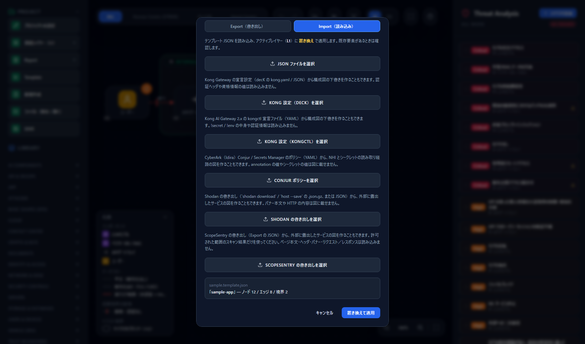
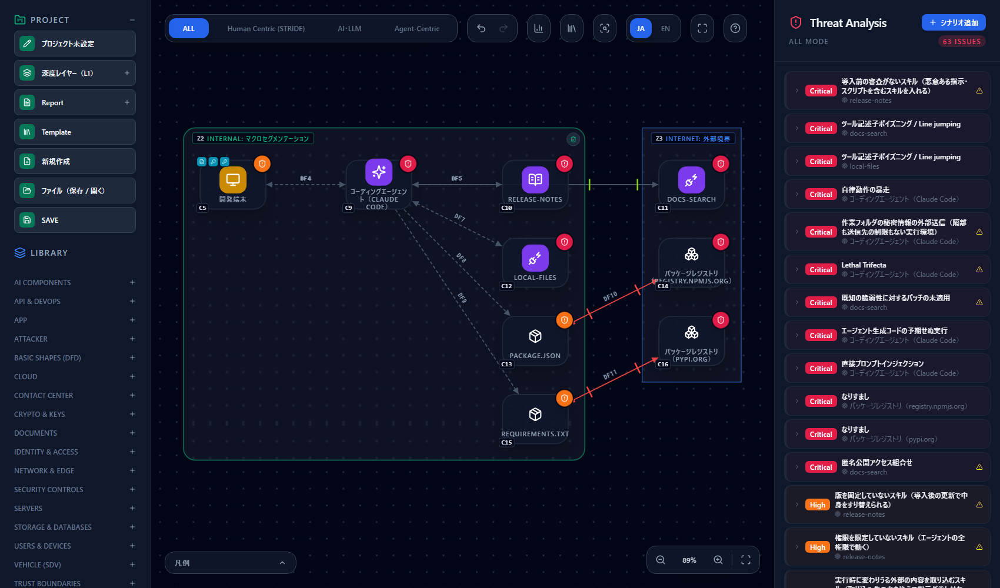
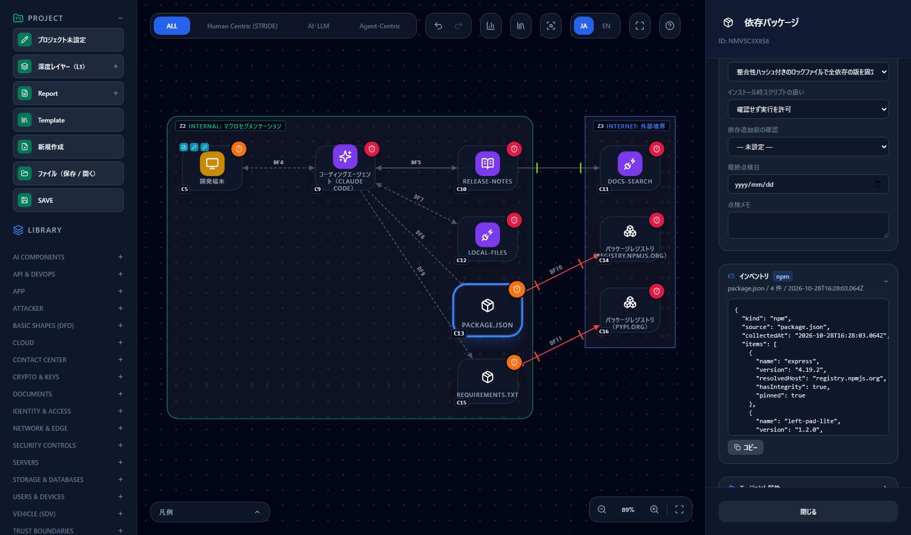
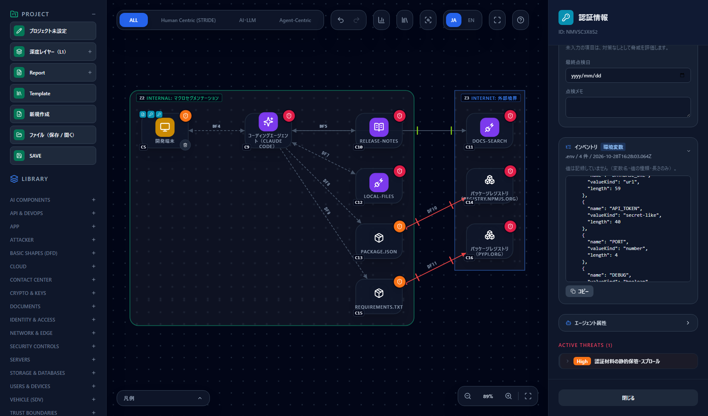
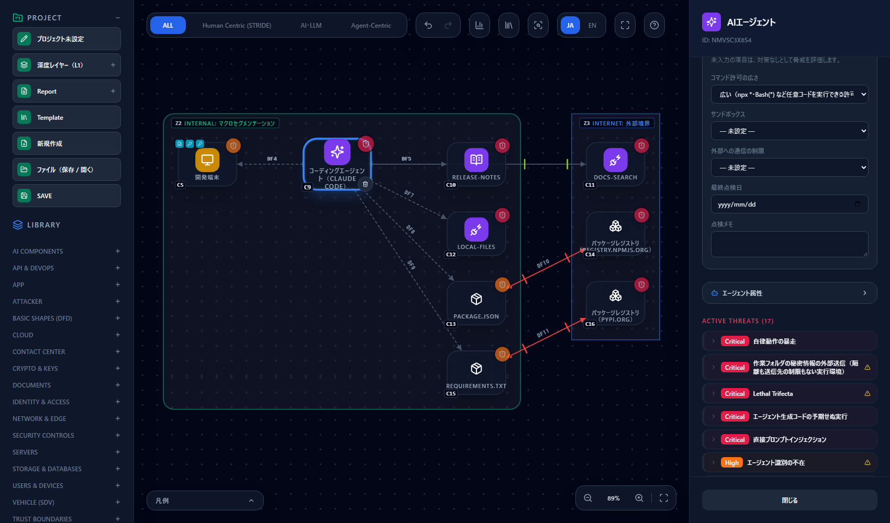

# 作業ディレクトリを脅威モデルにする — 依存パッケージと Claude Code の設定から構成図を作る

[English](repo-import.md) | **日本語**

> Claude Code は Anthropic の、npm は npm, Inc. の、PyPI は Python Software Foundation の名称です。このページは
> 「CyberRiskScape で作業ディレクトリ（リポジトリ）から開発環境の構成図を作る方法」を説明するもので、各社が提供・認定・推奨する
> ものではありません。記述的な使用です。ファイルの形式は執筆時点（2026 年 10 月）のものです。最新は各社の公式の情報で確かめてください。

> **読んでよい範囲** — この取り込みを実行するのは、**自分が管理する、または診断を許可された作業ディレクトリだけ**にしてください。
> 取り込みはファイルを読むだけで、書き込み・実行・通信はしません。

---

## 1. このページで分かること・前提

- コーディングエージェント（Claude Code など）を使っている作業ディレクトリを CLI で読み、**開発環境と依存パッケージの構成図の
  下書きを自動で作る**方法（`import-repo`）
- **何を読み、何を読まないか**（`.env` の値・認証情報は読み取り後に捨てます）
- どのファイルが図のどの型になるか、依存パッケージを**インベントリ**で見る方法
- 図で**実際に検出される脅威**（新しい 6 ルール）と、運用状況を入力して消す方法
- 顧客の作業ディレクトリの診断や、PR で開発環境の変化を見張る使い方、そして**限界**

**前提**

- Node.js が動くこと。CLI をビルドしておきます（`npm ci && npm run build:cli`）。
- **CLI 専用です。画面からフォルダを読み込むことはできません。** CLI が書き出した JSON を、画面の **Template** → **Import** で読み込みます
  （手順は §3）。
- 対象は「**開発環境と依存パッケージ**」です。アプリの中身（API・データベース・IaC）は描きません（§9）。

**このページの前提となる知識**：[はじめに](getting-started.ja.md)の操作と、[テンプレートを作る・使う](templates.ja.md)の読み込み手順。

---

## 2. 何を読むか・何を読まないか

CLI は決まった形式のファイルだけを読みます。同じディレクトリなら同じ結果になります。

| 対象 | 読むもの | 読まない・捨てるもの |
|---|---|---|
| `package.json`＋`package-lock.json`（v2・v3） | パッケージ名・版・取得元のホスト・整合性ハッシュの有無・インストールスクリプトの有無・dev／optional | `resolved` の URL のパスやクエリ（ホストだけ残します）。URL・パス・git 参照の版指定は記録しません |
| `requirements*.txt`・`*.lock`・`*.in` | パッケージ名・版・版の固定の有無・`--hash` の有無・`--index-url` のホスト | `name @ URL` の直接参照の URL |
| `.npmrc` | `ignore-scripts` と `registry` の行だけ | **トークンなどそれ以外の行は解釈せず、図にも出力にも残しません** |
| `.env`・`.env.*` | **変数名・値の種類・値の長さ**・テンプレートか（`.example`・`.sample`・`.template`）・`.gitignore` に載っているか | **値そのもの・値の一部は記録しません** |
| `.mcp.json` | サーバー名・stdio の実行ファイル名・リモートの URL のホスト・`env`／`headers` の**キー名** | 引数・`env`／`headers` の値・URL のパスやクエリ |
| `.claude/settings.json`・`.claude/settings.local.json` | 許可（allow）・拒否（deny）の**件数**、許可に出てくるツール名、サンドボックスの有効・無効、hooks の有無、広い許可（§6） | **許可ルールの全文は出しません**（トークン入りのコマンドが溜まりやすいため） |
| `.claude/skills/*`・`.claude/commands/*` | 名前だけ | 中身は開きません |

- 値の種類は、空・秘密鍵・JWT・URL・真偽値・数値・パス・秘密らしい文字列・その他のどれかに分類します。
- `node_modules`・`.git`・`dist`・`build`・`.venv` などのビルド出力や依存の置き場は**辿りません**。シンボリックリンクも辿りません
  （作業ディレクトリの外を読まないためです）。
- 上限があります：深さ 8 階層、読むファイル 500、1 ファイル 10 MB。超えた分は読み飛ばし、警告に出ます。
- `.mcp.json` は作業ディレクトリ直下のものだけ、`.claude/settings*.json` も直下の `.claude/` のものだけを読みます。
- **読むのは `.claude/` の設定だけです。** Cursor・GitHub Copilot など、ほかのコーディングエージェントの設定ファイルは読みません（§9）。

---

## 3. 取り込み方

```bash
npm ci && npm run build:cli
node dist-cli/main.js import-repo ./my-app --out repo.json
```

- `--locale en` を付けると、図のノード名・説明が英語になります（既定は `ja`）。英語の画面で読むなら付けてください。
- 標準エラー出力に、読んだ件数（マニフェスト・パッケージ・インストールスクリプトありのパッケージ・`.env`・MCP サーバー・スキル・コマンド）と
  警告が出ます。**件数が想定と合うかを確かめてください。** 読めなかったファイルや上限は警告に出ます。
- 読む対象が 1 つも無いディレクトリではエラーになります。

出力は L1 に図を置いた**プロジェクト JSON** で、`analyze`・`diff` にそのまま渡せます。

```bash
node dist-cli/main.js analyze repo.json --format md
```

### 画面に読み込む

画面の **Template** → **Import（読み込み）** タブの「JSON ファイルを選択」は、プロジェクト JSON ではなく**テンプレート形式**を読みます。
次の小さなスクリプトで包んでから読み込みます（`to-template.mjs` などの名前で保存します）。

```js
// 使い方: node to-template.mjs repo.json repo.template.json my-app
import { readFileSync, writeFileSync } from 'node:fs';
const [, , src, dst, name] = process.argv;
const project = JSON.parse(readFileSync(src, 'utf8'));
writeFileSync(
  dst,
  JSON.stringify({ schemaVersion: 1, kind: 'cyberriskscape-template', name, layer: project.layers.L1 }),
);
```

1. 左サイドバーの **Template** → **Import（読み込み）** タブで **「JSON ファイルを選択」** を押し、`repo.template.json` を選びます。
2. ファイル名と件数（このページのサンプルは ノード 12 / エッジ 8 / 境界 2）が表示されます。**「置き換えて適用」** を押すと、
   アクティブなレイヤーが生成された図に置き換わります（既存の要素があれば確認が出ます。Undo で戻せます）。



---

## 4. 図の構成

このページの画面は、**架空のサンプルアプリ**（`package.json`・`package-lock.json`・`requirements.txt`・`.env`・`.env.example`・`.mcp.json`・
`.claude/settings.json`・スキル 1 つ。値はすべてダミー）から作ったものです。



| ファイル | 図の要素（型） | 補足 |
|---|---|---|
| （常に） | **開発端末**（`PC`）＝Internal（Office Area）の境界 | リポジトリ（`ソースコード`）と `.env` を内包します |
| リポジトリ | `ソースコード` | ラベルはディレクトリ名 |
| `.env`・`.env.*` | `認証情報`（1 ファイルにつき 1 つ） | 開発端末に内包。インベントリ付き（§5） |
| `.claude/` の下に何かある | `AIエージェント`（ラベル「コーディングエージェント（Claude Code）」） | 開発端末と双方向の線（`.env` などを読む経路）。運用状況が自動で入ります（§6） |
| `.claude/skills/*`・`.claude/commands/*` | `エージェントスキル` | コマンドのラベルは `/名前`。エージェントから線 |
| `.mcp.json` の stdio サーバー | `MCPサーバー`（組織内） | Global IP なし。エージェントとの線は `tool_invocation` |
| `.mcp.json` のリモートサーバー | `MCPサーバー`（URL のホストが社内なら組織内、それ以外は Internet の境界） | `headers` があればトークン認証、なければ認証なし。https でなければ平文 |
| `package.json`・`requirements*.txt` | **`依存パッケージ`**（マニフェストごとに 1 つ） | ラベルはパス。インベントリ付き |
| 取得元（`resolved`・`--index-url`・`.npmrc` の registry） | `パッケージレジストリ`（ホストごとに 1 つ） | 既定は `registry.npmjs.org`・`pypi.org`。依存パッケージから線 |

- **依存はマニフェストごとに 1 ノード**です。個々のパッケージは型を増やさず、そのノードの**インベントリ**に記録します。
- 同じディレクトリに `package.json` と `package-lock.json` があれば、ロックファイルの内容（版・ハッシュ・インストールスクリプト）を使います。
  ロックファイルが無いときは `package.json` の指定（`^1.2.0` など）だけを使います。
- 配置は縦一列の簡易なもので、線が重なることがあります。必要に応じて整えてください。

---

## 5. インベントリの見方

`依存パッケージ` と `認証情報`（`.env`）のノードを選ぶと、右のパネルに **インベントリ** の欄が出ます。クリックで開くと、
取り込んだ内容が JSON で表示され、**コピー**で持ち出せます（読み取り専用です）。



パッケージ 1 件の項目：`name`・`version`・`resolvedHost`（取得元のホスト）・`hasIntegrity`（整合性ハッシュ）・`pinned`（版が固定されているか）・
`hasInstallScript`・`dev`・`optional`。上の画面は `package.json`（4 パッケージ）で、見出しの横に取得日時が出ます。

`.env` のインベントリには、**値は入っていません**。画面にも「値は記録していません（変数名・値の種類・長さのみ）」と出ます。



1 変数の項目は `name`・`valueKind`（url・secret-like・number など）・`length` だけです。ファイル側には `template`（テンプレートか）と
`gitIgnored`（`.gitignore` に載っているか。Git が使えないときは入りません）があります。
**モデルの JSON はコミット・共有される正本なので、値を入れない作りにしています。**

---

## 6. 自動で入る運用状況と、利用者が入力するもの

CyberRiskScape の大方針は「**未入力は、対策なしとして脅威を出す**」です。CLI は**設定ファイルから分かるものだけ**を運用状況に入れ、
**安全だと断定できないものは入れません**（入れないものは未入力のままで、脅威が出ます）。

| ノード | 運用状況の項目 | CLI が入れる値 | 入れない（利用者が入力する）値 |
|---|---|---|---|
| 依存パッケージ | 依存の版の固定 | 全依存が整合性ハッシュ付きのロックで固定 → **固定済み**、そうでなければ**固定していない** | — |
| 依存パッケージ（npm） | インストール時スクリプトの扱い | `.npmrc` に `ignore-scripts=true` → **実行しない**。スクリプトを持つパッケージがある → **確認せず実行を許可** | 内容を確認した分のみ許可（「確認した」は図から分からない）。スクリプトが無い場合も未入力 |
| 依存パッケージ（pip） | インストール時スクリプトの扱い | なし | pip のインストールスクリプトは自動で判定しません |
| 依存パッケージ | 依存追加前の確認 | なし | 人が実在・公開者・類似名を確認／スキャンのみ／なし |
| AIエージェント | コマンド許可の広さ | 広い許可がある → **広い**（§7 のルール 5） | 必要なコマンドに限定（設定を直したあと再取り込みしても入りません） |
| AIエージェント | サンドボックス | `.claude/settings*.json` で有効 → **強制** | 制限していない |
| AIエージェント | 外部への通信の制限 | なし | 許可リストで制限／制限していない |

「広い許可」は、`Bash(*)`、`Bash(npx *)`、`node`・`python`・`python3`・`sh`・`bash`・`zsh`・`npm exec`・`pnpm dlx`・`pnpm exec`・`yarn dlx`・`bunx`・
`uvx`・`deno`・`pwsh`・`powershell`・`cmd`・`eval`・`sudo` の `*` 付き許可、`defaultMode: bypassPermissions` です。
固定の一覧に一致したものだけを数え、許可の本文は出力に書きません。



画面は AIエージェント を選んだところです。「コマンド許可の広さ」は CLI が **広い** にしており、「サンドボックス」「外部への通信の制限」は
未入力（— 未設定 —）なので、対策なしとして評価されます。

---

## 7. 押さえるべき脅威

新しい 6 ルールです（`data/threat-library/dev-supply-chain.yaml`）。ルールは特定の文書を出典とせず、一般的な考え方として書いてあります。
運用状況は、ノードを選んだときの **運用状況** の欄で入力します。

| ルール ID | 名前（画面の表示） | 深刻度 | 発火する条件 | 消し方 |
|---|---|---|---|---|
| `dev-dependency-unlocked-001` | 版を固定していない依存パッケージ（後から悪性版を取り込む） | High | 依存パッケージの「依存の版の固定」が**固定していない・未入力** | ロックファイルを作ってコミットし、`npm ci` など完全一致でインストールする。実態が固定済みなら「固定済み」を入力 |
| `dev-dependency-install-scripts-001` | インストール時スクリプトの実行を許している依存パッケージ（取得しただけで任意コードが動く） | High | 「インストール時スクリプトの扱い」が**確認せず実行を許可・未入力** | `ignore-scripts=true` にする（再取り込みで「実行しない」が入る）。許可するパッケージを人が確認したなら「内容を確認した分のみ許可」を入力 |
| `dev-dependency-unvetted-001` | 確認せずに追加する依存パッケージ（類似名・先回りで登録された偽パッケージを入れる） | High | 「依存追加前の確認」が**なし・スキャンのみ・未入力** | 追加時に名前・公開者・公開日を人が確認する手順にしたうえで「人が実在・公開者・類似名を確認」を入力（CLI は入れません） |
| `dev-registry-publisher-takeover-001` | パッケージレジストリの乗っ取り・同名の公開パッケージ（悪性版の公開と dependency confusion） | High | **パッケージレジストリのノードがあれば常に**（運用状況は無関係） | 入力で消える項目はありません。社内パッケージ名の予約・取得元のスコープ固定・社内ミラーなど、脅威カードの対策を実施して実装状況を記録する |
| `dev-agent-command-allow-broad-001` | 任意コードを実行できるコマンド許可（npx *・Bash(*)・node/python の実行を許可している） | High | 「コマンド許可の広さ」が**広い・未入力** | 許可を必要なコマンドと引数に限る。直したら「必要なコマンドに限定」を入力 |
| `dev-agent-workspace-secret-exfiltration-001` | 作業フォルダの秘密情報の外部送信（隔離も送信先の制限もない実行環境） | **Critical** | 「サンドボックス」が**制限していない・未入力**、**かつ**「外部への通信の制限」が**制限していない・未入力** | どちらか一方を強制すれば消える（サンドボックス＝強制、または通信先＝許可リストで制限）。両方備えるのが望ましい |

- **ルール 5 は、既存の「過剰な権限」の脅威と同じ種類として 1 枚のカードにまとまります。** 画面では「自律動作の暴走」のカードが代表になり、
  このルールの ID は裏付けとして記録されます（高い深刻度のカードが代表に選ばれます）。
- サンドボックスを `.claude/settings.json` で有効にしていると、CLI が「強制」を入れるため、ルール 6 は消えます。**設定が実際に効いているかは
  確かめません。** 実態を確認してください。
- 取り込みで出る既存ルールにも注意してください。`.env` の `認証情報` には**認証材料の静的保管・スプロール**（`zt-credential-sprawl-static-secret-001`、High）が出ます。
  値が `.gitignore` で守られていても出ます。テンプレート（`.env.example`）にも同じカードが出るので、実際の秘密が入っていないことを確認して扱ってください。
  `MCPサーバー` と `エージェントスキル` には、ツール記述子のポイズニングや版の固定・審査に関する既存ルールが当たります。

サンプルでは **63 件**（Critical 12・High 44・Medium 7）が検出されます（執筆時点）。そのうち、このページの 6 ルールは次のとおり出ます。

| 対象 | 出るルール |
|---|---|
| `package.json`（ロック済み・スクリプトありのパッケージが 1 つ） | インストール時スクリプト（許可）・確認せずに追加（未入力） |
| `requirements.txt`（固定なしが混在） | 版を固定していない・インストール時スクリプト（未入力）・確認せずに追加（未入力） |
| レジストリ（registry.npmjs.org・pypi.org） | 乗っ取り・同名の公開パッケージ（各 1） |
| コーディングエージェント | 作業フォルダの秘密情報の外部送信（Critical）、コマンド許可（既存の脅威に統合） |

> **ひとこと** — 運用状況の入力は、**確かめた項目だけ**にしてください。推測で「固定済み」「許可リストで制限」にすると、脅威が消えて見えるだけになります。
> 入力の流れは [脅威パネルの読み方](reading-threats.ja.md) を参照してください。

---

## 8. ユースケース

### 8.1 顧客の作業ディレクトリを診断する

診断を許可された作業ディレクトリ（またはそのコピー）に対して、`import-repo` → `analyze` を実行します。

```bash
node dist-cli/main.js import-repo ./customer-app --out customer.json
node dist-cli/main.js analyze customer.json --format md --out customer.md
```

先に標準エラー出力の件数と警告を見て、読めたものを確かめます。出力の JSON は値を持たないので、共有しやすい形です
（**それでも共有先は確認してください。** ホスト名・パッケージ名・変数名は入っています）。図は §3 の手順で画面に読み込み、
自動で入らなかった運用状況を、顧客に聞いて入力します。

### 8.2 PR で開発環境の変化を見る

`import-repo` の出力は `diff` にそのまま渡せるので、変更前後の作業ディレクトリから、**新しく出た脅威**だけを判定できます。

```bash
# 変更前（main）を別のディレクトリに取り出す
mkdir base && git archive origin/main | tar -x -C base
node dist-cli/main.js import-repo base --out base.json
node dist-cli/main.js import-repo . --out head.json

# 新しい High 以上の脅威があれば exit 1（PR を止める）
node dist-cli/main.js diff base.json head.json --format md --fail-on High --out result.md
```

サンプルで試した結果です（執筆時点）。

- **ロックファイルを消し、`.mcp.json` にリモートの MCP サーバーを 1 つ足す**と、追加 12 件、High 以上の新しい脅威 11 件で、終了コード 1 で止まります。
  実行トリガーには **T7（エージェントの能力拡大）** などが出ます。
- **既存のマニフェストに依存を 1 つ足しただけ**では、追加は 0 件です。脅威は「マニフェスト単位」で出るためで、個々のパッケージの増減は
  インベントリで見ます。差分で止まるのは、ロックファイルを外した・インストールスクリプトを許した・広い許可を足した・新しい MCP サーバーや
  マニフェスト、レジストリを足した、といった**構成の変化**です。

`git archive` は追跡しているファイルだけを取り出すので、`.gitignore` に載っている `.env` は含まれません。**比べるのは同じ条件の取り込み同士**にしてください
（CI でチェックアウトした状態どうしが確実です）。GitHub Actions への組み込み方は [AI駆動開発のCIに組み込む](ci-integration.ja.md) を参照してください。

---

## 9. 限界

- **読むのは `.claude/` の設定だけです。** Cursor・GitHub Copilot など、ほかのコーディングエージェントの設定は読みません。
- **pip は `.in` と `.lock`（`requirements*.txt`）が別のノードになります。** 同じ依存を 2 つのノードで数えることがあります。
- **pip のインストールスクリプトは自動で判定しません**（運用状況は未入力のまま、脅威が出ます）。
- **package-lock の v1 は未対応です。** `packages` が無いので、警告を出して `package.json` の指定だけを使います（版は固定扱いになりません）。
- **実際の通信は分かりません。** 図はファイルに書かれた宣言から作った下書きです。エージェントが実際にどこへ接続したかは、別の手段（通信の記録）で確かめてください。
- **アプリの中身（API・データベース・IaC）は描きません。** 今回は開発環境と依存パッケージまでで、アプリの構成は次の段階です。
- 許可ルールの一覧、`.env` の値、MCP の引数は出力に入りません。そのため、**どのコマンドが許可されているかの細部**や、**値が本当に秘密か**までは分かりません
  （値の種類と長さで目安を付けます）。
- 設定を直しても、**CLI は「安全」を自動では入れません**（広い許可を外した、サンドボックスを有効にした以外）。直したら運用状況を入力してください。
- 上限（深さ 8・500 ファイル・10 MB）を超えた部分は読みません。モノレポは、対象のディレクトリを指定して取り込んでください。
- `.mcp.json` は直下のものだけです。ユーザー設定（`~/.claude`）は読みません。

---

## 参考リンク

このページの内容は、CyberRiskScape の実装と同梱の脅威ルールに基づきます。外部のフレームワークを出典とする記述はありません。

---

## 次に読むもの

- 検出された脅威の読み方・運用状況の入力 — [脅威パネルの読み方](reading-threats.ja.md)
- 画面への読み込み（テンプレート） — [テンプレートを作る・使う](templates.ja.md)
- 定期評価を CI に組み込む — [AI駆動開発のCIに組み込む](ci-integration.ja.md)
- 経路から守りどころを探す — [攻撃経路分析](attack-paths.ja.md)
- エージェントから脅威を問い合わせる — [コーディングエージェントから使う](mcp-integration.ja.md)
- 同じ流れで別の製品を扱う例 — [Kong AI Gateway を脅威モデリングする](kong-ai-gateway.ja.md)
