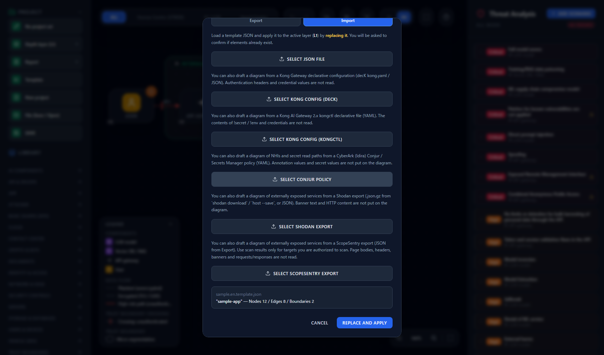
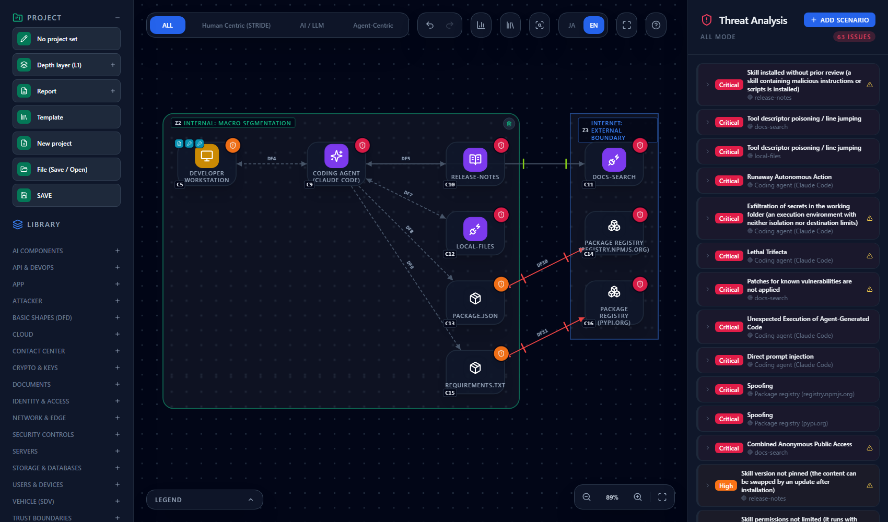
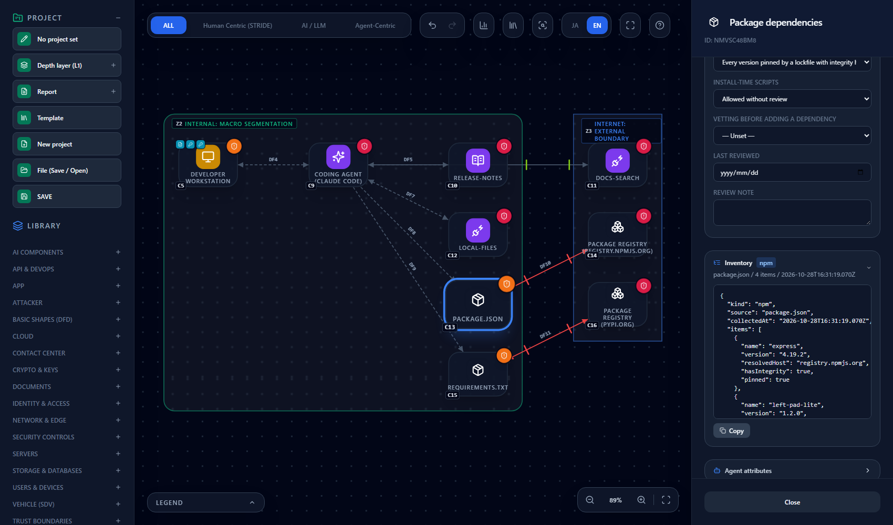
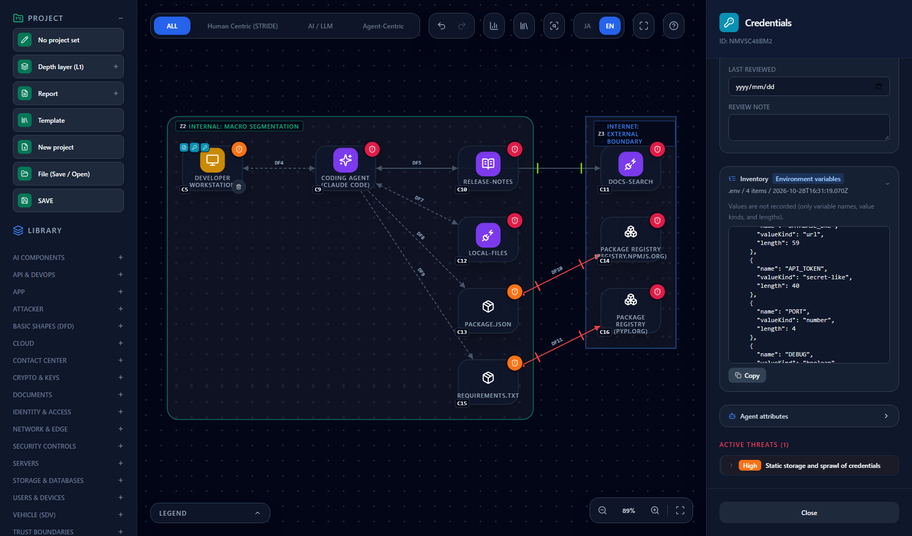
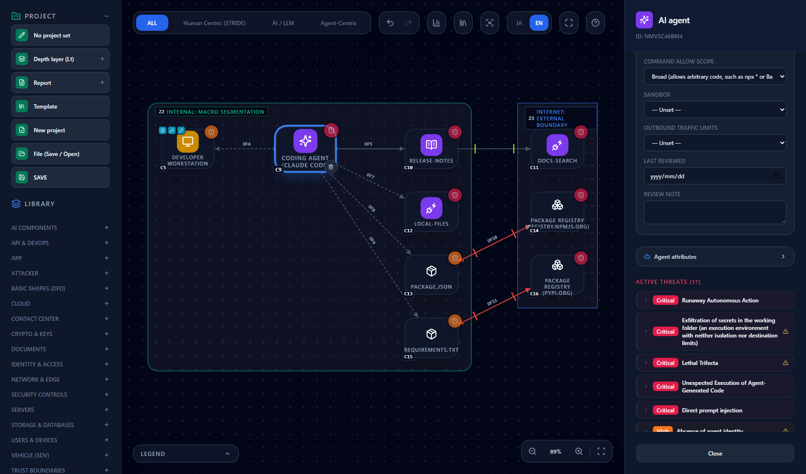

# Turn a working directory into a threat model — build a diagram from dependencies and Claude Code settings

**English** | [日本語](repo-import.ja.md)

> Claude Code is a name of Anthropic, npm of npm, Inc., and PyPI of the Python Software Foundation. This page explains how to build a
> development-environment diagram from a working directory (repository) in CyberRiskScape. It is not provided, certified or endorsed by
> any of these companies. This is descriptive use. The file formats are those at the time of writing (October 2026); check each
> company's official information for the latest.

> **Where you may run this** — Run the import only on **working directories you manage or are authorized to assess**. The import only
> reads files. It never writes, executes or communicates.

---

## 1. What this page covers, and prerequisites

- How to read a working directory used with a coding agent (such as Claude Code) with the CLI and **generate a draft diagram of the
  development environment and its dependency packages** (`import-repo`)
- **What is read and what is not** (values in `.env` and credentials are discarded after reading)
- Which file becomes which type in the diagram, and how to view the dependency packages in the **inventory**
- The **threats actually detected** on the diagram (6 new rules) and how to clear them by entering operational posture
- Uses such as assessing a customer's working directory and watching development-environment changes in a PR, and the **limits**

**Prerequisites**

- Node.js, with the CLI built (`npm ci && npm run build:cli`).
- **This is CLI-only. The screen cannot read a folder.** You load the JSON the CLI writes through **Template** → **Import** on the screen
  (steps in §3).
- The scope is the **development environment and dependency packages**. The content of the app itself (APIs, databases, IaC) is not drawn (§9).

**Background knowledge for this page**: the operations in [Getting Started](getting-started.md) and the import steps in
[Creating and Using Templates](templates.md).

---

## 2. What is read and what is not

The CLI reads only files in fixed formats. The same directory gives the same result.

| Target | What is read | What is not read or is discarded |
|---|---|---|
| `package.json` + `package-lock.json` (v2, v3) | Package name, version, source host, whether an integrity hash exists, whether an install script exists, dev / optional | The path and query of the `resolved` URL (only the host is kept). Versions given as a URL, path or git reference are not recorded |
| `requirements*.txt`, `*.lock`, `*.in` | Package name, version, whether the version is pinned, whether `--hash` is present, the host of `--index-url` | The URL of a `name @ URL` direct reference |
| `.npmrc` | Only the `ignore-scripts` and `registry` lines | **Token lines and all other lines are not interpreted and are kept out of both the diagram and the output** |
| `.env`, `.env.*` | **Variable name, kind of value, length of value**, whether it is a template (`.example`, `.sample`, `.template`), whether it is listed in `.gitignore` | **The value itself, or any part of it, is not recorded** |
| `.mcp.json` | Server name, the executable name of stdio servers, the host of remote URLs, the **key names** of `env` / `headers` | Arguments, the values of `env` / `headers`, the path and query of URLs |
| `.claude/settings.json`, `.claude/settings.local.json` | The **count** of allow and deny rules, the tool names that appear in the allow rules, whether the sandbox is enabled, whether hooks exist, broad allows (§6) | **The full text of allow rules is not output** (commands containing tokens tend to pile up there) |
| `.claude/skills/*`, `.claude/commands/*` | Names only | Contents are not opened |

- The kind of a value is one of: empty, private key, JWT, URL, boolean, number, path, secret-like string, or other.
- Build output and dependency folders such as `node_modules`, `.git`, `dist`, `build` and `.venv` are **not traversed**. Symbolic links are not
  followed either (so nothing outside the working directory is read).
- There are limits: depth 8, 500 files read, 10 MB per file. Anything beyond is skipped and reported as a warning.
- `.mcp.json` is read only at the top of the working directory, and `.claude/settings*.json` only from the top-level `.claude/`.
- **Only `.claude/` settings are read.** The settings of other coding agents, such as Cursor and GitHub Copilot, are not read (§9).

---

## 3. How to import

```bash
npm ci && npm run build:cli
node dist-cli/main.js import-repo ./my-app --out repo.json
```

- With `--locale en`, node names and descriptions in the diagram are in English (the default is `ja`). Add it if you read the result in the English UI.
- Standard error shows the counts that were read (manifests, packages, packages with install scripts, `.env` files, MCP servers, skills, commands)
  and warnings. **Check that the counts match what you expect.** Files that could not be read and limits that were hit appear as warnings.
- A directory with nothing to read is an error.

The output is a **project JSON** with the diagram placed on L1. You can pass it straight to `analyze` and `diff`.

```bash
node dist-cli/main.js analyze repo.json --format md
```

### Load it on the screen

The project JSON can be loaded as is, with no conversion.

1. In the left sidebar, open **Template** → the **Import** tab, press **Select JSON file**, and choose `repo.json`.
2. The file name and counts appear (the sample in this page is Nodes 12 / Edges 8 / Boundaries 2). Press **Replace and apply** and the
   active layer is replaced with the generated diagram (you are asked to confirm if elements already exist; Undo restores it).



---

## 4. The diagram

The screens on this page were made from a **fictional sample app** (`package.json`, `package-lock.json`, `requirements.txt`, `.env`,
`.env.example`, `.mcp.json`, `.claude/settings.json` and one skill; every value is a dummy).



| File | Diagram element (type) | Notes |
|---|---|---|
| (always) | **Developer workstation** (`PC`) inside an Internal (Office Area) boundary | Contains the repository (`Source code`) and the `.env` files |
| The repository | `Source code` | The label is the directory name |
| `.env`, `.env.*` | `Credentials` (one per file) | Contained in the workstation. Has an inventory (§5) |
| Anything under `.claude/` | `AI agent` (labelled "Coding agent (Claude Code)") | A two-way link to the workstation (the path that reads `.env` and so on). Operational posture is filled in automatically (§6) |
| `.claude/skills/*`, `.claude/commands/*` | `Agent skill` | Commands are labelled `/name`. Linked from the agent |
| stdio servers in `.mcp.json` | `MCP server` (inside the organization) | No Global IP. The link to the agent is `tool_invocation` |
| Remote servers in `.mcp.json` | `MCP server` (inside the organization if the URL host is internal, otherwise in the Internet boundary) | Token authentication if `headers` exist, none otherwise. Plain text unless https |
| `package.json`, `requirements*.txt` | **`Package dependencies`** (one per manifest) | The label is the path. Has an inventory |
| Sources (`resolved`, `--index-url`, `.npmrc` registry) | `Package registry` (one per host) | Defaults are `registry.npmjs.org` and `pypi.org`. Linked from the dependencies |

- **Dependencies are one node per manifest.** Individual packages do not get a type; they are recorded in that node's **inventory**.
- If `package-lock.json` sits next to `package.json`, the lockfile content (versions, hashes, install scripts) is used. Without a lockfile, only the
  specs in `package.json` (such as `^1.2.0`) are used.
- The layout is a simple one in columns, and links may overlap. Tidy it as needed.

---

## 5. Reading the inventory

Select a `Package dependencies` or `Credentials` (`.env`) node and an **Inventory** section appears in the right panel. Click it to open the
imported content as JSON, and use **Copy** to take it out (it is read-only).



The fields of one package: `name`, `version`, `resolvedHost` (the source host), `hasIntegrity` (integrity hash), `pinned` (whether the version is pinned),
`hasInstallScript`, `dev`, `optional`. The screen above is `package.json` (4 packages); the collection time appears beside the heading.

The `.env` inventory **contains no values**. The screen also says "Values are not recorded (only variable names, value kinds, and lengths)."



A variable has only `name`, `valueKind` (url, secret-like, number and so on) and `length`. The file has `template` (whether it is a template) and
`gitIgnored` (whether it is listed in `.gitignore`; absent when Git cannot be used).
**The model JSON is a source of truth that gets committed and shared, so it is built to hold no values.**

---

## 6. Posture filled in automatically, and what you enter

CyberRiskScape's rule of thumb is: **an unset item is evaluated as having no countermeasure, and threats are raised.** The CLI puts into
operational posture **only what the configuration files show**, and **never something it cannot call safe** (those stay unset, so threats appear).

| Node | Posture item | Value the CLI sets | Value it does not set (you enter it) |
|---|---|---|---|
| Package dependencies | Dependency pinning | Every dependency pinned by a lockfile with integrity hashes → **Locked**; otherwise **Not pinned** | — |
| Package dependencies (npm) | Install-time scripts | `ignore-scripts=true` in `.npmrc` → **Not run**. A package with a script exists → **Allowed without review** | Allowed only after review (the diagram cannot show a review). Also unset when there are no scripts |
| Package dependencies (pip) | Install-time scripts | None | pip install scripts are not judged automatically |
| Package dependencies | Vetting before adding a dependency | None | Existence, publisher and look-alike names checked by a person / Scan only / None |
| AI agent | Command allow scope | A broad allow exists → **Broad** (rule 5 in §7) | Limited to the commands needed (re-importing after you fix the settings does not set it) |
| AI agent | Sandbox | Enabled in `.claude/settings*.json` → **Enforced** | Not limited |
| AI agent | Outbound traffic limits | None | Limited by an allowlist / Not limited |

A "broad allow" is `Bash(*)`, `Bash(npx *)`, `*` allows for `node`, `python`, `python3`, `sh`, `bash`, `zsh`, `npm exec`, `pnpm dlx`, `pnpm exec`,
`yarn dlx`, `bunx`, `uvx`, `deno`, `pwsh`, `powershell`, `cmd`, `eval` and `sudo`, and `defaultMode: bypassPermissions`.
Only entries that match this fixed list are counted, and the text of the allow rules is not written to the output.



The screen shows the AI agent selected. "Command allow scope" was set to **Broad** by the CLI, while "Sandbox" and "Outbound traffic limits" are
unset (— Unset —), so they are evaluated as having no countermeasure.

---

## 7. Threats to address

These are the 6 new rules (`data/threat-library/dev-supply-chain.yaml`). The rules cite no specific document and are written as general
principles. You enter posture in the **Operational posture** section when the node is selected.

| Rule ID | Name (as shown) | Severity | Fires when | How to clear it |
|---|---|---|---|---|
| `dev-dependency-unlocked-001` | Dependency packages with unpinned versions (a malicious version is pulled in later) | High | "Dependency pinning" is **Not pinned or unset** | Create and commit a lockfile, and install with an exact-match method such as `npm ci`. If it is really pinned, enter "Locked" |
| `dev-dependency-install-scripts-001` | Dependency packages allowed to run install-time scripts (arbitrary code runs just by fetching) | High | "Install-time scripts" is **Allowed without review or unset** | Set `ignore-scripts=true` (re-importing sets "Not run"). If a person reviewed the packages you allow, enter "Allowed only after review" |
| `dev-dependency-unvetted-001` | Dependencies added without checking (lookalike or pre-registered fake packages get installed) | High | "Vetting before adding a dependency" is **None, Scan only or unset** | Make a person check name, publisher and publication date when adding, then enter "Existence, publisher and look-alike names checked by a person" (the CLI never sets it) |
| `dev-registry-publisher-takeover-001` | Package registry takeover and same-name public packages (malicious version publication and dependency confusion) | High | **Always, if a package registry node exists** (independent of posture) | No input clears it. Carry out the mitigations on the threat card, such as reserving internal package names, pinning the source by scope and using an internal mirror, and record their status |
| `dev-agent-command-allow-broad-001` | Command permissions that allow arbitrary code execution (npx *, Bash(*), running node/python are allowed) | High | "Command allow scope" is **Broad or unset** | Limit allows to the commands and arguments needed. After fixing, enter "Limited to the commands needed" |
| `dev-agent-workspace-secret-exfiltration-001` | Exfiltration of secrets in the working folder (an execution environment with neither isolation nor destination limits) | **Critical** | "Sandbox" is **Not limited or unset**, **and** "Outbound traffic limits" is **Not limited or unset** | Enforcing either one clears it (sandbox enforced, or destinations limited by an allowlist). Having both is better |

- **Rule 5 is merged into one card with the existing "excessive agency" threat.** On screen the "Runaway Autonomous Action" card is the
  representative, and this rule's ID is kept as corroboration (the card with the higher severity is chosen as the representative).
- If the sandbox is enabled in `.claude/settings.json`, the CLI sets "Enforced", so rule 6 disappears. **It does not check that the setting is
  actually effective.** Verify the real state.
- Existing rules also apply to the import. A `.env` `Credentials` node gets **Static storage and sprawl of credentials**
  (`zt-credential-sprawl-static-secret-001`, High), even when the value is protected by `.gitignore`. The same card appears for a template
  (`.env.example`), so make sure no real secret is in it. `MCP server` and `Agent skill` nodes get the existing rules on tool-descriptor
  poisoning and on pinning and vetting.

The sample yields **63 findings** (Critical 12, High 44, Medium 7) at the time of writing. The 6 rules on this page appear as follows.

| Target | Rules that fire |
|---|---|
| `package.json` (locked; one package has a script) | Install-time scripts (allowed), added without checking (unset) |
| `requirements.txt` (mixed pinned and unpinned) | Not pinned, install-time scripts (unset), added without checking (unset) |
| Registries (registry.npmjs.org, pypi.org) | Takeover and same-name public packages (one each) |
| Coding agent | Exfiltration of secrets in the working folder (Critical); command allow (merged into the existing threat) |

> **Note** — Enter posture only for items you have **confirmed**. Entering "Locked" or "Limited by an allowlist" on a guess only makes the threats look gone.
> For the input flow, see [Reading the Threat Panel](reading-threats.md).

---

## 8. Use cases

### 8.1 Assess a customer's working directory

Run `import-repo` then `analyze` on a working directory you are authorized to assess (or a copy of it).

```bash
node dist-cli/main.js import-repo ./customer-app --out customer.json
node dist-cli/main.js analyze customer.json --format md --out customer.md
```

First look at the counts and warnings on standard error to confirm what was read. The output JSON holds no values, so it is easy to share
(**still, check who you share it with.** Host names, package names and variable names are in it). Load the diagram on the screen with the steps in §3,
then ask the customer and enter the posture that was not filled in automatically.

### 8.2 Watch development-environment changes in a PR

The output of `import-repo` goes straight into `diff`, so you can judge **only the new threats** from the working directories before and after a change.

```bash
# Extract the base (main) into a separate directory
mkdir base && git archive origin/main | tar -x -C base
node dist-cli/main.js import-repo base --out base.json
node dist-cli/main.js import-repo . --out head.json

# Exit 1 (stop the PR) if there is a new High or higher threat
node dist-cli/main.js diff base.json head.json --format md --fail-on High --out result.md
```

Results on the sample (at the time of writing):

- **Deleting the lockfile and adding one remote MCP server to `.mcp.json`** gives 12 added and 11 new threats at High or above, and it stops with exit code 1.
  The execution triggers include **T7 (expanded agent capabilities)**.
- **Just adding one dependency to an existing manifest** adds 0, because threats are raised per manifest; changes to individual packages are seen in the
  inventory. What stops the diff is a **change in structure**: dropping a lockfile, allowing install scripts, adding a broad allow, or adding a new MCP server,
  manifest or registry.

`git archive` extracts only tracked files, so a `.env` listed in `.gitignore` is not included. **Compare imports made under the same conditions**
(two checked-out states in CI are the safest). To wire this into GitHub Actions, see [Integrating with AI-Driven Development CI](ci-integration.md).

---

## 9. Limits

- **Only `.claude/` settings are read.** Settings of other coding agents, such as Cursor and GitHub Copilot, are not read.
- **For pip, `.in` and `.lock` (`requirements*.txt`) become separate nodes.** The same dependency may be counted in two nodes.
- **pip install scripts are not judged automatically** (the posture stays unset, so a threat appears).
- **package-lock v1 is not supported.** There is no `packages` section, so a warning is shown and only the specs in `package.json` are used (versions are not treated as pinned).
- **Actual communication is not known.** The diagram is a draft made from declarations in files. Where the agent really connected must be checked by another means (a traffic record).
- **The content of the app (APIs, databases, IaC) is not drawn.** This covers only the development environment and dependency packages; the app's own structure is a later stage.
- The list of allow rules, the values in `.env` and MCP arguments are not in the output. So the **details of which commands are allowed**, and **whether a value is truly a secret**,
  are not known (the kind and length of a value give a rough guide).
- Even after you fix a setting, **the CLI does not set "safe" by itself** (except for removing a broad allow and enabling the sandbox). Enter the posture after fixing.
- Anything beyond the limits (depth 8, 500 files, 10 MB) is not read. For a monorepo, import by pointing at the target directory.
- `.mcp.json` is read only at the top level. User settings (`~/.claude`) are not read.

---

## References

The content of this page is based on CyberRiskScape's implementation and its bundled threat rules. No statement cites an external framework as its source.

---

## What to read next

- How to read detected threats and enter posture — [Reading the Threat Panel](reading-threats.md)
- Loading on the screen (templates) — [Creating and Using Templates](templates.md)
- Put periodic assessment in CI — [Integrating with AI-Driven Development CI](ci-integration.md)
- Find where to defend from the paths — [Attack Path Analysis](attack-paths.md)
- Ask about threats from an agent — [Using It from Coding Agents](mcp-integration.md)
- Another product handled the same way — [Threat Modeling Kong AI Gateway](kong-ai-gateway.md)
