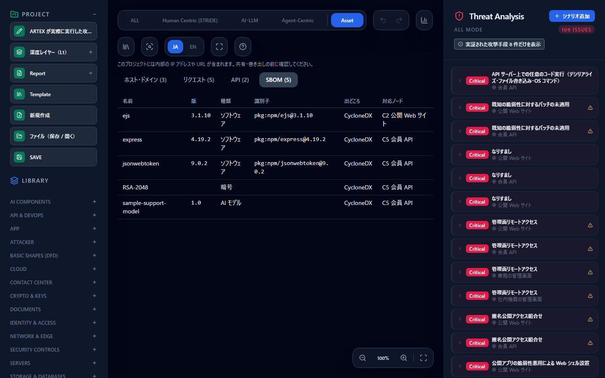

# SBOM・CBOM・AI BOM を取り込み、SPDX・CycloneDX で書き出す — 部品を脅威モデルと一緒に持つ

[English](sbom.md) | **日本語**

> CycloneDX は OWASP、SPDX は Linux Foundation の仕様です。このページは、それらの形式のファイルを CyberRiskScape で読み書きする方法を説明するもので、各団体が提供・認定・推奨するものではありません。記述的な使用です。

---

## 1. このページで分かること・前提

- CycloneDX・SPDX のファイルにある部品（ライブラリ・暗号資産・AI モデル等）を、プロジェクトに保存する方法
- 部品を図のノードに結びつけ、**Asset タブの SBOM の見方**で確かめる方法
- 保存した部品を SPDX 2.3・CycloneDX 1.7 で書き出す方法と、書き出しで失う情報（§5）

**前提**：[はじめに](getting-started.ja.md)の操作。CLI を使う節は `npm run build:cli` で `dist-cli/main.js` を作ってから実行してください。

部品を取り込んでも、**脅威の判定は変わりません**。ノードの暗号の PQC 判定を確かめるレポートは別の機能です（[PQC 移行を支援する](pqc-migration.ja.md)）。

---

## 2. デモで見る

[オンラインデモ](https://takashi-ohmoto-git.github.io/CyberRiskScape/)を開き、次の順に操作します。

1. 左の **Template** を開き、**Import** タブを選ぶ。
2. **「サンプル：ARTEX が実際に実行した攻撃手段（架空の構成）」** を選び、**置き換えて適用** を押して、確認する。
3. 画面上部の **Asset** を押し、**SBOM** を選ぶ。

> **プロジェクト全体が置き換わります。** 編集中の図があるブラウザでは開かないでください。



行を押すと、右の脅威一覧がそのノードの脅威だけになります。同じ行をもう一度押すと元に戻ります。

| 列 | 内容 |
|---|---|
| 名前・版 | 部品の名前と版 |
| 種類 | ソフトウェア・暗号・AI モデル・データセット・その他。**CBOM と AI BOM の部品もこの見方に載ります** |
| 識別子 | purl、無ければ CPE |
| 出どころ | BOM を作ったツールの名前 |
| 対応ノード | 結びついたノード。無ければ **未対応** |

ノードの依存パッケージのインベントリ（`import-repo` で取り込んだ npm・PyPI）も、同じ一覧に載ります。

---

## 3. 取り込む（CLI）

```bash
node dist-cli/main.js import-sbom my-project.json --sbom app.cdx.json --scope app --node C3 -o with-sbom.json
```

- `--sbom`：CycloneDX または SPDX 2.x の JSON（必須）。形式は中身で判定します
- `--scope`：置き換えの範囲（必須）。**同じ形式・同じ scope の部品を置き換えます**。アプリやシステムごとに名前を付けてください
- `--node`：すべての部品を結びつけるノード（C 番号またはノード ID）。無ければ **未対応** になります。推測では結びつけません
- `-o`：部品を保存したプロジェクト JSON の出力先。報告（Markdown）は標準出力に出ます

できたファイルは **Template → Import → 「JSON ファイルを選択」** で開けます。**プロジェクト全体を置き換えます。**

**読めない形式**：SPDX 3、XML、タグ値形式の SPDX。

**保存するものと、しないもの**

| 保存する | 保存しない |
|---|---|
| 名前・版・種類 | 依存関係、ライセンス、提供元 |
| purl（修飾子を除く）・CPE・SHA-256 | 証拠、外部参照 |
| 暗号資産の方式・パラメーター・量子耐性のレベル・プロトコルの版・有効期限 | **暗号の鍵の値** |
| BOM の作成時刻・作成ツール | purl の修飾子（取得元の URL が入ることがあるため） |

保存できる部品は **5,000 件**までです。超えた分は、暗号・AI モデル・データセットを優先して残し、保存しなかった件数を報告します。

---

## 4. 書き出す

| 形式 | CLI | 画面（左の Report） |
|---|---|---|
| **SPDX 2.3 JSON** | `export-spdx my-project.json --out sbom.spdx.json` | **SBOM（SPDX 2.3 JSON）** |
| **CycloneDX 1.7 JSON**（SBOM for AI） | `export-sbom-ai my-project.json --out sbom.cdx.json` | **SBOM for AI（CycloneDX 1.7 JSON）** |

CycloneDX の出力には、図から作る要素に、保存した部品が加わります。同じノードにインベントリと同じ purl があれば重複して出しません。対象のレイヤーのノードに結びつく部品と、未対応の部品を載せます。

---

## 5. 書き出しで失う情報

| 書き出し先 | 失うもの | 扱い |
|---|---|---|
| SPDX 2.3 | **暗号資産** | SPDX 2.3 に載せる項目が無いので出しません。件数を文書の `creationInfo.comment` に書きます |
| SPDX 2.3 | AI モデル・データセットの種類 | 用途を `OTHER` にし、パッケージのコメントで示します。読み直すと種類は「その他」になります |
| CycloneDX 1.7 | 暗号の `primitive`・`curve` | 値が仕様の列挙に合う保証が無いので出しません |
| どちらも | 依存関係、ライセンス、提供元 | 保存していないので出ません |

**暗号資産を標準形式で渡すときは CycloneDX を使ってください。**

---

## 6. 限界

- 一覧は**読み込んだファイルの内容**です。実際に動いている部品と一致するとは限らず、載っていない部品が無いという意味でもありません。正しさはファイルを作ったツールに依存します。
- 依存関係を持たないので、間接依存の経路は分かりません。
- 取り込み直すと同じ scope の部品は置き換わります。履歴は残りません。
- 内部のパッケージ名がプロジェクト JSON に入ります。**ファイルを共有するときは中身を確認してください**。

---

## 次に読むもの

- 暗号の移行を確かめる — [PQC 移行を支援する](pqc-migration.ja.md)
- 他の製品との連携の一覧 — [連携](integrations.ja.md)
- 資産を取り込む — [ARTEX が実際に実行した攻撃手段を脅威カードで見る](artex.ja.md)
