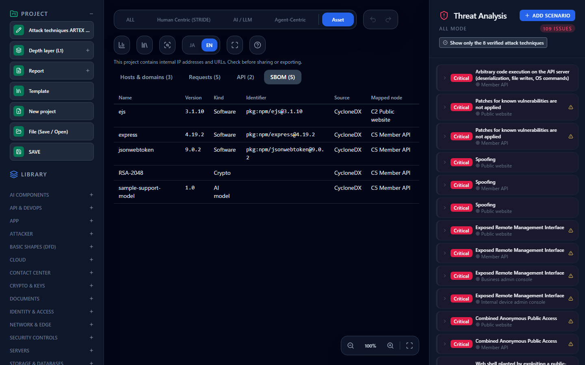

# Importing SBOM, CBOM, and AI BOM and Exporting SPDX and CycloneDX — Keeping Components with the Threat Model

**English** | [日本語](sbom.ja.md)

> CycloneDX is a specification of OWASP, and SPDX of the Linux Foundation. This page explains how to read and write files in those formats with CyberRiskScape. It is not provided, certified, or endorsed by those organizations. The names are used descriptively.

---

## 1. What this page covers and prerequisites

- How to save the components in CycloneDX and SPDX files (libraries, cryptographic assets, AI models, and so on) in a project
- How to link components to diagram nodes and check them in the **SBOM view of the Asset tab**
- How to export saved components as SPDX 2.3 and CycloneDX 1.7, and what is lost on export (§5)

**Prerequisites**: the basics in [Getting Started](getting-started.md). For the CLI sections, run `npm run build:cli` first to create `dist-cli/main.js`.

Importing components **does not change threat detection**. Checking a node's cryptography for PQC is a separate report ([Supporting PQC Migration](pqc-migration.md)).

---

## 2. See it in the demo

Open the [online demo](https://takashi-ohmoto-git.github.io/CyberRiskScape/) and follow these steps.

1. Open **Template** on the left and choose the **Import** tab.
2. Choose **"Sample: attack techniques ARTEX actually executed (fictional setup)"**, click **Replace and apply**, then confirm.
3. Press **Asset** at the top of the screen and choose **SBOM**.

> **This replaces the entire project.** Do not open it in a browser where you are editing a diagram.



Pressing a row narrows the threat list on the right to that node's threats. Press the same row again to undo this.

| Column | Content |
|---|---|
| Name, Version | The component's name and version |
| Kind | Software, Crypto, AI model, Dataset, or Other. **Components from a CBOM or AI BOM appear in this view too** |
| Identifier | The purl, or the CPE if there is none |
| Source | The name of the tool that created the BOM |
| Mapped node | The linked node, or **Unmapped** |

A node's dependency inventory (npm and PyPI imported with `import-repo`) appears in the same list.

---

## 3. Import (CLI)

```bash
node dist-cli/main.js import-sbom my-project.json --sbom app.cdx.json --scope app --node C3 -o with-sbom.json
```

- `--sbom`: a CycloneDX or SPDX 2.x JSON file (required). The format is detected from the content
- `--scope`: the replacement scope (required). **Components with the same format and scope are replaced.** Name it after the application or system
- `--node`: the node to link all components to (a C number or node ID). Without it they are **Unmapped**; nothing is linked by guessing
- `-o`: where to write the project JSON containing the components. The report (Markdown) goes to standard output

Open the result with **Template → Import → "Select JSON file"**. **This replaces the entire project.**

**Formats that cannot be read**: SPDX 3, XML, and SPDX tag-value.

**What is and is not saved**

| Saved | Not saved |
|---|---|
| Name, version, kind | Dependencies, licenses, suppliers |
| purl (without qualifiers), CPE, SHA-256 | Evidence, external references |
| A cryptographic asset's algorithm, parameters, quantum security level, protocol version, expiry | **Cryptographic key values** |
| The BOM's creation time and creating tool | purl qualifiers (they can contain a source URL) |

Up to **5,000** components can be saved. Beyond that, cryptographic assets, AI models, and datasets are kept first, and the number not saved is reported.

---

## 4. Export

| Format | CLI | Screen (Report on the left) |
|---|---|---|
| **SPDX 2.3 JSON** | `export-spdx my-project.json --out sbom.spdx.json` | **SBOM (SPDX 2.3 JSON)** |
| **CycloneDX 1.7 JSON** (SBOM for AI) | `export-sbom-ai my-project.json --out sbom.cdx.json` | **SBOM for AI (CycloneDX 1.7 JSON)** |

The CycloneDX output adds the saved components to the elements built from the diagram. A purl that matches the inventory on the same node is not repeated. It includes components linked to nodes in the target layer and unmapped components.

---

## 5. What is lost on export

| Export to | Lost | Handling |
|---|---|---|
| SPDX 2.3 | **Cryptographic assets** | SPDX 2.3 has no field for them, so they are left out. The count is written to the document's `creationInfo.comment` |
| SPDX 2.3 | The kind of AI models and datasets | The purpose is set to `OTHER`, with a package comment. Reading it back gives the kind Other |
| CycloneDX 1.7 | Cryptographic `primitive` and `curve` | Left out because the values are not guaranteed to match the specification's enumerations |
| Both | Dependencies, licenses, suppliers | Not saved, so not exported |

**Use CycloneDX to hand over cryptographic assets in a standard format.**

---

## 6. Limits

- The list shows **the contents of the file you read**. It may not match what is actually running, and a component that is not listed may still exist. Accuracy depends on the tool that created the file.
- Dependencies are not kept, so indirect dependency paths are not available.
- Re-importing replaces components in the same scope. No history is kept.
- Internal package names end up in the project JSON. **Check the contents before sharing the file.**

---

## What to read next

- Check cryptographic migration — [Supporting PQC Migration](pqc-migration.md)
- The list of integrations — [Integrations](integrations.md)
- Import assets — [Seeing the Attack Techniques ARTEX Actually Executed on Threat Cards](artex.md)
