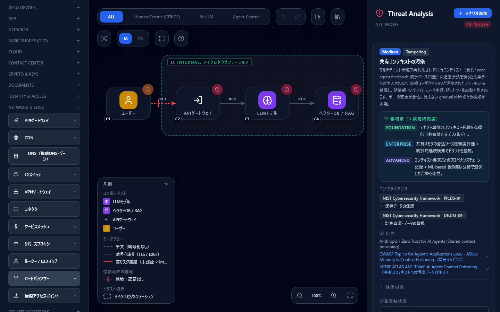
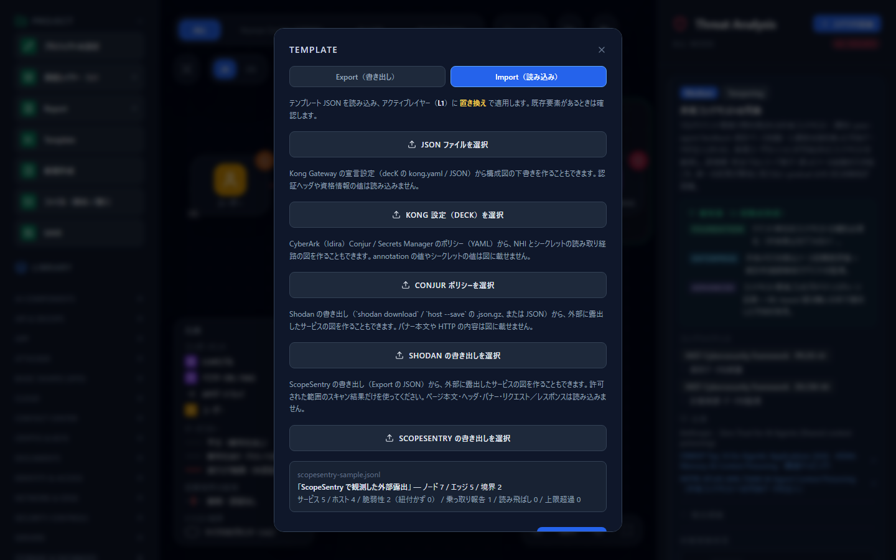
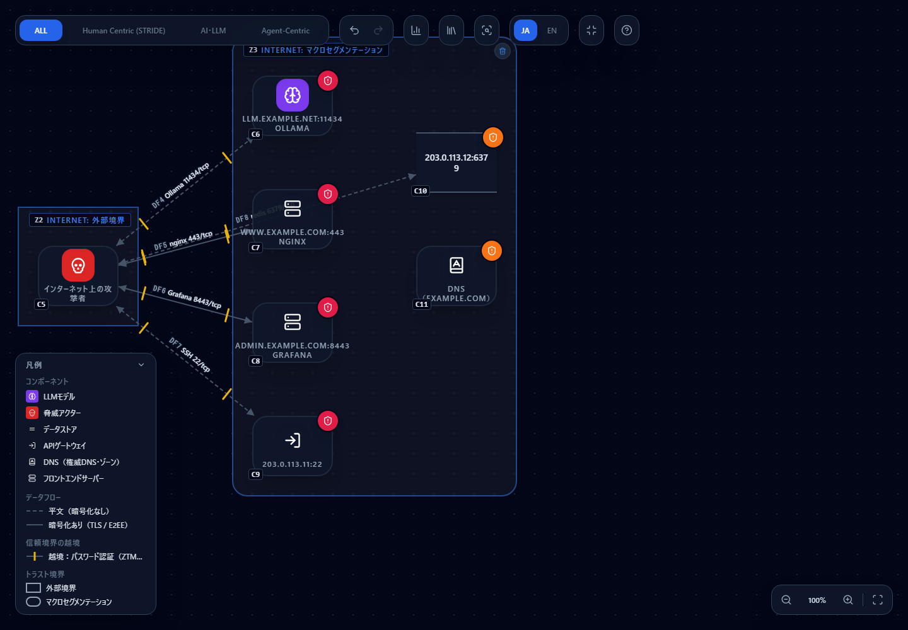
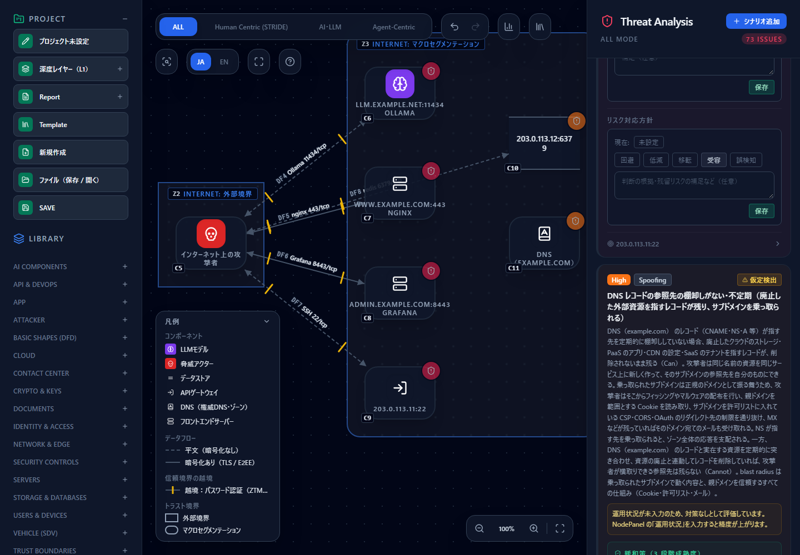
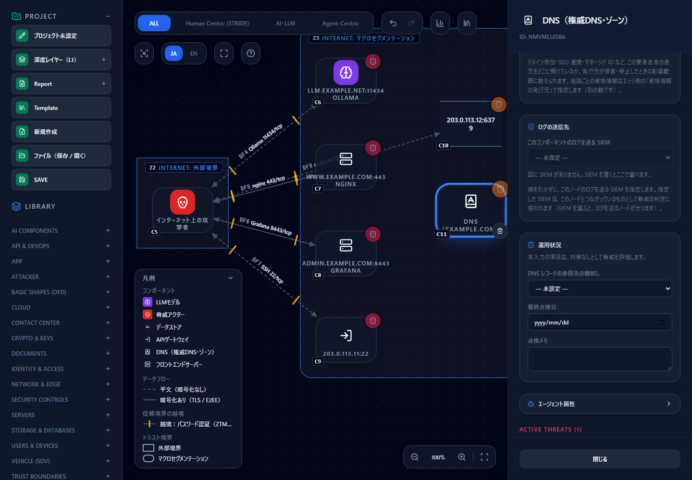

# ScopeSentry の資産・脆弱性・乗っ取り結果を構成図にする — 自前の ASM の観測を脅威モデルへ

[English](scopesentry.md) | **日本語**

> ScopeSentry は各権利者の名称です。このページは「ScopeSentry の書き出しや API から得た観測結果を、
> CyberRiskScape の構成図に取り込む方法」を説明するもので、ScopeSentry の開発者が提供・認定・推奨するものではありません。
> 記述的な使用です。ScopeSentry の書き出しの形式と API の呼び方は、執筆時点（2026 年 10 月）の公式のソースによります。
> 最新は公式の情報で確かめてください。

> **スキャンしてよい範囲** — ScopeSentry でスキャンするのは、**自組織が管理する、または診断を許可された資産だけ**にしてください。
> 許可のない対象へのスキャンは、法令や契約に反するおそれがあります。このページの取り込みは、スキャン済みの結果を読むだけで、
> 新しくスキャンはしません。

---

## 1. このページで分かること・前提

- ScopeSentry の**資産（asset）・脆弱性（vulnerability）・サブドメイン乗っ取り（SubdomainTakerResult）**を取り込んで、
  インターネットに露出したサービスの**構成図の下書きを自動で作る**方法（画面・CLI）
- 取り込みの種類を 2 つ：**書き出しファイルから**、**API（ScopeSentry の MCP）から**
- どの項目が図のどの型・属性になるか、**読み込まないもの**は何か
- 取り込んだ図で**実際に検出される脅威**（サンプルで確認した件数つき）と、サブドメイン乗っ取りの脅威を消す入力
- 定期的に取り込み直して、**新しく出た露出を `diff --fail-on` で検知する**方法

**前提：ScopeSentry とは**（執筆時点の公式の記載による）

- ScopeSentry は、自前で動かす OSS の ASM（攻撃対象領域の管理）・偵察のプラットフォームです。サブドメインの列挙・ポートスキャン・
  フィンガープリント・脆弱性スキャン・**サブドメイン乗っ取りの検知**ができ、分散ノードで動かせます。MongoDB と Redis を使い、
  Docker で導入します（[出典 1](#参考リンク)）。
- CyberRiskScape は ScopeSentry の**書き出しの形式を読むだけ**です。ScopeSentry のコードやライセンスには依存しません。

**このページの前提となる知識**：[はじめに](getting-started.ja.md)の操作と、[脅威パネルの読み方](reading-threats.ja.md)。
Shodan の取り込みと同じ考え方なので、先に [インターネット露出を減らす](exposure-reduction.ja.md) の §4.4 を読むと分かりやすくなります。

---

## 2. 観測結果と CyberRiskScape の型の対応

### 2.1 ScopeSentry から書き出す

ScopeSentry の画面で、資産の一覧の **Export** から形式に **JSON**（1 行に 1 件）を選び、項目を選んで書き出します。

- **XLSX は読み込めません。** 必ず JSON を選んでください。
- 項目は次の 12 個を勧めます：`host`・`ip`・`port`・`service`・`type`・`url`・`technologies`・`webServer`・`cdnname`・`tls`・`rootDomain`・`time`
- 脆弱性のページとサブドメイン乗っ取りのページからも、同じ手順で書き出せます。**3 つのファイルは 1 つに連結して**（`cat a.json b.json c.json > all.json`）
  読み込めます。種類は項目の名前から自動で判定します。

### 2.2 対応

1 サービス（IP とポートの組）につき 1 ノードを作ります。同じサービスが複数あれば、観測日時が新しいほうを使います。上から順に判定します。

| ScopeSentry の情報 | CyberRiskScape の型 |
|---|---|
| 製品名・技術に Ollama・vLLM など、ポート 11434 | `LLM`（LLMモデル） |
| データベースのポート（3306・5432・6379・9200・27017 など） | `DATA_STORE`（データストア） |
| 遠隔管理のポート（22・23・445・3389・5900〜5903・5938・5985・5986） | `GATEWAY`（APIゲートウェイ） |
| HTTP の応答がある（`type` が http・`url` がある）、ポート 80・443・8080・8443 | `FRONT_END_SERVER`（フロントエンドサーバー） |
| 上のどれでもない | `PROCESS`（プロセス） |
| **サブドメイン乗っ取りの報告** | 根ドメイン（`rootDomain`）ごとに `DNS_ZONE`（**DNS（権威DNS・ゾーン）**）を 1 つ |



`DNS（権威DNS・ゾーン）` は、左のパレットの **Network & Edge** にあります。自組織のドメインのレコード（A・CNAME・NS・MX など）を持つゾーンを
表す新しい型です。

- **線**：攻撃者（インターネット）から各サービスへ。TLS が確認できれば **TLS**、できなければ **Plain**。認証は外から確かめられないので **Password** にします
  （実態に合わせて直してください）。DNS には線を引きません（名前の問題で、接続ではないため）。
- **攻撃面属性**：フロントエンドサーバーと APIゲートウェイには「Global IP の割り当て」を**有り**にします。ほかの項目は未入力で、危ない側の値として評価されます。
- **説明欄**：IP・ポート・製品・観測日・検出された技術・CDN と、ScopeSentry が報告した脆弱性の ID（**未検証**）を書きます。
  脆弱性は URL のホストとポートが一致するサービスに結びつけ、結びつかないものは件数だけ数えます。脆弱性は脅威としては扱いません。
  パッチやスキャンの結果を確かめるきっかけに使ってください。
- **乗っ取りの報告**：DNS ノードの説明欄に「乗っ取り可能と報告（**未検証**）」として、対象のホストと CNAME を書きます。
- **読み込まないもの**：ページの本文（body）・ヘッダ・バナー・リクエスト／レスポンス・スクリーンショット・タイトル・照合箇所。
  URL は脆弱性をノードに結びつけるときにだけ使い、図には出しません（URL の userinfo とクエリは、照合の前に捨てます）。
- 上限は 300 サービスです。超えた分は取り込まず、件数を表示します。

---

## 3. 構成図の例

架空のデータ（説明用のアドレス `192.0.2.0/24`・`203.0.113.0/24`・`198.51.100.0/24`、`example.com`・`example.net`）で作ったサンプルを置いています。

| ファイル | 内容 |
|---|---|
| [`templates/scopesentry-sample.jsonl`](templates/scopesentry-sample.jsonl) | ScopeSentry の書き出しの形のサンプル（資産 5・脆弱性 2・乗っ取り 1） |
| [`templates/scopesentry-sample.ja.json`](templates/scopesentry-sample.ja.json)（[英語版](templates/scopesentry-sample.en.json)） | 上を取り込んだ図（テンプレート） |

資産は、公開 Web（443・TLS）・管理画面（8443）・SSH（22）・Redis（6379）・Ollama（11434）です。読み込み方は [テンプレートを作る・使う](templates.ja.md) を参照してください。

### 画面から取り込む

**Template → Import タブ → 「ScopeSentry の書き出しを選択」** で、書き出した JSON（または上のサンプル）を選びます。



読み込むと件数が出ます（サンプルは サービス 5 / ホスト 4 / 脆弱性 2 / 乗っ取り報告 1）。**置き換えて適用**で図になります。



図の中身：コンポーネント 7（攻撃者 1・サービス 5・DNS 1）・データフロー 5・トラスト境界 2。攻撃者を外部境界（Internet）に、露出したサービスを
Public Area の境界に置きます。

### CLI から取り込む

```bash
npm run build:cli
node dist-cli/main.js import-scopesentry guide/templates/scopesentry-sample.jsonl --out scopesentry.json
node dist-cli/main.js analyze scopesentry.json
```

---

## 4. 押さえるべき脅威

サンプルを取り込むと **73 件**（Critical 14・High 38・Medium 21）の脅威が検出されます（執筆時点）。

### 4.1 サブドメイン乗っ取り（DNS）

| 脅威 | 重大度 | 発火の条件 |
|---|---|---|
| DNS レコードの参照先の棚卸しがない・不定期（`posture-dns-dangling-record-001`） | High | DNS ノードの運用状況「DNS レコードの参照先の棚卸し」が**未入力・実施していない・不定期** |

廃止したクラウドの資源（ストレージ・PaaS・CDN・SaaS）を指すレコードが残ると、攻撃者が同じ名前の資源を作ってサブドメインを乗っ取れます。
ScopeSentry の乗っ取り報告があるのは、この状態の疑いです。



カードには「運用状況が未入力のため、対策なしとして評価しています」と出ます（未入力は悪い値と同じ扱いです）。**脅威を消す方法**は 2 つです。

1. 乗っ取りの報告を実際に直す（残っているレコードを消す・参照先を確認する）。
2. その上で、DNS ノードを選び、**運用状況**の「**DNS レコードの参照先の棚卸し**」を実態に合わせて入力する。
   **定期的に実施**を選ぶと、この脅威は消えます（サンプルで確認：73 件 → 72 件）。



「不定期」「実施していない」では消えません。最終点検日と点検メモも書けます。**棚卸しをしていないのに「定期的」と入力しないでください。**

### 4.2 露出したサービス

サンプルで検出される主な脅威です（ID は検出時の脅威ルール）。

| 対象 | 主な脅威（ルール ID） | 重大度 |
|---|---|---|
| 公開 Web・管理画面・SSH | 管理面リモートアクセス（`stride-web-remote-mgmt-exposed-001`）、匿名公開アクセス組合せ（`stride-web-anonymous-on-public-001`） | Critical |
| 同上 | グローバルIP直接公開（`stride-web-global-ip-exposure-001`）、送信元IP無制限アクセス（`stride-web-no-source-ip-restriction-001`）、アプリケーション層攻撃保護欠如（`stride-web-no-waf-001`） | High |
| 同上 | 既知の脆弱性に対するパッチの未適用（`posture-patch-missing-001`） | Critical |
| 公開 Web・管理画面 | 公開アプリの脆弱性悪用による Web シェル設置（`webserver-webshell-implant-001`） | Critical |
| Redis（6379） | 情報漏洩（`stride-data-store-info-disclosure-001`）・データ改ざん（`stride-data-store-tampering-001`）、ログの保持期間が短い（`posture-log-retention-short-001`） | High |
| Ollama（11434） | 直接プロンプトインジェクション（`owasp-llm01-prompt-injection-001`）・モデル完全アクセス（`atlas-aml-t0044-full-model-access-001`） | Critical |
| 線（平文・パスワード単独） | 盗聴（`stride-edge-plain-encryption-001`）、パスワード・API キー単独の認証 / 公衆網（`stride-edge-password-internet-001`） | High |

> **ひとこと** — ScopeSentry が報告した脆弱性（サンプルでは 2 件）は、ノードの説明欄に「未検証」として載るだけで、脅威の件数は変わりません。
> 管理画面の既定のログインのような報告は、**図の属性（認証・送信元 IP 制限）を確かめて入力し直す**きっかけにしてください。
> 確かめた項目だけを入力します。推測で「有り」にすると、脅威が消えて見えるだけになります。

---

## 5. 攻撃経路分析

取り込んだ図で[攻撃経路分析](attack-paths.ja.md)を開くと、インターネット上の攻撃者から各サービスへの経路を比べられます。
取り込んだだけの図は、サービス同士の関係（どのサービスが Redis を使うか）が描かれていません。内部の構成を描き足すと、露出した入口から
重要な資産に届く経路とチョークポイントが見えます。

---

## 6. ユースケース

### 6.1 書き出しファイルから取り込む

§2.1 で書き出した JSON を、画面または CLI で読み込みます（§3）。ScopeSentry に接続せず、**ファイルだけで完結**します。

### 6.2 API（ScopeSentry の MCP）から取り込む

書き出しの手間をなくしたいときは、CLI から直接取得できます。ScopeSentry が公式に備える MCP の窓口（`<base-url>/mcp`）に接続して、
資産・脆弱性・サブドメイン乗っ取りの 3 種類を、**読み取り専用の `list_assets`** だけで取得します（1 ページ 100 件、合計 3000 件まで）。
REST の API は画面のログイン（JWT）が必要で、API キーが通るのは `/mcp` だけのため、この方式にしています。

```bash
# API キーは ScopeSentry の API Key のページで作成し、環境変数で渡す（コマンドラインや図には残らない）
export SCOPESENTRY_API_KEY=ssk_xxxxxxxx
node dist-cli/main.js import-scopesentry --api https://scopesentry.example.internal --out scopesentry.json
# プロジェクトや検索式で絞る
node dist-cli/main.js import-scopesentry --api https://scopesentry.example.internal \
  --project <プロジェクトの ObjectID> --search "<ScopeSentry の検索式>" --out scopesentry.json
```

**安全のために**

- **API キーは環境変数だけで渡します。** ファイル・図・ログ・エラー文言には出しません。コマンド履歴や CI のログにも残さないでください。
- **ScopeSentry の標準の構成は平文の HTTP です**（執筆時点）。API キーが通信路に流れるため、`--api` には **HTTPS（リバースプロキシで終端）**か、
  **閉じたローカルネットワーク**の URL を使ってください。インターネット越しに平文で使わないでください。
- このツールが呼ぶのは **`list_assets` だけ**で、書き込み系の呼び出しは許可リストで拒否します。キーを持たせる利用者は、ScopeSentry 側で
  権限を選べるなら**読み取りだけで足りる範囲**に絞ってください（権限の選び方は公式の情報で確かめてください）。
- 上限（3000 件）に達したときは、その旨を表示して打ち切ります。`--project` や `--search` で絞り込んでください。
- 許可された範囲の結果にだけ使ってください（冒頭の注意を参照）。

### 6.3 定期的に取り込み直して、新しい露出を検知する

取り込んだ図は、要素の ID が **IP・ポート（と DNS の根ドメイン）から決まる**ため、前回と今回の取り込みをそのまま `diff` で比べられます。
新しく開いたポートや、新しく報告された乗っ取りの脅威だけが「追加」に出ます。

```bash
node dist-cli/main.js import-scopesentry 2026-10.json --out 2026-10.model.json
node dist-cli/main.js import-scopesentry 2026-11.json --out 2026-11.model.json
node dist-cli/main.js diff 2026-10.model.json 2026-11.model.json --fail-on High
```

サンプルに RDP（3389）の資産を 1 件足して比べると、追加 16 件・解消 0 件で、High 以上の新しい脅威 12 件が見つかり、終了コード 1 で止まります（執筆時点）。
差分レポートには、新しい外部インターフェース（T2）など、人が見直すべき**実行トリガー**も出ます。CI への組み込み方は
[AI駆動開発のCIに組み込む](ci-integration.ja.md) を参照してください。

> 取り込んだ図に手で入力した属性（DNS の「定期的に実施」など）は、取り込み直した図には入っていません。
> 手入力を加えた図を基準にして比べると、同じ脅威が「追加」に出てしまいます。**比べるのは「取り込み同士」**にしてください。

---

## 7. 限界

- **執筆時点では実機ではなく、公式のソースの形式に基づくモックで確認しています。** 実際の ScopeSentry の書き出し・API の応答で、
  項目の名前や形式が異なる場合は、取り込めない行が「読み飛ばし」として数えられます。件数を確かめてください。
- **図は観測の写しです。** ScopeSentry が見つけなかった資産は描かれません。スキャンは実行した時点のもので、最新とは限りません。
- **認証・送信元 IP の制限・WAF・ログなどは外から分かりません。** 確かめられた項目だけを入力してください。
- **脆弱性（CVE 等）は判定しません。** ScopeSentry の報告を「未検証」として説明欄に書くだけです。
- **乗っ取りの報告は、DNS と接続した線では表しません。** 報告ホストは DNS ノードの説明欄に書き、どのサービスが影響を受けるかは利用者が判断して描き足します。
- **XLSX の書き出しは読み込めません。** 根ドメインは `rootDomain` の項目を使い、無ければホストの末尾 2 ラベルで求めます（`co.jp` のような多段の TLD は正しく分けられないことがあります）。
- OT / ICS の機器（産業用プロトコル）は表せません。

---

## 参考リンク

1. ScopeSentry（GitHub） — <https://github.com/Autumn-27/ScopeSentry>

---

## 次に読むもの

- 露出を減らす手順全体 — [インターネット露出を減らす](exposure-reduction.ja.md)
- 脅威の読み方 — [脅威パネルの読み方](reading-threats.ja.md)
- 定期評価を CI に組み込む — [AI駆動開発のCIに組み込む](ci-integration.ja.md)
- 攻撃者の視点で経路を調べる — [攻撃経路分析](attack-paths.ja.md)
- 診断の計画を作る — [脅威モデルからペネトレーションテスト計画書を作る](pentest-plan.ja.md)
