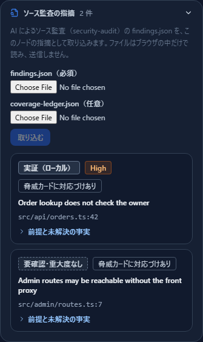
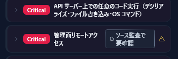

# AI によるソース監査の指摘を構成図に載せる — 実証と要確認を脅威カードで見分ける

[English](security-audit.md) | **日本語**

> Cloudflare は各権利者の名称です。このページは「Cloudflare が公開しているコーディングエージェント用のスキル
> security-audit（https://github.com/cloudflare/security-audit-skill 、MIT ライセンス）の出力を CyberRiskScape の構成図に取り込む方法」を
> 説明するもので、Cloudflare が提供・認定・推奨するものではありません。記述的な使用です。出力の形式は、執筆時点（2026 年 11 月）の
> 公式のリポジトリによります。最新は公式の情報で確かめてください。

> **監査してよい範囲** — security-audit で監査するのは、**自組織が管理する、または監査を許可されたリポジトリだけ**にしてください。
> このページの取り込みは、監査済みの結果ファイルを読むだけです。スキルを実行したり、対象を攻撃したりはしません。

---

## 1. このページで分かること・前提

security-audit は、コーディングエージェントにソースコードを監査させるスキルです。偵察・網羅台帳に沿った探索・別エージェントによる反証を経て、
指摘を `findings.json` に、どの入口・信頼境界・攻撃の型を調べたかを `coverage-ledger.json` に出します。
指摘の判定は 3 種類です。

| 判定 | 意味 | CyberRiskScape での扱い |
|---|---|---|
| `confirmed` | ソースで成立を確かめた | 指摘として保存。脅威カードに **「ソース監査で実証（ローカル）」** |
| `needs_validation` | 配置（本番の設定・経路）が分からないと決まらない | **重大度なしの要確認**として保存。脅威カードに **「ソース監査で要確認」** |
| `rejected` | 反証された | 保存しない（件数だけ報告） |

このページでは、この 2 つのファイルを図のノードに取り込み、**ソースで分かったこと**と**図（配置）で分かること**を並べて見る方法を説明します。

前提：

- 構成図に、監査したソースが動くノード（例：バックエンド API）があること。
- 取り込みは画面（ノードの詳細）と CLI（`import-security-audit`）の両方でできます。どちらもファイルを読むだけで、外部に送信しません。

---

## 2. 何を保存し、何を保存しないか

| 保存する | 保存しない |
|---|---|
| 指紋（`fingerprint`）・題名・判定・重大度・場所（ファイルと行）・成立の前提（`conditions`）・要確認の未解決の事実（`blockers`）・配置で確かめる手順 | 攻撃の実行内容（payloads）・修正コード・evidence・root_cause の本文 |

- 同じ製品・同じ範囲（scope）の指摘は、取り込み直すと置き換わります（他の製品・範囲の指摘は消えません）。
- 要確認は重大度を持ちません。CI のゲート（`analyze --fail-on-findings`）と優先度づけ（`findings-priority`）の対象から外し、
  SARIF の書き出しでは level を `none` にします。相手が「要確認に重大度を付けない」方針のためです。

---

## 3. 手順

### 3.1 security-audit を実行する

security-audit の手順に従って、対象のリポジトリで監査を実行します（隔離した環境での実行が前提です）。
出力のうち、`findings.json` と `coverage-ledger.json` を使います。

### 3.2 画面から取り込む

監査したソースが動くノードを選び、右の詳細の **「ソース監査の指摘」** を開いて、`findings.json`（必須）と
`coverage-ledger.json`（任意）を選んで **取り込む** を押します。ファイルはブラウザの中だけで読み、送信しません。



取り込んだ指摘が、判定・重大度・場所つきで並びます。**「前提と未解決の事実」** を開くと、指摘の前提（例：インターネットから届く・
ログイン済みの会員）と、図の事実（ノードの信頼境界・入ってくる接続の経路と認証・攻撃面属性・運用状況）が並びます。
**成立する／しないの判定はしません**。要確認を決着させるために、どこを確かめればよいかの手がかりです。

`coverage-ledger.json` を渡すと、台帳の攻撃の型から脅威ライブラリへ対応づけ、該当する脅威カードに印が付きます
（「脅威カードに対応づけあり」）。台帳が無い、または対応表に無い型の指摘は、カードには載りません。

### 3.3 脅威カードで見分ける



- **ソース監査で実証（ローカル）** — その脅威に当たる指摘を、ソースで確かめた。「ローカル」は、配置での成立までは確かめていない意味です。
- **ソース監査で要確認** — 配置を確かめないと決まらない指摘がある。図の事実と並べて確かめます。

### 3.4 CLI から取り込む

```bash
npm run build:cli
node dist-cli/main.js import-security-audit model.json \
  --in findings.json --ledger coverage-ledger.json \
  --node C11 --scope member-api --out model.json
```

| オプション | 意味 |
|---|---|
| `--in` | `findings.json`（必須。16 MB まで） |
| `--ledger` | `coverage-ledger.json`（任意。攻撃の型から脅威へ対応づける） |
| `--node` | すべての指摘を結びつけるノード（C 番号か ID。無ければ未結合） |
| `--scope` | 置き換えの範囲（既定 `default`） |
| `--report` | 報告の形式（`md` か `json`。標準出力） |
| `--out` | 指摘を保存したプロジェクト JSON の出力先（指定しなければ報告のみ） |

報告の例（同梱のサンプルを国家サイバー統括室のテンプレートの会員 API に取り込んだもの。報告は日本語で出ます）：

```markdown
## 件数

- 保存 2 件（新規 2 / 解消 0 / 継続 0）
- 成立を確認した指摘（confirmed） 1 件
- 要確認の指摘（needs_validation。重大度なし・ゲートや優先度づけの対象外） 1 件
- 反証されたため保存しなかった指摘（rejected） 1 件
```

取り込んだ後は、`findings-priority` で攻撃経路の上の優先度を出し（要確認は別の表）、`analyze --fail-on-findings High` で CI のゲートに使えます。

---

## 4. ユースケース

- **AI で見つけた指摘を、配置の文脈で並べ替える** — ソースの監査は「コードの上で成立する」ことまでしか分かりません。
  図の上で攻撃者から届くか・推奨標的に近いかを `findings-priority` で重ねると、どれから直すかを決めやすくなります
  （[OSS で組む脆弱性管理](oss-vulnerability-management.ja.md)と同じ流れです）。
- **要確認を決着させる** — needs_validation の前提（経路・認証・設定）を図の事実と並べ、配置の担当者に確かめてもらう項目を絞ります。
- **繰り返しの監査** — 同じ範囲で取り込み直すと、新規・解消・継続が分かります。

---

## 5. 同梱のサンプル

| ファイル | 内容 |
|---|---|
| `guide/templates/security-audit-findings.json` | 架空の指摘 3 件（confirmed・needs_validation・rejected 各 1 件） |
| `guide/templates/security-audit-coverage-ledger.json` | 上の指摘に対応する台帳の単位 2 件 |

国家サイバー統括室のテンプレート（`guide/templates/nco-advisory-2026-11-project.ja.json`）の会員 API（C11）に取り込むと、上の画面になります。

---

## 6. 限界

- **判定はしません。** 前提と図の事実を並べるだけで、「この構成なら成立する」とは言いません。
- 脅威カードに載るのは、台帳の攻撃の型が対応表（`data/finding-maps/security-audit.yaml`）に載っているものだけです。
- 台帳の「調べていない領域」（out_of_scope・deferred・blocked）を脅威カードに出す機能は、まだありません。
- 指摘をノードに結びつけるのは利用者です（`--node` か、画面で選んだノード）。ファイルのパスから図のノードを推測はしません。

---

## 参考リンク

- Cloudflare security-audit skill — https://github.com/cloudflare/security-audit-skill

## 次に読むもの

- 優先順位の付け方 — [OSS で組む脆弱性管理](oss-vulnerability-management.ja.md)
- ペンテストで実証した攻撃手段を載せる — [ARTEX](artex.ja.md)
- 連携の一覧 — [連携ガイド](integrations.ja.md)
