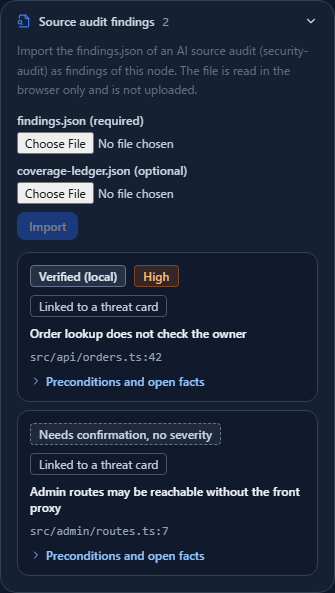
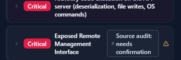

# Putting AI Source-Audit Findings on the Diagram — Telling Verified from Needs-Confirmation on Threat Cards

**English** | [日本語](security-audit.ja.md)

> Cloudflare is the name of its respective owner. This page explains how to import the output of security-audit, a skill for coding
> agents published by Cloudflare (https://github.com/cloudflare/security-audit-skill, MIT License), into a CyberRiskScape diagram. It is
> not provided, certified, or endorsed by Cloudflare; the name is used descriptively. The output format follows the official repository at
> the time of writing (November 2026). Check the official sources for the latest.

> **What you may audit** — Run security-audit only on **repositories your organization manages or that you are authorized to audit**.
> The import on this page only reads result files that already exist. It does not run the skill or attack anything.

---

## 1. What this page covers and prerequisites

security-audit is a skill that has a coding agent audit source code. After reconnaissance, exploration along a coverage ledger, and
refutation by a separate agent, it writes findings to `findings.json` and records which entry points, trust boundaries, and attack classes
it examined in `coverage-ledger.json`. Each finding has one of three verdicts.

| Verdict | Meaning | How CyberRiskScape treats it |
|---|---|---|
| `confirmed` | Confirmed to hold in the source | Stored as a finding. The threat card shows **"Verified by source audit (local)"** |
| `needs_validation` | Cannot be decided without the deployment (production settings and routing) | Stored as a **needs-confirmation finding with no severity**. The threat card shows **"Source audit: needs confirmation"** |
| `rejected` | Refuted | Not stored (only counted in the report) |

This page shows how to import these two files onto a diagram node and look at **what the source tells you** next to **what the diagram
(the deployment) tells you**.

Prerequisites:

- The diagram has a node where the audited source runs (for example, a backend API).
- You can import from the screen (node details) or the CLI (`import-security-audit`). Both only read files and send nothing out.

---

## 2. What is stored and what is not

| Stored | Not stored |
|---|---|
| Fingerprint, title, verdict, severity, location (file and line), preconditions (`conditions`), open facts for needs-confirmation findings (`blockers`), and the steps to check in the deployment | Attack execution (payloads), fix code, and the text of evidence and root_cause |

- Findings from the same product and scope are replaced when you import again (findings from other products or scopes are kept).
- Needs-confirmation findings have no severity. They are left out of the CI gate (`analyze --fail-on-findings`) and prioritisation
  (`findings-priority`), and their SARIF level is `none`, because the skill deliberately does not assign them a severity.

---

## 3. Steps

### 3.1 Run security-audit

Follow the skill's instructions to audit the target repository (it is meant to run in an isolated environment).
You will use `findings.json` and `coverage-ledger.json` from its output.

### 3.2 Import from the screen

Select the node where the audited source runs, open **"Source audit findings"** in the details on the right, choose `findings.json`
(required) and `coverage-ledger.json` (optional), and press **Import**. The files are read only in the browser and are not uploaded.



The imported findings are listed with verdict, severity, and location. Open **"Preconditions and open facts"** to see the finding's
preconditions (for example, reachable from the Internet, any signed-in member) next to facts from the diagram (the node's trust boundary,
the routing and authentication of incoming connections, attack-surface attributes, and operational posture). **It does not decide whether
the finding holds.** It is a pointer to what to check to settle a needs-confirmation finding.

If you provide `coverage-ledger.json`, attack classes in the ledger are mapped to the threat library and the matching threat cards are
marked ("Linked to a threat card"). Findings without a ledger, or whose class is not in the mapping, do not appear on cards.

### 3.3 Tell them apart on threat cards



- **Verified by source audit (local)** — A finding for this threat was confirmed in the source. "Local" means it has not been confirmed to hold in the deployment.
- **Source audit: needs confirmation** — A finding depends on the deployment. Check it against the diagram's facts.

### 3.4 Import from the CLI

```bash
npm run build:cli
node dist-cli/main.js import-security-audit model.json \
  --in findings.json --ledger coverage-ledger.json \
  --node C11 --scope member-api --out model.json
```

| Option | Meaning |
|---|---|
| `--in` | `findings.json` (required, up to 16 MB) |
| `--ledger` | `coverage-ledger.json` (optional; maps attack classes to threats) |
| `--node` | Node to link every finding to (C number or ID; unlinked if omitted) |
| `--scope` | Replacement scope (default `default`) |
| `--report` | Report format (`md` or `json`, to standard output) |
| `--out` | Output path for the project JSON with the findings saved (report only if omitted) |

The report is currently produced in Japanese. Importing the bundled sample into the member API of the NCO advisory template stores
2 findings (1 confirmed, 1 needs confirmation) and counts 1 rejected finding.

After importing, use `findings-priority` to rank findings on the attack paths (needs-confirmation findings get their own table) and
`analyze --fail-on-findings High` as a CI gate.

---

## 4. Use cases

- **Re-rank AI-found issues in the deployment's context** — A source audit can only show that an issue holds in the code.
  Overlaying whether the attacker can reach it and how close it is to recommended targets (`findings-priority`) helps decide what to fix
  first (the same flow as [OSS vulnerability management](oss-vulnerability-management.md)).
- **Settle needs-confirmation findings** — Line up the preconditions (routing, authentication, configuration) with the diagram's facts and
  narrow down what to ask the people who run the deployment.
- **Repeated audits** — Importing again into the same scope shows what is new, resolved, and continuing.

---

## 5. Bundled sample

| File | Contents |
|---|---|
| `guide/templates/security-audit-findings.json` | 3 fictional findings (one each: confirmed, needs_validation, rejected) |
| `guide/templates/security-audit-coverage-ledger.json` | 2 ledger units for the findings above |

Import them into the member API (C11) of the NCO advisory template (`guide/templates/nco-advisory-2026-11-project.en.json`) to get the screens above.

---

## 6. Limitations

- **No verdicts.** It lines up preconditions and diagram facts; it never says "this holds in your configuration".
- Only findings whose ledger attack class is in the mapping (`data/finding-maps/security-audit.yaml`) appear on threat cards.
- Showing the ledger's unexamined areas (out_of_scope, deferred, blocked) on threat cards is not implemented yet.
- You link findings to a node (`--node` or the node selected on screen). File paths are not used to guess the node.

---

## Links

- Cloudflare security-audit skill — https://github.com/cloudflare/security-audit-skill

## Where to go next

- Prioritisation — [OSS vulnerability management](oss-vulnerability-management.md)
- Attack techniques verified by a penetration test — [ARTEX](artex.md)
- All integrations — [Integrations](integrations.md)
